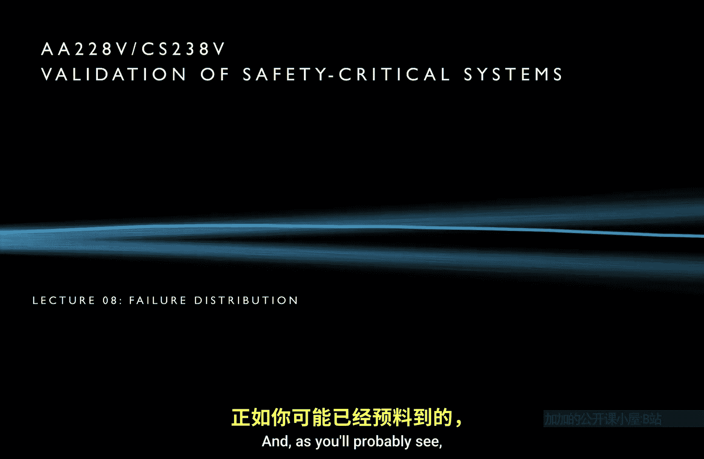
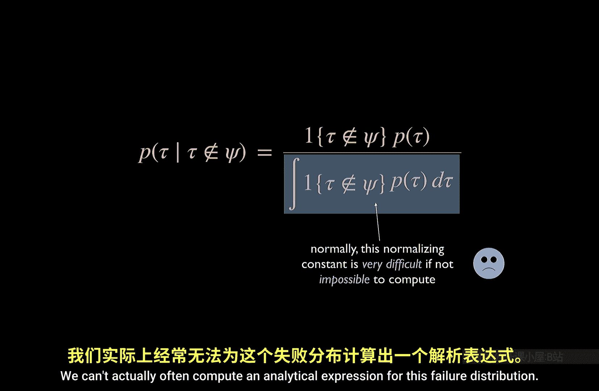
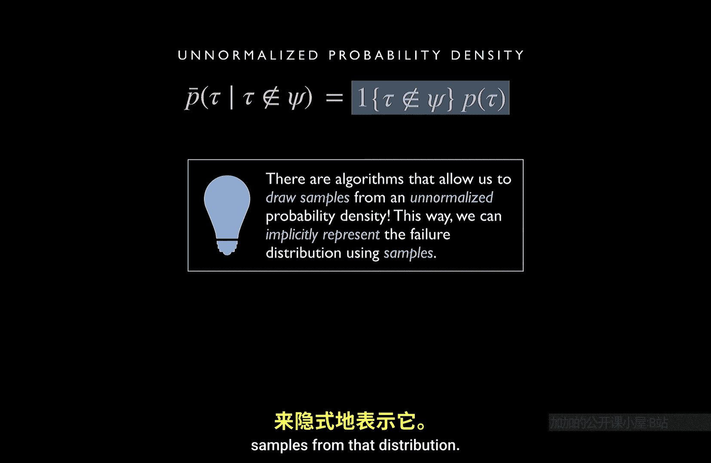
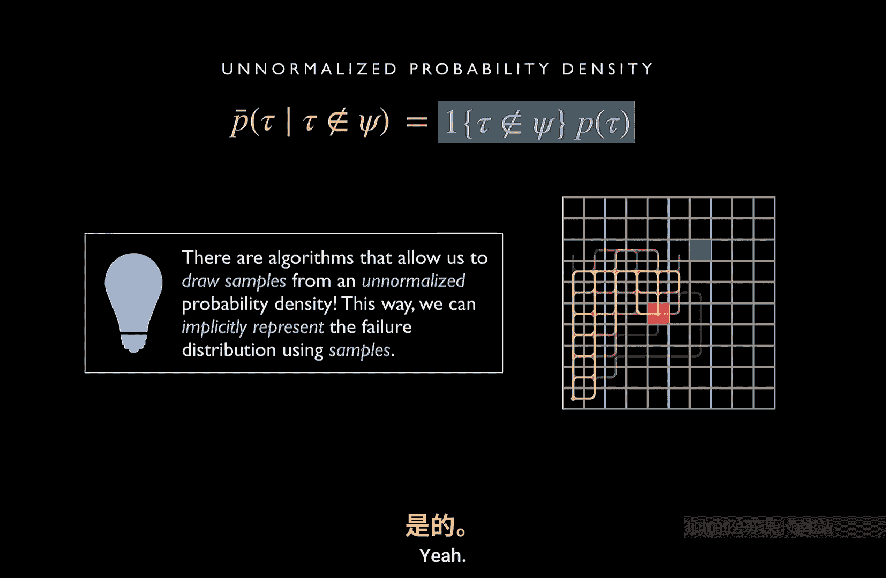

# 安全关键系统验证：08：故障分布

在本节课中，我们将学习如何从系统的“故障分布”中进行采样。之前我们讨论了如何寻找单个最可能的故障（即证伪），但有时我们需要了解所有可能故障的完整概率分布。本节将介绍故障分布的数学定义，并探讨如何通过采样来近似表示它。

## 故障分布的数学定义

上一节我们介绍了轨迹分布的概念，它描述了所有可能轨迹的出现概率。本节中，我们来看看如何在此基础上定义故障分布。

故障分布本质上是一个条件概率分布。它表示在已知轨迹 `τ` 是一个故障（即 `τ ∈ F`）的条件下，该轨迹出现的概率。其数学公式如下：

**P(τ | τ ∈ F) = [ 1{τ ∈ F} * P(τ) ] / ∫ 1{τ ∈ F} * P(τ) dτ**

让我们分解这个公式：
*   **分子 `1{τ ∈ F} * P(τ)`**：这是一个指示函数与轨迹分布的乘积。如果轨迹 `τ` 是故障，指示函数值为1，分子等于 `P(τ)`；如果轨迹成功，指示函数值为0，分子为0。
*   **分母 `∫ 1{τ ∈ F} * P(τ) dτ`**：这是分子在所有可能轨迹上的积分。它是一个常数，称为**归一化常数**，其作用是确保整个表达式的积分（总和）为1，从而构成一个有效的概率分布。

## 可视化理解故障分布

为了更直观地理解，我们来看一个简单的例子。假设系统轨迹只有一个初始状态 `x`，它服从一个正态分布 `P(τ)`（即白色曲线）。我们定义故障为状态值小于-1（即 `x < -1`）。

以下是公式各组成部分的可视化：
*   **分子（红色曲线）**：在故障区域（`x < -1`），其值与原始分布 `P(τ)` 相同；在成功区域，其值为0。这决定了故障分布的**形状**。
*   **分母（蓝色区域）**：是红色曲线下的面积，是一个常数。
*   **最终故障分布**：将红色曲线（分子）除以蓝色区域的面积（分母），得到一个新的分布（未画出），其曲线形状与红色部分相似，但总面积被缩放为1。

因此，**分子决定了分布的形状，分母只是一个缩放因子**。

## 未归一化的概率密度

计算故障分布的主要难点在于分母的积分通常非常困难，甚至无法求解。然而，我们可以轻松地计算分子部分，即 `1{τ ∈ F} * P(τ)`。

这个分子被称为**未归一化的概率密度**，我们通常用 `P̄(τ)` 表示：

**P̄(τ) = 1{τ ∈ F} * P(τ)**

它包含了分布的所有形状信息，只是其总面积不等于1。关键在于，存在一些算法（如我们将在后续课程中介绍的马尔可夫链蒙特卡洛方法）能够直接从这种未归一化的概率密度中进行采样。

## 通过采样表示分布

既然我们无法得到故障分布的解析表达式，我们可以通过从 `P̄(τ)` 中抽取大量样本，来隐式地表示这个分布。

例如，在一个网格世界模型中，我们可以从故障分布中采样出许多不同的故障轨迹。将这些轨迹绘制在一起，就能直观地展示系统故障的分布情况，例如哪些区域的故障更密集、故障模式有哪些主要类型等。

本节课中我们一起学习了故障分布的数学定义，理解了其由分子（决定形状）和分母（归一化常数）构成。我们认识到直接计算完整的分布通常是困难的，但可以计算其未归一化的密度 `P̄(τ)`。最重要的是，我们可以利用特定算法从 `P̄(τ)` 中采样，从而用一组样本点来近似和可视化整个故障分布，这为分析系统风险提供了更全面的视角。