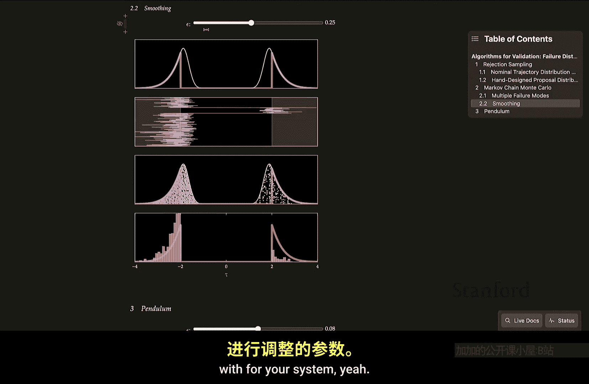

# 斯坦福大学【中英⚡安全关键系统验证｜Stanford AA228V I Validation of Safety Critical Systems】 p09 P9 Importance Sampling -BV15RkXByEW3_p9-

Awesome， okay， so we're going to jump back into where we left off last Thursday。

So if you remember we were trying to draw samples from the distribution over failures and we said that we knew how to we couldn't compute the normalized density of the failure distribution but we could compute the unormalized density by computing that numerator and so we were talking about different ways to then draw samples from this unnormalized density so we could kind of represent this distribution implicitly with our samples and so we talked about rejection sampling and we talked about Markov chain Monte Carlo。

And we left off talking about Markov chainin Monteney Carlo and kind of some of the challenges that we might end up with when doing Markov chainin Monte Carlo。

And one of these challenges was that kind of everything works with Monte Carlo in the limit of infinite samples。

 so in the limit of infinite samples， Car Markovane and Mon Carlo will give us distribution samples from the failure distribution。

But we were saying we don't have time for this， and so we need to figure out what to do in practice when we're always going to have some finite set of samples。

And so we talked about some different tricks to do。

 one was kind of adding this burning period which people sometimes do to just throw out the first few samples。

 there was also this thing called thinning where because these samples depend the next sample depends on the previous sample。

 the samples are actually correlated within the chain。

 so to get these kind of uncorrelated samples people often do this thing called thinning where they keep every like fifth sample tense sample。

 something like that。And then the last thing we were talking about was this idea called smoothing。

 so that's what we're going to kind of dive deeply into for the first part of today。

 and we had this Pluto notebook where we were looking at where essentially the idea was that we had now this bimodal failure distribution。

And we saw that when we just tried to do kind of this naive Markov Shane Mon Carlo to sample from this bimodal distribution。

 we only got samples from whichever failure mode we started in。

And the reason for that was because we had this proposal or not proposal。

 but this kind of distribution we were using to propose the next sample and when it was a current color kernel。

 when we were using this distribution we saw that assigned very low likelihood no matter what we did to kind of points in this failure mode over on the other side and so it's very unlikely that we would make that big jump and actually switch over to failure mode so in the limit of infinite samples this would eventually happen but because we're taking a finite sample a lot of times our finite sample is just going to contain samples from this failure mode。

😊，So we said， let's try to help this algorithm move between these failure modes by kind of smoothing out the failure distribution。

And so the way we said to do this was we'll define this distance function that we call deelta。

And we're just saying that this function should return zero if the trajectory is a failure and it should be positive otherwise。

 so it kind of represents a trajectory's distance to failure。

And one really easy way to do this is to just take the max of the robustness and zero。

 so the robustness will be positive when it's not a failure and then we'll make sure it's zero when it is a failure。

So then we said what we could do is we could just rewrite our unnormalized density for the failure distribution。

 and instead of saying tau not inside， we can just use this condition， which means the same thing。

 which is that deelta tau is equal to zero。And so we said， okay。

 now what we can do is we can say that this indicator function is actually kind of similar to a normal distribution with a very small variance。

 so here we you know kind of we have this indicator function it's one at zero when delta tau is zero and it's zero everywhere else。

😊，And we can kind of approximate that with kind of the smooth approximation。

 which is a normal distribution centered at zero with this kind of small variance。

So what we could do is we could just take our indicator function in our unnormalized density and replace it with this kind of smooth approximation。

And the idea is now we'll assign non zero probabilities to success trajectories with higher probability for successes that are closer to failure。

And what's kind of cool is we could actually now take this epsilon parameter。

 which is the variance of that normal distribution we replace it with and use it to control kind of how much we're smoothing out this distribution。

So when epsilon is zero， that means that there's no smoothing so that the variance is zero or just kind of collapses back to this。

And then you can imagine when epsilon is in infinity。

 if you imagine kind of an infinite variance for a normal distribution， it's like infinitely wide。

 it basically just becomes kind of uniform， and so this is kind of uniform now and then our unormalized density just becomes failure。

 the nominal trajectory distribution， and so when epsilon is infinity it approaches theminal trajectory distribution。

😊，Okay， is there any questions up to that point？Yeah， this is more of the。 Can you say this again。

 Can you Can you say a little bit more about what why we're modulating P to be that， Like。

 why this the。probability。Why we made this equation No。Thisservation， yes。

This is just the unnormalized density of the failure distribution get to this one we just said we defined this distance function in some way common way to do is max robustness in zero。

 such that if that distance is zero，How is a failure？And if it's not， then。It'll be positive。

Or it'll be a success and then basically we can just say then the condition that tau is a failure is the same as the condition that that distance function evaluates to zero so we just replace this。

What other questions you have on that？Yeah。So。The smoothing just lets us kind of like。

I be on this distribution more， so I guess like when。INow are distributions like larger。In a sense。

 is it possible that like there's two documents that aren less likely？

Kind of yeah and more specifically， we're now going to have a bunch of samples that are not failures because we just assign some non-zero probability to samples that are not failures and our failure distribution should only consist of failures because it's the distribution over failures。

 but we can actually solve this problem， and that we can just reject all the samples that are not failures。

 don't include them in our final set of samples and we'll actually be left still with samples from the failure distribution。

So this may seem kind of intuitive， but it's not necessarily an obvious result to derive。

 but one way you can think of this and actually what this is completely equivalent to is doing rejection sampling。

 which is what we did at the beginning of lecture last week with our smooth distribution as the proposal distribution and then we just reject all the ones that aren't failures and then the ones that are left will be from the failure distribution。

😊，So let me show you guys what this looks like。

So here we have similar plots to what we saw last week where we're trying to now sample from this kind of bimodal failure distribution and the plot on the top here in red we showed the true failure distribution that we're trying to sample from and then in this purple line is the smooth version with epsilon equal to 0。

05。So we have kind of just this tiny bit of smoothing that like smooths out this edge here。

 such that now we have some nonzero probability out here。

 and then this is still some really small nonzero probability。

Here we're showing the chain of samples so even still with this small amount of smooth we didn't manage to jump over into this other failure mode。

 but then what we do is we just do rejection sampling so that's what this part is showing on all the samples get rid of all the ones that were not failures and then we're left with samples from the failure distribution but we still have this issue where we never jumped over to the other mode and so all we really need to do is like you know we smooth it out a tiny bit but this is still a really big jump for it to have to make。

And so what we can do is try to kind of smooth it out a little more。

 so let's increase that parameter bunch。And now we can see kind of this nice， big。

 smooth distribution， and we can see ourselves kind of jumping back and forth between these failure modes。

And kind of the one and now we have you know nice samples from both sides here The one drawback is we're now sampling some nonfailures so we're kind of wasting some of our samples on samples that we're ultimately going to reject。

 but we needed those to be able to kind of efficiently explore the full space of possible failure modes。

嗯。Yeah and so if we like have somewhere in between， I want to show you guys this too。this one。

Yeah so we have like something somewhere in between where we're like almost jumping back and forth enough。

 but we don't jump back and forth quite enough for our limited sample size。

 sometimes we can get like you know a few samples from our other failure mode but not enough to like fully even it up so this is really just a parameter that you kind of have to play around with for your system。

So right now you're not plotting the like next step proposal， the kernel。

 whatever's called right it's not visualized so could you also instead of doing that just widen your kernel distribution and then it would also manage to kind of jump over at some point Yeah your question so the question was can you just widen your kernel distribution that it's more likely to jump back and forth you could do that I think in general it won't be as obvious like what kernel is going to allow you to jump back and forth like imagine you this is one？

