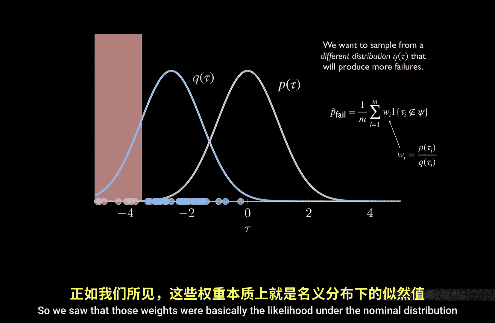
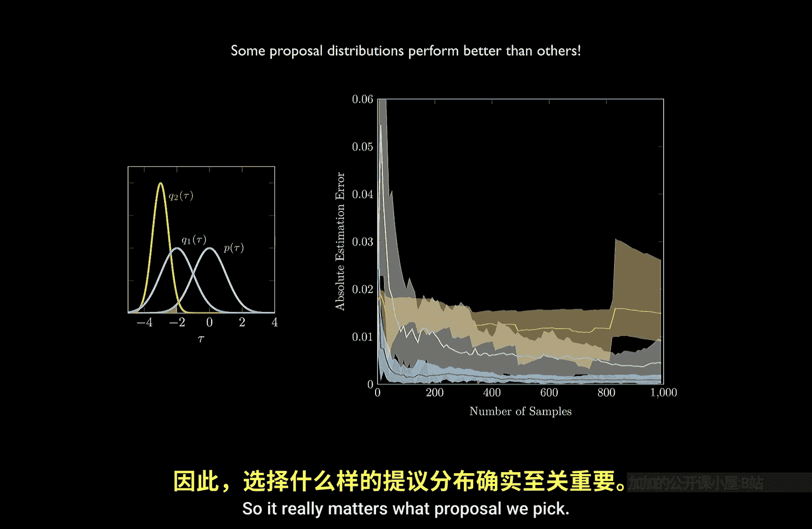
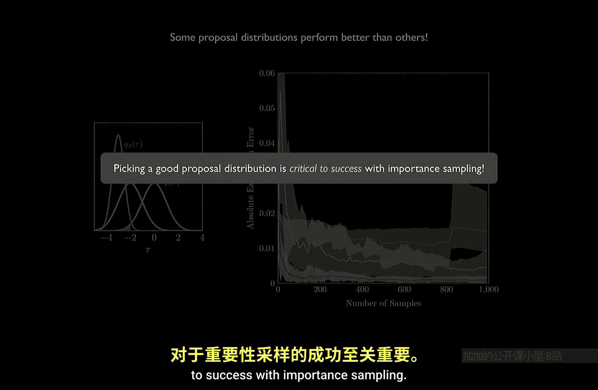
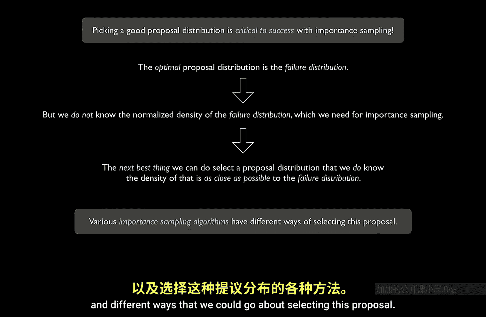
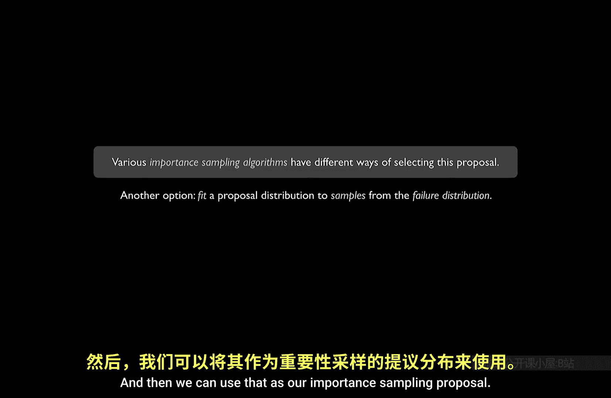
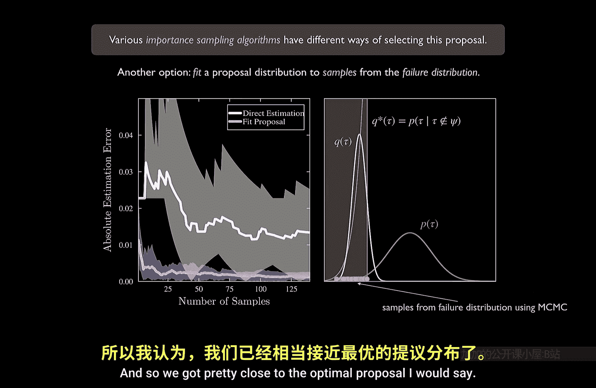

# 斯坦福大学【中英⚡安全关键系统验证｜Stanford AA228V I Validation of Safety Critical Systems】 p10 P10 Adaptive Importance Sampling -BV15RkXByEW3_p10-

So today we're going to talk about part two a failure probability estimation。

Okay so now let's get into it with a little bit of a recap of important sampling。

 so I realized the last time there was kind of a lot of distributions going on。

 a lot different distributions that mean different things samples coming from different places。

 so what I want to do is try to kind of boil it down to the minimum things that I want you to take away before you at least maybe go back through and read the book I understand you're probably studying for the quiz now maybe you haven't read this chapter yet but I want to kind of break it down to the kind of minimum set of things that I want you to take away at first just to understand the rest of this lecture so we're all kind of on the same page。

Okay， so we were talking about this thing called important sampling and the whole reason that we wanted to talk about it was because we had kind of this direct estimation algorithm where we would just sample from the nominal trajectory distribution and estimate the probability of failure from that。

 but then we realized that if failure events are rare。

 then we might not even get any failure samples。And so that's not going to work so well we're just going to have like an estimate of zero and we also saw when we looked at like the variance I showed you the formula for the variance of the direct  estimation estimator and we saw that as the probability of failure decreases that variance increases so basically the estimator will get less and less accurate as our probability of failure decreases。

😊，And the only way to fix that is to get more samples。

 but we might require like billions and billions of samples， so this could be very inefficient。

So we said okay， let's try to do something else and the something else that we do is that we just want to sample from a different distribution that we call Q of tau。

 we call this a proposal distribution and the idea is that we want this distribution to hopefully produce more failures than the nominal distribution。

😊，So in this case， for example， we picked this s of tau here and we actually were able to sample some failures when we sample from this distribution。

But then we're like， well， we still want to estimate the probability of failure under this nominal distribution。

 so we can't just take the number of failures here and divide it by the total number of samples because that will give us the probability of failure under this distribution。

And so what we actually need to do to get the probability failure under this distribution is we do a similar thing。

 but we just have to weight all of these samples based on their likelihood under the nominal distribution。

 so we saw that those weights were basically the likelihood under the nominal distribution divided by the likelihood under this proposal。

😊。

Okay， and then what I was kind of trying to show you in that Pluto notebook was that some proposals work better than others。

 so it really matters what we pick for this proposal distribution。So what this is showing here。

 this is a graphic from the book。We have our nominal distribution is just this simple Gaussian again。

 where the failure threshold is minus2。And we can see how that does， this is kind of， again。

 we're plotting the estimation error so we want to be lower on this plot ideally。

 and then we want to have kind of lower spread among our estimates because that means on average we'll be closer to the true estimate。

Okay， and so then this is kind of the performance of this direct estimator and now we could see if we shift our。

Our proposal over should be this blue proposal here。

 we're kind of now centered around the very high likelihood region of the failure distribution。

 and we were able to get a much lower variance estimator that's also much more accurate。

But what I also want to show you is that it is possible to pick a bad proposal so for example。

 if we pick this orange proposal here is now assigning high likelihood to kind of low likelihood failures so we are going tosem failures with it because anything to the left of minus2 is a failure but we're not really assigning it to failures that have very much probability mass and so we could actually end up doing worse than our direct estimator so it really matters what proposal we pick and that's kind of the point I'm trying to drive home here。

Which is that picking a good proposal distribution is very much critical to success with important sampling。

And so then we went on to look at say can we find what the actual optimal proposal distribution is with respect to the variance of the estimator so I didn't drive this。

 but I just showed you this is actually what the variance of the。

Important sampling estimator looks like。And we went on and we showed that if we plug in this particular density for Q of tau。

 then this variance becomes zero and we get the estimator that has zero variance and this would be optimal。

But then we said， actually， this is the failure distribution。

And so you know on the top here we have kind of the unormalized failure density we've been used to seeing。

 and then we said that the normalizing constant for the failure distribution is just the probability of failure。

And so we had this problem where we're like， okay， well， if we want to be optimal。

 we would use this distribution to sample from and we need to know this full density here。

 but the whole point is that we want to estimate PFAL so there's no way that we could possibly know this density。

Okay， so that kind of led to this line of thinking。

 which was that the optimal proposal distribution is the failure distribution。

 but we don't know the normalized density for the failure distribution and that's what we would need for important sampling。

😊，So kind of the next best thing we could do is try to select a proposal distribution that we do know the density of that's as close as possible to the failure distribution。

And that's kind of all the innovation that goes on in all the different important sampling algorithms that we're going to talk about so really what these algorithms are trying to do is just pick the best possible proposal knowing that we can never sample from the optimal one。

 which is the failure distribution so how can we pick a proposal that's kind of as close as possible that we do know the density of。

Okay。So one more note I'm picking this proposal that I think there was a question about last Tuesday。

 but I kind of skipped over， which is that we must pick a proposal such that the probability density of the proposal assigns non-zero density to every possible failure。

 so everywhere that the failure distribution density is non-ze。

 meaning that a failure is possible for that trajectory it needs to be possible that we could sample that trajectory from our proposal。

So if we just look at this one on this example on the left here。

 where our proposal is a Gaussian distribution， can someone tell me if this property is satisfied？

Yeah， people are nodding their heads， yep they's satisfied。

 so a Gaussian distribution assigns non zero probability everywhere。

 this is not going to be an issue。Okay， how about over here where we have this like uniform distribution as our proposal？

 because there's some region here where the probability density of the failure distribution is nonze。

 but we would never sample failures from that region。

 and so our important sampling estimator would be inaccurate。😊，さ。In this figure。

 our most likely failure than we might vice for is still within the distribution。

We're trying to estimate the probability of it。So we need to be able to sample all possible failures。

Okay。Sorry， this is all weight。But in that case。これわン内で。Simply so for trying to estimate the failure。

 just trying to falsify the failure。There's the're saving strength but taking it that's not necessarily。

It' like a heart string anymore in that case。 Yeah， when you're just trying to falsify。

 you don't have to。Like if you're trying to find the most likely failure and you assign。

Zero probability density to unlikely failures， that would be fine。Yeah， just depends on the time。嗯。

Okay， so back to where we were， so we're going to now talk about a bunch of different important sampling algorithms and different ways that we can go about selecting this proposal。

So one option for this proposal distribution is we could just hand designign it so we could just be like I kind of know what the failure distribution supposed to look like。

 we kind of did that in Project one and so I'm just going to pick something that I think would be similar to the failure distribution。

And hint， maybe your fuzzing distribution that you use for Project one would be a good thing to start with for Project two if you want to hand designign your proposal。

Okay， but hand designing doesn't always work， sometimes we have very complicated systems。

 we don't really know what the failure distribution looks like and it's not super obvious how we could pick something。

 so it might be a little bit better if we could actually try to do something more adaptive or automatic。

And so this other option that we talked about on Tuesday is that could we do know how to draw samples from the failure distribution so that's kind of the last topic that's on your quiz we talked about how we could use like Markovchain mining Carlo or rejection sampling to draw samples with just knowledge of what the unnormalized density for the failure distribution looks like so we do know samples from it we just don't know how to compute the density so then we say okay well why don't we just fit a distribution from a model class that we do know how to compute the density of so for example maybe a gasussian distribution or something to the samples from the failure distribution in hopes that we'll get a distribution that's close to the failure distribution and then we can use that as our important sampling proposal。

So we looked at how that looked towards the end of class on Tuesday。

 here's just another visualization of it， so here we have kind of our nominal distribution over here。

 we used MCMC to draw samples from our failure distribution so normally we don't know what the failure distribution looks like for the simple Gaussian we can't actually compute it but in general we don't know what it looks like。

 we just have these samples down here。And then we just took all of these samples and we said， okay。

 let's just fit you know maximum likelihood Gaussian distribution to these samples。

 so that's how we get the purple distribution here。And you can see it does。

 you know normally we don't get to know this， but it does actually look a decent amount like the failure distribution。

 which is the red one there。And so we got pretty close to the optimal proposal I would say。

 and you can see that in the results where here's the results of doing direct tests。

