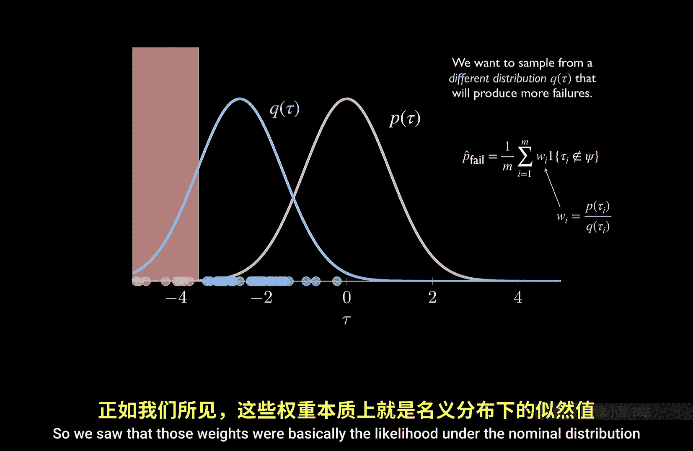
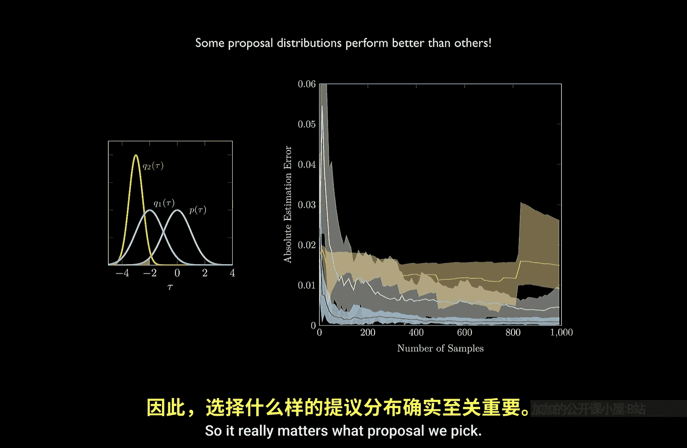
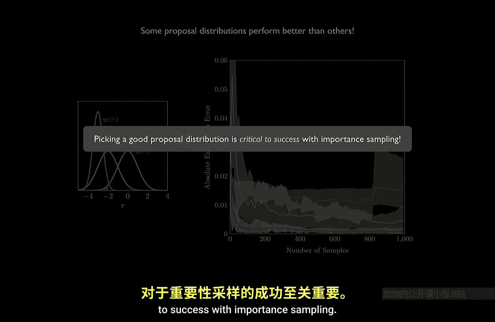
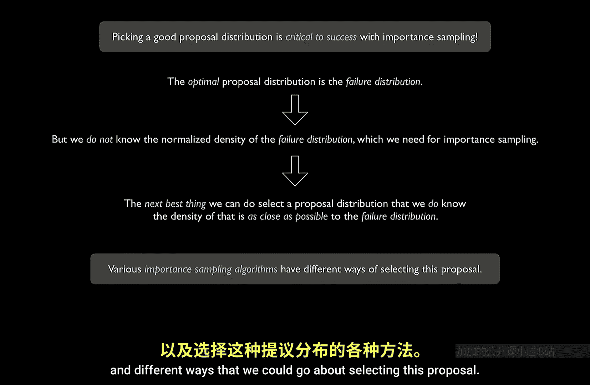
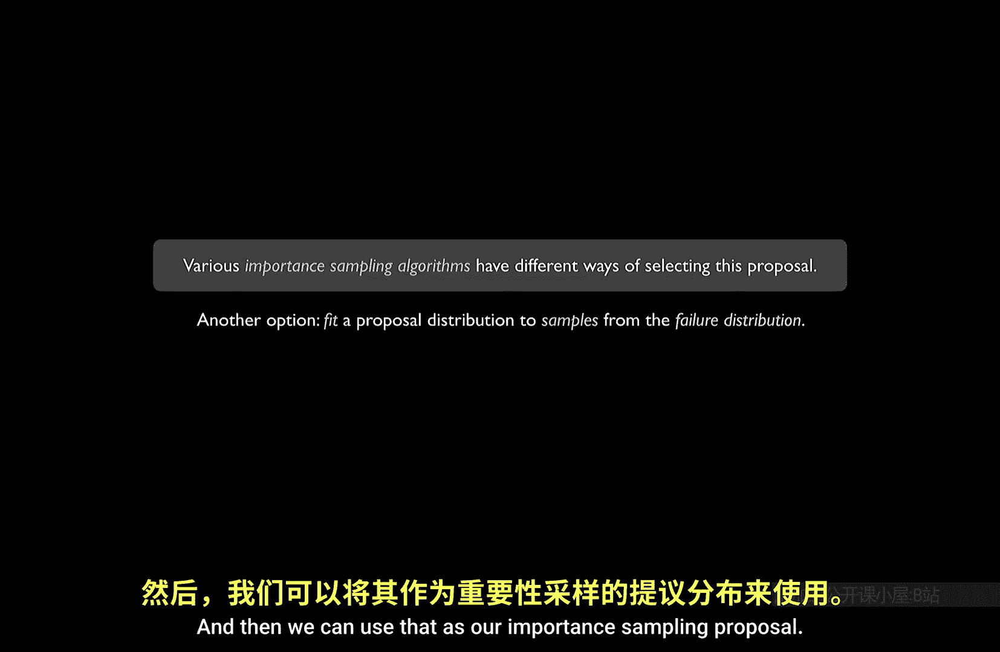
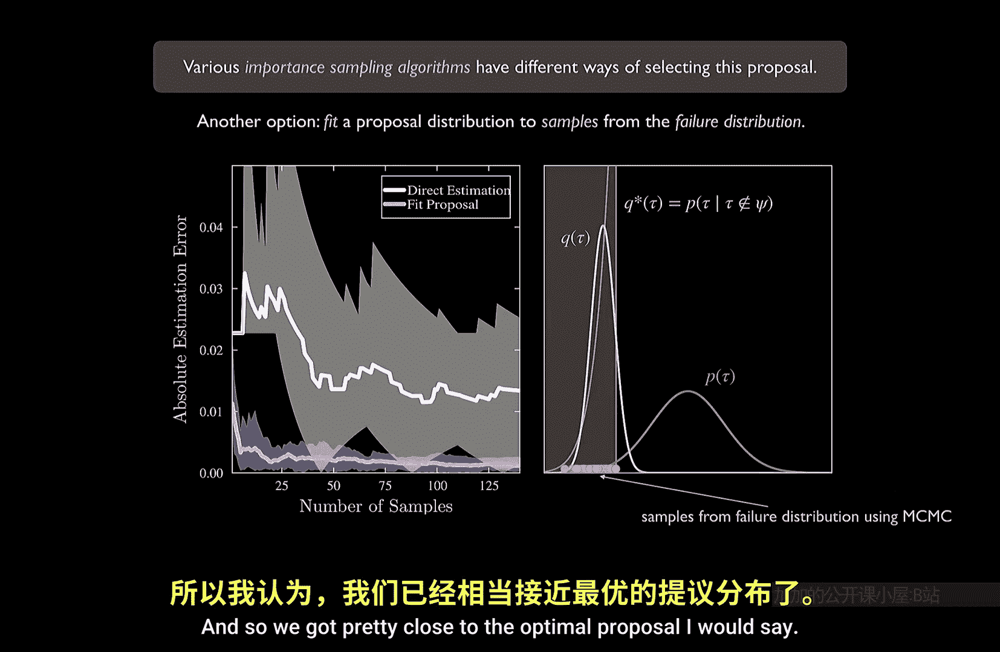

# 安全关键系统验证：10：自适应重要性采样

在本节课中，我们将学习故障概率估计的第二部分内容，重点是自适应重要性采样方法。我们将回顾重要性采样的核心概念，探讨如何选择有效的提议分布，并介绍几种自动或自适应地构建提议分布的策略。

## 重要性采样回顾

上一节我们介绍了直接估计方法在罕见事件估计中的局限性。本节中，我们首先回顾重要性采样的基本原理，为后续内容打下基础。

直接估计法从名义轨迹分布中采样来估计故障概率。当故障事件罕见时，我们可能一个故障样本都采不到，导致估计值为零。此外，直接估计器的**方差**公式表明，随着故障概率降低，方差会增大，估计精度下降。提高精度的唯一方法是增加样本数量，但这可能需要数十亿样本，效率极低。

因此，我们引入了重要性采样。其核心思想是从另一个分布，即**提议分布** `Q(τ)` 中采样。我们希望这个分布能比名义分布产生更多的故障样本。

然而，我们最终需要估计的是名义分布下的故障概率 `P_fail`。因此，我们不能简单地将故障样本数除以总样本数（那得到的是提议分布下的故障概率）。我们需要对每个样本根据其在名义分布下的似然性进行加权。**权重** `w_i` 的计算公式为：

`w_i = P_nominal(τ_i) / Q(τ_i)`

然后，故障概率的估计值为：

`\hat{P}_fail ≈ (1/N) * Σ [ I_fail(τ_i) * w_i ]`

其中 `I_fail(τ_i)` 是指示函数，当轨迹 `τ_i` 导致故障时为1，否则为0。

## 提议分布的选择至关重要

以下是不同提议分布对估计性能影响的图示说明。性能通过估计误差和估计值的分布（方差）来衡量，越低、越集中越好。

*   **名义分布（直接估计）**：如图所示，其估计误差较高，方差较大。
*   **好的提议分布（蓝色）**：该分布将高概率密度区域集中在故障分布的高似然区域。使用它进行重要性采样，我们得到了方差更低、更准确的估计器。
*   **差的提议分布（橙色）**：该分布虽然也能采样到故障（阈值左侧），但它将高概率密度分配给了故障分布中概率质量很低的区域。这可能导致估计性能甚至比直接估计还要差。

因此，**选择一个好的提议分布对于重要性采样的成功至关重要**。

## 最优提议分布与挑战

我们进一步探讨了是否存在一个理论上的最优提议分布。通过分析重要性采样估计器的方差公式，我们发现，当提议分布 `Q(τ)` 恰好等于**故障分布**时，估计器的方差为零，达到最优。

故障分布的（未归一化）密度函数我们已知，即名义分布密度乘以故障指示函数。但其归一化常数正是我们想要估计的故障概率 `P_fail`。这就形成了一个悖论：为了最优地估计 `P_fail`，我们需要知道 `P_fail` 本身来构造最优提议分布。

因此，所有重要性采样算法的核心创新点可以归结为：**既然无法从最优的故障分布采样，我们如何选择一个我们已知密度、且尽可能接近故障分布的提议分布？**

## 提议分布必须满足的条件

在选择提议分布时，有一个关键条件必须满足：**提议分布的概率密度必须在所有可能的故障轨迹处非零**。也就是说，对于任何能导致故障的轨迹，我们的提议分布都必须有可能采样到它。

例如，在之前的图示中：
*   **高斯分布作为提议**：满足条件，因为高斯分布在整个空间上的概率密度都非零。
*   **均匀分布作为提议（图示右侧）**：如果不均匀分布的范围没有覆盖所有可能的故障区域，那么有些故障轨迹将永远无法被采样到，这会导致重要性采样估计不准确。

这个条件在估计故障概率时必须遵守。但如果目标仅仅是**证伪**（例如，寻找最可能的故障），则不一定需要满足此条件。

## 构建提议分布的策略

接下来，我们看看有哪些具体策略可以构建有效的提议分布。

### 1. 手动设计

我们可以基于对系统的理解，手动设计一个我们认为接近故障分布的提议分布。例如，在项目一中使用的模糊测试分布，就可以作为项目二中手动设计提议的一个起点。

### 2. 自适应/自动方法

对于复杂系统，手动设计可能很困难。这时，我们可以采用更自适应或自动化的方法。

上周二讨论的一种思路是：虽然我们不知道故障分布的归一化密度，但我们可以利用其**未归一化密度**，通过马尔可夫链蒙特卡洛或拒绝采样等方法，从故障分布中抽取样本。

获得这些样本后，我们可以从一个已知密度形式的模型族（例如高斯分布）中，拟合一个分布来近似这些样本。这个拟合出的分布就可以作为我们的重要性采样提议分布。

上图展示了这个过程：
1.  名义分布是左侧的高斯分布。
2.  使用MCMC从故障分布（红色）中抽取样本（底部点）。
3.  对这些样本进行最大似然拟合，得到一个高斯分布（紫色）。
4.  可以看到，拟合出的紫色分布与真实的故障分布（红色）相当接近，接近了最优提议。

使用这个拟合分布进行重要性采样的结果，相比直接测试（蒙特卡洛），其估计误差和方差都显著降低。

## 总结

本节课中，我们一起学习了自适应重要性采样的核心思想。我们首先回顾了重要性采样通过从提议分布采样并加权来估计罕见事件概率的原理，并强调了提议分布的选择对估计精度有决定性影响。我们探讨了理论上的最优提议分布是故障分布本身，但由于其归一化常数未知而无法直接使用。因此，各种重要性采样算法的目标都是寻找一个已知密度且尽可能接近故障分布的替代提议。最后，我们介绍了两种构建提议分布的策略：手动设计和通过从故障分布采样并拟合模型来自动生成。这些方法为高效、准确地估计安全关键系统的故障概率提供了有力工具。