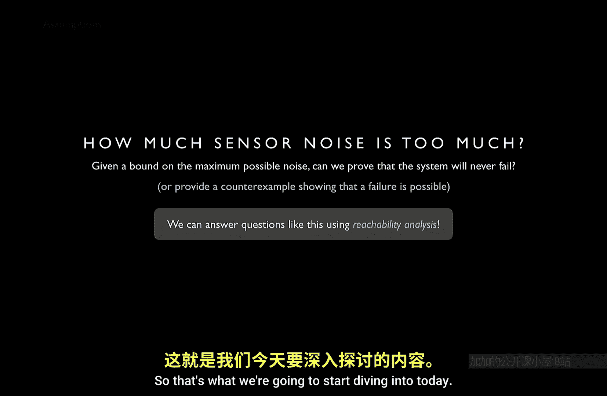
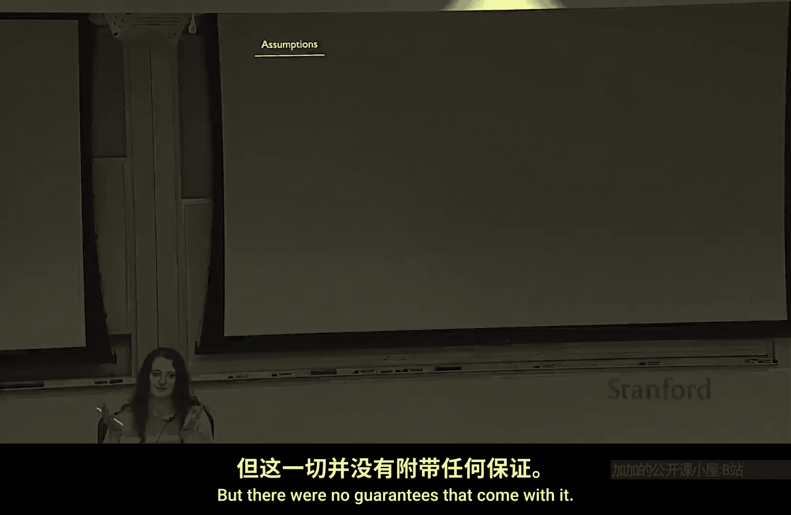
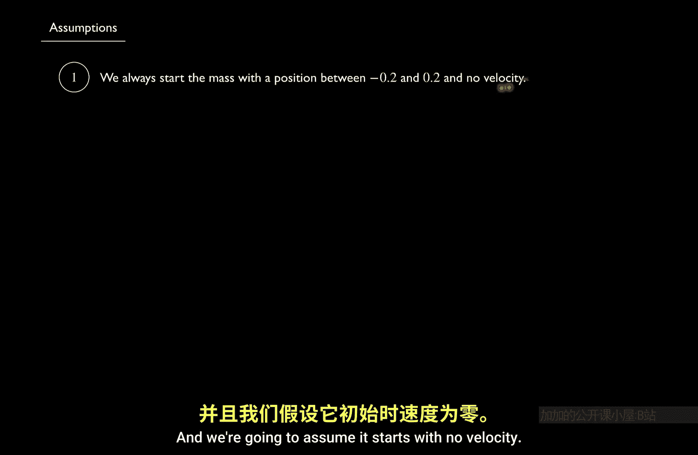
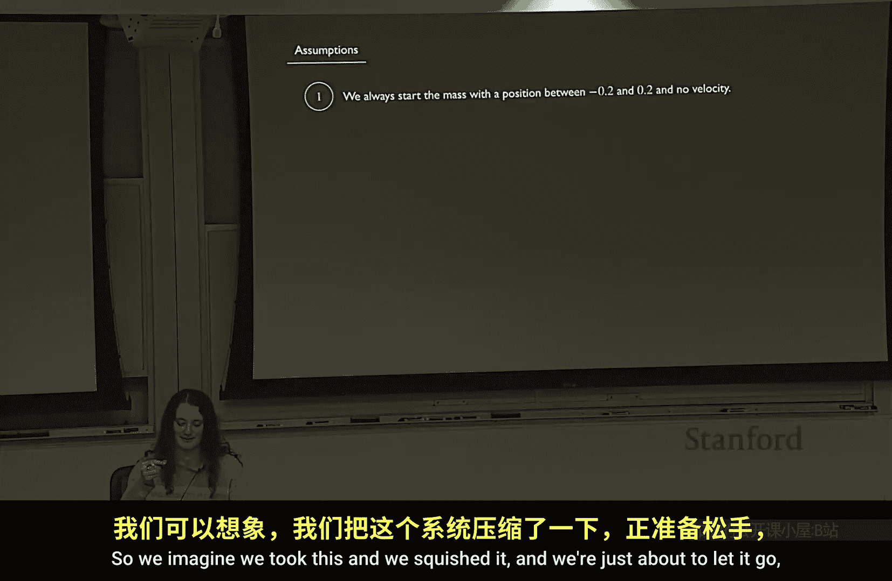
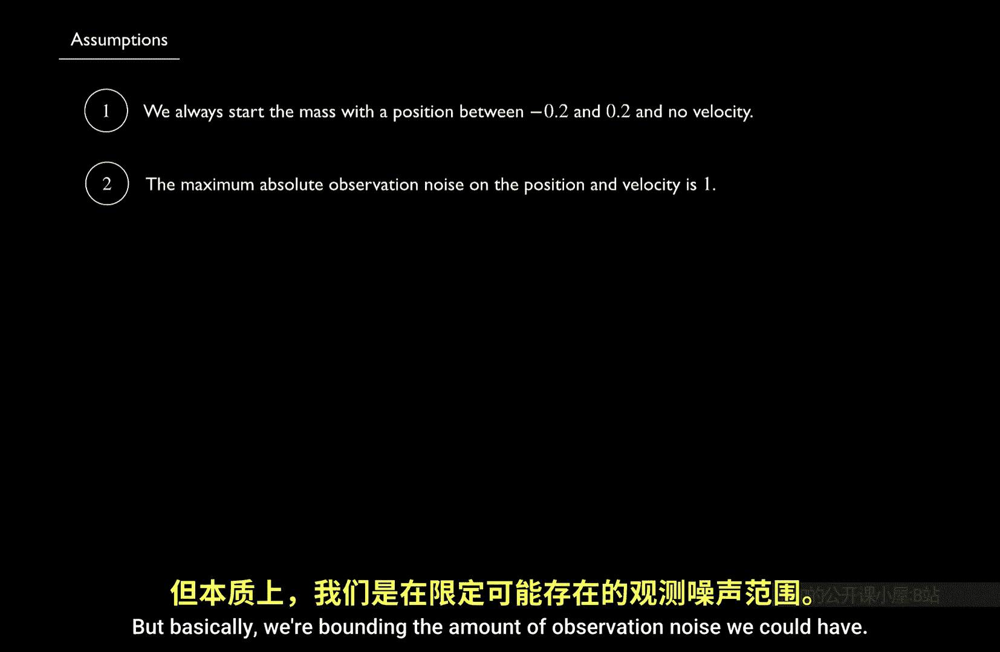
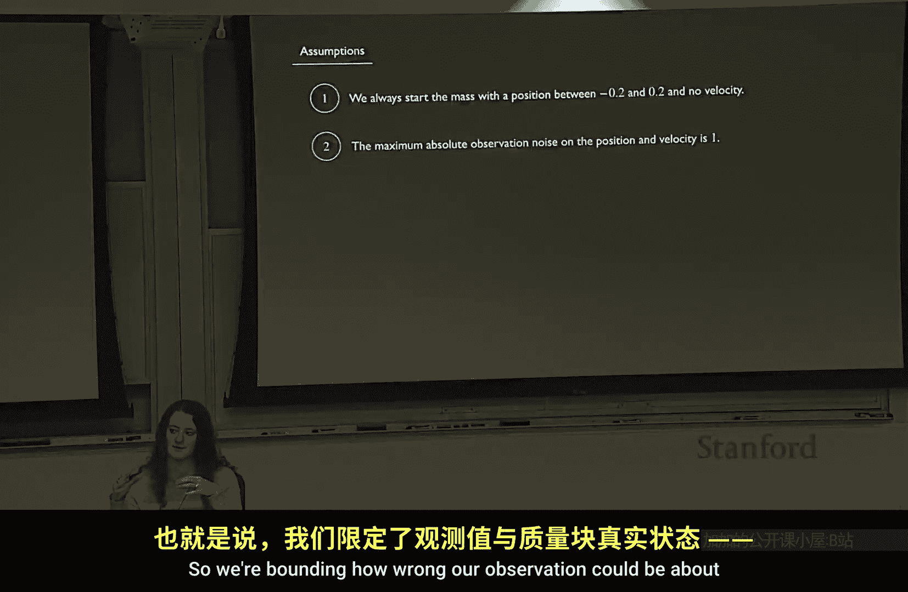
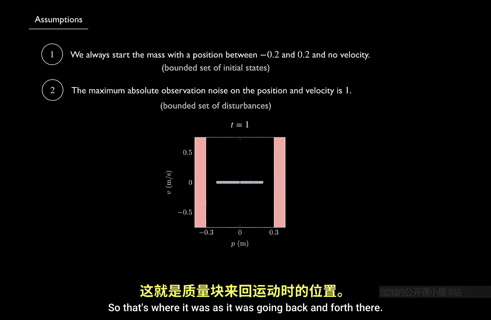
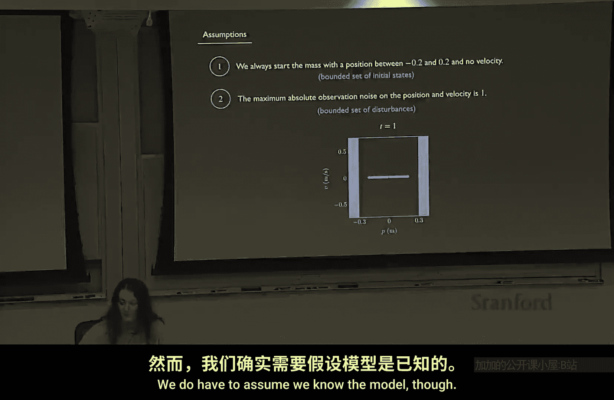
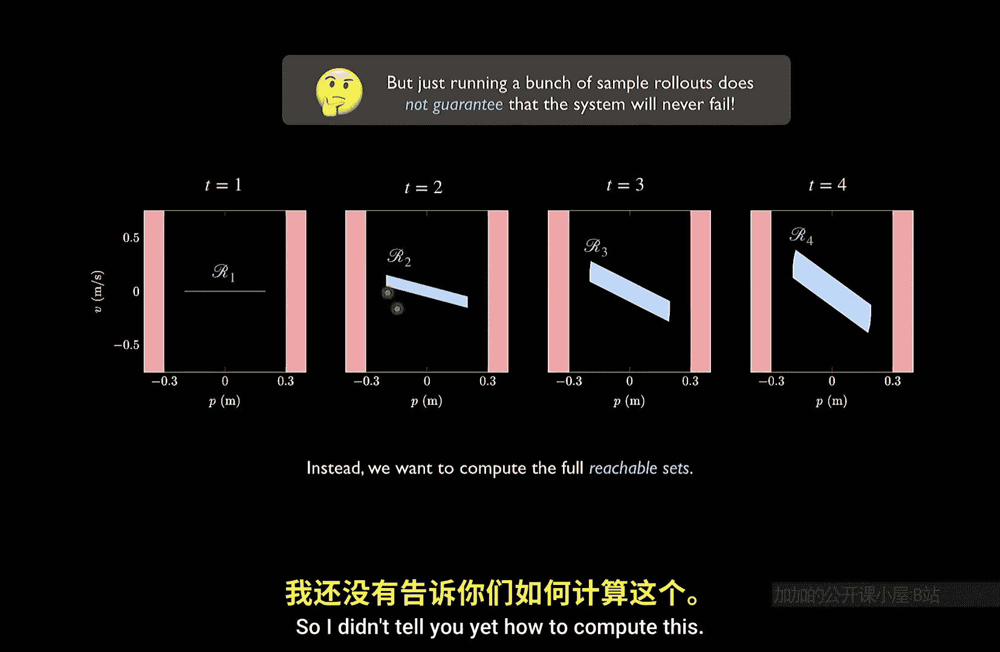

# 斯坦福大学【中英⚡安全关键系统验证｜Stanford AA228V I Validation of Safety Critical Systems】 p11 P11 Reachability for Linear Systems -BV15RkXByEW3_p11-

Today we're going to kind shift gears a little bit。

Up until maybe like the last three weeks or so or for the last three weeks or so we've been talking mostly about this topic of failure analysis。

 so we did falsification， we did the failure distribution。

 we looked at failure probability estimation and now we're going kind of switch gears to this sort of idea of formal methods where we're of trying to more formally get guarantees on systems so instead of trying to find failures or estimate probabilities of failure here we're actually trying to prove the absence of failure so under some set of assumptions can we prove that our system will never fail。

😊，And we're going to do that mostly through something called reachability。And before I jump in。

 I want to give a disclaimer here。Over the kind of course of the quarter。

 I've been really concerned that there was just going to come some point where I just like run out of jokes to tell and then I just can't entertain you anymore because I'm just like I don't know if I can keep this up and so to be honest we've now come to our point of reachability and at this point I don't know if that point has occurred but I'm really reaching for some jokes right now wasn't sure if I was going get food off the station that one okay some of that let's get started on reachability。

Okay， so most of the stuff that we've done so far has basically no guarantees with it。

 so we've been able to like search for failures and estimate these probabilities and whatnot。

 but if we let's say ran our search for failure for a long time and we didn't find any failures that didn't necessarily mean that the system would never fail。

 it's just that we didn't necessarily find them so that might be kind of unsatisfactory for some of you。

And so today we're going to kind of switch over to this world of formal methods where we can actually start getting some guarantees on the behavior of our system。

And specifically with reachability， what we want to do is we want to compute the set of states that a system could reach over time。

Okay， and so we're going to use this kind of very simple system that maybe some of you who have taken like controls classes or dynamics classes have seen before。

 basically it's a mass spring damper system， so we have this mass here。

 it's kind of square object is just like some mass。😊。

It's attached to a wall and it's attached by this spring and this damper and basically the spring acts like a spring like that maybe you've seen before in the world and then the damper is just something you can kind of think of it like modeling air resistance or something like that。

 so this might look a little weird but it's actually a very common model that's used for many physical systems。

 for example， like the suspension on a car。And so this kind of system often comes up in like control theory and things like that。

And here we're going to say so that this mask can kind of move back and forth along here。

 we're ignoring any idea of gravity， and then we're going to say it fails if it ends up in like this region so if it gets too close to the wall or it extends too far。

 that's a failure。Okay， and so then let's imagine now that this mass is kind of out here and its actual resting position with respect to the spring is right here。

 so we've kind of stretched it out here， so let's say that we now let go of whatever it's holding onto as it's stretched out。

 what do you guys think is going to happen？Yeah， as you I'm going to do this it's going to oscillate back and forth。

 so that's what happens here。Okay but we might not be satisfied with that。

 we might actually want it to like slow down a little bit faster or not oscillate as much and so we could add some sort of controller to this or in the terminology of this class we could add an agent and the agent is able to apply a force at this mess that can kind of counteract with the spring and the damper our doing and ideally it should like make it oscillate a little bit less so if we look at what happens when we add this kind of agent。

We get。We get it to kind of slow down a little bit faster。

So that's the system that we're trying to validate and again we don't want it to end up in these red regions and to make things a little bit more difficult and kind of continue with the model of this class。

 we're going to assume that there's some sensor noise so whatever agent is getting to apply the force to this mess doesn't get to observe exactly where the mass is and it just has like some noisy observation of it with some like additive sensor noise。

So if we add in some sensor noise， it's not able to do quite as well。

 but it's still able to kind of keep it in the center。

But what happens if we add a lot of sensor noise then the whole thing might kind of go crazy and it does fail。

 et cetera， I had to add a lot of sensor noise to make this happen so that's why sometimes you don't even like see it's like all the way out here or something But the idea is that at some point there's like too much sensor noise and the thing could fail。

😊，And so we might want to know like what is too much sensor noise， how do we know？

Kind of how much we could have， and so maybe we ask this question like given a bound on the maximum impossible noise。

 can we prove that the system will never fail？Or maybe we want to provide a counter exampleamp showing that a failure is possible because of course。

 if there is a failure possible， then we're not going to be able to prove that it can't fail。

 and so typically what these formal methods do is return a counterexample in that case that says。

 here's a trajectory where it does fail。😊，Okay， and so we can answer questions like this using reachability analysis。

 so that's what we're kind of going to start diving into today。

And to do this， you know there's kind of no free lunch here so we。

In all the previous lectures we were doing all this failure analysis， blah， blah， blah。

 but there were no guarantees that would come with it now we're going to get guarantees but we have to make some assumptions in order to actually get those guarantees。

😊。

So one assumption that we're going to make in terms of the mass spring damper。

So we're going to say we always start the mass with a position between  0。2 and 0。2。

 whatever units you want to apply here， of its resting points。

 so we'll say it's resting points at  zero so we either like squish it minus 0。

2 or we pull it out plus 0。2 and we're going to assume it starts with no velocity so we imagine like we took this and we squish it and we're like just about to let it go and it starts with no velocity there。

And then。We're also going to make an assumption that the maximum absolute observation noise on the position and the velocity is one。

 so again whatever units you want to apply here， but basically we're bounding the amount of observation noise we could have so we're bounding how wrong our observation could be about what the true state of this mass is what the true position and velocity is and specifically we can be off by at most one is what we're saying so this would be like let's say we have a sensor we generally know how good it is and we're saying we expect our sensor to be off by at most one。

😊。

So to kind of make these things more general， what we basically did was we just specified a bounded set of initial states。

And then we specified a bounded set of disturbances， so more generally with respect to other systems。

 these are kind of the general things that we need to assume for reach ability analysis。Okay。

 so now let's look at what this kind of looks like。

 so here's on this axis we're showing the position of the mass。

 so that's kind of like where it was as it was going back and forth there on the vertical axis we're showing the speed of the mass yeah。

😊。

And we assume that we know exactly the model and have no dynamics。Yeah。

 we're assuming we know the model and the only noises on the observation。Yeah。

 we don't have to make that assumption we could add noise elsewhere。

 but I'll show the more general formulation soon。We do just let me know the model though。

嗯。Okay， so we basically have。Vlocity on the vertical axis and then we're showing。

 you know I said that it's a failure kind of if its position exceeds some value so it either gets like2 squished。

 so it exceeds minus 0。3 or it extends too far as so it exceeds 0。

3 that would be like a failure so in these red regions。😊。

And we're going to start in this kind of set of initial states where the position is between minus 0。

2 and 0。2， and then we have 0 velocity。😊，So what I've done here is just draw a bunch of samples from this kind of initial set of states。

So this is kind of the represents the set of states that we have at time step one。

And then we could imagine we just apply the dynamics for the system。

 which I haven't really showed you to figure out where that mass could end up at the next time step。

 so here's all the position and velocities that we get at the next time step for all of these samples that we started with。

And then we could just keep doing this for some amount of time and let's say that we're just interested for some reason now and whether or not it's going to be safe at the first four time steps so we can now see kind of what states it reaches over the first four time steps。

But the thing here is like all we did was just run a bunch of samples so we just did kind of basically a bunch of rollouts of depth4 and we saw that none of the samples ended up in this kind of failure region。

 but that doesn't guarantee that the system will never fail so again like this is kind of just almost like we were doing classification。

 we didn't find any failures but that doesn't mean that it will never fail。😊。

And what we actually want to do instead is see if we can compute the full reachable set。

 so what is the full set of states that we could reach if we started in our initial set and applied these like bounded disturbances over time so that's what these kind of shapes in the background are showing。

I'll get rid of the samples so you can see it better。

So here our initial reachable set at time step one is just that initial set we started with。

 so we said we're always going to start at a position between minus  two and 2 and a velocity of zero。

 so it's just kind of this line here。And then the next time step， we get this shape here。

 and this contains all possible states that the system could reach at time step two。

So I didn't tell you yet how to compute this， that's what we're going to be spending a lot of the lecture on。

But that's the idea of what a reachable set。