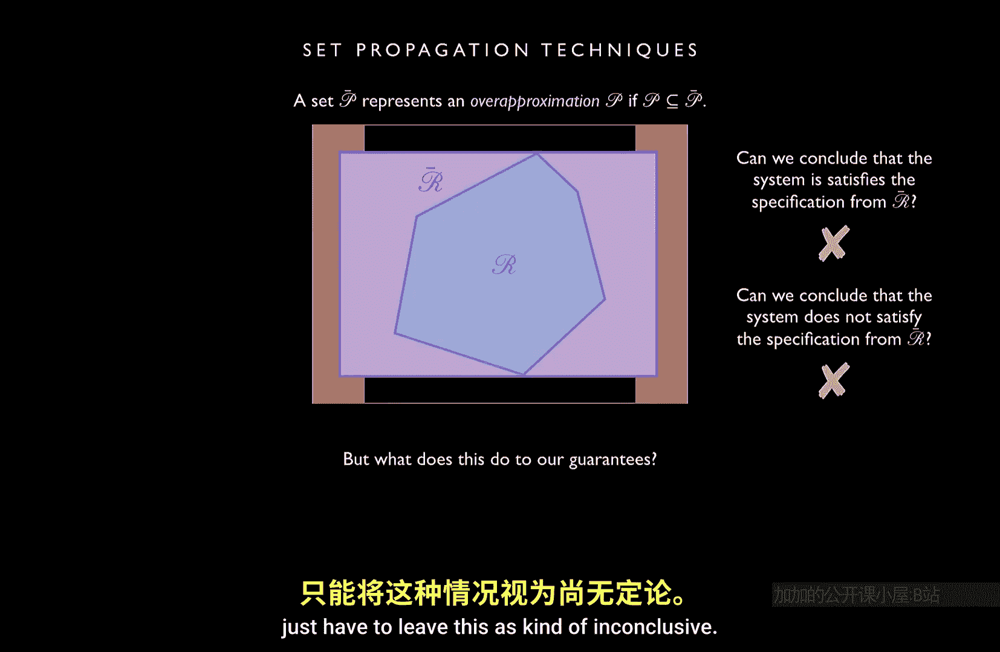
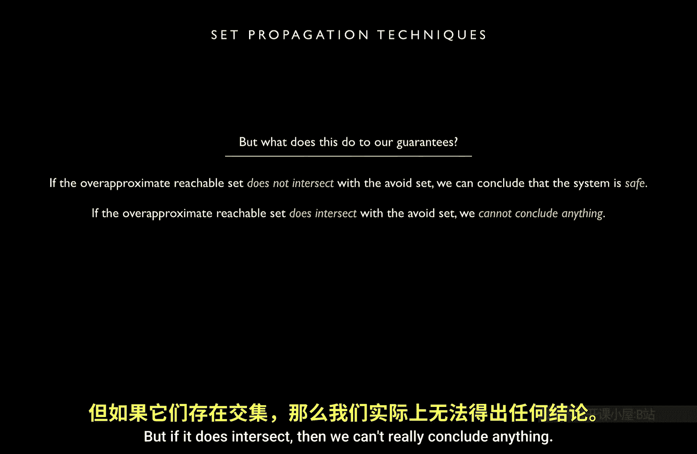
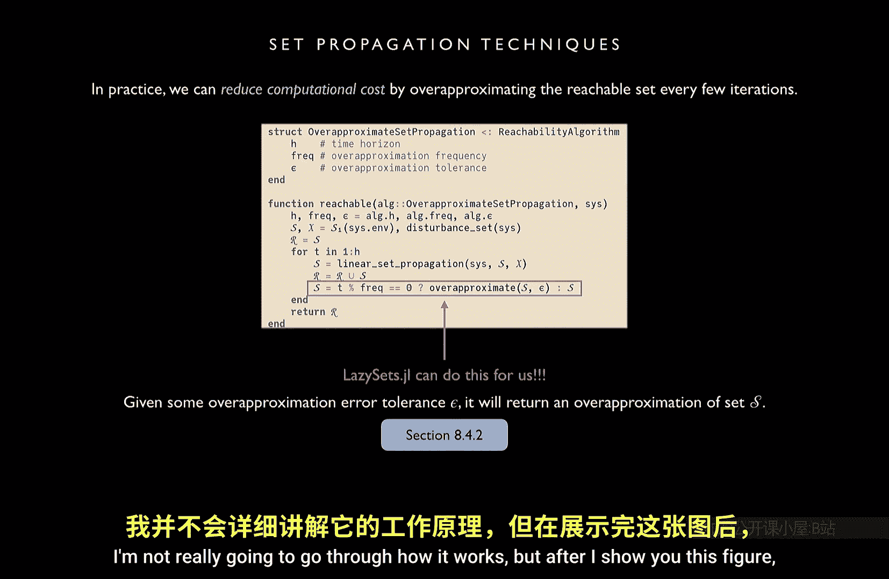
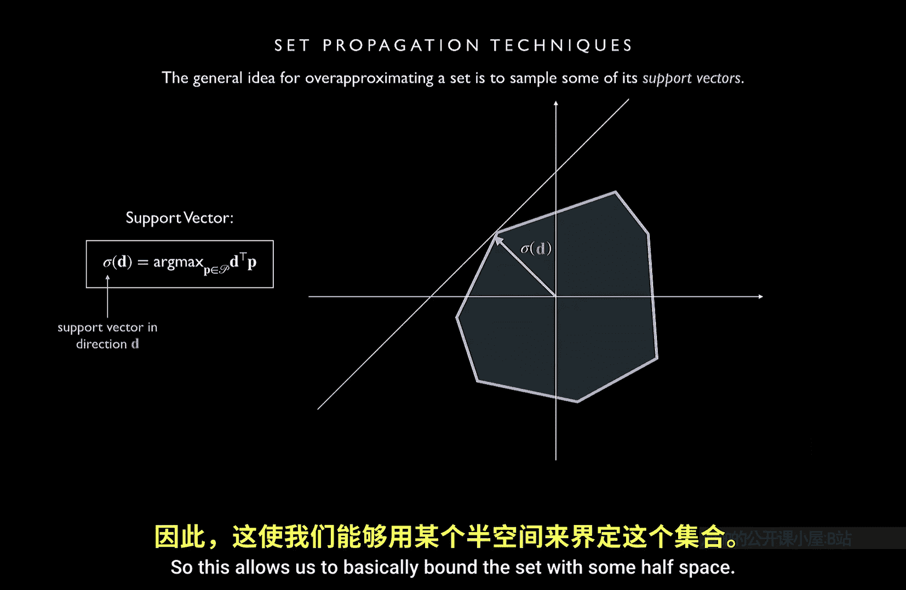
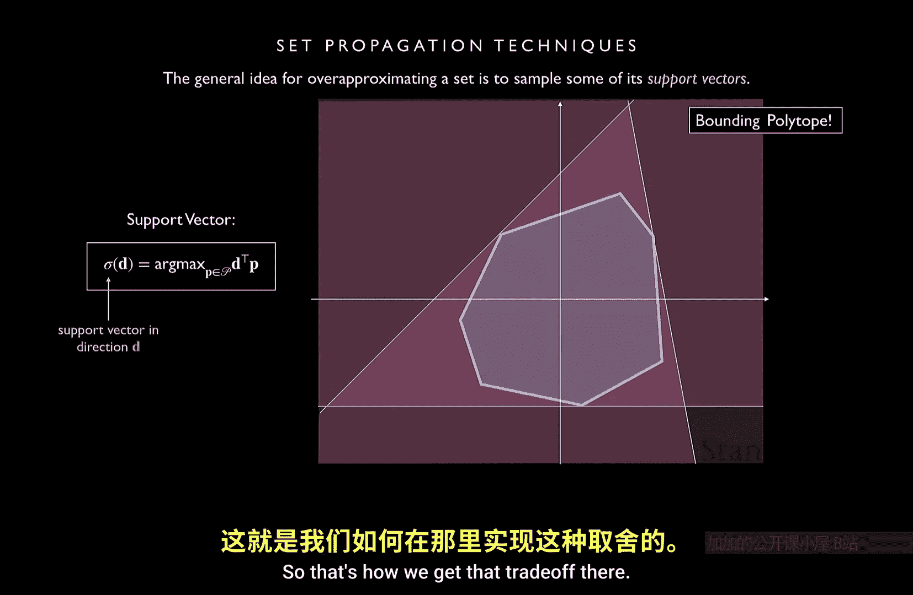
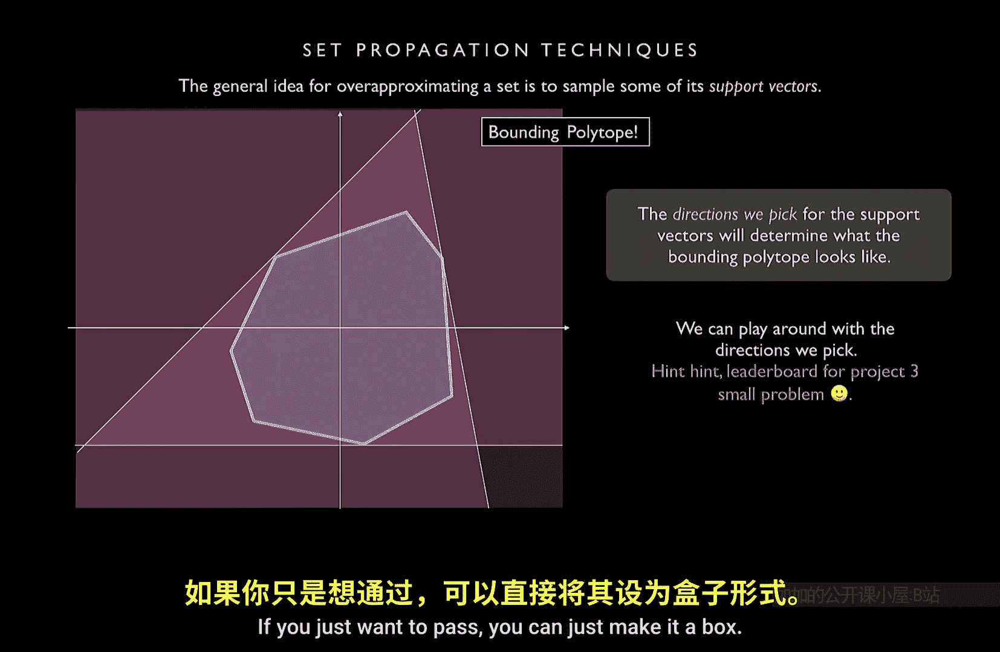

# 斯坦福大学【中英⚡安全关键系统验证｜Stanford AA228V I Validation of Safety Critical Systems】 p12 P12 Reachability for Nonlinear Systems -BV15RkXByEW3_p12-

Last Tuesday we were talking about linear reachability or reachability for linear systems。

 and we left off where we were having this problem where there was kind of we were propagating polytopes through these linear equations and we saw that every single time step up to some depth。

 we were kind of accumulating this number of verticies。

And we had this exponential growth in the number of vertices。

 and so we were worried because that can quickly become computationally intractable。

And so we said one thing that we could do to help with this was represent things as zonotopes and for zonotopes the number of generators grows linearly with the depth and so that was much better。

 but zonotopes we can't represent all polytopes as zonotopes。

 so sometimes maybe that's not what we want to do。And so another option we were talking about at the end of lecture was to over approximate things。

And basically we said an over approximation is just a set。

 so here's the set maybe that we want to over approximate。

 and over approximation is just a set that is guaranteed to contain the set that we were trying to over approximate。

And we typically represent these over approximateimate sets by putting a bar on top of them。

And the idea was that if we have a set that has lots and lots of verticies。

 then we could over approximateimate it with a set that has fewer vertices and then we have fewer vertices to keep track of。

But then we have to make sure that。We still want to get guarantees out of this because we're using coral methods here。

 we want to guarantee that a system is safe。And so we had to。

 what kind of guarantees can we get if we only know， for example， the over approximate set。

 so say this was our over approximation of the reachable set。

And we said if the over approximation still doesn't intersect with the avoid set。

 then we know for a fact that our true reachable set also won't intersect with the avoid set and so we can still make conclusions about safety even if we over approximateroimate things。

嗯。But if the over approximateoximate set does intersect with the avoid set。

 then we definitely can't say that it's safe， but we also can't say that it's unsafe because we don't really know what the true reachable set looks like。

 it could just be like some small portion of this that actually doesn't intersect with the avoid set but we don't know that。

 and so we basically just have to leave this as kind of inconclusive。

So to recap， if the over approximateimate reachable set does not intersect with the avoid set。

 we can still make claims about safety， we're good to go。

 but if it does intersect then we can't really conclude anything。

Okay。And so then we kind of loved Do talking about how in practice。

 what we might do to then reduce this computational cost about this growing number of vertices is every once in a while。

 so every few iterations is kind of problem dependent。

 you could over approximateimate your reachable set and then over approximateimate it with a set that has fewer vertices and use that from there on out and so your number of vertices doesn't grow as quickly。

And the amazing thing is our favorite package lazy sets can just do this automatically for us。

 so basically all that's going on in this algorithm here is we have some frequency which is like after how many steps or every how many steps did we want to do this over approximation and then we just call this over approximateimate function that's provided by lazy sets。

 give it some error tolerance and it will over approximate the set for us with a set that has fewer vertices。

And if you want to know exactly how this algorithm works， we do talk about it in the book。

 and so if you want to know what lazy sets is actually doing when you call that function。

 you can check out this section in the book。I'm not really going to go through like how it works。

 but。

After I show you this figure， I am going to show you like a little bit of the kind of general concepts behind that algorithm。

But first let's look at this so this is just visually showing what we were doing where we were over approximatexiating every few steps。

 so let's say we wanted to over approximate the set every three steps in our reachability then we start with our initial set like we've been doing we get the reachable set at time step two and then when we get to time step3 we compute the reachable set this has some number of vertices in it some number more than four and then we over approximate it with a set that has four vertices and we can control how much like over approximatexiation error we have if we allow for like more vertices of this over approximateimate set but let's say we just one in four that's all we could keep track of and then we take this new set and we propagate this forward from there on out。

So you can see there's kind of a trade off here because we're getting this kind of extra over approximation error because we started with this over approximateimate set to compute the reachable set at time step four。

 so there's kind of this trade off that goes on between how much computation you have to do and the accuracy of your reachable sets or like the conservativeness of them。

So now I want to talk about kind of the general idea for how we can go about over approximating acent and the key concept here that that's really behind all of this is this idea of something called a support vector。

So a support vector mathematically looks like this， a support vector。

 so this is kind of confusing or at least has confused me at some point。

 what's interesting about it is it's a function that takes in a direction， so we take in a direction。

 so this is like a multi-dimensional vector like that gives us a direction in our space and it returns a vector。

So essentially what this sigma of D represents is this is going to give us the support vector in the direction D。

 so these are all with respect to some direction in our space。

And then what we're doing is we're just looking at all of the points in our set and finding the point that maximizes this like God product here。

I think it's a lot easier to look at support vectors visually because they're actually like a pretty intuitive idea and the idea is just like we specify some direction so let's say we picked this direction here。

And we want to find the support vector in this direction for this particular shape。

 which is a polyte here。And basically what you can imagine for the support vector is all we do is we draw a line that is perpendicular to this vector。

 and then you can imagine we're just going to take this vector and we're going to push on this line until it's just barely touching the set so we're kind of maximizing the。

This dot product here by pushing it as far as we can until we're no longer in the set so that's kind of what's going on there and then this point here where this line touches that's our support vector so if we were to draw a line to that point that would be the support vector。

And what's cool about this is this actually defines a half space because we know that since this maximized it。

 all the points below it must be in the set。So this allows us to basically bound the set with some half space and we can say that you everything in this set is going to be within that half space。

 so this gives us basically a bounding half space。

And so then you can imagine like this is you know one direction that we evaluated the support vector。

 but let's try to do it in another direction， so let's say that we pick this direction here。

 for example。So we draw our line and again， we're going to imagine that we're going to take this direction。

 we're going to push this line until it just barely touches our set。So we do this again。

And now this is going to give us another half space and we know that our set must be on this side of this particular half space。

And so now we don't have a bounding halfspace anymore， we now have a bounding polyhedron。

And then let's do this one more time， let's pick a direction。Like this here。

 so we're going to go straight down and again we're going to imagine pushing this line down until it just barely touches the set。

😊，And now we add in our half space now， and then we have kind of this triangle here and we've got a bounded set that over approximateimates our current set。

 so we have a bounding polytope， which is kind of what we were after。

And you can imagine that so we just did three directions here but we could keep doing this in many different directions and we'll get different planes and different slices here and so our over approximation is just going to get more and more accurate。

 it's going to get closer and closer to this actual set。

 but it will have more burgeies so that's how we kind of get that trade off there。

And specifically like the directions that we pick for evaluating the sepho vector that's going to determine what this bounding polytope looks like。

 so these three directions gave us kind of this triangle here if we add another direction maybe going this way we'll get like another one that slices through here and we'll have more than three vertices etc。

And basically with that algorithm that lazy sets is using。

 it just kind of has this smart way of actually picking these directions so that it can kind of most efficiently over approximate the set。

And so this is kind of something that you can play around with and hit hit for Project three if you want to optimize your leaderboard score and the small problem。

 you might want to be smart about how you pick these directions。If you just want to pass。

 you can just make it a box。Okay， is there any questions on that yet？

好对。と过。urg。Yeah， your question， let's save that I'm going to show something at the end that will clear that up I think。

Don't have to。Computation have as many things to look at。Within his founding thoughts。Then。

It's better if for're closer to the actual reachability spaces than to make boards or guarantees。

Yepep， that as exactly so to summarize like we're trying to over approximateimate so we don't have to keep track with as many vertices。

 but the tighter this over approximation is， the more likely we're going to be able to still make like good。

