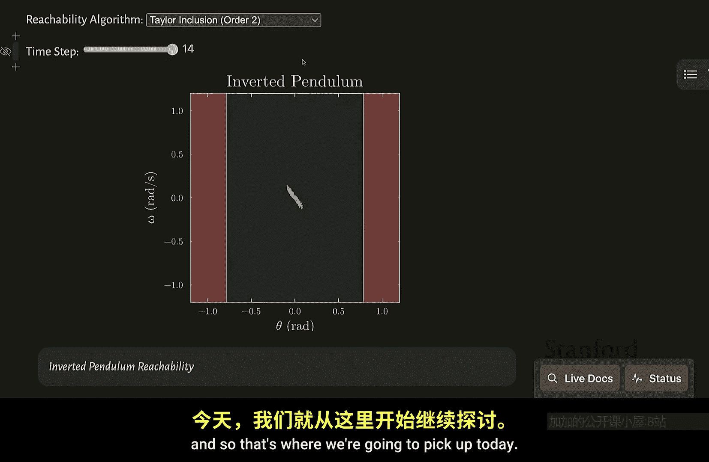
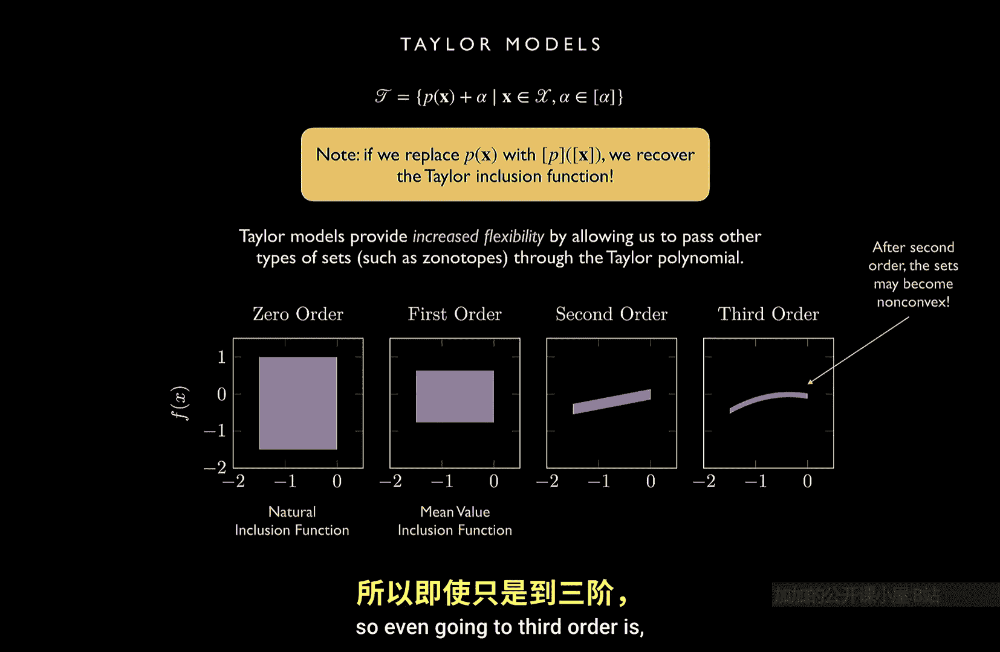

# 斯坦福大学【中英⚡安全关键系统验证｜Stanford AA228V I Validation of Safety Critical Systems】 p13 P13 Discrete Reachability -BV15RkXByEW3_p13-

Last week， we kind of left off talking about nonlinear reachability。

And we were talking about how it's kind of harder for nonlinear systems than it was for linear systems because。

We have these window up with these sets that can be like non convex and we need to。

 it's much harder to work with them and so what we ended up doing was just showing a whole bunch of different ways to over approximate these sets。

And so we came up with these things where we were passing intervals through these nonlinear functions。

 so we had like interval arithmetic， and then we showed for these more complex functions。

 we need something called inclusion functions。😊，And so we started with the natural inclusion function。

 which was just the thing that allowed us to replace every single elementary function in our nonlinear function with the interval counterpart。

😊，But we showed that that worked kind of poorly， so we saw like when we applied it to the inverted pendulum。

 the reachable set quickly got really， really big to the point where we couldn't really say anything about the safety。

So then we were like okay， we need to do something better so we went back to our calculus class and we remembered the mean value theorem and we came up with this mean value inclusion function and then we saw that that did slightly better at least for a little bit。

 but then in the end it still ended up kind of blowing up and we weren't able to show safety。

And then we saw that those were kind of just special cases of this general thing called a tailor inclusion function。

 and so we showed how we could kind of go up to higher orders。

 but we left off last week and we were still having this problem where it's still kind of pullinging up we still have too much of approximation and we were all kind of annoyed that when we were doing everything with intervals we could only get hyperectangular sets out because we put an interval。

 we get out an interval and then we take the Cartesian product of those intervals and we end up with a hyperectangle and so all we could get with hyperectangle even though it looks like this set you know wouldnt a hyperectangle wouldn't fit necessarily very well。

And so I kind of left you all hanging over the weekend。

 I'm sure this is all you could think about and you're just in major suspense about how we were going to possibly deal with this and not have hyperectangles anymore。

 and so that's where we're going to pick up today。

Okay， so as I said last week we talked about intervalrithmetic and then we talked about inclusion functions。

 and then I told you at the very end there's this thing called Tayloror models that will allow us to not have just hyperrectangular sets。

😊，So the idea here is that inclusion functions， no matter how high the order。

 so even if we have a  tenth0th order Taylor inclusion function。

 we're still only ever going to output a hyper rectangular set。

And so then now we're going to talk about this thing called Taylor modelss。

 which allows us to represent much more expressive sense。But before we get into that。

 I just wanted to follow up from last week， so I really wanted this mashup of Taylor Swift and Taylor inclusion functions and chat GBT wouldn't give it to me。

 but given the advice we got last week about how to do this was able to create an image of a person who looks like Taylor Swift is not Taylor Swift just has very similar features to Taylor Swift and is now in a matchshup with a Taylor inclusion function。

 so here you go I think。Okay， what's sort of like a DNA hereel looks sunred。

This one or this thing this top DNA Oh this thing。 Yeah， I mean， similar to Taylor series。

 it's all math and science。😊，Yeah， this also doesn't really say it says kind of tailor in the sh I don't know。

 they haven't quite figured out how to write yet， I guess generator can't read yes。Anyway。

 there you go， in case you were really looking forward to that mashup as I was。Okay。

 so back to Taylor models。So tailor models are basically the thing where we say we have some input set now so it doesn't have to be intervals like it had to be before。

 we can have just kind of an arbitrary set here， and we're going to say a tailor model。

 we're going to apply a polynomial to this set and that polynomial has a specific meaning which I'll talk about in a second and then we're going to add on some value alpha that comes from an interval。

And so the idea here is that the polynomial is actually just the Taylor polynomial of degree and minus1。

So if we have a tailor model of order N， we're going to use the Taylor polynomial up to degree n minus1。

 and then the alpha here is just an interval remainder， you can kind of think of it like a remainder。

 which I'll explain in a second。😊，So the Taylor polynomial just looks like this is just the terms of the Tayloror model or Taylor polynomial up to n minus1。

 and then the interval remainder， which I'm not like deriving here for you or anything I'm just telling you that this works。

 it involves actually kind of the inclusion function for the n derivative of the function。

 so we're basically passing intervals through the n derivative and that gives us the remainder。😊。

And sometimes this is called the La Grande remainder。

And what's kind of cool about this is the way that you can really think of it is so tailor models as you hopefully learned about in calculus。

 those are things that can approximate the function。

 so like the more terms you have of your tailor model。

 the closer you get to approximating the actual function。

 so you can think of this polynomial as giving us an approximation to the function that we're trying to pass our set through。

😊，And then there's like some remainder， you know， there's all those higher order terms that we're not including。

And so what this kind of interval remainder does is bound the error that we could have in our approximation。

 so it's saying this polynomial approximates the function as best we can。

 and then we're just going to add on this interval at the end to bound all of the rest of the error that we could have so that way we still know that no matter what our output set is going to be an over approximation of the points that could actually be reached。

😊，Any questions on that？Yeah， why does alpha live in some alpha like it like found it somehow。

 but like what is the alpha and the alpha so it's like， it's this particular remainder term。

 I didn't derive how you actually get that。嗯。So this is like requiring creating this like inclusion function and whatnot。

 that's all we're going to do， there's actually ways where you could instead of passing an interval through this you could pass like a zonotope through it so that you get a tighter bound。

 we cite that in the book but we're not actually going to like get into it。This is a。

Well when you're， when you're doing the Tayloror series， all the apps are box by a natural。So。

What is what is like you see how you have like bracket。

end this has the natural inclusion function for extra im of that。好。

And so one thing that's kind of cool about this is it turns out and maybe you can stare at it longer on your own time to see that this is true。

 but it turns out that if we just replace this P of x here with the natural inclusion function for the polynomial so we just pass an interval basically through this P of x instead of passing this arbitrary set that we're going to pass we just recovered the Taylor inclusion function。

 so basically the idea here is like，😊，We want to pass arbitrary sets now through these functions。

But if we were still passing intervals through them and we just pass an interval through this Tayloror model。

 we actually get the exact same thing we would get if we use the Taylor inclusion function。

But the idea here is that we don't have to do that anymore so we can tailor models provide increased flexibility by allowing us to pass like other types of sets through the tailored polynomial so in the linear reachability lecture we saw how we could pass all these kind of polytopes through different functions and hopefully we would want to be able to do the same thing here and so now we can kind of do that。

😊，Okay， so here's kind of what this looks like， so I'm showing the same function that we've been working with for a while。

 but with a different interval this1。And you can see kind of as we increase the order of the Taylor polynomial for the Taylor model。

 then we get better and better over approximations。

At the beginning it's not so great and it turns out actually for a zero order tailor model。

 maybe this is an exercise you can do on your own time。

 you'll see that it actually just reduces to the natural inclusion function。

A first order tailor model just reduces to the mean value inclusion function so we've actually added like nothing interesting yet。

 but then if we look at the second order Tayloror model， this isn't a hyperrectangle anymore。

 this kind of shaded purple set it's now actually a polytope which is great because that was like a whole goal we can now get like polytopes out。

 we don't have to have these hyperectangles anymore。In third order。

 it's actually kind of hard to see so I'll kind of get rid of all the other lines that are there。

The third order set is actually like this non convex smooth like funky funky shape here So the idea here is like after second order we're actually able to get sets that become non convex Yeah so what stops us from doing like you know 50th order just the point。

😊，I know is just like a line I guess yeah yeah so the fact that this set becomes non convex like we can make this third order thing and it's nice in1 d and I can plot it and see what it looks like but in general like non convex sets are really really difficult to work with so even going to third order is like typically pretty difficult for like anything higher than what to mention。

Okay， well I guess the mod is kind of straightforward right。

 but then working with it Yeah so then it's like okay。

 I have this set that's like this 15 degree polynomial plus interval and I want to know if it intersects with this other set that's like a 15 degree polyno。

