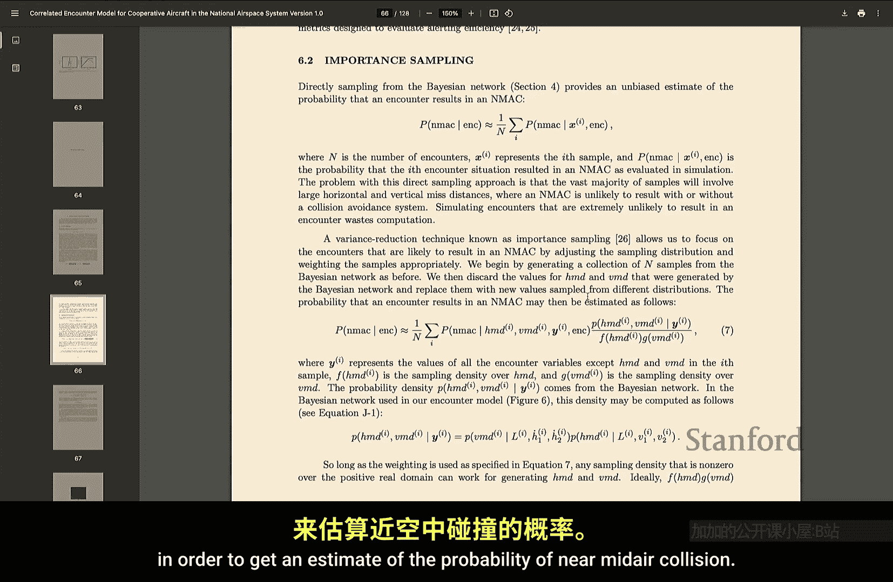
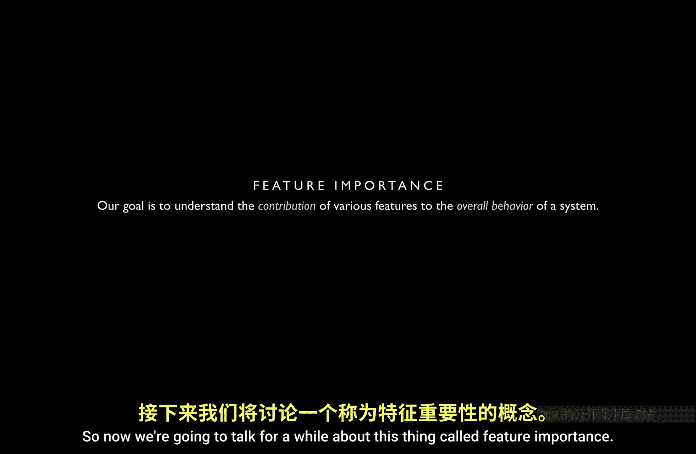

# 斯坦福大学【中英⚡安全关键系统验证｜Stanford AA228V I Validation of Safety Critical Systems】 p14 P14 Explainability -BV15RkXByEW3_p14-

So we've been talking about collision avoidance as one of our example problems。

 and many of you know both Michael Am worked on a system called AX。

 which does airborne collision avoidance。And what's really cool about this is I mentioned。

 I think at one point in this class， they like trained this model of the airspace on nine months of radar data across the continental United States for those of you who took AA228。

 this model is actually represented as a Bayesian network， which is pretty cool。

 and you can basically sample aircraft encounters from this Bayesian network in order to simulate two aircraft flying at each other to understand whether or not your system will be preventing a near midair collision or an NMAC。

And so what you want to end up computing is the probability that with your system the。

Aircraft result in an near mid air collision， given that they're in some sort of encounter scenario。

 and so you could do that by just sampling a bunch of encounters from this Bay network and then trying to。

See how many of them result in NMX when you use your collision avoidance system。

But as they mentioned in the paper and as we've kind of talked about quite a bit in this class。

 is that this approach tends to be quite inefficient because you're not going to get very many near midter collisions because in the airspace it's generally pretty safe already。

 like you're not in a lot of scenarios where you would result in a near midairic collision。

 which is a good thing。And so if you want to get kind of a better estimate on these things。

 you can actually sample from a different distribution by kind of biasing the distribution after you sample from a Bayesian network to have smaller vertical and horizontal mist distanceistances and then that will give you the more interesting behavior you need and then you can do this kind of importance reweighting in order to get an estimate of the probability of near meter collision so there's kind of just a cool。

Real world example of important sampling helping out in basically estimating the probability of collision for the ASX collision avoidance system。

So yeah， if you guys are interested in more， I'll share this paper on Ed， it was written by Michael。

 so it's a course of wonderful paper and you can check it out。You the use of slash。They use this s。

 although I'm not so sure about this like multi like italicized， I don't know。

 but this was years ago so。You you've grown since then many of you guys。😊，mindsetGrowth mindset。Okay。

 cool。So with that， we're going to talk about explainability today。

And so kind of so far in this class we've actually kind of just been like this so we've been like we've either been like it doesn't work or it does work like we found failures。

 we estimate to made the probability of failure we sometimes prove that there were no failures and sometimes that kind of gave us insights into what was going on but we never really explicitly explaining like why does it work why does it not work we're just kind of like it works and sometimes that's okay sometimes you can just be like all right it works we have a proof that it works so I'm glad I'm just gonna go for it but sometimes it really does matter like why it actually works or why it's doing what it's doing because you could get fooled by like it could always be working and all of these things that you're validating over but maybe there's some metrics that you kind of missed out on and it turns out would you like really poorly on those metrics and if you can instead kind of explain the behavior of a system and be like okay the system is making this decision or it fails in this way because of this this and this then you might have a better idea of like what's actually going on and you can feel more confident when you deploy the system in the real world。

So sometimes it's good to know why it actually works。

So that's what we're going to do today we're going to talk about a whole bunch of different techniques for explainability。

 we'll start with policy visualization， then we'll talk for a while about feature importance。

 we'll talk about surrogate models for explaining policies and then we're going to talk about the last two topics kind of briefly but we'll talk about counterfactuals and failure mode characterization。

😊，So let's just jump in here， policy visualization。

 we've actually already done like a whole bunch in this class because really what you could do is you could just visualize some rollouts of your system。

So we've done this lots of times， so for example， we could roll out our collision avoidance system a whole bunch of times and just look at what happens and so we can see there's kind of two modes of behavior。

 it either goes above the intruder or below the intruder and really this is kind of one of maybe the first things that you would do when you design a system you just roll it out and make sure it looks reasonable。

Same with the inbroidrated pendulum， we can see like for the most part。

 it just kind of stays upright with an angle of zero， and then sometimes it falls over。Okay。

 so that's one thing you could do。 Another thing you could do is try to plot the policy of the agent。

So let's actually look at the one on the right first， this is the inverted pendulum policy。

And what's nice about the inroid pendulum is it has a 2D state and the policy is only dependent on the current state。

 so we can look at what the agent would say to do if it was given an observation of any of these states so we have theta on this axis andome go on this axis and we can just sandche that all of this kind of make sense so for example at zero zero so that means we're perfectly upright and we're not moving at all。

We would hope then that we would just stay that way so we would want to apply a torque of zero。

 so we can see here we get a torque of zero， seems reasonable。

If we move to the right here where theta is positive。

 we get a negative torque because we want to push it back up the other way， if we move to the left。

 we get a positive torque to push it back up and so on so this is kind of just a nice sanity check to plot the policy。

For the collision avoidance system， we can do a similar thing， but now the actions are discrete。

So here we're applying a slice of the state space where on this axis we have the time to collision。

 and then on this axis we have the relative altitude between the ownership and intruder。

So you can imagine like the ownership ship is right here。

Or sorry the intruder is right here in the plot and then you could imagine if you kind of put the ownership ship at any of these places。

 this is the action that it would get so if we're like above the intruder we get told to climb if we're below。

 we get told to thecend and if we're far enough above or far enough below we get no advisory clear of conflict we don't need to do anything because we're not in like a dangerous situation。

So this is very interesting and this is actually something they did when they were first generating the policies for AsX and you can find some kind of interesting unintuitive features。

 so for example， kind of like this notch back here。

 does anyone maybe if you' taken A8228 does anyone have any ideas of why this notch isn't like filled in why it's no advisory？

Yeah， yeah， so we don't know if it's going to like whether or not climbing or descending is going to be better。

So it's kind of interesting you can discover interesting features by doing this policy visualization。

 so it's definitely something that I would recommend as you're designing systems。

And then another thing to note here for the Col avoidance policy is specifically that we're plotting a policy slice。

 so what's nice about the in pendulum is the state was only two dimensional so we could just plot the entire policy and see what it looked like。

😊，The state for the collision avoidance policy is actually four dimensional。

 so we can't just plot the whole thing at once and visualize it。

 we have to plot slices because again we don't really know how to visualize four dimensions。

And so you have to plot different slices of it。And so another kind of way to do this when you have these kind of more complicated high- dimensionional policies is to partition the state space and I know this is blurry。

 it's really bothering you but I honestly didn't have time to fix it so I'm sorry it's not blurry in the book。

 I don't know some PDF renders make this blur， I don't know what's going on but anyway so pretend it's not blurry so we can also partition the state space into a bunch of regions。

And then simulate a bunch of trajectories so we'll just imagine like all those rollouts that we had from before and then every time it passes through a region。

 we mark down what action it took in that region and so it might not always have the same like vertical rate or previous action withins in these regions so it might not always take the same action in each region but we just keep track in each region of the action that it took and then for example we could maybe plot the action that was taken most frequently in each region。

What is this。We're just trying to be able to visualize the policy that's four dimensional and this we just rolling out a bunch。

We were plotting the action that got taken as we were doing the。Oh。

 penlum it's like history dependent， that's what。On the pendulum it's not history dependent Oh actually this one's not history dependent。

 it's just because we're plotting a slice of the state space that you might get different ones but that does bring me to my next point which is what's really nice about this method is it works for non-markovan system so if it is history dependent we can't just like look over the state space and be like in this state I'm going to take this action because it also depends on how you got to that state sometimes and so in this case we can actually just simulate a bunch of rollouts than we know how we got to every single state and we can still make this kind of visualization so this is nice if you have like a complex potentially non-markovan system as well。

Okay。Great， so that's the first thing so just visualize your policy that's something that's always pretty simple to do。

 but also can be quite useful in finding bugs。Okay。

 so now we're going to talk for a while about this thing called feature importance。

 I think this is what a lot of people think of when they think of explainability。😊。

