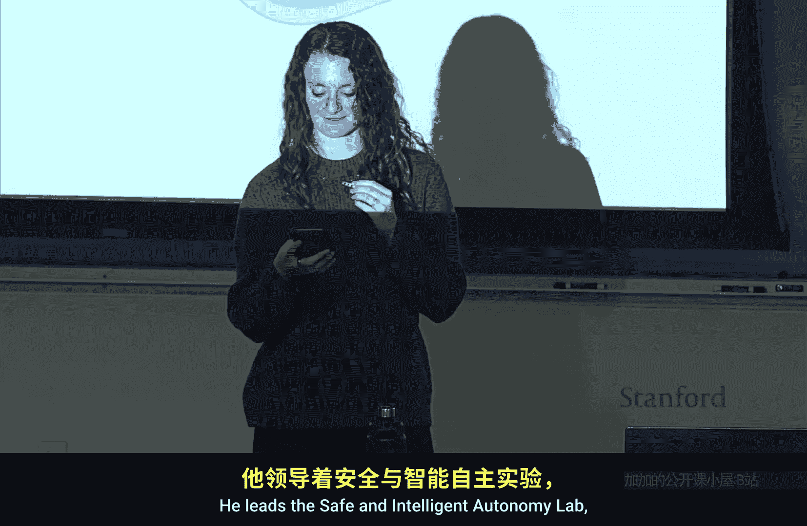
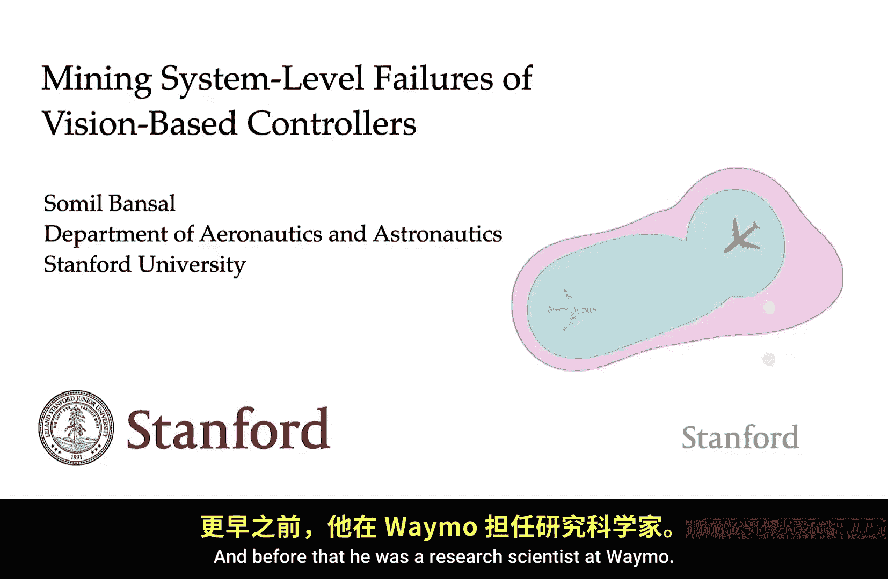
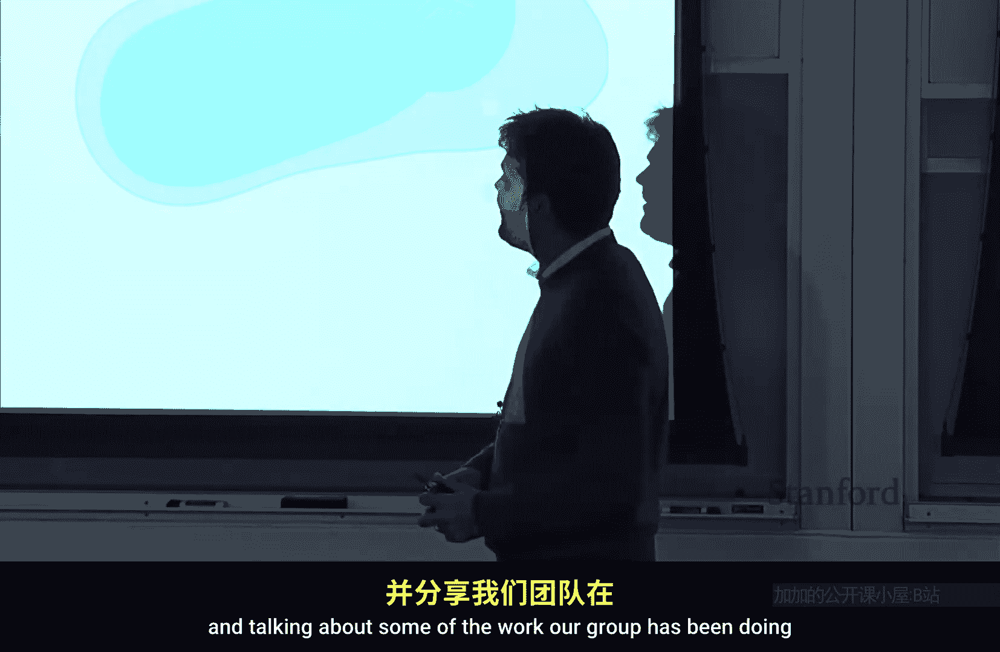
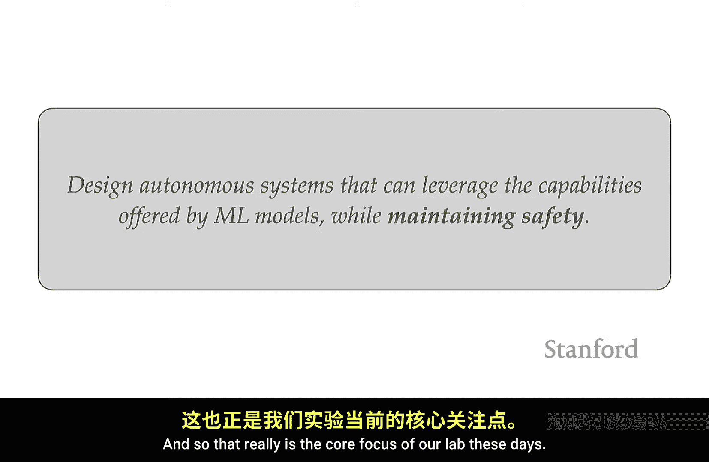
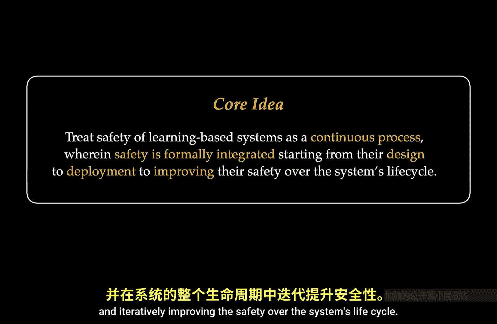
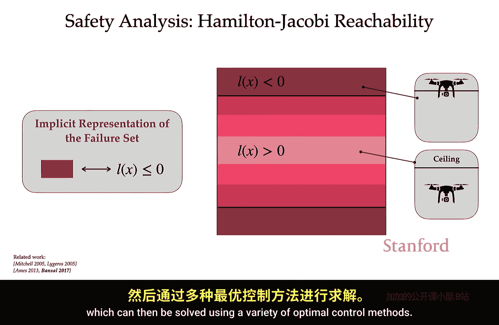

# 斯坦福大学【中英⚡安全关键系统验证｜Stanford AA228V I Validation of Safety Critical Systems】 p15 P15 Guest Lecture： Somil Bansal, Stanford -BV15RkXByEW3_p15-

So today we have a guest lecture I'm super excited about， we have Professor Souel Bonssel。

Who's in the AA department here， he leads the Safe and intelligent autonomy La and before that he was an assistant professor in electrical and Comp engineering at USC and before that he was a research scientist at Waymo so super excited to hear your lecture。

Thank you。Hello everyone I'm Soel， first of all thank you so much Michael and Sydney for offering this wonderful course several of my students are taking this course and they absolutely rave about this so in my spring break I'm planning on catching up on the lecture videos which I have access to。

😊，And so I'm very excited to be here and talking about some of the work our group has been doing on mining failures in vision based controllers。

 which I think is quite related to some of the topics covered in this class。

So at a high level， sort of our group focuses on robotics and autonomy with the general goal being developing robot algorithms that operate with guaranteed safety and performance in new and uncertain environments。

And we focus on developing these algorithms in the context of a variety of different applications。

 ranging from autonomous drones， autonomous cars， aircraft and space robotics。And。

In a lot of these systems， machine learning is becoming increasingly pervasive in their autonomy tax。

 the predominant one still remains perception and vision。

 but now also in prediction and behavior forecasting and then planning and control as well。

And for a number of good reasons， machine learning is really good at capturing the complexity of real world situations these systems must operate in。

 which could otherwise be very hard to model using engineering domain knowledge。啊。

But not without some pitfalls， so inpoing a machine learning has also opened up a set of new safety challenges and you know the one very close to my heart is this rollback of cruise cars from the San Francisco city and since then actually they have terminated their operations altogether in autonomous driving。

And。The issues were severe enough that the US government now almost when an appears is back。

 but also a couple of other governments， and notably UK government passed this executive order to prioritize discussion on AI safety。

 both for autonomy but sort of AI more broadly。And。So coming back to autonomy。

 there is this tension that we have a lot in autonomous systems today。

 which is how can we leverage the capabilities offered by modern machine learning methods while also maintaining safety。

 and so that's really the core focus of our lab these days。

And our approach to sort of overcoming this challenge is to think of safety of AI based systems more as a continuous process。

 where safety is integrated in different stages of this data cycle or the system cycle。

 starting from the training time to the deployment of the systems and iteratively improving the safety over the systemss life cycle。

And so that's unoutful， what that means really is we think of safety in three different stages。

 we start from the training time and we ask ourselves。

 how can we programmatically incorporate safety requirements in the training phase itself so that we get safety policies or safety of AI systems as a result。

And so one way to think about this is we are asking questions of how to ensure safety within the training data distribution。

But that is not sufficient when we deploy these systems in new and uncertain conditions。

 so we have to ask ourselves， you know， when are we going out of distribution and how can we adapt our safety corresponding to these out of distribution scenarios？

And finally， we focus on developing methods that allow for stress testing of these systems to mine their safety critical failures and use them to improve the design of the system。

 so thereby closing this loop。And so together this framework allows for our continual safety assurances for learning the systems where safety is provided provisionally during the training time。

 they are adapted during the operation time and they are improved over the systems life cycle。

But for the remaining time that I have today， I want to focus on this last component and in particular the stress testing component。

 which is how can we stress test the learning based controller to minor safety critical failures and then I will talk about how can we use those failures to improve the system。

And we have been particularly asking this question in the context of vision based controllers for two reasons。

 one vision based controllers are becoming quite ubiquitous now in the autonomy stacks。

 but also traditionally stress testing these controllers have been very challenging for controlled thetic tools because of the high- dimensionmenality of vision based controllers and also their complicated input spaces like RGB images。

So let's talk about how can we stress as these systems or this based controls？

So let me first formula the problem mathematically， so we are given a system。

Wch has so this could be a row， which has some dynamics with state X and control U。

Now at each state we have a visual sensor that gives me some visual observations。

 so these could be RGB images or point clouds， which are then taken as input by the vision based controller and that gives me the control to be applied on the robot so this forms a closed loop system。

And we also assume access to a simulator that we can use for stress testing this control。

And so our goal here is to find these safety critical failures， in other words。

 find the visual input's eye that leads to the safety of the overall or that leads to the violation of safety of the overall system。

And。Really， the approach we take here is to cast this failure discovery as a reachability problem。

And so the way to do that is essentially we can concatenate the visual observation function along with the vision based controller to obtain an equivalent state based policy for the robot。

And so I can simplify for distress testing purposes。

 my closed loop system as the robot in closed loop with this equivalent state based policy。And。

And on this particular closed loop system， we can use a lot of existing visibilityability based methods that at the end of the day compute what we call backward reachable tube or some version of backward reachable tube。

 which。At least in English means that the set of all initial states of this system。

 which will eventually steer this system into some predefined failure region under this controller。

 in our case， this controller。So what I want to do is I want to talk a little bit about what this backward re tube is and how can we compute this backward reable tube and then I'm going to come back to this problem and talk about how that backward re tube could be useful to find the safety critical failures that I'm after。

So let me give a five minute primer of Hamilton Jacobco reachability。

 which is one of the reachability methods to compute this backward reachable tube。

So in visionary analysis we start with the dynamics of the underlying system。

 which we assume has some state X control U and disturbance D disturbance here could represent the modeling uncertainty in the systems so for example。

 we might not have fully model the system or could be some external disturbances that we may want to safeguard against。

Now， given these dynamics， once again， the key thing they are interested in is the backward reachable tube of this system。

 which is the set of all initial states from which it will be ultimately driven to an undesirable set of states。

 sometimes also effort as failure set despite the best control effort。

I totally what that means is let's consider a very simple example。

 imagine there's a quad order flying longitudinally in this room。So in this particular case。

 ceiling and floor might be that failure set that we don't want the quad order to crash into。

And this light red region over here is the back reachable tube。

 meaning that if the quad starts inside this set， then no matter what it does。

 it will eventually crash into ceiling or the floor。

 or in other words it will eventually enter the failure set。

The converse of this backward reachable tube is this blue region or the safe set and visibilityability。

Analysis provides the guarantee that if the system starts inside this set。

 then there exists a policy to keep it inside this set at all times in other words。

 this blue set is control invariance set。And the way we compute this blue set and the corresponding safety controller is by converting this whole safety problem into an optimal control problem。

 which can then be sold using a variety of optimal control methods。

And the first step to do so is to implicitly represent our failure set such that you know this function with which we are using to implicitly represent the failure set is negative inside the failure set and positive outside。

 So in this particular case， it should be negative inside the ceiling and the floor。

