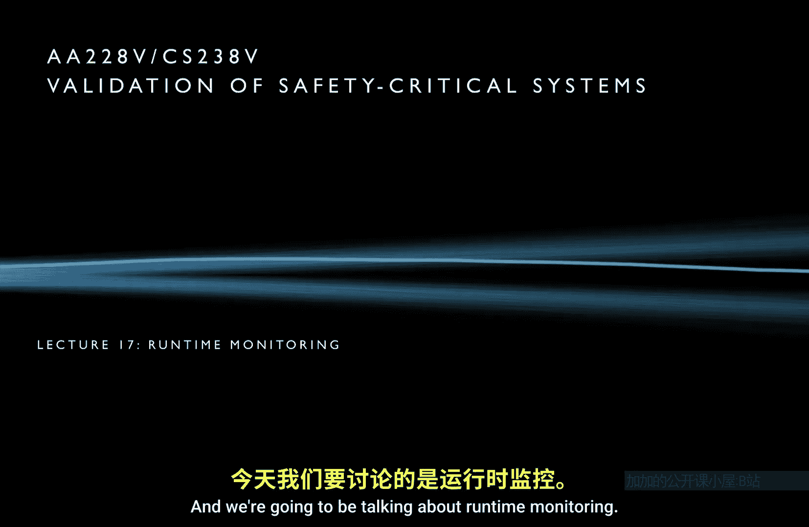
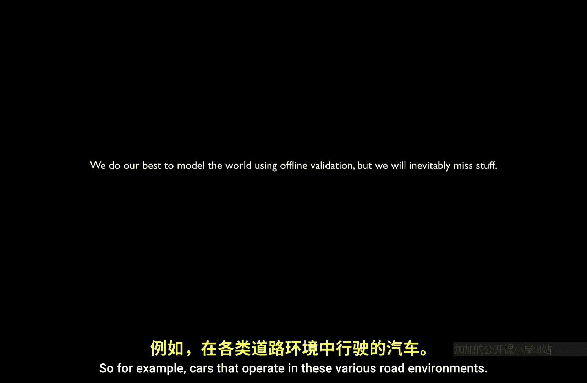
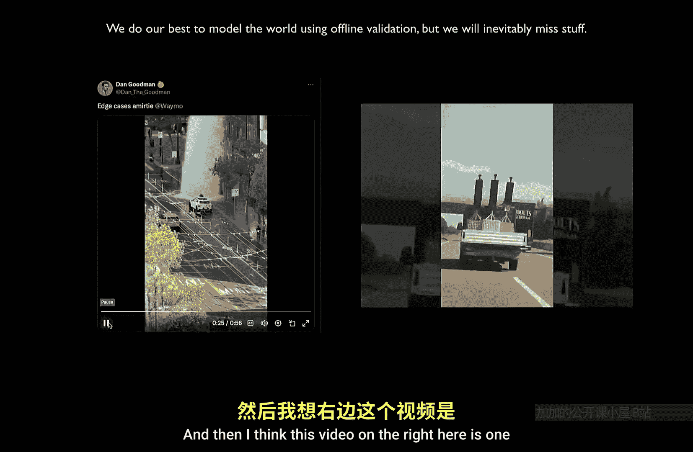
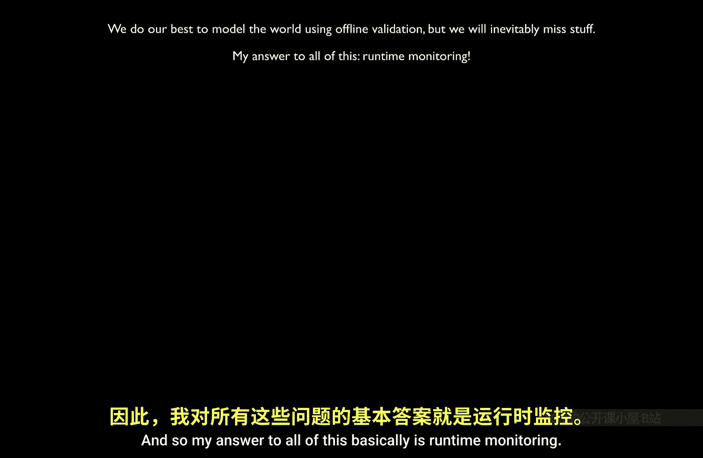
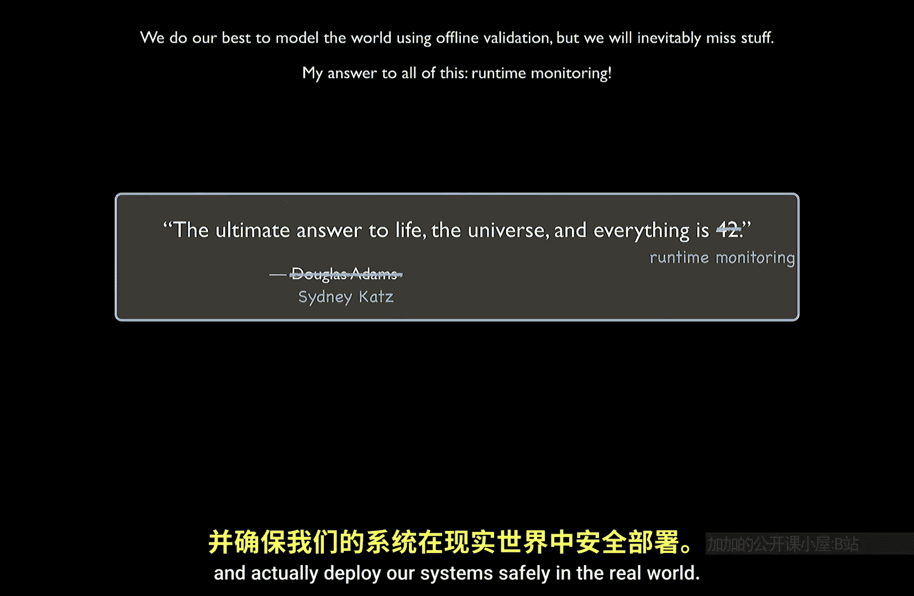
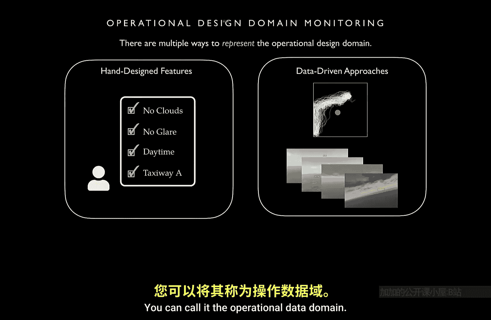

# 斯坦福大学【中英⚡安全关键系统验证｜Stanford AA228V I Validation of Safety Critical Systems】 p16 P16 Runtime Monitoring -BV15RkXByEW3_p16-

Welcome back everyone， I hope you' all had a good weekend so we're going to today get into the very last chapter of the book so we've made it through all 12 chapters which is pretty cool and we're going to be talking about runtime monitoring we have。

Talked about a whole bunch of methods up to this point for validation and all of these methods we can kind of call offline validation methods。

 so these are things that we would do potentially before deploying the system into the real world so we might find failures。

 estimate probability of failure， try to get some formal guarantees， do some explainability。

And we're doing all of this based on some model of the world that we made。

 which we talked about some ways to make models in like the second and third lecture。

But we kind of said it's really hard to model all possible things that we might see and inevitably this model is probably going to miss stuff。

 especially if we're trying to model systems that operate in very complicated environments。

 so for example cars that operate in these various road environments。

 so for example the video on the left here is like this crazy playing this crazy edge case that like this Waymo vehicle sees where it's like。

😊。

I don't know I'm sure that like giant random fountain in the middle of the road was probably not something that was in the model maybe like a fire hydrant exploded or something and then it kind of just drives up to it stops and doesn't really know what to do but at least it doesn't go through it and then I think this video on the right here is one that Anthony showed during his guest lecture but basically what's going on is there's like a Tesla that's driving down the road and it keeps detecting all of these traffic lights and it turns out that it's following a truck that was transporting traffic lights so again these are just like these crazy edge cases that like we can try as much as we want to incorporate every possible edge case into our model but at some point we're just like not going be able to think of every possible thing that could happen。

嗯。And this kind of brings me back to a slide from my second lecture where we were talking about modeling and I was talking about like my general thoughts on making models。

 and I was identifying some of these key challenges here。😊。

And I said kind of one of the main key challenges is that we need to end up with a model that's expressive enough to capture all possible scenarios that the system may encounter。

 so random water shooting out of road or traffic lights on a truck we would want our model to be able to capture all of these possible things and I mentioned to you that basically every single time I give a talk on validation it seems like I always get at least one question where someone comes up and they say totally valid question which is just how can I capture all possible scenarios that my like crazy whatever system is going to end up in like I don't even know they all are like I probably wasn't going to think of that truck on traffic lights on truck thing。

So how do I deal with this so again it's a totally valid question because it's a really hard thing to do and so my response I told you in the psy lecture is always like yeah it's totally a problem。

 this is really hard but I mentioned that there's some hope here and that you should stay tuned for the runtime monitoring chapter so here we are so runtime monitoring is going to be the solution here。

😊，So again we kind of do our best to model the world when we do our offline validation but we're inevitably going to miss stuff and so my answer to all of this basically is runtime monitoring so you may have seen this wonderful quote from Hitchhiker's Guide to the galaxy by Douglas Adams that's the ultimate answer to life the universe。

 the universe and everything is 42 I would like to revise it slightly and just say that the ultimate answer to life the universe and everything is runtime monitoring so I just I'm a big。

 big proponent of runtime monitoring I think it's going to be absolutely necessary to kind of catch all those things we didn't catch an offline validation and actually deploy our systems safely in the real world。

Okay， so with that like the goal of runtime monitoring is to basically flag situations that might be hazardous when they occur so we can trigger some kind of fallback mechanism。

 so we should ideally understand that we're in a situation that maybe we didn't validate for we haven't seen before。

 we don't know what's going on and we can trigger some kind of fallback mechanism so that could be something like entering into a safe mode。

 maybe if you're driving it's just like stop the car maybe if you have like some human operator that's in the loop you could transfer control back to this human operator lots of different things you can do we're not going to talk super specifically about that but we're going to focus on today is like how can we flag these situations that might be hazardous。

Okay， so that kind of brings me here into the plan for today so we're going to talk about lots of different ways that we could do this one way is operational design domain monitoring。

 that's what we'll start with， then we'll get into uncertainty quantification。😊。

And there's two different types of uncertainty we're going to talk about。

 the first one is output uncertainty and the second one is model uncertainty。And then super briefly。

 we're going to talk about failure monitoring， and then this is my last lecture。

 so we'll wrap up the course as I said， okay。😊，So let's jump in with operational design domain monitoring。

Okay， so this idea behind and by the way， I think some of you may have heard of like out of distribution detection techniques。

 there's different ways to kind of categorize this。

 I think this is very similar to what you would think of when you maybe hear out of distribution detection so you can kind of equate these two in your brain。

 but for our purposes we're going to call this operational design domain monitoring。😊。

And the idea is that systems have these things called operational design domains or ODDs。

And these are basically the set of conditions under which we've designed our system to operate safely。

 so this could be like daytime conditions with no rain or something like that。and basically。

 the idea here is like what this could be is like actually the set of conditions that。

The model that we used for validation covers so we created some model。

 we validated against it and that model contains some set of conditions。

 it models some set of conditions and then the idea is like if we then operate outside the ODD or the operational design domain then we are outside of the conditions that the model we use for validation covers and so our validation results may no longer be valid so basically the general idea here is just that we want to flag situations that could potentially be us operating outside our operational design domain and in that case we would have basically no more guarantees on safety or like our validation resultst don't mean anything anymore。

😊，And so for example， like there's a decent chance I would imagine that truck transporting traffic lights was not in the operational design domain that Tesla defined for their self-driving car understandably because this is like a weird。

 crazy thing to kind of contrive in your mind。that you would have had to come up with and so kind of the next best thing that we can do。

 I would say， is to monitor at runtime whether a system is operating within its operational design domain。

 which is an non trivialal thing to do and we're going to talk about different methods to do this but this is kind of our goal。

Okay， so in order to monitor whether or not we're in the operational design domain。

 we have to figure out some way to represent what this thing is。

 and there are multiple ways to do this。One option is to just use a bunch of handdes features。

 so for example maybe for the aircraft taxi system。

 we could say something like we designed it for days where there's no clouds in the sky。

 there's no glare coming from the sun， it's daytime and it operates on taxiway A so maybe this is like a super restrictive system but maybe that's all we tested for and if it turns out that we're outside of these conditions then we can't use the system or we say that we're outside the ODD。

And so this is something we could just write down ourselves and maybe even check ourselves on the day of before we like go deploy our taxi system。

嗯。And then there's also one more way that we could define the operational design domain。

 which is to take a data drivenri approach， so instead of ourselves hand designing all of the different features that say what's in the ODD。

 we can take a bunch of data from maybe it's all the data that we use for our validation。

So maybe like for the continuum world， maybe we like simulated a whole bunch of trajectories and we have all of these trajectories that we saw during our offline validation。

 or for example， maybe for this like intruder detection， aircraft detection system。

 we have all of the images that we trained it on， all of the images that we validated over。

 and that defines the operational design domain of the system。

So these are both like equally valid ways to do this。

 and in some cases you might want to use one versus the other， yeah。TwoSo first of all。

 this is respective or like ignorant of the model that we actually use right it's just something about the problem space and the data okay and then for the second approach。

 where's the design。When you do data driven。Definition of your design domain because I feel like when you have hand design features makes some sense to say。

 I design the kind of domain that I want to work on。

 but I feel like the right approach is much more than like distribution out of distribution perspective on this question here。

Like the word design is like let's ripping out Well， I mean。

 the data you use is a design decision I would say。Okay。

You can call it the operational data Dring or the distribution of。😊。

