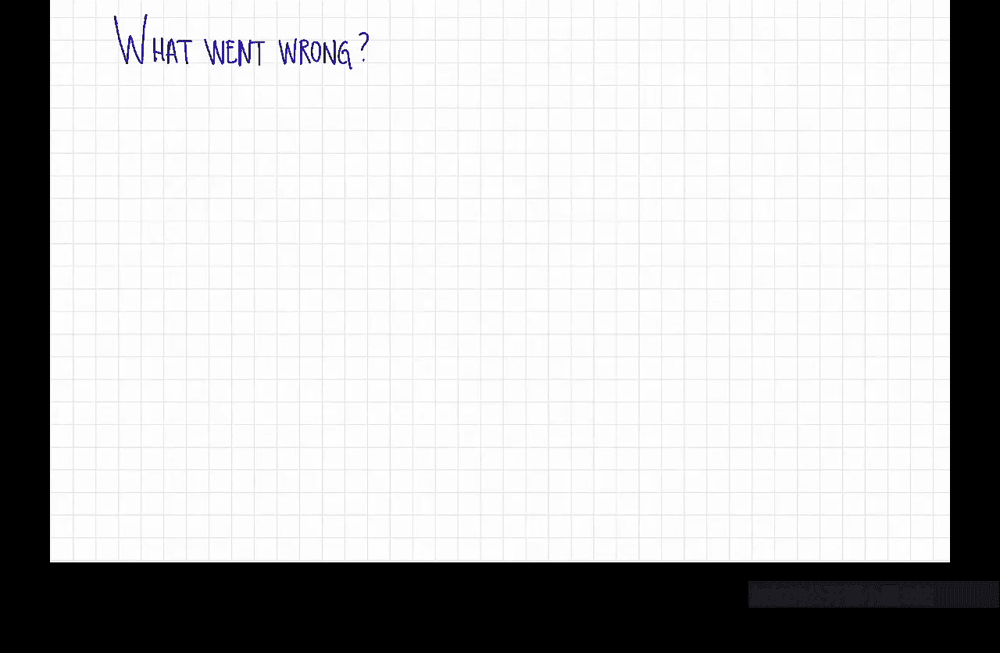
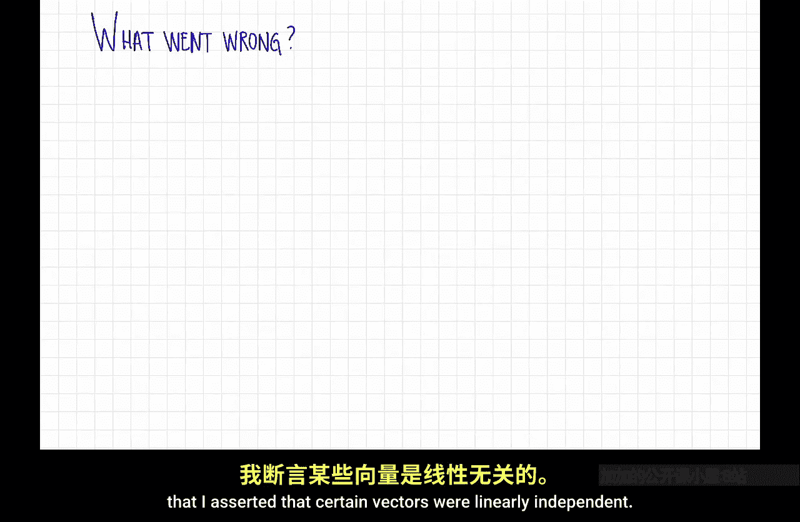
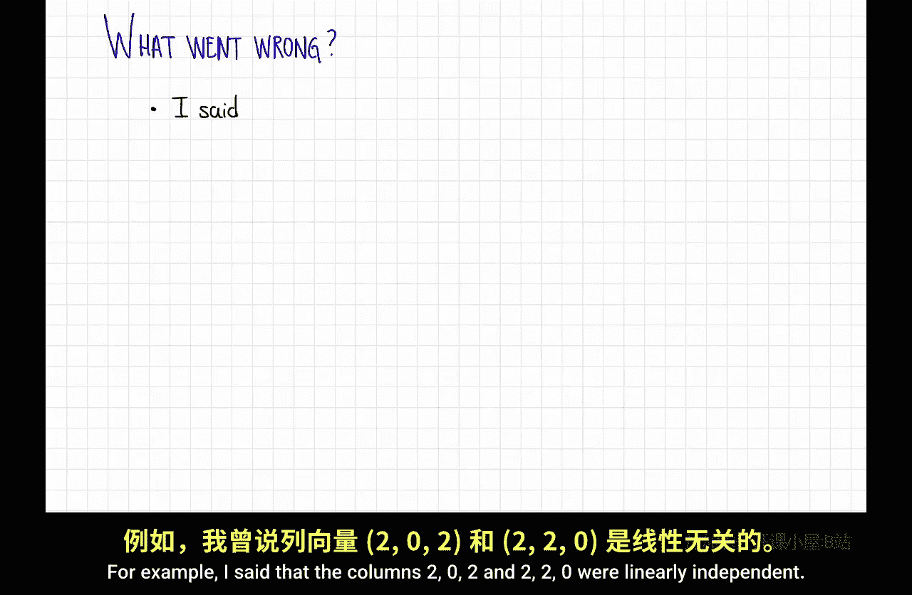
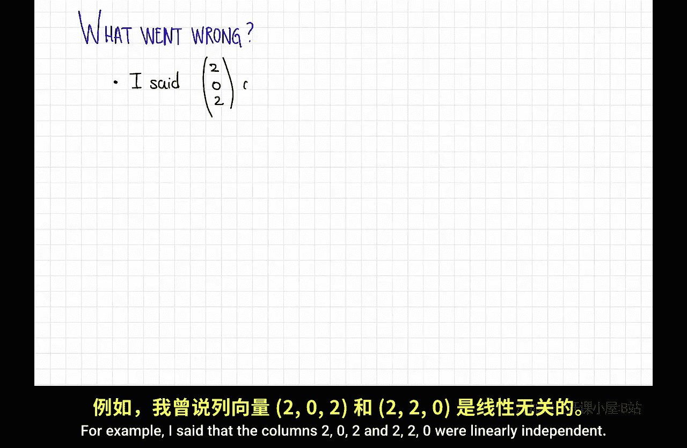
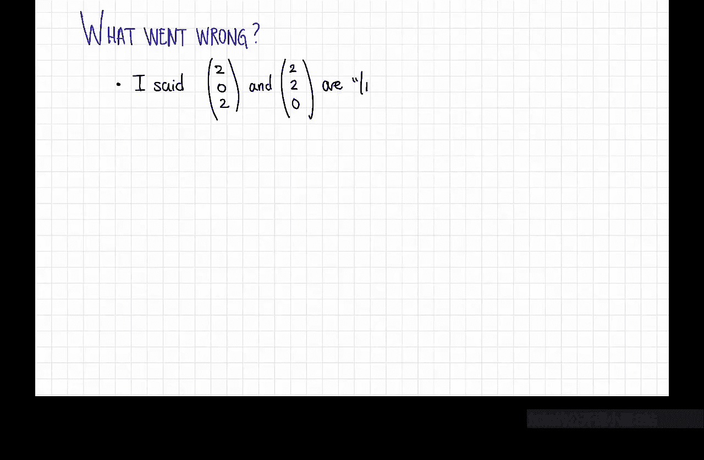
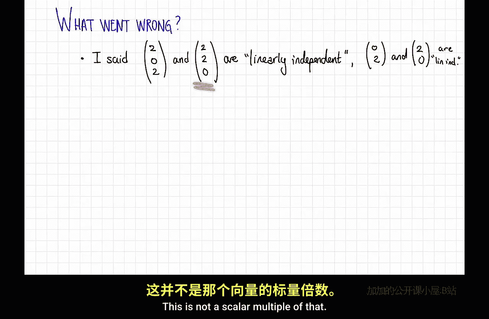
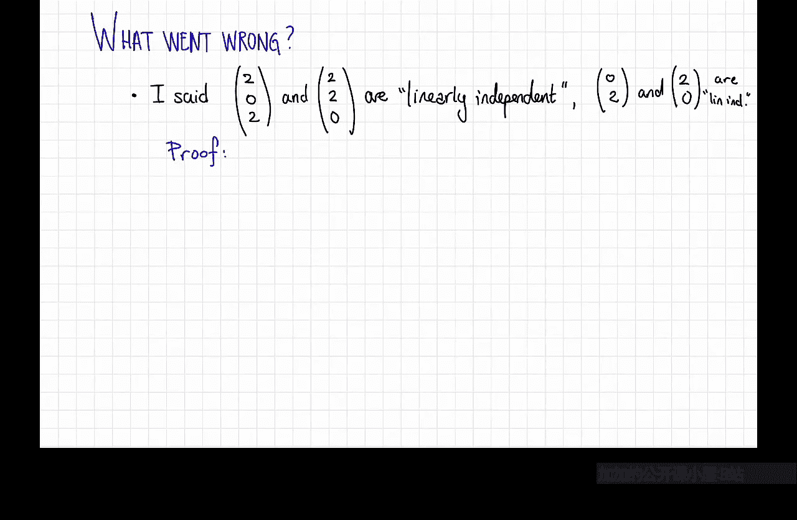
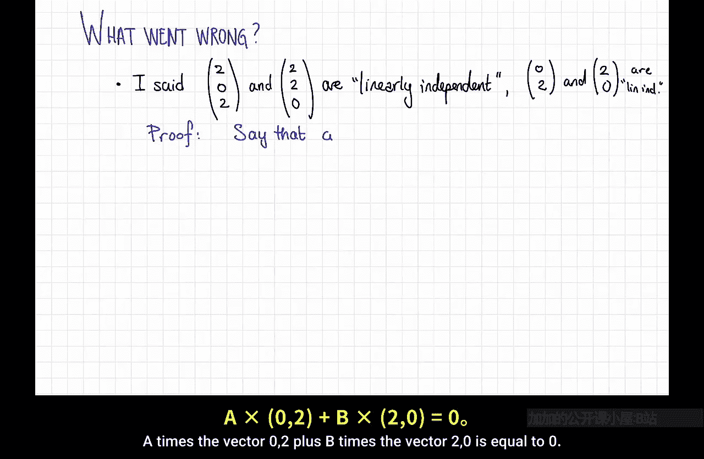
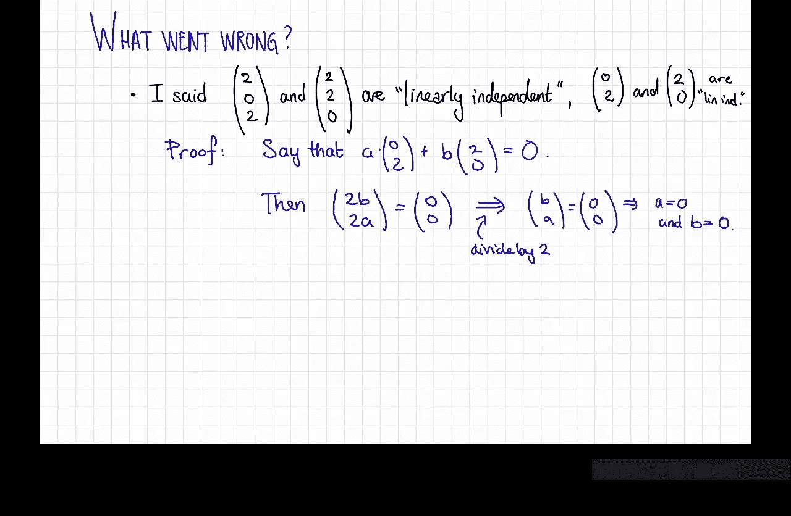

代数编码导论：p05：一个警示性的例子 🔍

在本节课中，我们将要学习一个关于模运算下线性代数可能失效的警示性例子。我们将通过一个具体的模4运算的例子，来理解为什么不能理所当然地将实数域上的线性代数结论直接套用到有限域上。

在上一节视频中，我们看到，如果线性代数在模2运算下“正常工作”，会带来很多便利。

本节中，我们来看看一个快速的例子，说明为什么我们不应该理所当然地认为这种“正常工作”总是成立。

具体来说，在模4运算下，情况似乎会变得更加复杂。

以下是一个例子。

假设字母表 Σ 是 {0, 1, 2, 3}，我们在模4下运算。考虑矩阵 **G**。

这个矩阵将作为我们的生成矩阵，其值为：
```
G = [2, 0;
     0, 2;
     2, 2]
```
同时，令 **H** 为 **G** 的转置，所以 **H** 为：
```
H = [2, 0, 2;
     0, 2, 2]
```
现在，考虑由生成矩阵 **G** 定义的码 **C**。

即，**C** 是所有 **G** 乘以 **x** 的结果（模4）的集合，其中 **x** 取自集合 {0, 1, 2, 3}²。

因此，**C** 是一个消息长度 k = 2、码块长度 n = 3、定义在字母表 Σ 上的码。

让我们尝试用这个码重复上一节视频中针对汉明码所做的同类分析。

首先注意到，对于这个 **H**，我们有：
```
H * G = [8, 4;
         4, 8] ≡ [0, 0;
                  0, 0] (mod 4)
```
这意味着 **H** 是 **C** 的一个合法的校验矩阵。也就是说，对于码 **C** 中的所有码字 **c**，存在某个对应的消息 **x**，使得 **H * c = H * (G * x) ≡ 0 (mod 4)**。

这如同之前一样，意味着 **C** 包含在 **H** 的核空间中。

至此，我们得到了一个定义在大小为4的字母表上的码 **C**，以及其生成矩阵和校验矩阵。但这里有些地方不太对劲。

首先，**H** 的核空间的维数。

如果我们沿用上一节视频中的逻辑，它应该是 3 - 2 = 1。这是因为观察矩阵 **H**，它的两行看起来是线性无关的，所以 **H** 的秩应为2，那么核空间维数就是 3 - 2 = 1。

另一方面，码 **C** 的维数应该等于2。

因为 **C** 是矩阵 **G** 的列张成的空间，而 **G** 的两列看起来也是线性无关的，所以秩应为2。

但这说不通，因为一个维数为2的空间不可能包含在一个维数为1的空间里。

所以这里有些奇怪。不过，让我们先忽略这一点，继续进行计算。

让我们尝试沿用之前的逻辑，通过观察校验矩阵来确定这个码的距离。



如果我们这样做，会发现奇怪的事情仍在继续。

如果应用上一节视频中的相同逻辑，可以证明这个码的距离至少为3。这个结论的得出，是基于 **H** 中没有任何两列是线性相关的（至少看起来是这样）。



但是，考虑码字 **G** 乘以向量 (1, 1)ᵀ：
```
G * [1; 1] = [2; 2; 4] ≡ [2; 2; 0] (mod 4)
```
这个向量的汉明重量为2。





这意味着，如果遵循上一个例子的逻辑，码 **C** 的距离小于或等于2。



于是我们得出了一个矛盾的结论：3 ≤ 2。这显然是有问题的。

那么，问题出在哪里呢？



也许你在跟随论证过程时已经发现了，我陈述了一些错误或没有意义的事情。

我所说的没有意义的主要事情是，我断言某些向量是线性无关的。

例如，我断言 **H** 的列向量 [2, 0]ᵀ 和 [0, 2]ᵀ 是线性无关的。我还断言 **G** 的列向量 [2, 0, 2]ᵀ 和 [0, 2, 2]ᵀ 是线性无关的。



如果我们暂时忘记是在模4下运算，这看起来相当合理。一个向量看起来不是另一个向量的标量倍数。



但如果我们实际查阅线性无关的正式定义，就会发现问题所在。

例如，如果我想正式证明这些向量是线性无关的，我会怎么做？



以下是一个注定会失败的证明。假设存在这些向量的一个非平凡线性组合等于0。

也就是说，假设存在系数 a 和 b，使得：
```
a * [0; 2] + b * [2; 0] = [0; 0]
```
那么我们可以得出结论：向量 [2b; 2a] 等于向量 [0; 0]。如果我们两边同时除以2，就意味着向量 [b; a] 等于向量 [0; 0]，从而推出 a = 0 且 b = 0。因此，这并不是一个非平凡的线性组合，所以这些向量线性无关。

这个证明在实数域上是完全正确的，但在模4下是错误的。原因在于，在模4下“除以2”这个操作没有意义。

事实上，我们确实可以找到这些向量的一个非平凡线性组合等于0。例如：
```
2 * [0; 2] + 2 * [2; 0] = [4; 4] ≡ [0; 0] (mod 4)
```
所以，之前出错的地方在于，我仅仅因为两个向量不是彼此的标量倍数，就断言它们是线性无关的，但这在模4下并不成立。

以上所有这些只是为了说明，当我们开始在模2（或其他模数）下进行线性代数运算时，应该更加谨慎。

在下一节视频中，我们将深入探讨，要使这种“线性代数”在有限域上合法有效，究竟需要满足什么条件。

本节课中，我们一起学习了一个在模4运算下线性代数直觉失效的具体例子。我们看到了如何错误地判断向量的线性无关性，以及这如何导致关于码的维数和距离的矛盾结论。这个例子强调了在将实数域上的线性代数概念应用到有限域时，必须严格遵循定义，并意识到运算规则的根本不同。