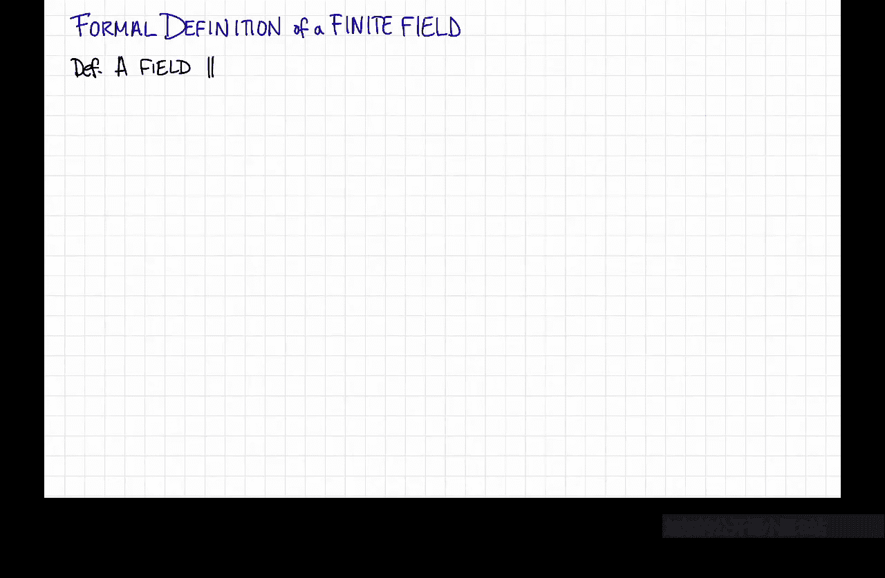
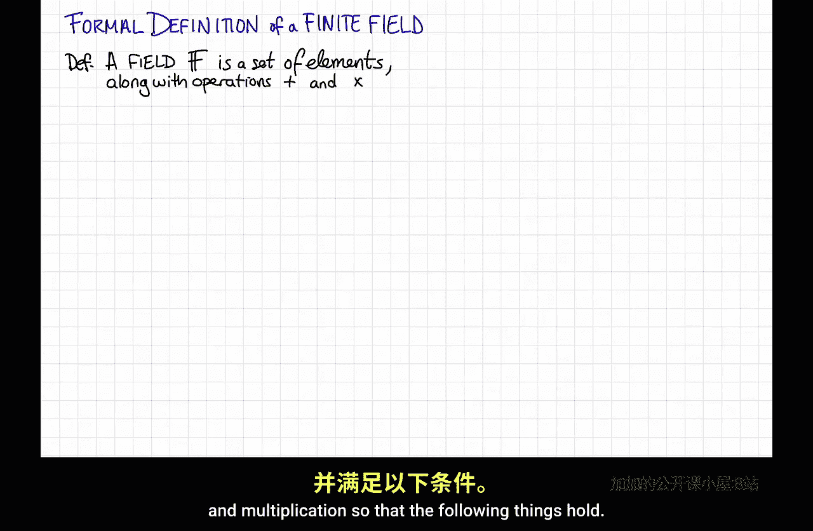
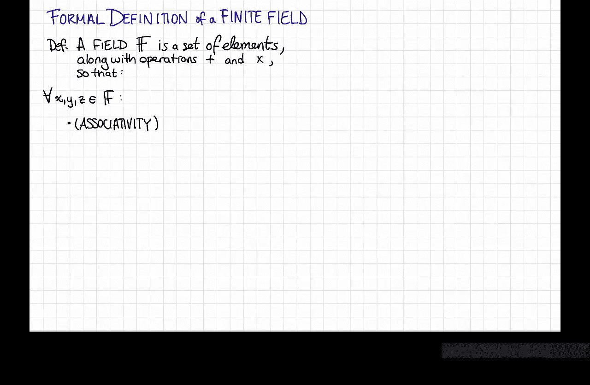
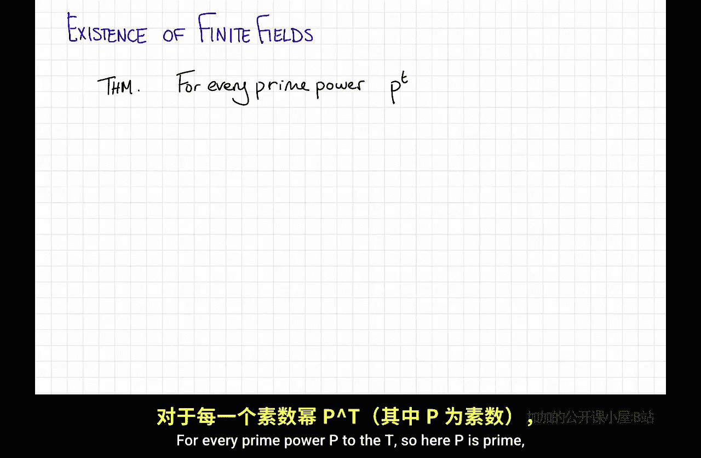
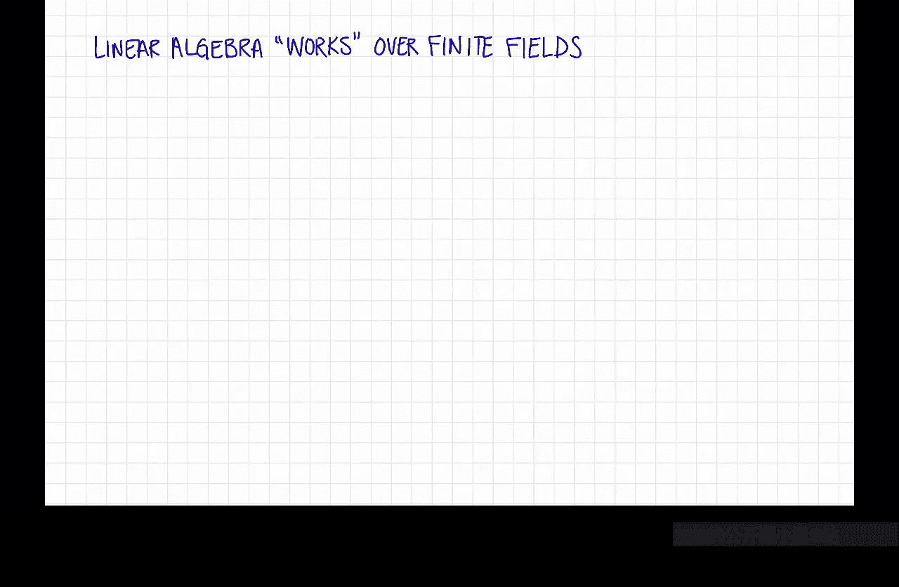
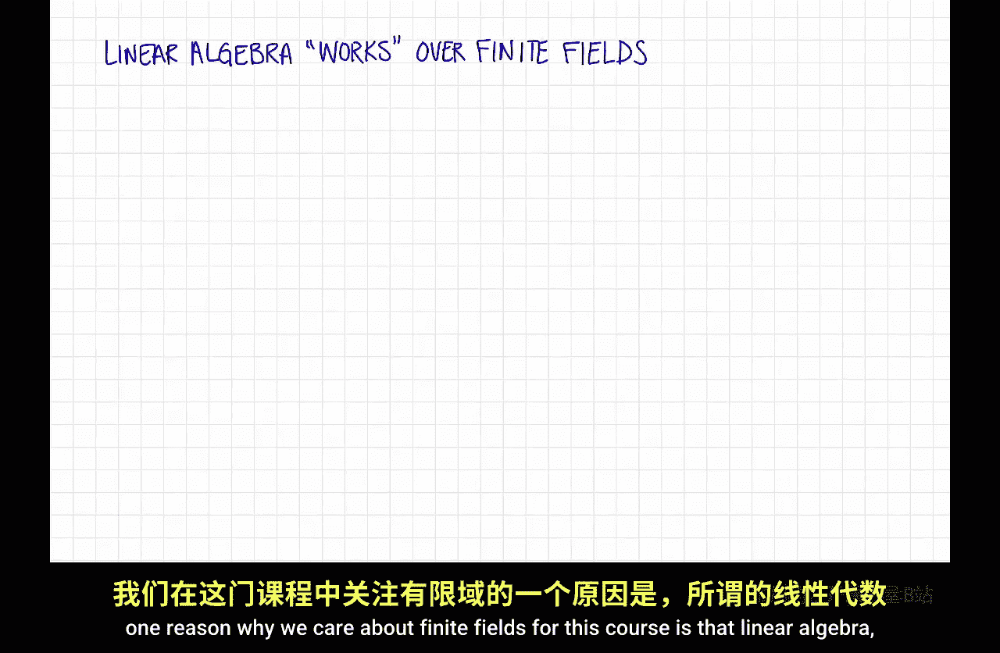
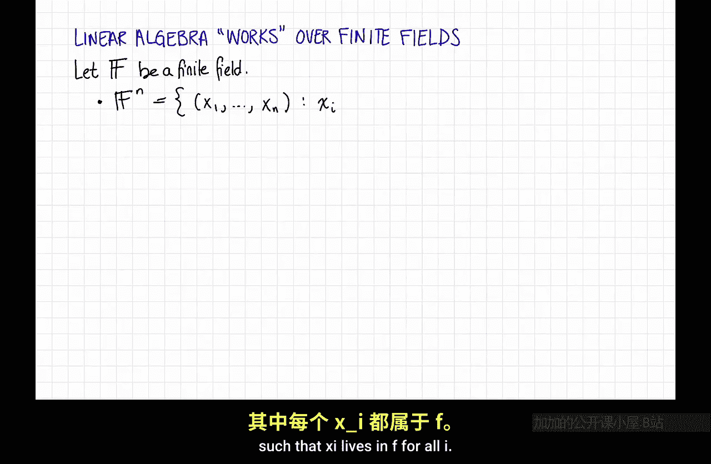
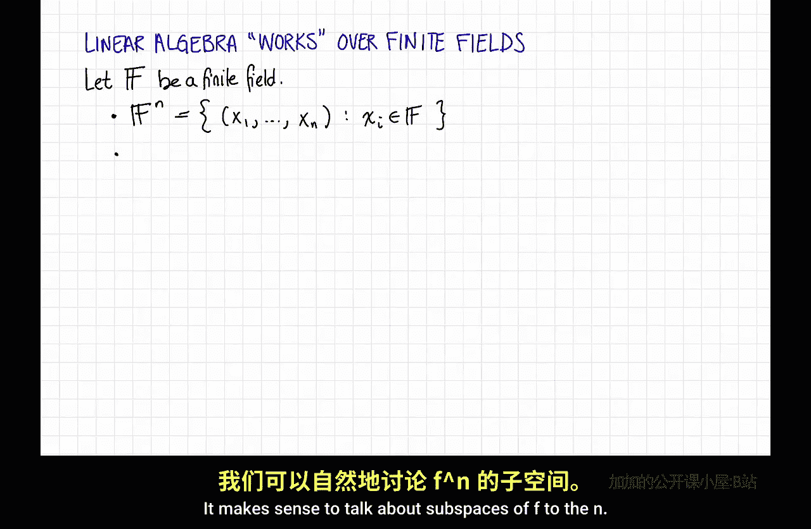

代数编码导论：06：有限域

在本节课中，我们将学习有限域的概念。有限域是代数编码理论中至关重要的数学结构，它为在线性代数运算中处理有限元素集合提供了坚实的理论基础。

在上一个视频中，我们了解到在有限集合上进行线性代数运算需要格外小心，例如在模4的整数集合上。本节视频将说明，只要我们在称为“有限域”的结构上进行运算，一切都会顺利进行。如果你已经熟悉有限域，可以跳过本节。

### 什么是域？什么是有限域？

首先，我们从一个非正式的定义开始。

非正式地讲，一个**域**是一个元素集合，你可以在其中像通常期望的那样进行**加、减、乘、除**运算。

那么，一个**有限域**就是一个**有限**的元素集合，你可以在其中同样自由地进行加、减、乘、除运算。

现在，让我们将这个定义形式化。

**定义**：一个**域** **F**（我几乎总是用黑板粗体 **F** 来表示一个域）是一个元素集合，连同两个称为**加法**（+）和**乘法**（×）的运算，使得以下性质成立：

1.  **结合律**：对任意 `x, y, z ∈ F`，有 `(x + y) + z = x + (y + z)` 和 `(x × y) × z = x × (y × z)`。
2.  **交换律**：对任意 `x, y ∈ F`，有 `x + y = y + x` 和 `x × y = y × x`。
3.  **分配律**：对任意 `x, y, z ∈ F`，有 `x × (y + z) = (x × y) + (x × z)`。
4.  **单位元存在性**：存在**加法单位元** `0 ∈ F`，使得对任意 `x ∈ F`，有 `x + 0 = x`。存在**乘法单位元** `1 ∈ F`，使得对任意 `x ∈ F`，有 `x × 1 = x`。
5.  **逆元存在性**：
    *   **加法逆元**：对任意 `x ∈ F`，存在 `y ∈ F` 使得 `x + y = 0`。这个 `y` 记作 `-x`。
    *   **乘法逆元**：对任意**非零**元素 `x ∈ F`（即 `x ≠ 0`），存在 `y ∈ F` 使得 `x × y = 1`。这个 `y` 记作 `x⁻¹` 或 `1/x`。

一个**有限域**就是一个元素个数有限的域。

### 例子与非例子

为了理解这个定义，让我们看一个具体的例子和一个反例。

**例子：模5的整数域**
考虑集合 `{0, 1, 2, 3, 4}`，运算为模5的加法和乘法（即 `+ mod 5` 和 `× mod 5`）。

以下是验证它满足域的所有条件：
*   **结合律、交换律、分配律**：由于普通整数运算满足这些定律，模5运算也继承这些性质。
*   **单位元**：`0` 是加法单位元，`1` 是乘法单位元。
*   **逆元**：
    *   **加法逆元**：`1+4=0`, `2+3=0`, `0+0=0`。每个元素都有加法逆元。
    *   **乘法逆元**：`1×1=1`, `2×3=1 mod 5`, `4×4=1 mod 5`。每个非零元素都有乘法逆元。

因此，`{0, 1, 2, 3, 4}` 在模5运算下构成一个有限域。

**非例子：模4的整数（不是域）**
现在考虑集合 `{0, 1, 2, 3}`，运算为模4的加法和乘法。

它满足结合律、交换律、分配律，也有单位元 `0` 和 `1`。但是，它**不满足**乘法逆元条件。例如，元素 `2` 在模4下没有乘法逆元，因为：
`2 × 0 = 0`, `2 × 1 = 2`, `2 × 2 = 0`, `2 × 3 = 2`。没有任何数与 `2` 相乘模4等于 `1`。
因此，模4的整数集合**不是**一个域。

### 有限域的存在性与结构

了解了域的定义和例子后，一个自然的问题是：有限域有哪些？它们何时存在？

对此有一个非常简洁的答案，由以下定理描述：

**定理**：对于每一个**素数幂** `pᵗ`（其中 `p` 是素数，`t` 是正整数），都存在一个唯一的（在同构意义下）有限域，其元素个数恰好为 `pᵗ`。在本课程中，我们将其记作 **F_{pᵗ}**（有时也记作 GF(pᵗ)，GF 代表伽罗瓦域）。此外，不存在元素个数不是素数幂的有限域。

这个定理的证明超出了本课程范围，但你可以查阅抽象代数教材以深入了解。

一个特别有用的事实是：当 `t = 1` 时，即域的大小是素数 `p` 时，这个有限域就是整数模 `p` 的集合 `{0, 1, ..., p-1}`，以及模 `p` 的加法和乘法。我们刚才验证的模5域就是 `F₅`。

**重要警告**：当 `t > 1` 时，大小为 `pᵗ` 的有限域**并不等于**整数模 `pᵗ` 的集合。我们刚刚看到模4（`2²`）的集合不是一个域，尽管大小为4的有限域 `F₄` 是存在的。尝试构造 `F₄` 的加法和乘法表是一个很好的练习。

### 为什么有限域对本课程很重要？

在前几节的背景下，有限域对本课程至关重要的一个原因是：线性代数在有限域上“依然成立”。

这意味着，你在实数或复数域上熟悉和喜爱的线性代数中的大多数定义，在有限域上同样有意义且适用。

以下是几个关键概念在有限域 **F** 上的定义：

*   **向量空间**：我们可以定义向量空间 **Fⁿ** 为所有形如 `(x₁, x₂, ..., xₙ)` 的向量的集合，其中每个分量 `xᵢ ∈ F`。
*   **子空间**：**Fⁿ** 的一个**子空间** **V** 是一个对加法和标量乘法封闭的集合。即，对于所有 `v, w ∈ V` 和所有标量 `λ ∈ F`，都有 `v + λw ∈ V`。
*   **线性无关**：向量 `v₁, ..., vₜ ∈ Fⁿ` 是**线性无关**的，如果不存在一组不全为零的标量 `λ₁, ..., λₜ ∈ F`，使得线性组合 `∑ λᵢ vᵢ = 0`。
*   **张成空间**：向量 `v₁, ..., vₜ` 的**张成空间** `span{v₁, ..., vₜ}` 是所有由这些向量的线性组合（系数来自 **F**）构成的向量的集合。
*   **基与维数**：子空间 **V** 的一个**基**是一组线性无关的向量，其张成空间恰好等于 **V**。子空间 **V** 的**维数**就是其任意一个基中向量的个数（可以证明，在域上，所有基的大小相同，因此维数定义良好）。

在这个意义上，线性代数在有限域上“运作良好”。许多算法，如高斯消元法，在有限域上同样有效。

当然，也有一些不同之处。例如，在实数域线性代数中关于角度、长度等的几何直觉，在有限域上不再适用。

**补充说明**：在非域的结构（如模 `n` 的整数环，当 `n` 不是素数时）上也可以进行某种程度的线性代数，但这会更复杂且性质不那么好（相关概念可查阅“模”）。在本课程中，我们将坚持使用有限域。

### 总结

本节课中，我们一起学习了有限域的核心概念。我们首先给出了域和有限域的形式化定义，要求集合元素在加、减、乘、除（除以非零元）运算下封闭且满足基本代数定律。接着，我们通过模5整数（是域）和模4整数（不是域）的例子加深了理解。然后，我们了解了有限域的存在性定理：有限域的元素个数必须是素数幂 `pᵗ`，且对于每个素数幂都存在唯一的（同构意义下）这样的域。最后，我们探讨了有限域对于本课程的重要性——它为在有限集合上进行可靠、定义良好的线性代数运算提供了基础，这是代数编码理论的基石。