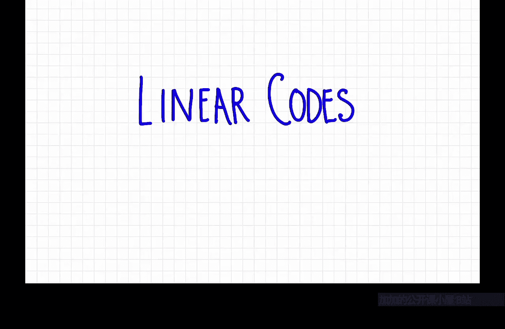
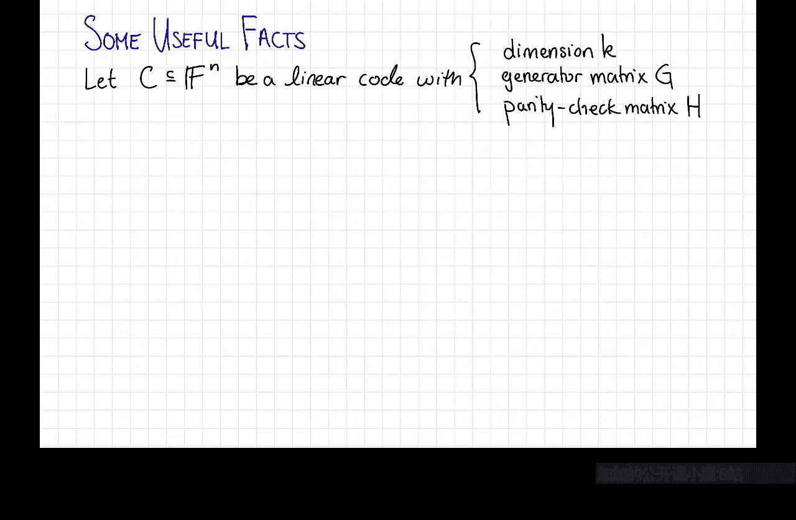
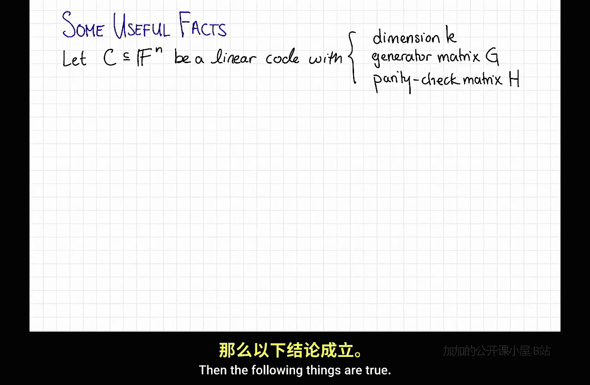
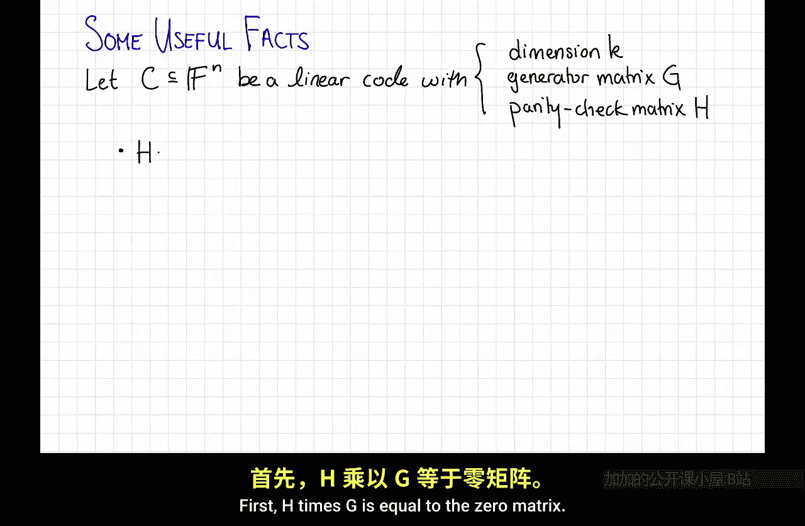
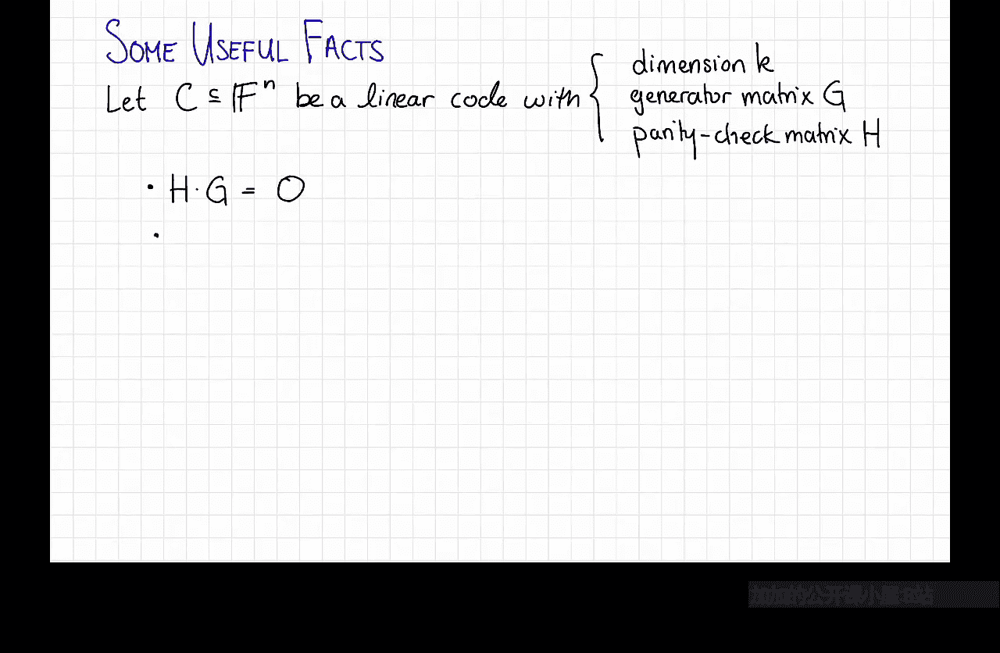
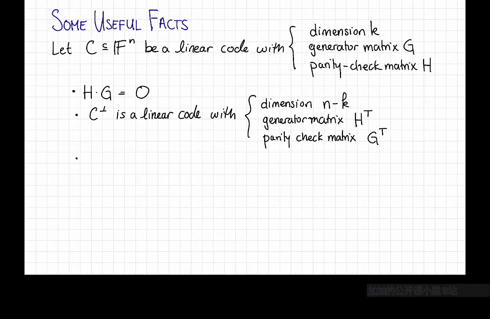

# 007：线性编码 📚

在本节课中，我们将学习线性编码的核心概念，包括线性码的定义、生成矩阵、校验矩阵及其重要性质。我们将使用线性代数的语言来描述这些概念，使初学者也能轻松理解。

## 线性码的定义

上一节我们介绍了编码的基本概念，本节中我们来看看线性码的正式定义。

一个**线性码** \( C \)，维度为 \( K \)，分组长度为 \( N \)，定义在有限域 \( F \) 上，是 \( F^N \) 中的一个 \( K \) 维子空间。

这与我们之前对码的定义以及用 \( K \) 表示消息长度是一致的。具体来说，如果一个码 \( C \) 的分组长度为 \( N \)，消息长度为 \( K \)，字母表 \( \Sigma \) 等于有限域 \( F \)，那么根据此定义，\( C \) 是线性码当且仅当 \( C \) 是 \( F^N \) 的一个子空间。

特别地，我们可以注意到，如果码的消息长度是 \( K \)，那么其维度也是 \( K \)。这是因为，如果 \( C \) 是一个维度为 \( K \) 的子空间，那么其大小等于 \( |F|^K \)。对等式两边取对数，我们有 \( K = \log_{|F|} |C| \)，这恰好是我们对消息长度的定义。因此，线性码就是一个恰好是线性子空间的码。

## 生成矩阵

接下来，我们定义码的生成矩阵。我们已经在汉明码的例子中见过这个概念，现在我们将更一般地定义它。

假设 \( C \) 是 \( F^N \) 中维度为 \( K \) 的线性码。我们说一个矩阵 \( G \in F^{N \times K} \) 是码 \( C \) 的**生成矩阵**，如果码 \( C \) 是 \( G \) 的列张成的空间。也就是说，码 \( C \) 应该是集合 \( \{ G \cdot x \mid x \in F^K \} \)。

以下是关于生成矩阵的几个要点：
*   任何线性码都有生成矩阵。我们可以取 \( C \) 的任何一组基向量，将它们作为 \( G \) 的列即可。
*   生成矩阵不是唯一的。同一个码可能有多个生成矩阵。
*   通过行约简，总存在一个形如 \( G = \begin{bmatrix} I_K \\ P \end{bmatrix} \) 的生成矩阵，其中 \( I_K \) 是 \( K \times K \) 的单位矩阵。这种形式的生成矩阵对应于**系统编码**。系统编码意味着消息的 \( K \) 个比特直接出现在码字的前 \( K \) 个比特中。因此，对于线性码，总是存在一个系统编码映射。

## 对偶码与校验矩阵

现在，我们来定义对偶码和校验矩阵。

首先，**对偶码**。假设 \( C \subset F^N \) 是一个线性码。我们定义 \( C \) 的对偶码为 \( C^\perp \)，其表达式为：
\[
C^\perp = \{ v \in F^N \mid \langle v, c \rangle = 0, \ \forall c \in C \}
\]
其中，\( \langle v, c \rangle = \sum_{i=1}^{N} v_i c_i \) 是标准内积。对偶码的定义与线性代数中对偶子空间的定义完全相同。

接下来，**校验矩阵**。假设 \( C \subset F^N \) 是一个维度为 \( K \) 的线性码。我们说一个矩阵 \( H \in F^{(N-K) \times N} \) 是码 \( C \) 的校验矩阵，如果 \( C \) 是 \( H \) 的零空间，即：
\[
C = \{ x \in F^N \mid H \cdot x = 0 \}
\]

以下是关于校验矩阵的几个要点：
*   任何线性码都有校验矩阵。我们可以取对偶码 \( C^\perp \) 的任何一组基向量，将它们作为 \( H \) 的行即可。
*   校验矩阵也不是唯一的。

## 重要性质

有了这些定义，我们来记录一些关于生成矩阵和校验矩阵的有用性质。我们在之前关于汉明码的例子中已经见过其中一些，这里不再证明，但你应该确保理解它们为何成立。

假设 \( C \) 是 \( F^N \) 中维度为 \( K \) 的线性码，其生成矩阵为 \( G \)，校验矩阵为 \( H \)。那么以下性质成立：

1.  **矩阵乘积为零**：\( H \cdot G = 0 \)（零矩阵）。
2.  **对偶码的结构**：对偶码 \( C^\perp \) 本身也是一个线性码，其维度为 \( N-K \)。它的生成矩阵是 \( H^T \)（\( H \) 的转置），而其校验矩阵是 \( G^T \)（\( G \) 的转置）。
3.  **距离与最小重量**：码 \( C \) 的**距离**等于其所有非零码字中的最小**汉明重量**。我们之前在汉明码的背景下论证过这一点，对于任何线性码，仅凭线性性就足以保证此性质成立。
4.  **距离与线性相关性**：码 \( C \) 的**距离**是满足“校验矩阵 \( H \) 有 \( d \) 个线性相关的列”这一条件的最小数字 \( d \)。我们同样在汉明码的例子中见过这个性质，它对于任何线性码都成立。

## 总结

本节课中我们一起学习了线性编码的核心构件。我们定义了**线性码**作为向量空间的子空间，引入了**生成矩阵** \( G \) 用于编码消息，以及**校验矩阵** \( H \) 用于验证码字和描述对偶码。我们还回顾了线性码的几个关键性质，包括距离与最小重量的等价性，以及距离与校验矩阵列线性相关性之间的关系。这些概念和工具为我们进一步分析和构造纠错码奠定了坚实的代数基础。