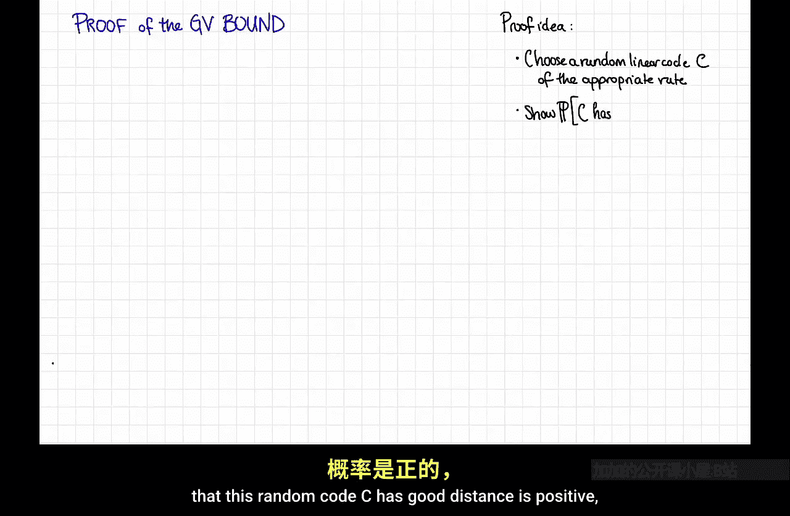
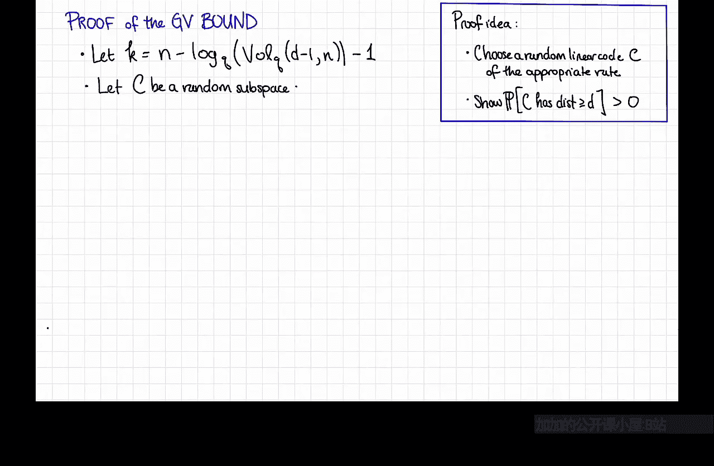

# 008：GV界

在本节课中，我们将学习一个基于上次建立的线性代数视角得出的重要结果，称为吉尔伯特-瓦尔沙莫夫界，简称GV界。GV界证明了在码率和距离之间存在良好权衡的编码是存在的。

## 📖 定理陈述

GV界的陈述如下：对于任意素数幂 **Q**，以及任意满足 **D ≤ N** 的 **N** 和 **D**，存在一个线性码 **C**。该码具有长度 **N**、字母表大小 **Q** 和距离 **D**。其码率 **R**（定义为 **k/n**）至少为以下表达式：

**R ≥ 1 - (log_Q(V_Q(N, D-1)) - 1) / N**

其中，**V_Q(N, D-1)** 表示在 **N** 维空间中，半径为 **D-1** 的汉明球的 **Q** 元体积。我们将证明的是针对素数幂 **Q** 和线性码的版本，但事实上，该定理在不附加这些条件时也成立。

## 🔍 与汉明界的比较

上一节我们介绍了GV界，本节中我们来看看它与之前学过的汉明界有何异同。

汉明界指出，对于任意具有长度 **N**、距离 **D** 和字母表大小 **Q** 的码 **C**，其码率 **R** 至多为：

**R ≤ 1 - log_Q(V_Q(N, ⌊(D-1)/2⌋)) / N**

以下是GV界与汉明界的几个主要区别：

1.  **不等式方向相反**：汉明界是一个“不可能性”结果，它告诉我们无法构造出码率过高的码。相反，GV界是一个“可能性”结果，它断言存在具有不错码率的码。
2.  **半径参数不同**：GV界中的半径是 **D-1**，而汉明界中是 **⌊(D-1)/2⌋**。忽略GV界表达式中的 **-1**（因为除以 **N** 后影响很小），这是两个表达式之间最主要的定量差异。

这两个表达式中的对数项可能看起来有些复杂。现在，请暂停视频，思考并确认GV界的表达式（下界）确实小于汉明界的表达式（上界）。这是合理的，如果情况相反，数学上就会出现矛盾。

## 🧮 GV界的证明

在接下来的部分，我们将证明吉尔伯特-瓦尔沙莫夫界。证明思路是概率方法：我们随机选择一个具有特定码率的线性码，然后证明这个随机码具有良好距离的概率大于零。这就能推出至少存在一个具有该良好距离的码。

### 第一步：参数设定

首先，令 **K** 等于：

**K = N - ⌈log_Q(V_Q(N, D-1))⌉ - 1**

请注意，如果我们这样选择 **K**，那么 **K/N** 恰好就是GV界定理陈述中的码率表达式。

### 第二步：构造随机码

现在，我们选择一个随机的线性码 **C**，其维数为 **K**。也就是说，**C** 是 **F_Q^N**（**N** 维 **Q** 元域空间）中一个均匀随机的子空间。由于所有对象都是有限的，所以只需在所有可能的 **K** 维子空间中均匀随机地选取一个。

接着，令 **G** 是一个 **N × K** 的随机生成矩阵，其元素取自 **F_Q**。这本质上是为子空间 **C** 随机选取一组基，并用这组基作为 **G** 的列。

### 第三步：一个有用的事实

在分析随机码的距离之前，我们先记录一个有用的事实：

**对于任意固定的非零向量 x ∈ F_Q^K，由这个随机矩阵 G 得到的向量 Gx 在集合 F_Q^N \ {0} 上是均匀分布的。**

换句话说，如果我固定一个非零的 **x**，并用我的随机矩阵 **G** 乘以它，得到的向量将均匀地取遍 **F_Q^N** 中所有非零向量的可能性相同。这个事实的证明基于对称性，鼓励你暂停视频尝试进行形式化证明。

### 第四步：计算距离概率

我们的目标是证明这个随机码 **C** 的距离至少为 **D** 的概率非零。

由于 **C** 是线性码，其距离等于所有非零码字的最小汉明重量。这可以写成：

**dist(C) = min_{x ∈ F_Q^K, x ≠ 0} weight(Gx)**

现在，对于任意固定的非零 **x**，事件“**weight(Gx) < D**”发生的概率，等于向量 **Gx** 落入以 **0** 为中心、半径为 **D-1** 的汉明球内的概率。

根据上述有用事实，**Gx** 是均匀分布的。因此，这个概率等于该汉明球的体积除以整个空间的大小（需注意排除零点，但为简化分析，我们可以给出一个上界）：

**P(weight(Gx) < D) ≤ V_Q(N, D-1) / Q^N**

### 第五步：应用并集界限

我们想知道是否存在任何一个非零 **x** 使得 **weight(Gx) < D**。应用并集界限，这个存在性事件的概率上界为：

**P(∃ x ≠ 0, weight(Gx) < D) ≤ (可能的 x 的数量) × P(weight(Gx) < D 对于某个特定的 x)**

可能的非零 **x** 的数量最多为 **Q^K** 个。因此：

**P(∃ x ≠ 0, weight(Gx) < D) ≤ Q^K × [V_Q(N, D-1) / Q^N]**

### 第六步：完成证明

我们希望证明上述概率严格小于 **1**。如果成立，那就意味着我们的随机码“不具有良好距离（即距离 < D）”的概率小于 **1**，因此其“具有良好距离（距离 ≥ D）”的概率就严格大于 **0**。这就能推出至少存在一个这样的码。

让我们验证这个不等式。对不等式两边取以 **Q** 为底的对数：

**K - N + log_Q(V_Q(N, D-1)) < 0**

整理后得到：

**K < N - log_Q(V_Q(N, D-1))**

而根据我们最初对 **K** 的定义：**K = N - ⌈log_Q(V_Q(N, D-1))⌉ - 1**，这个不等式显然成立。因此，概率上界确实严格小于 **1**。

于是，我们得出结论：这个随机的 **K** 维线性子空间，其距离至少为 **D** 的概率严格大于 **0**。因此，这样的码是存在的。这便完成了吉尔伯特-瓦尔沙莫夫界的证明。

## 📝 总结

本节课中我们一起学习了GV界。我们首先陈述了定理，并将其与汉明界进行了对比，明确了前者是存在性下界，后者是性能上界。随后，我们使用概率方法证明了GV界：通过构造一个随机的线性码，并计算其满足最小距离要求的概率大于零，从而证明了满足特定码率和距离权衡的码是存在的。尽管定理中的公式看起来复杂，但其核心思想清晰有力，为我们寻找好码提供了理论保证。在后续课程中，我们将进一步解读这个公式的直观含义。