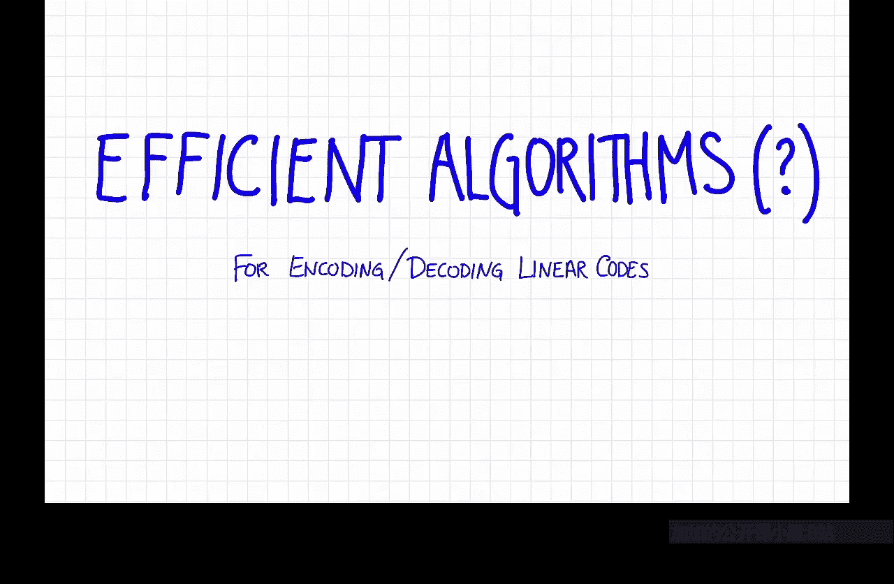
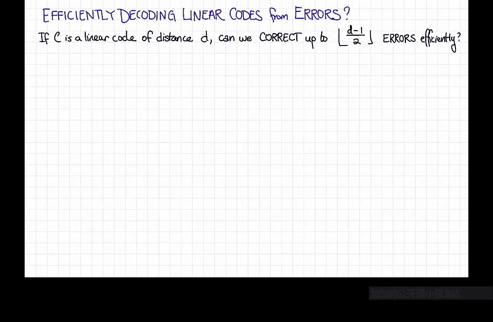
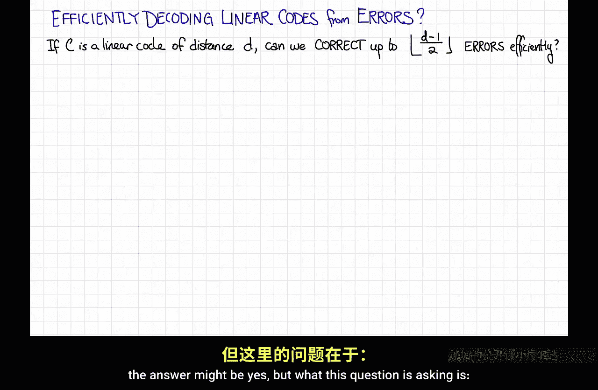
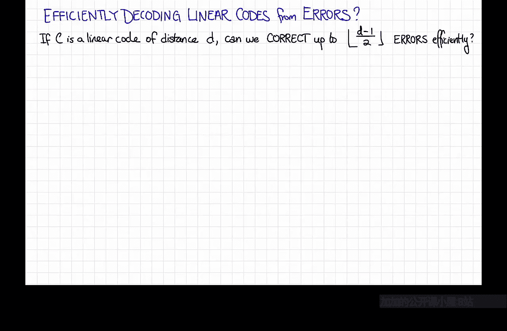
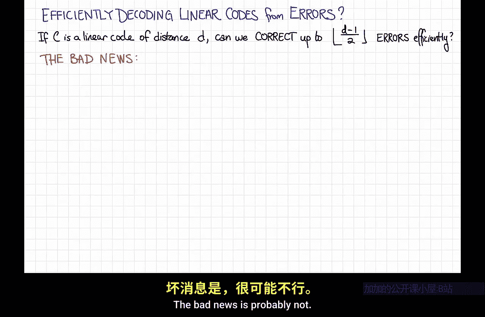

代数编码导论：09：线性码的高效算法

在本节课中，我们将要学习线性码所支持的高效算法。我们将探讨哪些任务可以高效完成，哪些任务在一般情况下被认为是困难的，并理解这对于编码理论的实际应用意味着什么。

如果一个码是线性的，那么它天然支持一些高效的算法。这里，“高效”指的是算法运行时间是码长 `n` 的多项式级别。

具体来说，假设 `C ⊆ F_q^n` 是一个距离为 `d` 的线性码，那么以下三件事是成立的。

以下是线性码可以高效完成的三个任务：

1.  **存在高效的编码映射** `Enc`，它将消息 `F_q^k` 映射到码字 `C` 中。这个映射就是乘以一个生成矩阵 `G`：
    `Enc(x) = G * x`
    由于矩阵乘法可以在多项式时间内完成，因此这是一个高效算法。

2.  **可以高效地检测最多 `d-1` 个错误**。给定一个可能被少于 `d` 个错误污染的接收向量 `c̃`，存在算法能判断是否出错。一种方法是使用校验矩阵 `H`：
    计算 `H * c̃`，如果结果等于 `0`，则 `c̃` 是一个合法的码字；否则，说明发生了错误。这同样是一个高效的矩阵乘法。

3.  **可以高效地纠正最多 `d-1` 个删除**。假设我们收到一个码字，其中部分坐标被删除（即未知）。原始的码字可以表示为 `c = G * x`。删除某些坐标相当于从矩阵 `G` 中移除对应的行，得到一个新矩阵 `G̃`。由于码的距离为 `d`，对于最多 `d-1` 个删除，存在唯一的 `x` 满足 `c̃ = G̃ * x`。因此，算法就是求解这个线性方程组，例如使用高斯消元法，这可以在有限域上高效完成。

上一节我们介绍了线性码可以高效完成的三个任务：编码、错误检测和删除纠正。然而，还有一个非常重要的任务我们尚未讨论：错误纠正。

这里的问题是：对于一个任意的、距离为 `d` 的线性码 `C`，是否存在一个高效算法，能够纠正最多 `⌊(d-1)/2⌋` 个错误？

对于某些特定的码（例如汉明码），答案可能是肯定的。但这个问题问的是：对于**任意**的线性码 `C`，我都能做到这一点吗？

坏消息是，答案很可能是否定的。

更详细地说，考虑以下问题：给定一个接收向量 `c̃ ∈ F_q^n` 和一个生成矩阵 `G ∈ F_q^(n×k)`，找到一个消息 `x ∈ F_q^k`，使得 `c̃` 与码字 `G * x` 之间的汉明距离最小。

这个问题被称为**最大似然译码**问题。解决这个问题，基本上就等同于能够高效纠正最多 `⌊(d-1)/2⌋` 个错误。

不幸的是，这个问题是 **NP 难**的。这意味着，我们不太可能找到一个多项式时间算法来解决任意（最坏情况）线性码 `C` 的这个问题。事实上，即使允许对码进行任意预处理，该问题仍然是 NP 难的。甚至仅计算给定生成矩阵的线性码的距离，本身也是 NP 难的。

因此，我们的结论是：我们不太可能为任意线性码找到解决此任务的多项式时间算法。

然而，也有好消息。

首先，我们并不关心任意的线性码。我们关心的是我们可以**设计**的线性码。在后续课程中，我们将重点研究如何设计具有特殊结构的、确实支持快速译码算法的线性码。

其次，这个问题被认为是困难的，有时反而带来了便利。在下一个视频中，我们将看到密码学中的一个应用，正是依赖于这个事实。

本节课中我们一起学习了线性码的高效算法。我们了解到，对于任意线性码，编码、错误检测和删除纠正都可以高效完成。然而，一般的错误纠正（最大似然译码）问题被认为是计算困难的（NP难）。这一事实既指明了通用译码算法的局限性，也为我们设计具有快速算法的特殊结构码提供了动力，同时还在密码学等领域找到了意想不到的应用。