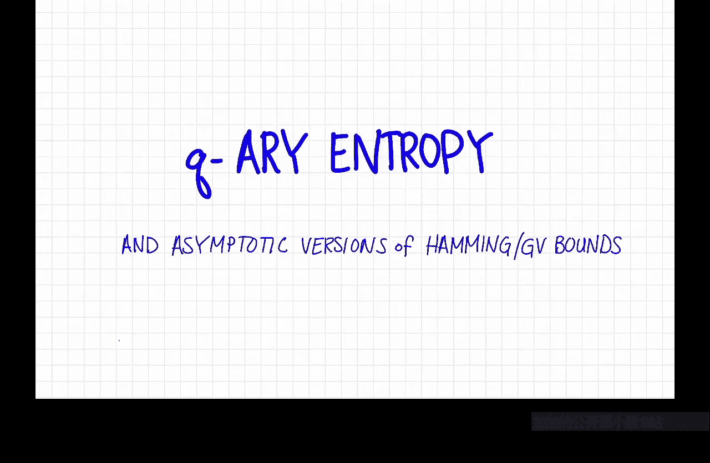
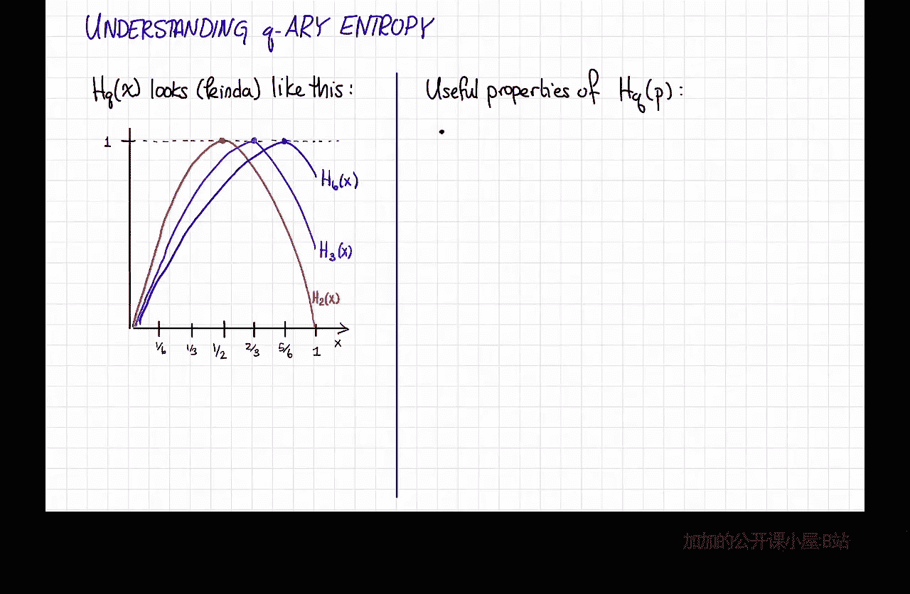

# 012：q元熵

在本节课中，我们将学习如何利用q元熵函数来简化汉明界和吉尔伯特-瓦尔沙莫夫界的渐近表达式。我们将定义q元熵函数，理解其基本性质，并最终用它来描绘码率与相对距离之间的渐近关系图。

---

上一节我们介绍了渐近参数体系。本节中，我们来看看如何利用q元熵来简化汉明界和吉尔伯特-瓦尔沙莫夫界的表达式。

q元熵函数是二进制熵函数的推广。其定义如下：

**定义**：对于整数 \( q \geq 2 \)，q元熵函数 \( H_q \) 将单位区间 \([0, 1]\) 映射到 \([0, 1]\)，其公式为：
\[
H_q(x) = x \log_q (q-1) - x \log_q x - (1-x) \log_q (1-x)
\]
其中 \( x \in [0, 1] \)。

我们关心这个函数，是因为它能帮助我们简化涉及汉明球体积的复杂表达式。具体来说，有以下命题：

**命题**：设整数 \( q \geq 2 \)，并设 \( p \) 是介于 \( 0 \) 和 \( 1 - 1/q \) 之间的一个数。那么以下两点成立：
1.  \( q \) 元汉明球 \( B_q(pn, n) \) 的体积上界为 \( q^{n H_q(p)} \)。
2.  该汉明球的体积下界为 \( q^{n (H_q(p) - o(1))} \)，其中 \( o(1) \) 表示当 \( n \to \infty \) 时趋于0的项。

本质上，这个命题说明汉明球的体积近似等于 \( q^{n H_q(p)} \)。这将允许我们用更简洁的表达式替换那些复杂的体积公式。

---

为了利用q元熵来简化界，我们首先需要理解这个函数的行为。

以下是q元熵函数在 \( q = 2, 3, 6 \) 时的示意图（手绘草图，非精确图像）：
*   **二进制熵 (\( q=2 \))**：在 \( x=0 \) 和 \( x=1 \) 处为0，在 \( x=1/2 \) 处达到最大值1。
*   **三元熵 (\( q=3 \))**：在 \( x=0 \) 处为0，最大值点右移至 \( x=2/3 \)，最大值仍为1。
*   **六元熵 (\( q=6 \))**：最大值点进一步右移至 \( x=5/6 \)。

更一般地，\( H_q(x) \) 在 \( x = 1 - 1/q \) 处取得最大值1，且随着 \( q \) 增大，曲线整体向右移动。

为了获得更定量的理解，我们考察两个参数体系下的行为：

1.  **当 \( q \) 非常大时**：若 \( q \to \infty \)，而 \( p \) 是 (0,1) 区间内的一个常数，则 \( H_q(p) \approx p \)。此时函数图像近似为一条直线 \( H_q(p) = p \)，仅在末端略有不同。
2.  **当 \( q \) 为常数且 \( p \) 非常小时**：此时 \( H_q(p) \) 的行为主要由中间项主导，即 \( H_q(p) \approx p \log_q (1/p) \)。

通过对各项进行类似的分析或使用泰勒展开，我们可以理解其他参数体系下q元熵的行为。

---

现在我们已经对q元熵有了一定的了解，接下来让我们用它来简化GV界和汉明界的表达式。

回顾一下，GV界和汉明界都涉及半径为 \( \delta n \) 的q元汉明球的体积。我们的策略是利用近似关系：
\[
\text{Vol}(B_q(\delta n, n)) \approx q^{n H_q(\delta)}
\]
两边取以 \( q \) 为底的对数，得到：
\[
\log_q (\text{Vol}) \approx H_q(\delta) \cdot n
\]
这个表达式简洁得多。

将这个近似代入之前得到的非渐近形式的界中，我们可以得到它们的渐近形式：

*   **渐近汉明界**：对于任何q元码族 \( C \)，其码率 \( R(C) \) 满足：
    \[
    R(C) \leq 1 - H_q(\delta(C)/2)
    \]
    其中 \( \delta(C) \) 是相对距离。
*   **渐近吉尔伯特-瓦尔沙莫夫界**：设 \( q \geq 2 \)，对于任意 \( \delta \in (0, 1-1/q) \) 和任意 \( \epsilon \in (0, 1 - H_q(\delta)) \)，都存在一个q元码族 \( C \)，其相对距离至少为 \( \delta \)，码率至少为 \( 1 - H_q(\delta) - \epsilon \)。这里的 \( \epsilon \) 是一个微调因子，它会影响码所需的最小码长。

---

使用这些渐近表达式的好处是，我们现在只需关注两个参数：码率 \( R \) 和相对距离 \( \delta \)。因此，我们可以将它们绘制在一张图上。

在横轴为 \( \delta \)、纵轴为 \( R \) 的坐标系中：
*   **汉明界**（红色曲线）给出了**不可能**达到的 \( (R, \delta) \) 区域（曲线上方）。
*   **吉尔伯特-瓦尔沙莫夫界**（蓝色曲线）给出了**已知存在**码能达到的 \( (R, \delta) \) 区域（曲线下方）。
*   两条曲线之间是一个巨大的**不确定区域**。

这张图引出了几个重要问题：

以下是关于这些界限和构造的几个关键问题：

1.  **是否存在超越GV界的码族？** 答案是“是”也是“否”。对于字母表大小 \( q \geq 49 \，已知代数几何码可以超越GV界。然而，对于二进制码 (\( q=2 \))，这仍然是一个悬而未决的问题。
2.  **能否给出达到或接近GV界的显式构造？** 答案同样是“是”也是“否”。对于大的 \( q \)，答案是肯定的，我们将在后续视频中看到这样的构造。但对于二进制码，除了在特定参数区间（如低码率区）有一些突破性进展外，这仍然是一个极具挑战性的开放性问题。
3.  **是否存在渐近好码？** 答案是肯定的。GV界本身就已经证明了渐近好码的存在性，例如图中蓝色曲线下方许多点的参数组合都对应着渐近好码。

---

本节课中，我们一起学习了q元熵函数的定义和基本性质，并利用它将汉明界和吉尔伯特-瓦尔沙莫夫界简化成了更易于处理的渐近形式。通过绘制码率-相对距离图，我们清晰地看到了已知可能区域、不可能区域以及广阔的未知区域。虽然许多关于构造最优码的根本性问题仍未完全解决，但我们已经取得了重要的进展，并确认了渐近好码的存在性。在接下来的视频中，我们将看到更多的界限和构造，以帮助缩小这片不确定的黄色区域。