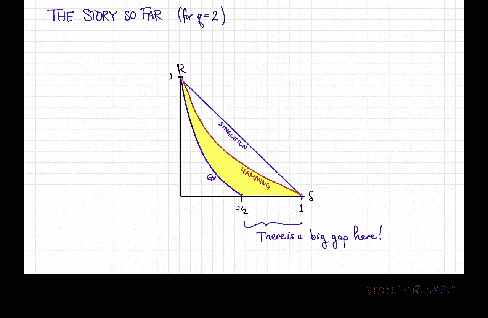
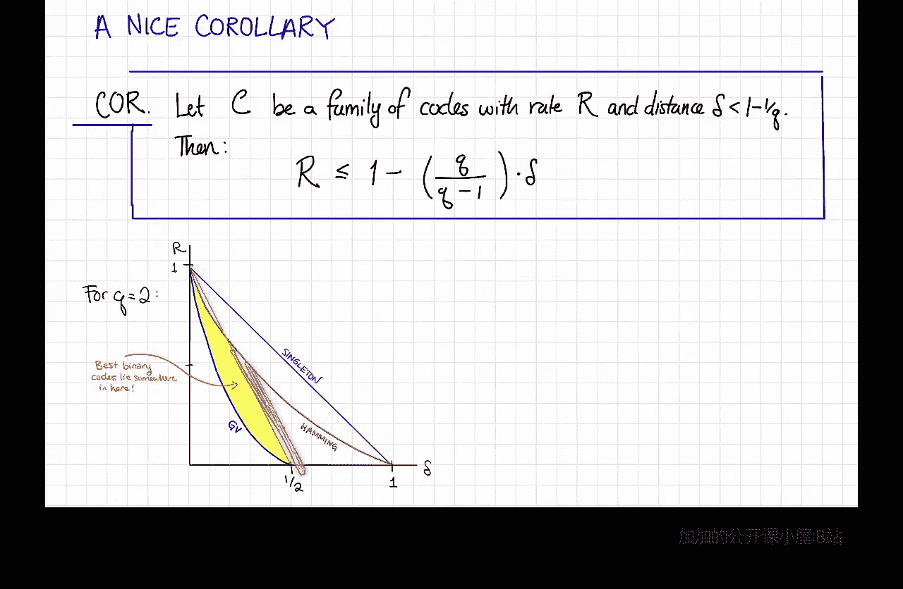
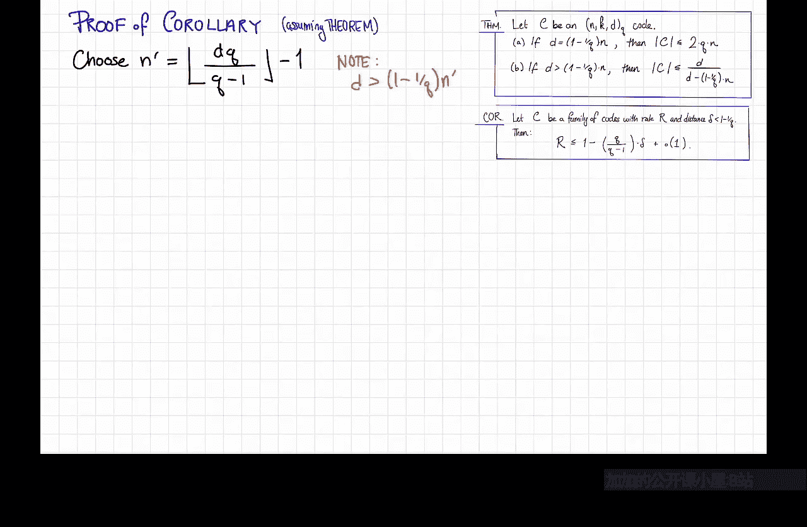
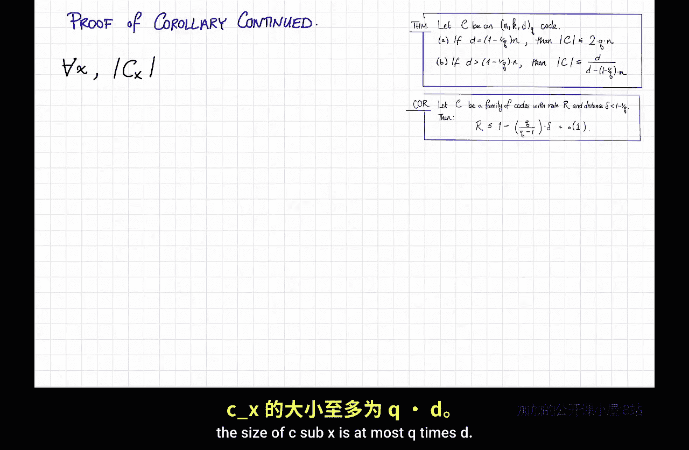
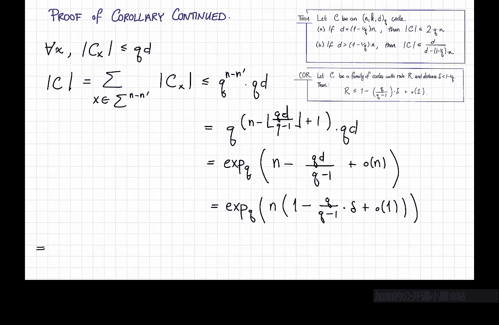
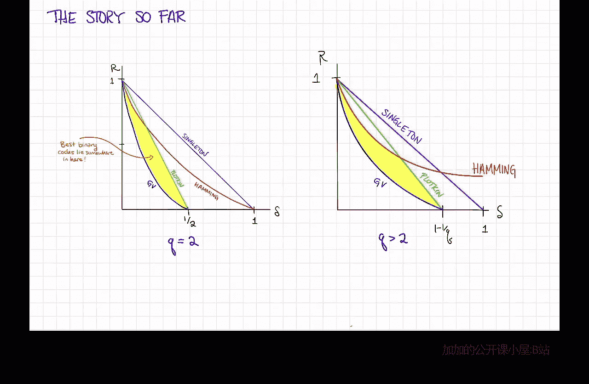
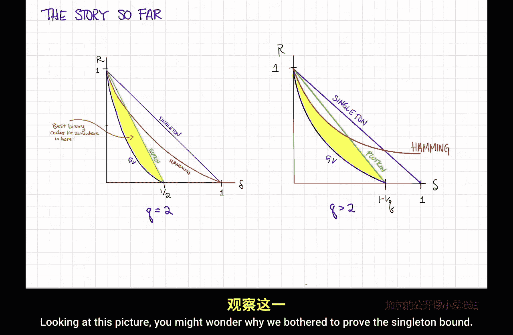
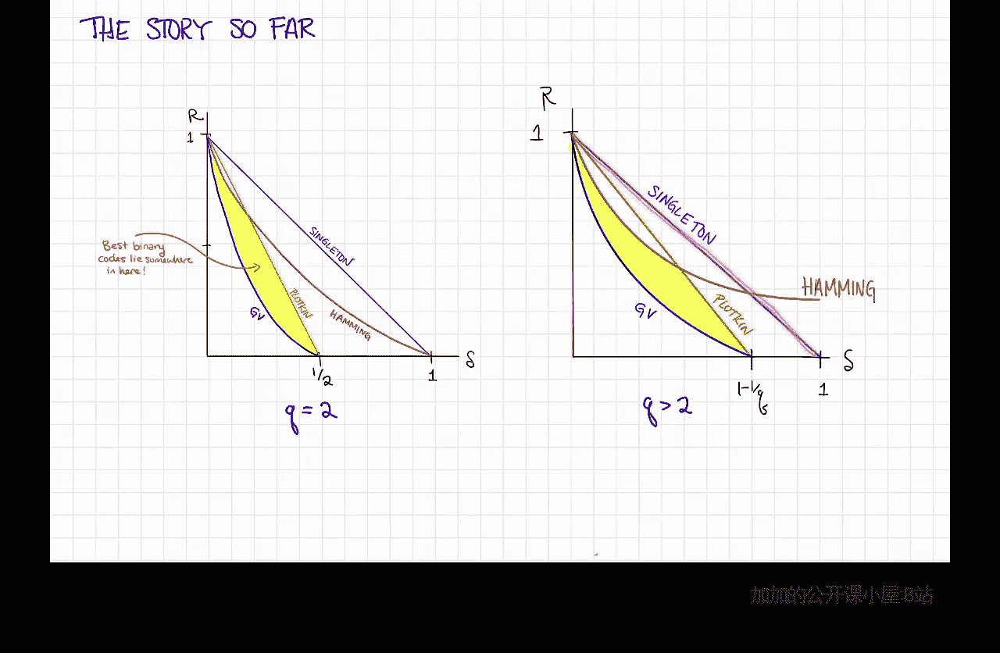
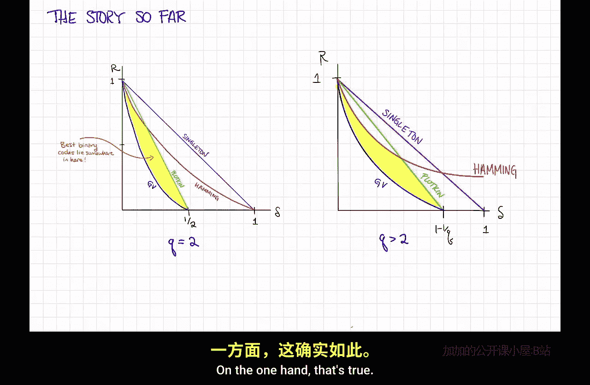
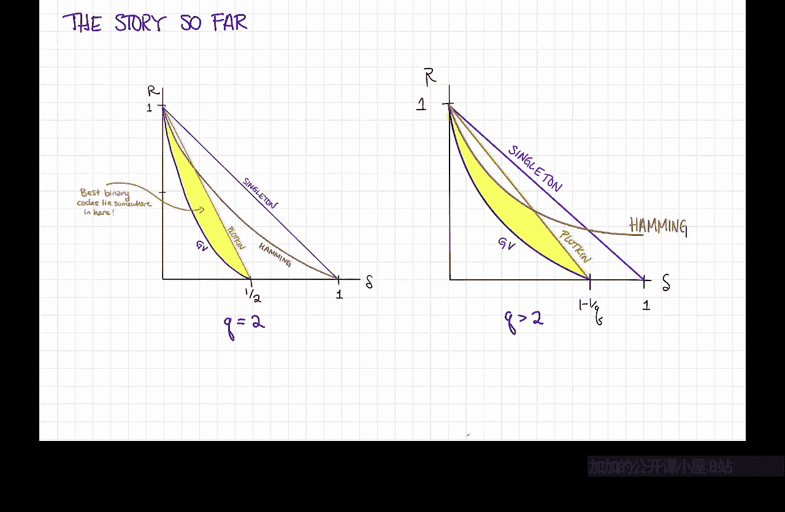

代数编码理论导论：2：普洛特金界

在本节课中，我们将学习另一个不可能性结果，即普洛特金界。我们将了解它如何进一步限制码的码率与相对距离之间的权衡关系，并证明其一个有用的推论。

上一节我们介绍了汉明界和辛格尔顿界，它们都是不可能性结果，限定了码率与距离之间可实现的权衡范围。我们还介绍了吉尔伯特-瓦尔沙莫夫界，它是一个可能性结果。这留下了一个问题：在汉明界/辛格尔顿界与吉尔伯特-瓦尔沙莫夫界之间的区域，权衡关系是否可能实现？特别是对于二进制码，是否可能拥有大于1/2的相对距离和大于0的码率？

普洛特金界告诉我们，答案是否定的。

### 普洛特金界定理

设 **C** 是一个参数为 **[n, k, d]_q** 的码。那么以下两点成立：
1.  如果码的距离 **d = (1 - 1/q) * n**，则码的大小 **|C| ≤ 2qn**。
2.  如果码的距离 **d > (1 - 1/q) * n**，则码的大小 **|C| ≤ d / (d - (1 - 1/q)n)**。

这个定理的核心结论是：如果相对距离 **δ = d/n ≥ 1 - 1/q**，那么当码长 **n** 趋于无穷大时，码率 **R** 必然趋于0。这意味着，在相对距离很大的区域，无法维持非零的码率。

### 一个重要推论

虽然我们不在此视频中证明普洛特金界定理本身，但我们将基于该定理证明以下有用的推论。这个推论将普洛特金界的结论扩展到了 **δ < 1 - 1/q** 的区域。

**推论**：设 **{C}** 是一族渐近码率为 **R**、相对距离为 **δ** 的码，且 **δ < 1 - 1/q**。那么，码率 **R** 满足以下上界：
**R ≤ 1 - (q/(q-1)) * δ**

以下是推论的证明过程。

首先，我们选择一个参数 **n'**：
**n' = ⌊ (q*d) / (q-1) ⌋ - 1**
这个选择确保了 **d > (1 - 1/q) * n'**。

接着，对于所有 **x ∈ Σ^(n-n')**，我们定义一个新码 **C_x**：
**C_x = { (c_{n-n'+1}, ..., c_n) | c ∈ C 且 (c_1, ..., c_{n-n'}) = x }**
也就是说，**C_x** 是原码 **C** 中所有以 **x** 开头的码字的后 **n'** 个符号组成的集合。

**断言1**：**C_x** 的距离至少为 **d**。
**证明**：考虑 **C_x** 中的任意两个不同码字，它们对应于原码 **C** 中两个以相同前缀 **x** 开头的不同码字。由于原码的距离为 **d**，这两个码字至少相差 **d** 个位置。因为它们的前缀 **x** 完全相同，所以这些差异全部出现在后 **n'** 个位置上。因此，它们在 **C_x** 中的对应向量的距离也至少为 **d**。

**断言2**：**C_x** 的码长 **n' ≤ d / (1 - 1/q)**。
这由 **n'** 的定义直接可得。

现在，对码 **C_x** 应用普洛特金界定理的第二部分。因为 **d > (1 - 1/q) * n'**，所以有：
**|C_x| ≤ d / (d - (1 - 1/q)n')**
对分子分母同时乘以 **q**，得到：
**|C_x| ≤ (q*d) / (q*d - (q-1)n')**
由于分母是正整数，它至少为1，因此：
**|C_x| ≤ q*d**

接下来，我们观察原码 **C** 的大小。每个码字 **c ∈ C** 都唯一地属于一个以其前 **n-n'** 位 **x** 标识的集合 **C_x**。因此：
**|C| = Σ_{x ∈ Σ^(n-n')} |C_x|**
将 **|C_x|** 的上界代入：
**|C| ≤ Σ_{x ∈ Σ^(n-n')} (q*d) = q^(n-n') * (q*d)**
代入 **n'** 的定义（忽略取整和减1带来的低阶影响）：
**|C| ≤ q^n * q^{ - (q/(q-1))δ * n + o(n) } * (q*d)**
这里 **o(n)** 表示相对于 **n** 的低阶项。两边取以 **q** 为底的对数并除以 **n** 得到码率 **R**：
**R = (log_q |C|) / n ≤ 1 - (q/(q-1))δ + o(1)**
其中 **o(1)** 是随着 **n** 增大而趋于0的项。这就完成了推论的证明。

### 权衡关系全景图

现在，让我们总结一下目前所知的关于码率与相对距离最佳权衡的知识。

对于二进制码 (**q=2**)，权衡图如下所示：
*   **辛格尔顿界** 是一条直线：**R ≤ 1 - δ**。
*   **汉明界** 在中小 **δ** 区域给出了更紧的约束。
*   **普洛特金界** 在 **δ > 1/2** 的区域成为主导约束，它表明当 **δ ≥ 1/2** 时，**R** 必须趋于0。其推论在 **δ < 1/2** 时是一条斜率更陡的直线：**R ≤ 1 - 2δ**。
*   **吉尔伯特-瓦尔沙莫夫界** 则给出了可达到的下界。

对于更大的字母表 (**q > 2**)，图形类似，但关键点发生变化：
*   **辛格尔顿界** 不变。
*   **普洛特金界** 的“拐点”移动到 **δ = 1 - 1/q** 处，这也是GV界的终点。
*   **普洛特金界推论** 的直线变为：**R ≤ 1 - (q/(q-1))δ**。

你可能会问，既然普洛特金界似乎总是优于辛格尔顿界，为什么我们还需要辛格尔顿界？一方面，在渐近意义上这确实成立。另一方面，在后续课程中，我们将看到一类能够**达到**辛格尔顿界的码族（MDS码）。在学习了普洛特金界之后，你可以思考一下这是如何成为可能的。

本节课中，我们一起学习了普洛特金界及其推论。普洛特金界揭示了在相对距离较大时，无法维持非零码率，从而填补了之前认知中的一个重要空白。结合辛格尔顿界、汉明界和吉尔伯特-瓦尔沙莫夫界，我们现在对码的率-距权衡有了更全面的理解。