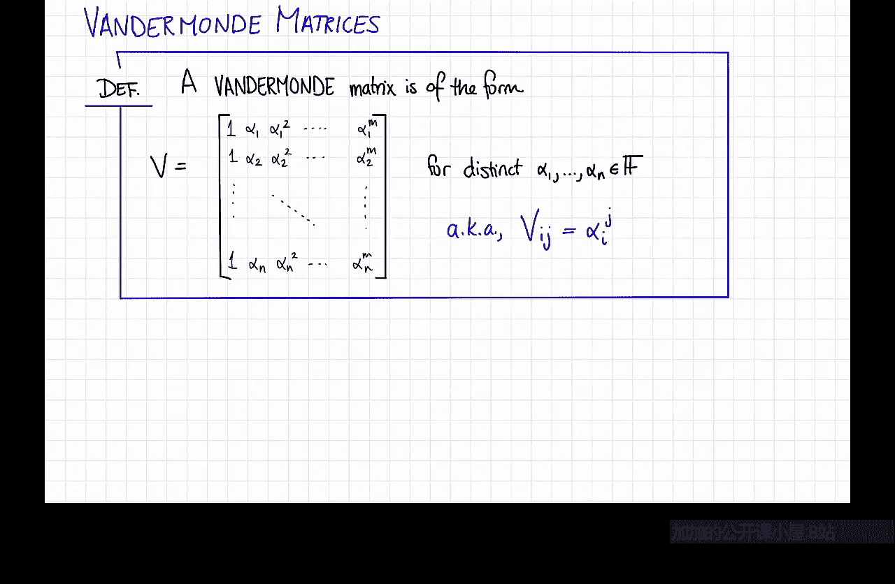
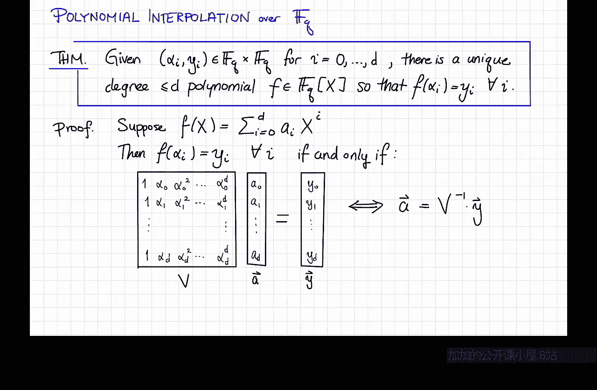
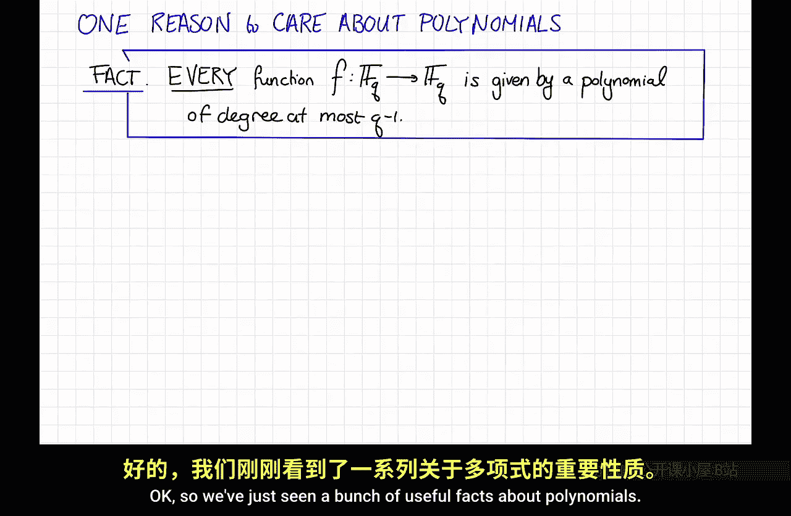
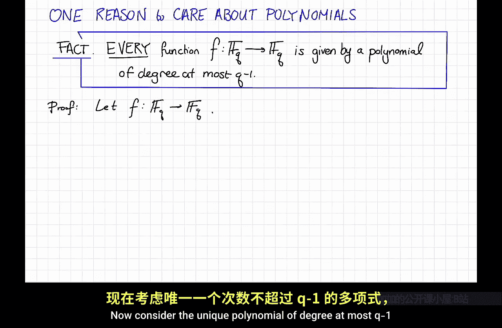
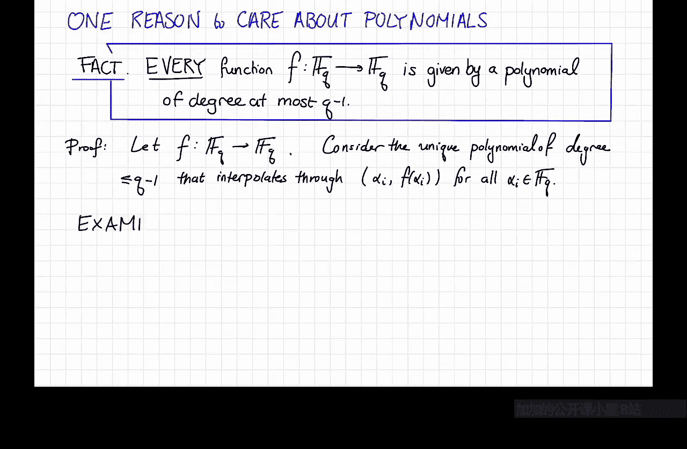

# 015：有限域上的多项式

在本节课中，我们将学习有限域上的多项式。这是理解后续课程中将要介绍的里德-所罗门码的基础。里德-所罗门码是一类达到单例界、拥有快速算法且非常实用和强大的编码。

## 多项式的定义

我们可以像在实数域上一样定义有限域上的多项式。

具体来说，在有限域 **Fq** 上，一个关于变量 **X** 的 **d** 次一元多项式具有以下形式：

**f(X) = a0 + a1X + a2X2 + ... + adXd**

其中，所有系数 **ai** 都来自域 **Fq**，并且最高次项系数 **ad** 不为零。所有在变量 **X** 上的一元多项式集合记为 **Fq[X]**。

## 多项式的根

关于实数域或有限域上的多项式，一个非常有用的性质是：低次多项式不会有太多根。

更精确地说，一个非零的、次数至多为 **d** 的多项式 **f**，其根的数量至多为 **d** 个。这里，多项式的根是指满足 **f(x) = 0** 的值 **x ∈ Fq**。

这个性质极其有用，我们将在整个课程中反复使用它。为了强调这一点，我们引入一个新角色：多项式插值鹦鹉波莉，来提醒我们“低次多项式没有太多根”。

### 性质证明

为什么这个性质成立？如果你相信多项式在 **Fq** 上的运算与预期大致相同，这里有一个简要的证明。

**证明**：假设对于某个特定的 **α ∈ Fq**，有 **f(α) = 0**。那么，一次多项式 **(X - α)** 可以整除 **f(X)**。

这意味着，如果 **f(X)** 有 **d+1** 个根，比如 **α1, ..., αd+1**，那么乘积 **∏ (X - αi)** 将整除 **f(X)**。然而，这个乘积是一个 **d+1** 次多项式，这意味着 **f(X)** 的次数至少为 **d+1**。这与 **f(X)** 次数至多为 **d** 的假设矛盾。

因此，一个次数至多为 **d** 的非零多项式，其根的数量至多为 **d** 个。

## 示例分析

为了确保我们理解“低次多项式没有太多根”这个极其有用的性质，让我们看几个在 **F3** 上的简单例子。

以下是几个多项式及其在 **F3** 上的根的数量：

1.  **f(X) = X2 - 1** 有两个根：**1** 和 **2**。
2.  **f(X) = X2 + 2X + 1** 有一个根：**2**。
3.  **f(X) = X2 + 1** 在 **F3** 上没有根。

这些例子表明，虽然二次多项式最多有两个根，但可能少于两个。同时，最后一个多项式 **X2 + 1** 在 **F2** 上确实有一个根（**1**），这说明多项式的根的数量也取决于所选的域。

## 范德蒙德矩阵

在讨论有限域上的多项式、多项式求值和多项式插值时，一个有用的概念是范德蒙德矩阵。

**定义**：一个范德蒙德矩阵具有以下形式。我们选择某个域 **F** 中 **n** 个不同的值 **α1, ..., αn**，然后令矩阵 **V** 的第 **(i, j)** 项为 **αij**。其形式如下：

**V = [ [1, α1, α12, ..., α1m], [1, α2, α22, ..., α2m], ..., [1, αn, αn2, ..., αnm] ]**

第一列全是1（即 **αi0**），第二列是所有的 **αi**，第三列是所有的 **αi2**，依此类推，直到某个整数 **m** 次幂。

一个有用的性质是：**方阵范德蒙德矩阵是可逆的**。

**证明概要**：设 **V** 是一个方阵范德蒙德矩阵。要证明 **V** 可逆，等价于证明其核空间仅为 **{0}**。假设存在向量 **a** 使得 **V * a = 0**。将 **a** 视为多项式 **f(X) = Σ aiXi** 的系数向量，那么 **V * a** 的结果向量就是 **f(α1), f(α2), ..., f(αn)**。

现在有两种情况：
1.  **f(X)** 是零多项式，这意味着 **a = 0**。
2.  **f(X)** 是一个非零的低次多项式。根据“低次多项式没有太多根”的性质，**f(X)** 的根数严格小于 **n**。这意味着 **V * a** 的结果向量不可能是零向量，因为它包含了 **n** 个求值结果，其中严格少于 **n** 个会是零。

因此，要么 **a = 0**，要么 **V * a ≠ 0**。这证明了 **V** 的核空间仅为 **{0}**，所以 **V** 是可逆的。

**推论**：范德蒙德矩阵的任何方阵子矩阵也是可逆的。证明思路是，这样的子矩阵可以表示为一个可逆的对角矩阵与一个（较小的）范德蒙德方阵的乘积，因此其本身也是可逆的。

## 多项式插值

关于范德蒙德矩阵的这些事实引出了一个非常有用的结论：多项式插值在 **Fq** 上是“可行”的。

**定理**：假设给定 **d+1** 个点对 **(αi, yi)**，其中 **i = 0, ..., d**。那么，存在一个唯一的、次数至多为 **d** 的多项式 **f**，使得对于所有 **i**，都有 **f(αi) = yi**。

**证明**：将多项式 **f** 写作 **f(X) = Σi=0d aiXi**。条件 **f(αi) = yi** 等价于以下线性系统成立：

**V * a = y**

其中，**V** 是以 **α0, ..., αd** 为参数构成的 **(d+1) x (d+1)** 范德蒙德矩阵，**a** 是系数向量，**y** 是值向量。

由于方阵范德蒙德矩阵 **V** 可逆，这个线性方程有唯一解：

**a = V-1 * y**

因此，插值这些点的唯一多项式 **f** 的系数由 **V-1 * y** 给出。这个证明不仅说明了唯一性，还表明我们可以通过求解线性系统来高效地找到这个多项式。实际上，存在类似快速傅里叶变换的算法，可以在 **O(d log d)** 时间内完成这个计算。

## 有限域上的函数与多项式

我们如此关心有限域上的多项式的另一个原因是以下事实：**从有限域 Fq 到其自身的每一个函数，都可以由某个次数至多为 q-1 的多项式给出**。

**证明**：设 **F** 是任意一个从 **Fq** 到 **Fq** 的函数。考虑那个唯一存在的、次数至多为 **q-1** 的、插值所有 **Fq** 中点 **(x, F(x))** 的多项式（根据上一节的定理，它存在）。这个多项式在域上的每一个点都与函数 **F** 的值一致，因此它就是我们要找的多项式。

**一个快速示例**：考虑多项式 **f(X) = Xq**。根据上述事实，它必须有一个次数至多为 **q-1** 的表示形式。实际上，这个表示就是 **f(X) = X**。原因在于有限域的一个有用性质：对于所有 **α ∈ Fq**，都有 **αq = α**。因此，多项式 **Xq** 和 **X** 在所有点上的求值结果都相同。

## 总结

本节课中，我们一起学习了有限域上多项式的核心知识：
1.  我们定义了有限域上的多项式。
2.  我们学习了“低次多项式没有太多根”的关键性质及其证明思路。
3.  我们介绍了范德蒙德矩阵，并证明了方阵范德蒙德矩阵的可逆性。
4.  基于此，我们证明了多项式插值在有限域上的可行性和唯一性。
5.  最后，我们了解到有限域上的任何函数都可以用一个次数至多为 **q-1** 的多项式来表示。

掌握了这些关于多项式的知识后，我们现在已经为定义和理解强大的里德-所罗门码做好了充分准备，这将是下一节课的内容。