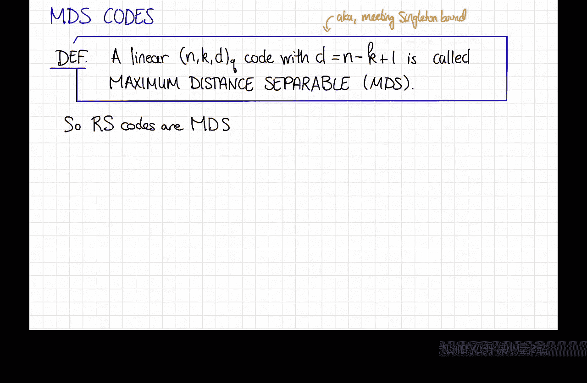
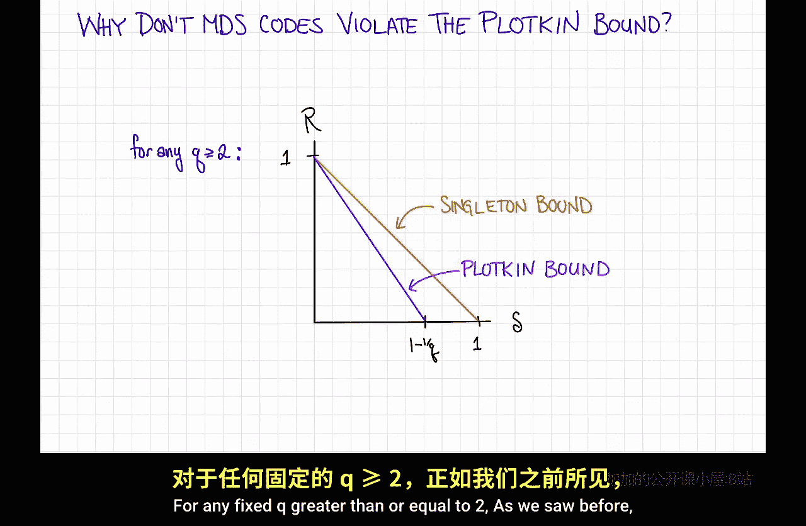
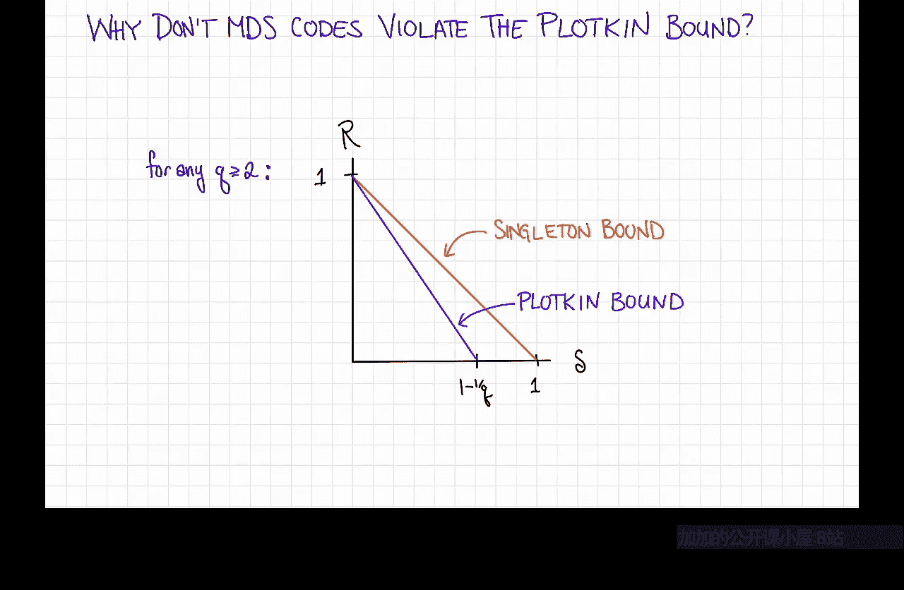
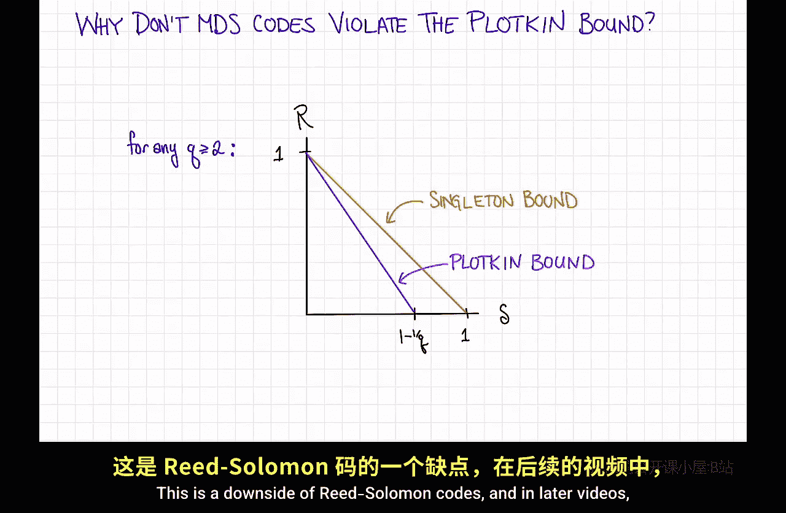
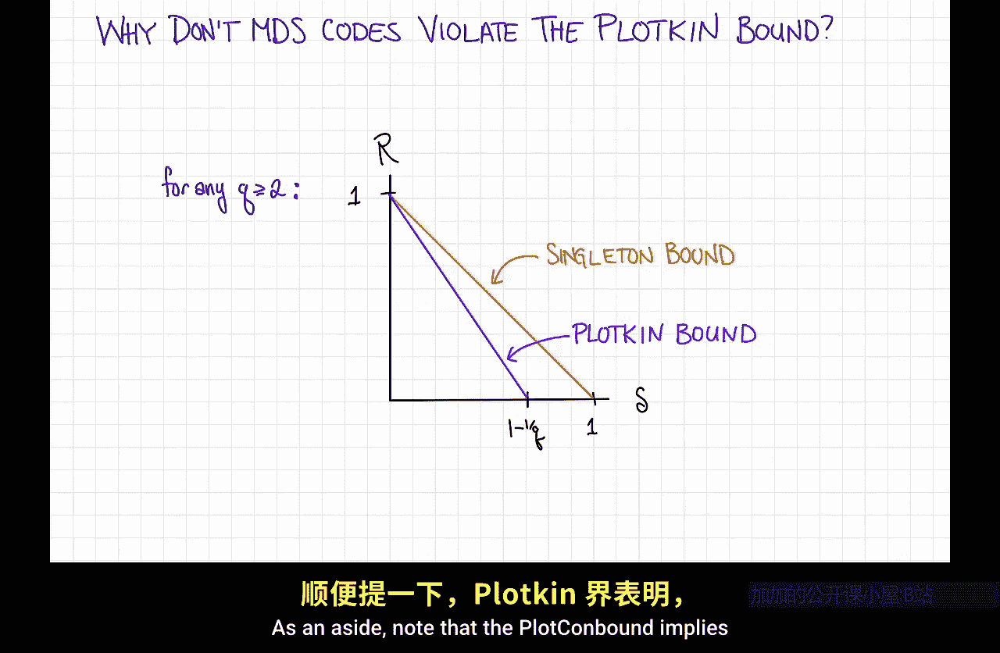
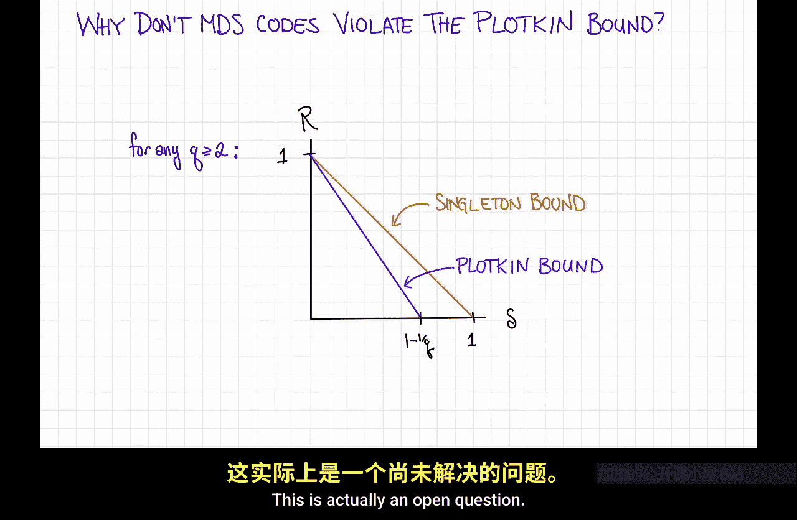

代数编码导论：4：Reed-Solomon 码！📡

在本节课中，我们将要学习 Reed-Solomon 码。这是一种重要的纠错码家族，以其能够达到 Singleton 界而闻名，并拥有高效的编码和译码算法，因此在实践中被广泛应用。

### 基本思想 🧠

Reed-Solomon 码背后的核心思想，正如我们之前所见，是低次多项式没有太多根。这意味着，当我们用低次多项式在多个点上求值来构造码字时，这些码字不会出现太多零值，从而保证了码具有良好的距离。

### 定义 📖

让我们正式定义 Reed-Solomon 码。

设 `Q >= n >= K`。我们在有限域 `F_Q` 中选择 `n` 个互不相同的点 `α_1, α_2, ..., α_n`。

那么，在 `F_Q` 上、以这些点为求值点、维数为 `K` 的 Reed-Solomon 码定义如下：

`RS_Q(α, N, K) = { (f(α_1), f(α_2), ..., f(α_n)) | f ∈ F_Q[x], deg(f) ≤ K-1 }`

当上下文明确时，我们也可以简写为 `RS(N, K)`。

这个定义隐含了一个自然的编码映射。它将一个消息向量 `(a_0, a_1, ..., a_{K-1})` 映射为码字 `(f_a(α_1), f_a(α_2), ..., f_a(α_n))`，其中 `f_a(x) = Σ_{i=0}^{K-1} a_i * x^i`。

### 性质与证明 🔍

上一节我们介绍了 Reed-Solomon 码的定义，本节中我们来看看它的一些关键性质。

以下是 Reed-Solomon 码的两个重要性质：

1.  **线性性与生成矩阵**：Reed-Solomon 码是线性码，其生成矩阵是一个 Vandermonde 矩阵。具体来说，对于求值点 `α` 和维数 `K`，生成矩阵 `G` 是一个 `n × K` 的矩阵，其第 `i` 行、第 `j` 列的元素为 `α_i^{j-1}`。将消息向量 `a` 乘以这个矩阵，就相当于在点 `α_i` 处求值多项式 `f_a(x)`。
2.  **距离**：一个块长为 `n`、维数为 `K` 的 Reed-Solomon 码，其距离 `d` 恰好等于 `n - K + 1`。

**距离性质的证明**：
由于 Reed-Solomon 码是线性的，我们只需证明任何非零码字的最小重量至少为 `n - K + 1`。这等价于证明任何码字最多有 `K-1` 个零分量。而一个码字是某个次数不超过 `K-1` 的多项式 `f(x)` 在 `n` 个点上的求值结果。码字中零分量的数量，就是多项式 `f(x)` 在这些求值点中根的数量。根据代数基本定理，一个非零的、次数不超过 `K-1` 的多项式，在域中最多有 `K-1` 个根。因此，码字中零分量的数量最多为 `K-1`，这意味着最小重量至少为 `n - (K-1) = n - K + 1`。同时，我们可以构造一个恰好有 `K-1` 个根的多项式（例如 `(x - α_1)...(x - α_{K-1})`），使得对应的码字重量恰好为 `n - K + 1`。因此，距离 `d` 精确等于 `n - K + 1`。

### 达到 Singleton 界与 MDS 码 🏆

上一节我们证明了 Reed-Solomon 码的距离公式，本节我们将其与之前学过的界联系起来。

Singleton 界指出，对于任何参数为 `(n, K, d)_Q` 的码，都有 `d ≤ n - K + 1`。

由于 Reed-Solomon 码的距离 `d` 精确等于 `n - K + 1`，因此它**恰好达到了 Singleton 界**。任何达到 Singleton 界的码都被称为**最大距离可分码**。

以下是关于 MDS 码的两个有用观察：

1.  **生成矩阵的性质**：一个线性码是 MDS 码，当且仅当其 `K × n` 生成矩阵的**任意** `K × K` 子矩阵都是满秩的。直观理解是，这保证了即使码字中发生 `n-K` 个删除（只剩下 `K` 个符号），我们仍然可以通过解这 `K` 个线性方程来唯一恢复原始消息。Reed-Solomon 码的 Vandermonde 生成矩阵正好满足这个性质。
2.  **信息位置**：对于一个 `(n, K, d)_Q` 的 MDS 码，码字的**任意** `K` 个位置就足以确定整个码字。这同样是其强大纠删能力的另一种表述。

### 在界图中的位置与字母表大小 📊

现在，让我们将 MDS 码放到我们之前学过的码率-距离权衡界图中进行观察。

我们之前学过 Singleton 界和 Plotkin 界，它们都是不可能性结果，指出在界线上方的参数组合是无法实现的。Plotkin 界比 Singleton 界更强，它表明对于**固定的字母表大小 `Q`**，Singleton 界实际上是无法达到的。

然而，我们刚刚说 Reed-Solomon 码是达到 Singleton 界的 MDS 码。这似乎产生了矛盾。

秘密在于：Plotkin 界适用于**固定**的 `Q`。而对于 Reed-Solomon 码，其字母表大小 `Q` 并不是固定的，它必须**随着块长 `n` 的增长而增长**（因为我们需要在域中找到 `n` 个互不相同的点）。这是 Reed-Solomon 码的一个缺点。在后续课程中，我们将看到一些试图减小字母表大小的方法。

作为一个旁注，Plotkin 界意味着，任何 MDS 码族都必须具有随块长增长的字母表大小。那么它需要以多快的速度增长呢？这实际上是一个开放问题，有一个称为 **MDS 猜想** 的假设，认为 Reed-Solomon 码基本上具有最优的字母表大小，但该猜想尚未被证明。

### 总结 📝

本节课中我们一起学习了 Reed-Solomon 码。我们首先了解了其基于“低次多项式根不多”的核心思想。然后，我们给出了其正式定义，并证明了它是线性码，其距离精确为 `d = n - K + 1`，从而达到了 Singleton 界，属于 MDS 码。我们还讨论了 MDS 码的性质，以及 Reed-Solomon 码的字母表大小必须随块长增长这一重要限制。Reed-Solomon 码因其优异的性能和高效的算法，成为了实践中极其重要的纠错码。