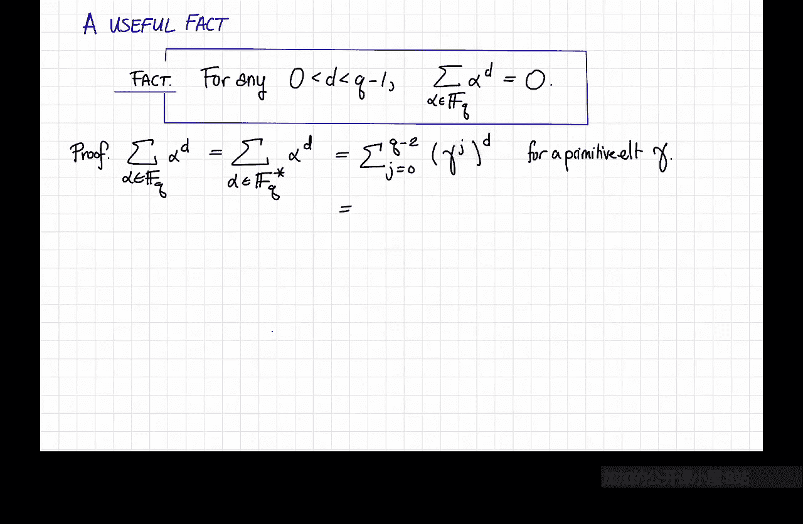
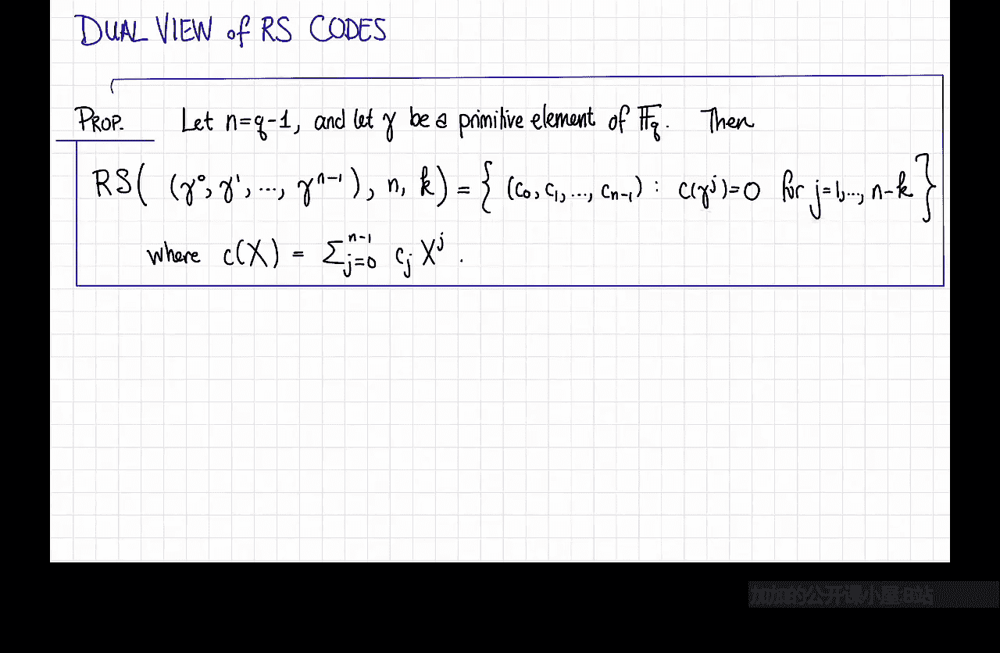
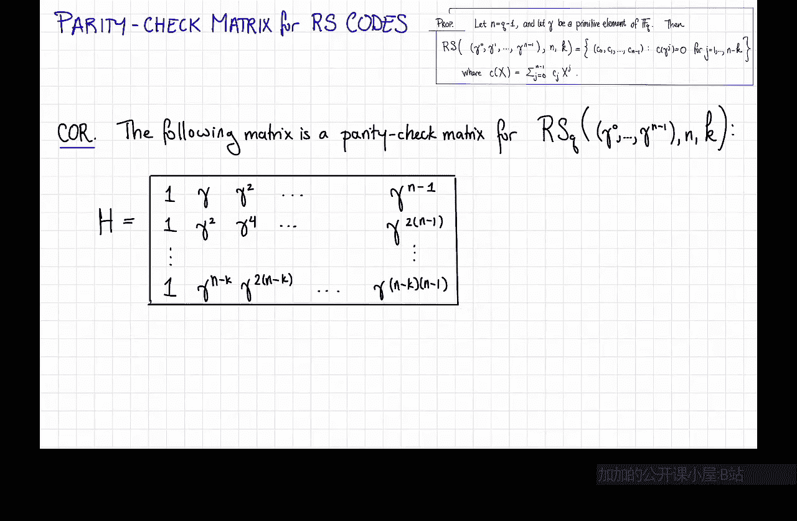
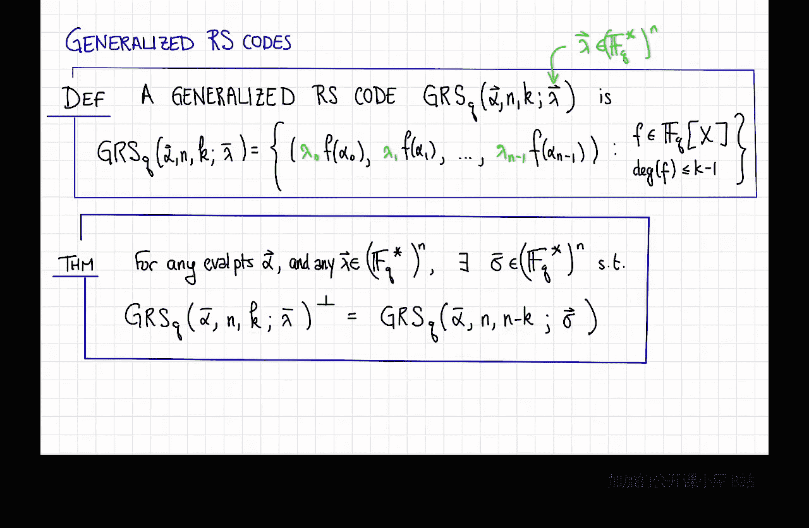

代数编码理论：第5章：RS码的对偶视角


在本节课中，我们将学习里德-所罗门码的奇偶校验矩阵。我们将从一些必要的代数定义开始，然后推导出RS码的奇偶校验矩阵，并探讨其对偶码的性质。

### 有限域乘法群与原始元

首先，我们需要定义 **Fq\***。**Fq\*** 是有限域 **Fq** 中所有非零元素构成的集合。在这个上下文中，乘法群意味着它在乘法运算下构成一个群，即它对乘法封闭且每个元素都有乘法逆元。

例如，考虑域 **F5** = {0, 1, 2, 3, 4}，其上的运算为模5加法和乘法。那么，**F5\*** 就是 **F5** 中所有非零元素，即 {1, 2, 3, 4}，并且我们只考虑其上的模5乘法。

关于 **Fq\*** 的一个重要事实是：它是一个**循环群**。这意味着存在一个元素 **γ ∈ Fq\***，使得 **Fq\*** 可以由 **γ** 的幂次生成。即：
**Fq\*** = {**γ**, **γ²**, **γ³**, ..., **γ^(q-1)**}
这样的 **γ** 被称为 **Fq** 的一个**原始元**。



回到我们的例子，**2** 是 **F5** 的一个原始元，因为：
2¹ = 2
2² = 4
2³ = 8 ≡ 3 (mod 5)
2⁴ = 16 ≡ 1 (mod 5)
集合 {2, 4, 3, 1} 恰好等于 **F5\***。另一方面，**4** 不是原始元，因为它的幂次只会产生 {4, 1}，无法生成整个 **F5\***。

### 一个关键代数事实

对于任何满足 0 < d < q-1 的整数 d，有限域 **Fq** 中所有元素的 d 次幂之和等于 0。即：
∑_{α ∈ Fq} α^d = 0

**证明**：
由于 α=0 时贡献为0，我们可以只对非零元素求和：
∑_{α ∈ Fq\*} α^d
设 **γ** 是 **Fq** 的一个原始元，那么 **Fq\*** 中的每个元素都可以表示为 **γ^j**，其中 j = 0, 1, ..., q-2。因此，求和式变为：
∑_{j=0}^{q-2} (γ^d)^j
这是一个几何级数。对于任何 x ≠ 1，我们知道：
∑_{j=0}^{t-1} x^j = (1 - x^t) / (1 - x)
令 x = γ^d， t = q-1，我们得到：
∑_{j=0}^{q-2} (γ^d)^j = (1 - (γ^d)^(q-1)) / (1 - γ^d)
根据有限域的性质，对于任何 β ∈ Fq，有 β^q = β。因此，令 β = γ^d，我们有 (γ^d)^q = γ^d。两边同时除以 γ^d（非零），得到 (γ^d)^(q-1) = 1。
所以，分子 1 - (γ^d)^(q-1) = 0。由于 d 满足 0 < d < q-1，且 **γ** 是原始元，因此 γ^d ≠ 1，分母 1 - γ^d ≠ 0。最终，整个分式等于 0。证毕。

### RS码的对偶描述

上一节我们介绍了有限域的关键性质，本节中我们来看看如何利用它来重新描述RS码。

**命题**：设 n = q-1，**γ** 是 **Fq** 的一个原始元。考虑一个里德-所罗门码，其评估点为 {**γ⁰**, **γ¹**, ..., **γⁿ⁻¹**}，码长为 n，维度为 k。那么，这个RS码等于以下集合：
{ (c₀, c₁, ..., c_{n-1}) ∈ Fqⁿ | C(**γʲ**) = 0, 对所有 j = 1, 2, ..., n-k }
其中，C(x) 是由系数 cᵢ 定义的多项式：C(x) = ∑_{i=0}^{n-1} c_i x^i。



注意，这个视角翻转了RS码的原始定义。在原始定义中，消息是某个多项式的系数，而码字是该多项式在评估点上的取值。在这个新视角下，码字本身被看作是某个多项式的系数，并且该多项式在某些点（**γ¹** 到 **γⁿ⁻ᵏ**）上的取值必须为0。

**证明（包含关系之一）**：
设 f(x) 是一个次数至多为 k-1 的多项式，那么一个RS码字就是 (f(**γ⁰**), f(**γ¹**), ..., f(**γⁿ⁻¹**))。
现在，考虑由这个码字构造的多项式 C(x) = ∑_{l=0}^{n-1} c_l x^l，其中 c_l = f(**γˡ**)。
我们计算 C(**γʲ**)（其中 1 ≤ j ≤ n-k）：
C(**γʲ**) = ∑_{l=0}^{n-1} c_l (**γʲ**)^l = ∑_{l=0}^{n-1} f(**γˡ**) **γʲˡ**
将 f(**γˡ**) 展开为 f(x) = ∑_{i=0}^{k-1} f_i x^i 在 x = **γˡ** 处的值：
= ∑_{l=0}^{n-1} [ ∑_{i=0}^{k-1} f_i **γⁱˡ** ] **γʲˡ**
交换求和顺序：
= ∑_{i=0}^{k-1} f_i [ ∑_{l=0}^{n-1} **γ⁽ⁱ⁺ʲ⁾ˡ** ]
令内部求和项为 S = ∑_{l=0}^{n-1} (**γ⁽ⁱ⁺ʲ⁾**)^l。
由于 0 ≤ i ≤ k-1 且 1 ≤ j ≤ n-k，我们有 1 ≤ i+j ≤ n-1 = q-2 < q-1。
根据上一节证明的关键事实，对于指数 d = i+j（满足 0 < d < q-1），有 ∑_{α ∈ Fq} α^d = 0。由于我们的求和是从 l=0 到 n-1（覆盖了 **γ⁰** 到 **γⁿ⁻¹**，即 **Fq\*** 的所有元素），因此 S = 0。
所以，C(**γʲ**) = 0。这证明了RS码是上述集合的一个子集。

要证明两个集合相等，还需要证明另一个方向的包含关系以及它们维度相同。通过计算奇偶校验矩阵，我们可以更清楚地看到这一点。

### RS码的奇偶校验矩阵

上一节我们看到了RS码的一个对偶描述，本节我们将把这个描述转化为具体的奇偶校验矩阵。

**推论**：以下矩阵 **H** 是上述命题中RS码的一个奇偶校验矩阵：
```
H = [ 1,    γ,    γ²,   ..., γⁿ⁻¹ ]
    [ 1,    γ²,   γ⁴,   ..., γ²⁽ⁿ⁻¹⁾ ]
    [ ...,  ...,  ...,  ..., ...     ]
    [ 1,    γⁿ⁻ᵏ, γ²⁽ⁿ⁻ᵏ⁾, ..., γ⁽ⁿ⁻ᵏ⁾⁽ⁿ⁻¹⁾ ]
```
矩阵 **H** 有 n 列和 n-k 行。



**为什么？**
考虑 **H** 乘以一个向量 **c** = (c₀, c₁, ..., c_{n-1})^T。乘积结果向量的第 j 个元素（j 从1到 n-k）是：
∑_{i=0}^{n-1} c_i (γʲ)^i = C(γʲ)
其中 C(x) = ∑_{i=0}^{n-1} c_i x^i。
因此，条件 **H * c = 0** 等价于要求 C(**γʲ**) = 0 对所有 j = 1, ..., n-k 成立。这正是上一节命题中描述的集合。所以，该RS码就是 **H** 的零空间（核），故 **H** 是其奇偶校验矩阵。

此外，矩阵 **H** 是一个范德蒙矩阵，因此它是满秩的，秩为 n-k。那么，其零空间的维度就是 n - (n-k) = k，这与RS码的维度一致，也证明了上一节命题中两个集合的维度相同，从而它们是相等的集合。

### 对偶码与广义RS码

注意到，奇偶校验矩阵 **H** 的转置 **Hᵀ** 看起来非常像一个RS码的生成矩阵（除了第一列全是1）。这暗示着RS码的对偶码本身也近似是一个RS码。为了精确描述这种关系，我们引入**广义里德-所罗门码**。

一个广义里德-所罗门码 **GRRS_q(α, n, k, λ)** 定义如下：
- **α** = (α₀, α₁, ..., α_{n-1}) 是一组互不相同的评估点。
- **n** 是码长。
- **k** 是维度。
- **λ** = (λ₀, λ₁, ..., λ_{n-1}) ∈ (Fq\*)ⁿ 是一个乘性权重向量。
其码字集合为：
{ (λ₀ * f(α₀), λ₁ * f(α₁), ..., λ_{n-1} * f(α_{n-1})) | f(x) ∈ Fq[x], deg(f) < k }
与标准RS码的唯一区别是在每个坐标上乘了一个非零常数 λᵢ。

**定理**：对于任意一组互异的评估点 **α** 和任意乘性权重向量 **λ** ∈ (Fq\*)ⁿ，总存在另一个乘性权重向量 **σ** ∈ (Fq\*)ⁿ，使得广义RS码 **GRRS_q(α, n, k, λ)** 的对偶码，等于另一个广义RS码 **GRRS_q(α, n, n-k, σ)**。

换句话说，广义RS码的对偶码仍然是广义RS码（评估点相同，维度变为 n-k，乘性权重向量不同）。我们在此不证明该定理，但鼓励读者思考权重向量 **σ** 应该如何由 **λ** 和评估点 **α** 决定。

### 总结



本节课中我们一起学习了：
1.  **有限域的乘法群 Fq\*** 和**原始元**的概念，它们能生成整个非零元素集合。
2.  一个关键代数事实：∑_{α ∈ Fq} α^d = 0（当 0 < d < q-1 时）。
3.  利用该事实，我们得到了RS码的一个对偶描述：码字作为系数的多项式在特定点（**γ¹** 到 **γⁿ⁻ᵏ**）上取值为零。
4.  由此推导出RS码的**奇偶校验矩阵 H**，它是一个范德蒙矩阵。
5.  通过观察 **Hᵀ** 类似于生成矩阵，我们引入了**广义RS码**，并指出其**对偶码仍然是广义RS码**。

所有这些结果都源于多项式的一个基本性质：非零多项式不能有太多根。正是这一性质赋予了RS码强大的纠错能力。