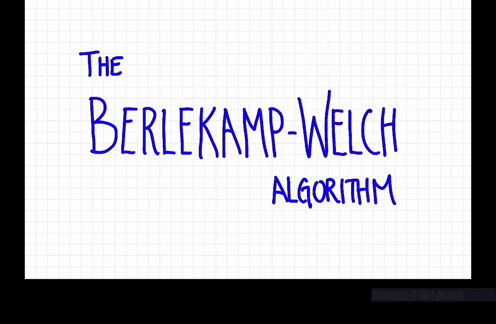
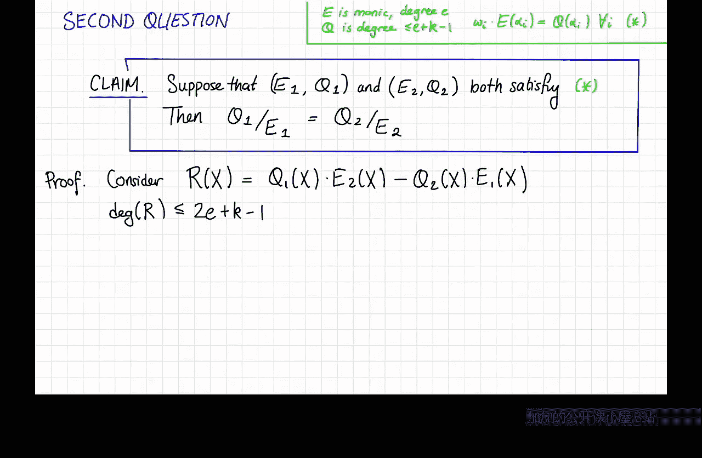
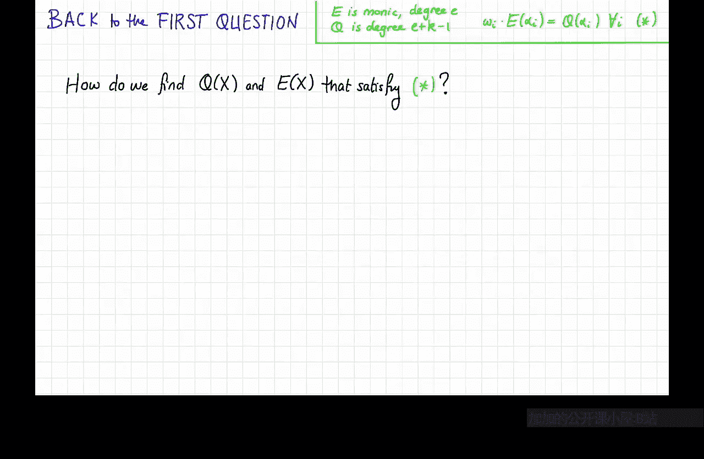
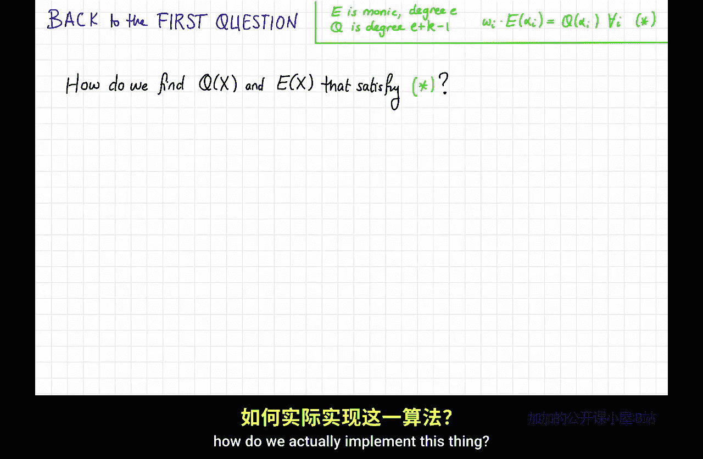
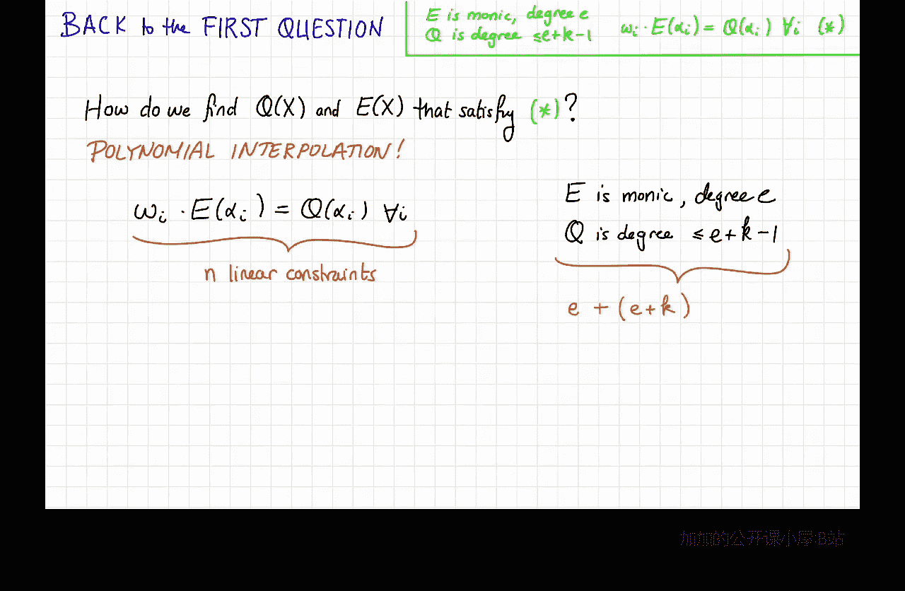
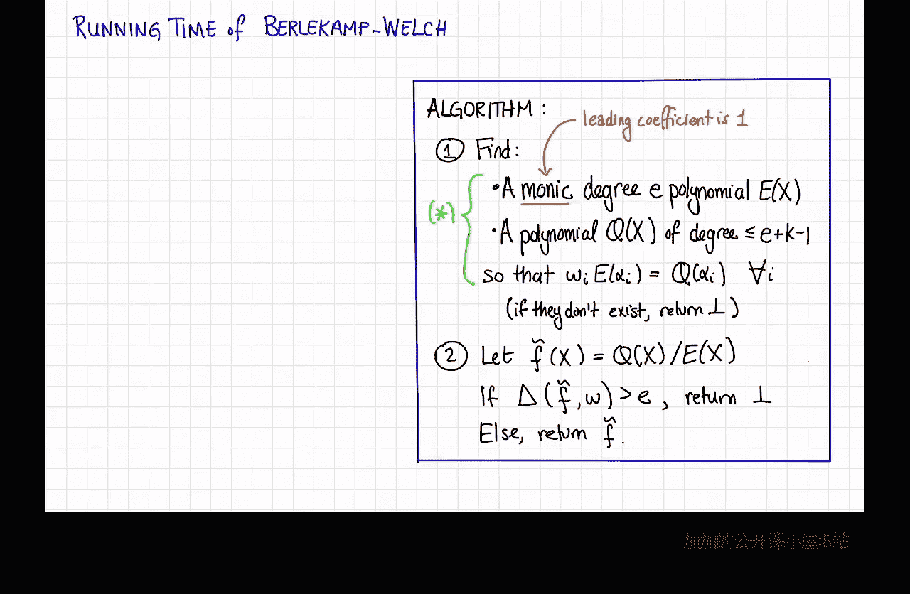

# 019：Berlekamp-Welch算法

在本节中，我们将学习一种用于解码里德-所罗门码的算法，称为Berlekamp-Welch算法。我们将了解该算法要解决的问题、其核心思想、具体步骤以及为何它是正确的。

## 问题定义 🎯

首先，我们需要明确要解决的问题：从错误中解码里德-所罗门码。

具体来说，假设我们收到一个字 **W**，即 **W = (W₁, W₂, ..., Wₙ) ∈ F_qⁿ**。我们的目标是找到一个里德-所罗门码字，使其与 **W** 足够接近。

这意味着我们需要找到一个定义在有限域 **F_q** 上的多项式 **F(x)**，其度数严格小于 **K**，并且与 **W** 的差异不能太大。量化来说，使得 **F(αᵢ) ≠ Wᵢ** 的位置 **i** 的数量最多为 **E**，其中 **E** 满足：

**E ≤ ⌊(n - K) / 2⌋**

如果不存在这样的多项式，算法应返回错误符号 **⊥**。

这里为什么是 **(n - K) / 2** 呢？因为里德-所罗门码达到了Singleton界，**⌊(n - K) / 2⌋** 本质上等于 **⌊(距离 - 1) / 2⌋**，这是我们理论上能纠正的最大错误数。因此，我们要求算法能高效地纠正尽可能多的错误。

## 算法核心思想 💡

上一节我们定义了要解决的问题，本节中我们来看看Berlekamp-Welch算法的基本思路。

算法的基本思想是引入一个**错误定位多项式 E(x)**。

假设 **F(x)** 是我们想找的正确码字多项式。我们定义多项式 **E(x)** 如下：

**E(x) = ∏ (x - αᵢ)**，其中乘积遍历所有满足 **Wᵢ ≠ F(αᵢ)** 的索引 **i**。

注意，在解决问题时，我们并不知道这个多项式具体是什么，因为我们不知道哪些位置是错误。但从数学上讲，如果存在正确的 **F**，那么这个 **E(x)** 就存在。我们称它为错误定位多项式，因为如果我们代入一个错误位置 **αᵢ**（即 **Wᵢ ≠ F(αᵢ)**），这个多项式值就为零。

基于这个定义，我们可以得到一个关键观察：对于所有的 **i**，下式成立：

**Wᵢ * E(αᵢ) = F(αᵢ) * E(αᵢ)**

为什么成立？如果 **Wᵢ = F(αᵢ)**，那么等式两边显然相等。如果 **Wᵢ ≠ F(αᵢ)**，那么根据定义 **E(αᵢ) = 0**，等式变为 **0 = 0**，同样成立。因此这个等式恒成立。

现在，我们定义另一个多项式 **Q(x) = F(x) * E(x)**。那么上面的等式可以重写为：

**Wᵢ * E(αᵢ) = Q(αᵢ)**， 对所有 **i** 成立。

Berlekamp-Welch算法的思路就是：找到满足上述关系式的多项式 **Q(x)** 和 **E(x)**，然后通过计算 **Q(x) / E(x)** 来恢复出 **F(x)**。

## 算法步骤 📝

理解了核心思想后，现在我们来看算法的具体步骤。算法分为两步：

**步骤 1：寻找多项式**
找到满足以下条件的多项式：
1.  **E(x)**：首一多项式（最高次项系数为1），次数恰好为 **E**。
2.  **Q(x)**：次数最多为 **E + K - 1**。
3.  对于所有 **i = 1 到 n**，满足：**Wᵢ * E(αᵢ) = Q(αᵢ)**。

我们称这组条件为 **（★）**。如果找不到这样的多项式，则返回 **⊥**。

**步骤 2：恢复并验证**
1.  计算 **F̃(x) = Q(x) / E(x)**（多项式除法）。
2.  检查 **F̃(x)** 是否是一个好答案。计算向量 **F̃**（在全部评估点 **αᵢ** 上的取值）与接收字 **W** 之间的汉明距离。
3.  如果距离大于 **E**，说明 **F̃** 不是正确答案，返回 **⊥**。
4.  否则，返回 **F̃**。

这就是完整的Berlekamp-Welch算法。此时，你可能会有两个疑问：第一，如何实现步骤1？第二，为什么步骤2中除以 **E(x)** 就能得到正确答案？

## 算法正确性证明 ✅

上一节我们提出了两个关键问题，本节我们先来回答第二个问题：为什么算法是正确的？这需要两个引理来证明。

**引理 1：解的存在性**
如果存在一个次数小于 **K** 的多项式 **F(x)**，其与 **W** 的汉明距离不超过 **E**，那么必然存在满足条件 **（★）** 的多项式 **E(x)** 和 **Q(x)**，并且满足 **F(x) = Q(x) / E(x)**。

**证明：**
按照核心思想中的定义来构造即可。
令 **d = d_H(F, W)** 为实际错误数（**d ≤ E**）。
定义错误定位多项式：
**E(x) = x^(E - d) * ∏_{i: Wᵢ ≠ F(αᵢ)} (x - αᵢ)**
乘以 **x^(E-d)** 是为了确保 **E(x)** 的次数恰好为 **E**，并且它是首一的。
定义 **Q(x) = E(x) * F(x)**。
可以验证，这样定义的 **E(x)** 和 **Q(x)** 满足条件 **（★）**，且 **Q(x) / E(x) = F(x)**。

**引理 2：解的唯一性（在比值意义上）**
假设有两组多项式 **（E₁, Q₁）** 和 **（E₂, Q₂）** 都满足条件 **（★）**。那么，**Q₁(x) / E₁(x) = Q₂(x) / E₂(x)**。

**证明：**
考虑多项式 **R(x) = Q₁(x)E₂(x) - Q₂(x)E₁(x)**。
1.  **次数**：**Q** 的次数 ≤ **E + K - 1**，**E** 的次数 = **E**。因此 **R(x)** 的次数 ≤ **2E + K - 1**。
2.  **根**：对于所有 **i**，根据条件 **（★）**，有 **Q₁(αᵢ) = Wᵢ E₁(αᵢ)** 和 **Q₂(αᵢ) = Wᵢ E₂(αᵢ)**。代入 **R(αᵢ)** 可得其值为0。所以 **R(x)** 在 **n** 个点 **αᵢ** 上都为0，即有 **n** 个根。
3.  **矛盾与结论**：我们已知 **E ≤ ⌊(n - K)/2⌋**，这意味着 **2E + K - 1 < n**。因此，**R(x)** 是一个次数小于 **n** 却拥有 **n** 个根的多项式。在域上，非零多项式的根数不能超过其次数。所以 **R(x)** 必须是零多项式，即 **R(x) ≡ 0**。
    由 **R(x) ≡ 0** 可得 **Q₁(x)E₂(x) = Q₂(x)E₁(x)**，从而 **Q₁(x)/E₁(x) = Q₂(x)/E₂(x)**。

结合这两个引理，算法的正确性就得到了保证：引理1保证了至少存在一组解 **（E, Q）** 能通过除法得到正确的 **F**；引理2保证了任何满足条件 **（★）** 的解，其比值 **Q/E** 都是相同的。因此，无论我们在步骤1中找到哪一组解，通过步骤2的除法都能得到唯一的正确答案 **F**。

## 算法实现：步骤1的求解 🔧

现在我们来回答第一个问题：如何具体实现步骤1，即找到多项式 **E** 和 **Q**？

答案是将其转化为一个**线性方程组**并求解。

条件 **Wᵢ * E(αᵢ) = Q(αᵢ)** 对于每个 **i** 都提供了一个线性方程。这些方程中的变量是多项式 **E(x)** 和 **Q(x)** 的系数。

*   **E(x)** 是首一的 **E** 次多项式，有 **E** 个未知系数（因为首一，所以最高次项系数为1，是已知的）。
*   **Q(x)** 是次数 ≤ **E + K - 1** 的多项式，有 **E + K** 个未知系数。

因此，我们总共有 **(E) + (E + K) = 2E + K** 个未知变量。
我们有 **n** 个线性方程（每个评估点一个）。

根据引理1，如果存在接近 **W** 的码字，那么这个线性方程组至少有一个解。我们的任务就是找到这个方程组的任意一个解。这可以通过标准的高斯消元法等线性系统求解方法来完成。

## 算法复杂度与总结 📊

最后，我们来分析一下Berlekamp-Welch算法的时间复杂度，并对本节内容进行总结。

算法的运行时间主要取决于两个步骤：
1.  **步骤1（求解线性系统）**：对于一个有 **O(n)** 个方程和 **O(n)** 个变量的系统，使用高斯消元法需要 **O(n³)** 的时间。
2.  **步骤2（多项式除法）**：两个次数为 **O(n)** 的多项式相除，也可以在 **O(n²)** 或 **O(n³)** 时间内完成（取决于实现方式）。

因此，算法的总时间复杂度为 **O(n³)**，其中 **n** 是里德-所罗门码的码长。这比暴力遍历所有码字（指数级复杂度）要高效得多。

😊 然而，还存在更快的解码算法。例如，在之前的课程中提到的 **Berlekamp-Massey算法**，其运行时间可以达到 **O(n²)** 甚至更快。虽然本系列视频不会深入讲解该算法，但鼓励感兴趣的读者自行查阅相关资料。

---

**本节课总结**
在本节课中，我们一起学习了Berlekamp-Welch解码算法。
1.  我们首先明确了算法要解决的问题：纠正最多 **⌊(n-K)/2⌋** 个错误的里德-所罗门码解码。
2.  我们理解了算法的核心思想：通过引入错误定位多项式 **E(x)**，将解码问题转化为寻找满足线性约束 **WᵢE(αᵢ) = Q(αᵢ)** 的多项式对 **（E, Q）**，然后通过 **Q/E** 恢复信息多项式 **F**。
3.  我们详细阐述了算法的两个步骤，并利用两个关键引理证明了算法的正确性。
4.  我们说明了如何通过建立并求解线性方程组来实现算法的关键步骤。
5.  最后，我们分析了算法具有 **O(n³)** 的多项式时间复杂度，是一种高效的解码方法。