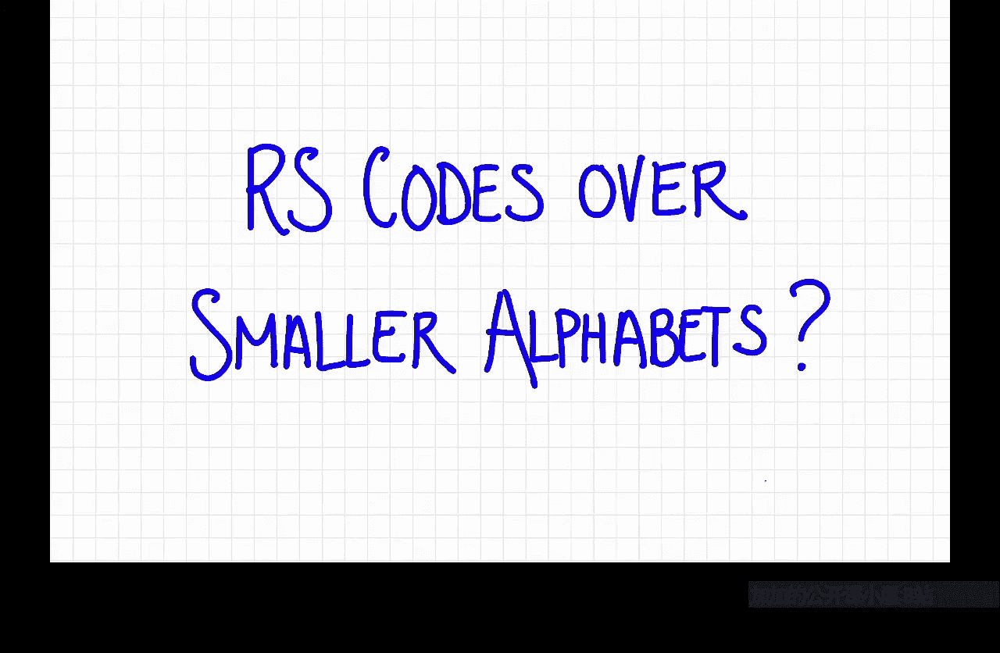
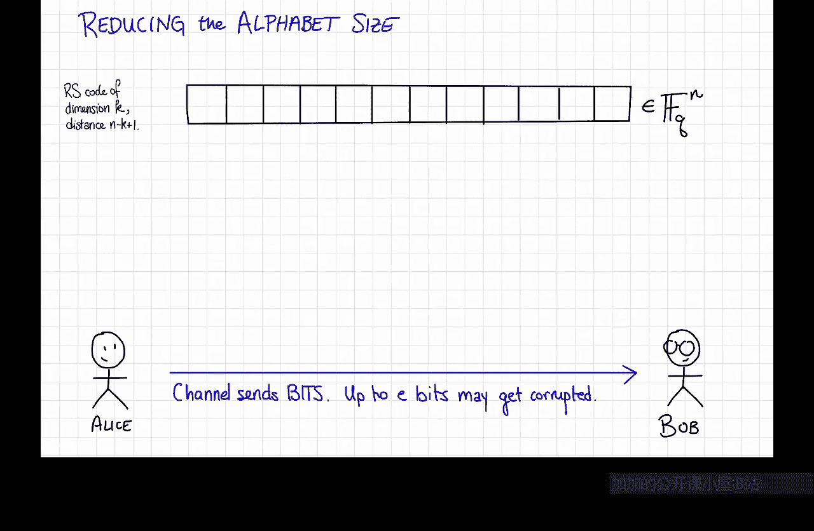
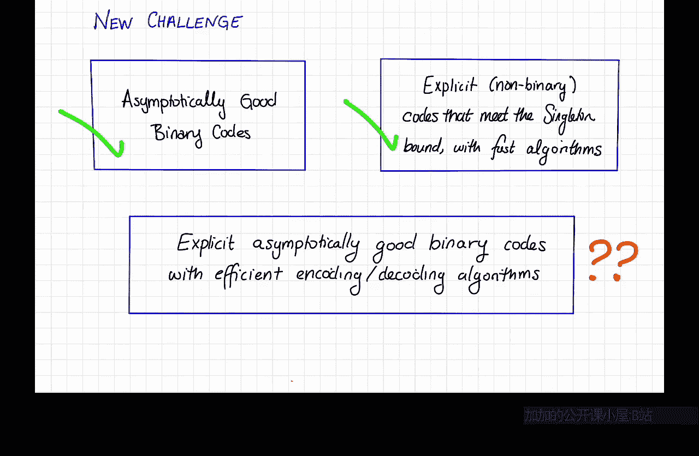

# 020：为RS码寻找更小的字母表？ 🔍

在本节课中，我们将要学习里德-所罗门码面临的一个主要挑战：其庞大的字母表规模。我们将分析为何这在实际应用中会成为一个问题，并探讨如何将其转化为性能更优的二进制码。

## 概述：里德-所罗门码的挑战

上一节我们介绍了里德-所罗门码，它基于低次多项式根的数量有限这一优美思想，达到了Singleton界，实现了编码率与距离之间的最优权衡，并且拥有高效的编解码算法。然而，里德-所罗门码有一个主要缺点：它需要很大的字母表。

为了理解为何这是一个问题，让我们回到Alice和Bob的通信场景。假设他们想使用一个参数为 `(n, k, d)` 的里德-所罗门码，其中字母表大小为 `Q`（且 `Q ≥ n`）。然而，他们之间的信道只能传输比特（0和1），并且最多可能有 `e` 个比特在传输中被破坏。

## 简单的二进制转换策略

Alice和Bob可以尝试一种非常自然的方法来将他们的里德-所罗门码用于这个二进制信道。

基本思路是，将字母表 `F_Q` 中的每个符号（大小为 `Q`）用 `log₂(Q)` 个比特来表示。这样，一个长度为 `n` 的RS码字就被转换成了一个长度为 `N = n log Q` 的比特串。

这似乎是一个合理的做法。但如果我们将其视为一个二进制码，它的参数表现如何呢？

以下是新二进制码的参数计算：

*   **消息长度 `k'`**：新码的大小与原码相同，为 `Q^k`。因此，二进制码的消息长度为 `k' = log₂(Q^k) = k log Q`。
*   **块长度 `n'`**：`n' = n log Q`。
*   **距离 `d'`**：我们至少可以保证 `d' ≥ d = n - k + 1`（即原RS码的距离）。这是因为，如果我们在转换后的比特串中破坏了 `d` 个比特，并且这些比特恰好分布在 `d` 个不同的符号块中，那么它们就对应着破坏了原码字中的 `d` 个完整符号。我们无法期望距离会乘以 `log Q`。

现在，让我们计算这个新二进制码的编码率和相对距离。

*   **新编码率 `R'`**：`R' = k' / n' = (k log Q) / (n log Q) = k / n`。这与原RS码的编码率 `R` 相同。
*   **新相对距离 `δ'`**：`δ' = d' / n' ≥ d / (n log Q) = δ / log Q`，其中 `δ = d/n` 是原RS码的相对距离。由于对于RS码有 `n ≤ Q`，我们可以得到 `δ' ≤ δ / log n`。

这个结果有些令人困扰。新二进制码的相对距离 `δ'` 不仅比原RS码的相对距离 `δ` 更差，而且随着 `n` 的增大，`log n` 项会使 `δ'` 趋近于0。如果我们采用这种方法，虽然得到了一个二进制码，但我们甚至无法得到一个**渐近好码**（asymptotically good code），因为其相对距离会随着块长度的增加而趋于零。

## 设定新目标

鉴于上述情况，让我们为自己设定一个新的目标。首先，回顾一下我们已经实现的目标：

1.  **证明渐近好二进制码的存在性**：我们通过Gilbert-Varshamov界实现了这个目标，它告诉我们随机线性码就是这样的码。
2.  **构造明确的、达到Singleton界且具有快速算法的码**：我们通过里德-所罗门码实现了这个目标（尽管它们不是二进制码）。这里的“明确”意味着存在一种高效的方式来描述它们。

接下来，我们追求的是**两者的结合**。

我们想要的是**明确的、二进制的、具有高效编解码算法的**码。同时，我们希望它们在编码率和距离之间有良好的权衡。理想情况下，我们希望它们能达到二进制码可达到的最优权衡（尽管我们尚不清楚这个最优值具体是什么）。目前，让我们先满足于**渐近好**这个条件，即编码率和相对距离都远离零。

这将是接下来几节课我们的新目标。

## 总结

本节课中我们一起学习了里德-所罗门码在实际应用中的一个核心限制：其庞大的字母表规模。通过分析将其简单转换为二进制码的性能，我们发现这种直接的方法会导致相对距离严重衰减，无法得到渐近好码。因此，我们需要寻找更好的方法将RS码（或其思想）转化为高效的二进制码。在后续课程中，我们将探索实现这一新目标的策略。