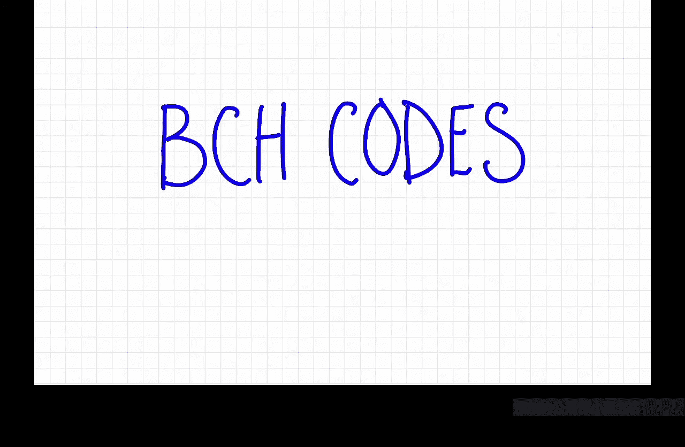
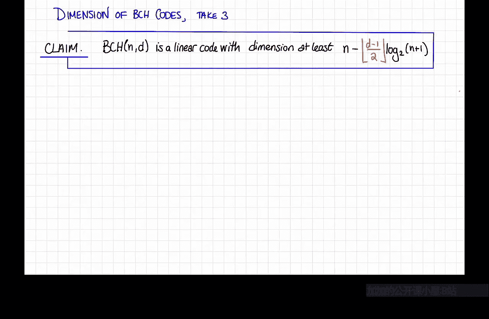
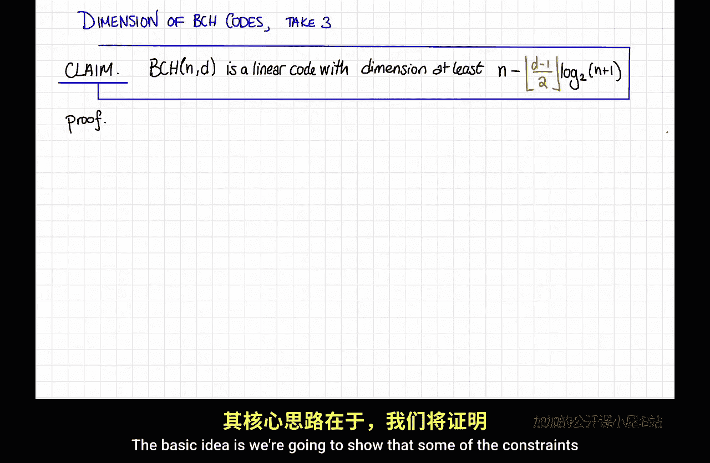
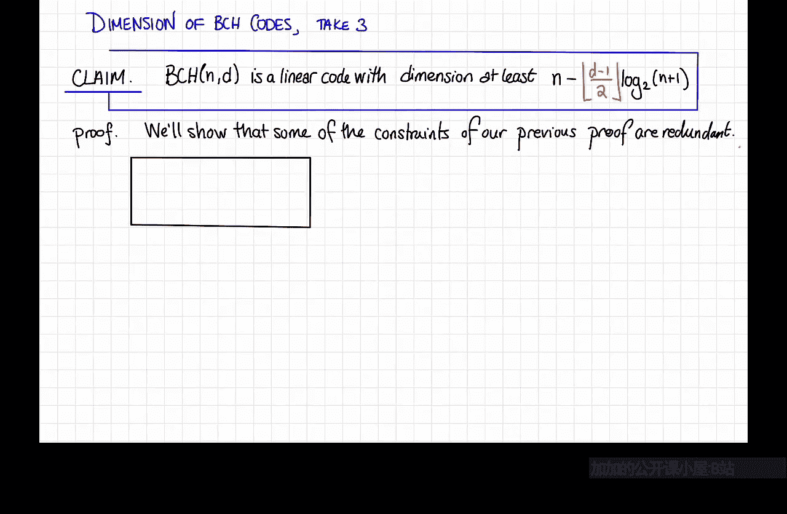
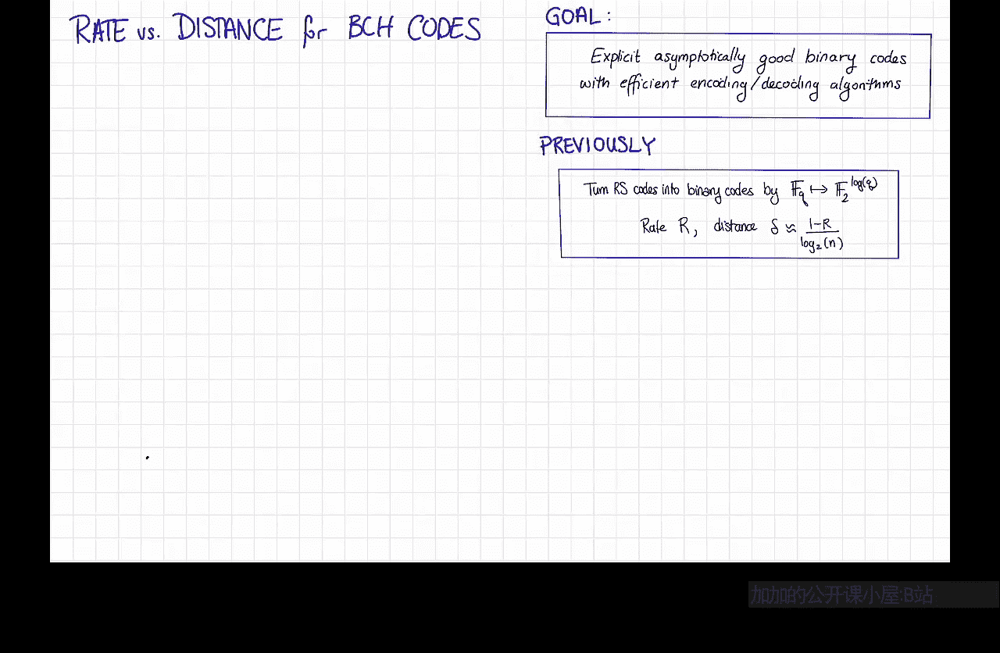
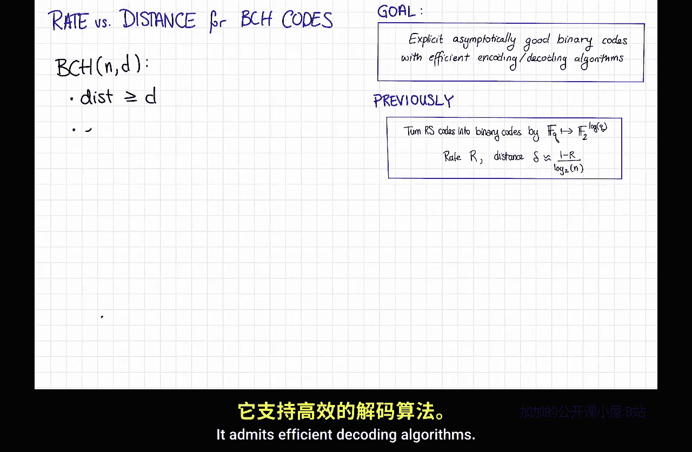
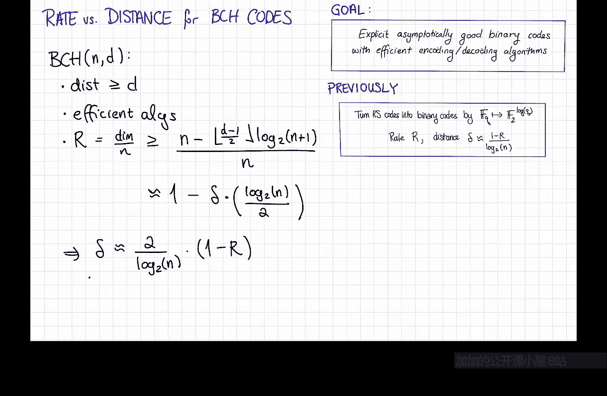

代数编码理论：2：BCH码

在本节课中，我们将学习如何将里德-所罗门码转换为二进制码，这种方法被称为BCH码。我们将探讨BCH码的定义、性质、维度分析，并评估其作为二进制码的性能。

---

在之前的课程中，我们提出了如何将里德-所罗门码转换为二进制码的问题。本节中，我们将介绍一种称为BCH码的方法。

BCH码的名称来源于其发明者Bose、Chaudhuri和Hocquenghem的首字母，他们分别在1959年和1960年发现了这种码。

以下是BCH码的定义。

设 **n = 2^m - 1**，其中 **m** 是一个整数。令 **γ** 是有限域 **F_{2^m}** 的一个本原元。对于某个参数 **d ≤ n**，定义参数为 **(n, d)** 的BCH码为所有满足以下条件的向量 **c = (c_0, c_1, ..., c_{n-1}) ∈ F_2^n** 的集合：
对于所有 **j ∈ {1, 2, ..., d-1}**，有 **c(γ^j) = 0**。
其中，**c(x)** 是以 **c_i** 为系数的多项式：**c(x) = Σ_{i=0}^{n-1} c_i x^i**。

这个定义与之前看到的里德-所罗门码的对偶视角非常相似。另一种理解是，BCH码就是所有恰好是二进制的里德-所罗门码字的集合。换句话说，它是相应里德-所罗门码与集合 **F_2^n** 的交集。

基于这个观察，我们可以得出两个结论。

首先，这个BCH码的距离至少为 **d**，因为 **d** 是对应里德-所罗门码的距离。我们通过丢弃所有非二进制码字得到BCH码，这不会减小距离。

其次，BCH码拥有高效的解码算法。特别是，我们可以使用一些为里德-所罗门码设计的算法（如Berlekamp-Massey算法）来解码BCH码。实际上，历史上这些算法是先为BCH码开发的，后来才扩展到里德-所罗门码。

因此，我们现在有了一个具有良好距离和高效算法的二进制码。剩下的主要问题是：BCH码的维度是多少？

如果我们把BCH码定义为所有恰好是二进制的里德-所罗门码字，我们可能会怀疑BCH码中是否真的存在任何码字。为什么一个定义在大域上的低次多项式，在其所有域元素上的取值会恰好都是0或1呢？凭直觉，我们可能认为BCH码的维度是0，除了全零码字外没有其他码字。但事实上，它的维度大于0。让我们看看原因。

以下是一个关于BCH码维度的断言。

**断言**：BCH码是域 **F_2** 上的一个线性码，其维度至少为 **n - d + 1**。

需要指出，这个断言是**错误**的。然而，我们尝试证明它的过程将很有启发性。在证明过程中，请注意找出错误。

以下是“证明”：

首先，注意到定义中的条件 **c(γ^j) = 0** 是系数 **c_0, ..., c_{n-1}** 上的一个线性约束。具体来说，这个线性约束是：
**Σ_{i=0}^{n-1} (γ^{j})^i * c_i = 0**。
对于每个 **j ∈ {1, ..., d-1}**，都有这样一个约束，因此总共有 **d-1** 个约束。

根据线性代数，BCH码的维度至少应为变量数减去约束数。这里有 **n** 个变量和 **d-1** 个约束，所以维度至少为 **n - (d-1) = n - d + 1**。证毕。

这个证明是错误的，断言也是错误的。为了看清原因，我们可以做一个快速检查。

在速率与相对距离的关系图上，对于 **q=2**，辛格尔顿界是一条斜率为-1的直线，而普洛特金界则指出，在相对距离大于1/2的区域，辛格尔顿界是无法达到的。然而，上述断言声称BCH码达到甚至可能超过了辛格尔顿界（具有块长 **n**，距离至少 **d**，维度至少 **n-d+1**），这与普洛特金界矛盾。

那么错误在哪里？问题在于，约束 **Σ_{i=0}^{n-1} (γ^{j})^i * c_i = 0** 并不是在 **F_2** 上的线性约束。这是一个系数在 **F_{2^m}**（大域）中的线性方程，而不是系数在 **F_2** 中的线性约束。因此，之前的线性代数论证不成立。

不过，我们可以修正这个证明。以下是正确的断言。

**修正后的断言**：参数为 **(n, d)** 的BCH码是一个线性码，其维度至少为 **n - (d-1) * ⌈log_2(n+1)⌉**。

让我们来证明它。

基本思路相同，我们仍然计算约束数量，但这次要正确计算。我们将证明，每个约束 **c(γ^j) = 0** 实际上对应着 **m** 个不同的 **F_2** 线性约束。

为此，我们需要使用关于域 **F_{2^m}** 的一个事实：有限域 **F_{2^m}** 在忽略乘法运算后，其加法结构与向量空间 **F_2^m** 相同。更正式地说，存在一个双射映射 **φ: F_{2^m} → F_2^m**，使得 **φ** 与加法兼容：**φ(α + β) = φ(α) + φ(β)**。

利用这个事实，我们来看约束 **c(γ^j) = 0**，即 **Σ_{i=0}^{n-1} c_i * γ^{ij} = 0**。
对等式两边应用映射 **φ**。由于 **φ** 是 **F_2** 线性的，并且 **c_i ∈ {0, 1}**，我们得到：
**Σ_{i=0}^{n-1} c_i * φ(γ^{ij}) = 0** （作为 **F_2^m** 中的向量）。

这可以写成一个矩阵方程：**H * c^T = 0**，其中 **H** 是一个 **m × n** 的矩阵，其第 **i** 列是向量 **φ(γ^{ij})**。因此，原始的单个约束等价于 **m** 个 **F_2** 上的线性约束（即矩阵 **H** 的 **m** 行）。

现在，让我们计算变量和约束的数量。
*   变量数：**n**（即 **c_0, ..., c_{n-1}**）。
*   约束数：对于每个 **j ∈ {1, ..., d-1}**，有 **m** 个约束。总约束数为 **m * (d-1)**。
由于 **n = 2^m - 1**，所以 **m = ⌈log_2(n+1)⌉**。

因此，BCH码的维度至少为：
**n - m*(d-1) = n - (d-1) * ⌈log_2(n+1)⌉**。
这就证明了修正后的断言。

另一种理解这个证明的方式是通过校验矩阵。我们可以构造BCH码的一个校验矩阵 **H**，它由 **d-1** 个上述的 **m×n** 矩阵堆叠而成，总共有 **m*(d-1)** 行。码字位于该矩阵的零空间中，因此维度至少是 **n - rank(H) ≥ n - m*(d-1)**。

实际上，我们还可以将这个界限改进大约2倍。

**改进的断言**：参数为 **(n, d)** 的BCH码的维度至少为 **n - ⌈(d-1)/2⌉ * ⌈log_2(n+1)⌉**。

证明的基本思想是，我们之前证明中的一些约束是冗余的，可以去掉一半。

考虑我们之前构建的校验矩阵 **H**，它有 **d-1** “层”（每层对应一个 **j**）。我们将证明，只需要保留对应于奇数 **j** 的那些层，得到的矩阵 **H'** 与 **H** 具有相同的行空间，因此是同一码的校验矩阵。

为了证明这一点，我们需要一个子结论。

**子结论**：对于任何系数在 **F_2** 上的多项式 **c(x)**，以及对于所有 **α ∈ F_{2^m}**，如果 **c(α) = 0**，那么 **c(α^2) = 0**。

**证明**：假设 **c(α) = 0**，即 **Σ c_i α^i = 0**。
在特征为2的域（如 **F_{2^m}**）中，有一个性质称为“Freshman‘s Dream”：**(a+b)^2 = a^2 + b^2**。这个性质可以推广到求和。因此：
**0 = (Σ c_i α^i)^2 = Σ (c_i α^i)^2 = Σ c_i^2 α^{2i}**。
由于 **c_i ∈ {0,1}**，有 **c_i^2 = c_i**。所以上式变为 **Σ c_i α^{2i} = c(α^2) = 0**。
这就证明了子结论。

这个子结论意味着，如果 **c(γ^j) = 0**，那么对于任何偶数 **j**，有 **c(γ^j) = 0 ⇔ c(γ^{j/2}) = 0**。因此，所有对应于偶数 **j** 的约束，都已经包含在对应于 **j/2**（一个更小的数，可能是奇数）的约束中了。所以，在构造校验矩阵时，我们只需要保留对应于奇数 **j** 的那些层。这样，约束层的数量就从 **d-1** 减少到了 **⌈(d-1)/2⌉**。

使用与之前相同的论证，变量数为 **n**，约束数至多为 **⌈(d-1)/2⌉ * m**。因此，维度至少为 **n - ⌈(d-1)/2⌉ * m**，其中 **m = ⌈log_2(n+1)⌉**。这就证明了改进的断言。

---

现在我们已经理解了BCH码的维度，让我们回到在之前视频中设定的原始目标：构造具有高效编码解码算法的、显式的、渐近好的二进制码。

之前我们看到的简单策略（将里德-所罗门码的每个q元符号替换为长度为 **log q** 的二进制串）效果不佳。其速率 **R** 和相对距离 **δ** 满足 **δ ≈ (1-R) / log_2 n**。

那么BCH码在这个目标上表现如何？与之前的结果相比又如何？

对于参数为 **(n, d)** 的BCH码：
*   距离至少为 **d**。
*   拥有高效解码算法。
*   根据改进的维度下界，其速率 **R = k/n** 满足：
    **R ≥ [n - (d-1)/2 * log_2(n)] / n ≈ 1 - (δ * log_2 n) / 2**，
    其中 **δ = d/n** 是相对距离。

整理上式，可得 **δ ≈ (2 / log_2 n) * (1 - R)**。

将此式与之前简单策略的结果 **δ ≈ (1-R) / log_2 n** 比较，我们发现BCH码的表现要好大约2倍（分母上多了个因子2）。

然而，当 **n** 趋于无穷大时，如果保持速率 **R** 为常数，相对距离 **δ** 仍然会趋于0。因此，BCH码**并未**实现我们“渐近好”的最终目标（即同时保持常数速率和常数相对距离）。

尽管如此，由于这些高效的算法以及比简单策略更优的速率-距离权衡，BCH码在实践中被广泛使用，特别是在 **n** 不是特别大的场景中。

---

**总结**

本节课中，我们一起学习了BCH码。BCH码是一种将里德-所罗门码“二进制化”的有效方法，即取里德-所罗门码中所有恰好是二进制的码字构成的子集。我们发现这个子集确实非空，并且BCH码具有明确定义的距离下界和高效解码算法。

我们详细分析了BCH码的维度，推导出其下界为 **n - ⌈(d-1)/2⌉ * ⌈log_2(n+1)⌉**。虽然BCH码未能实现构造渐近好二进制码的最终目标，但其在实用中的优异性能使其成为一个非常重要且有用的编码方案。

在下一节课中，我们将探索另一种将里德-所罗门码转换为二进制码的方法。