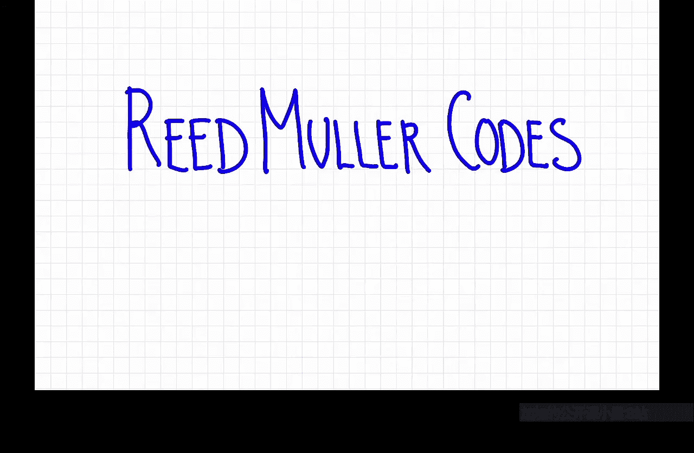
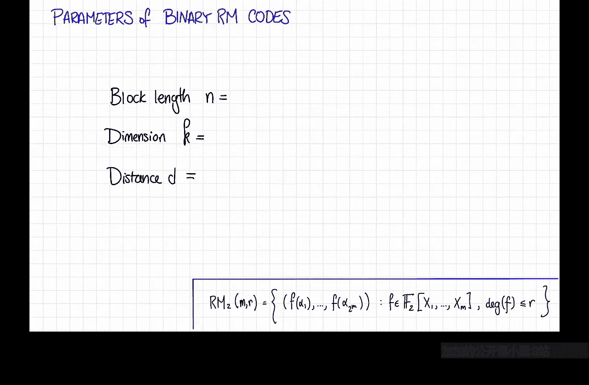
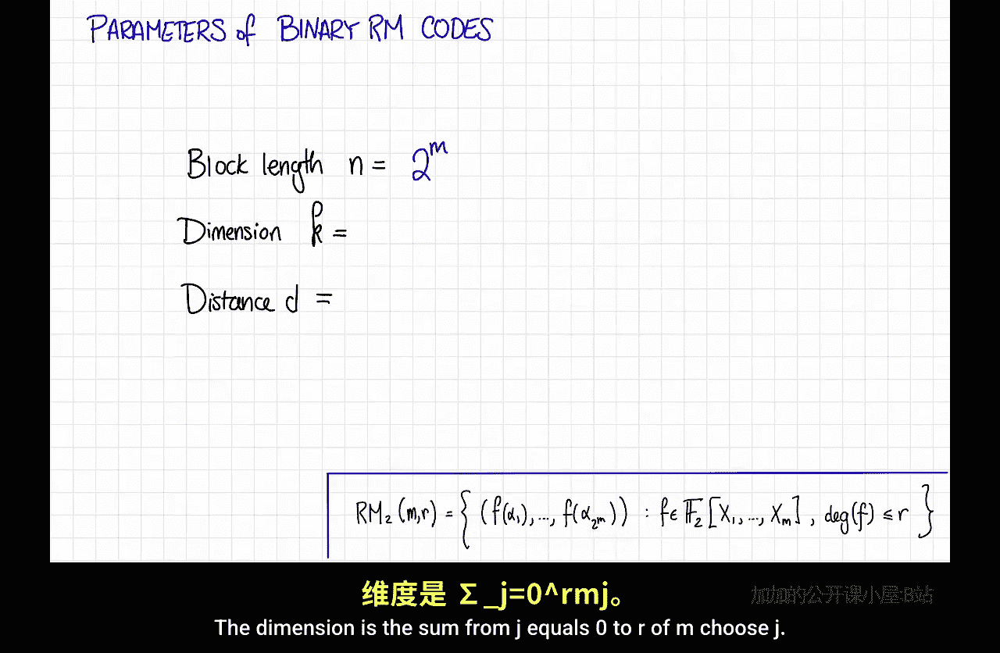
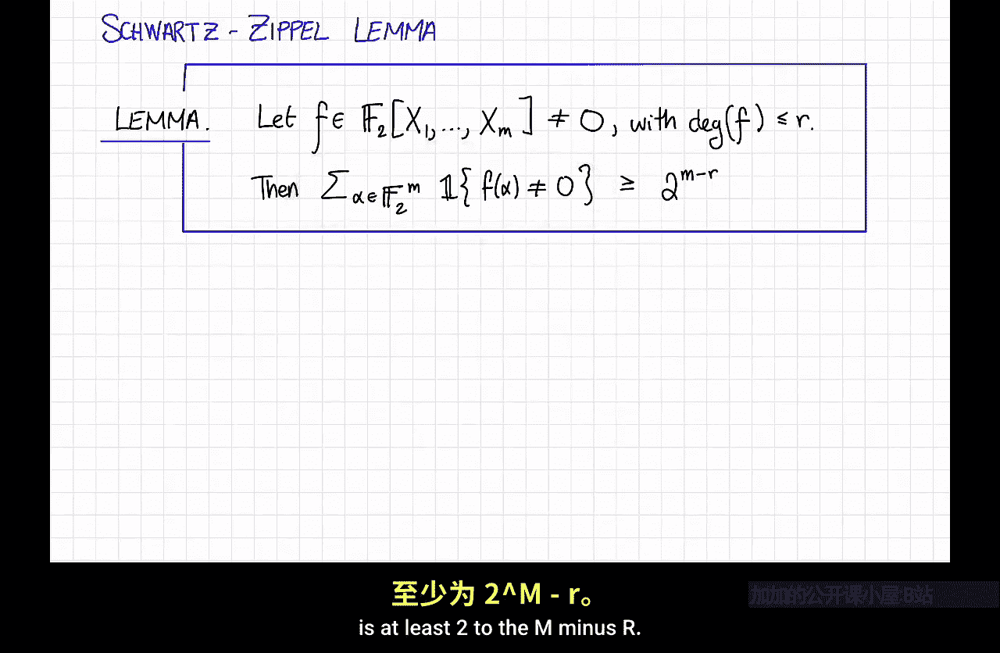
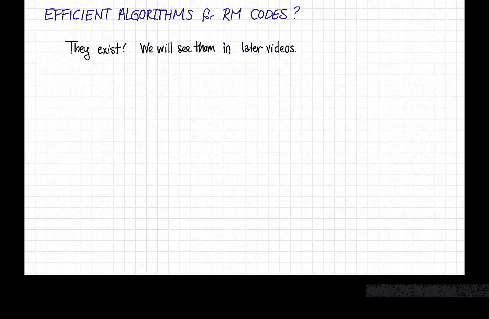
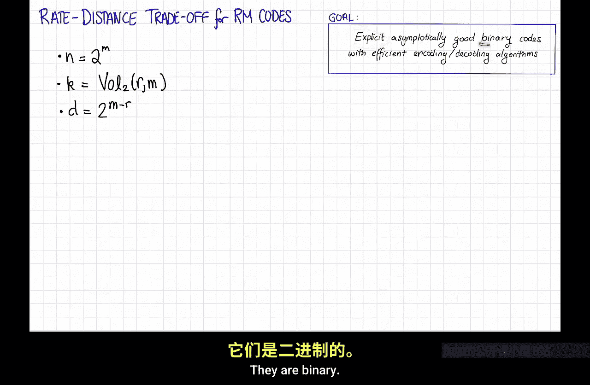
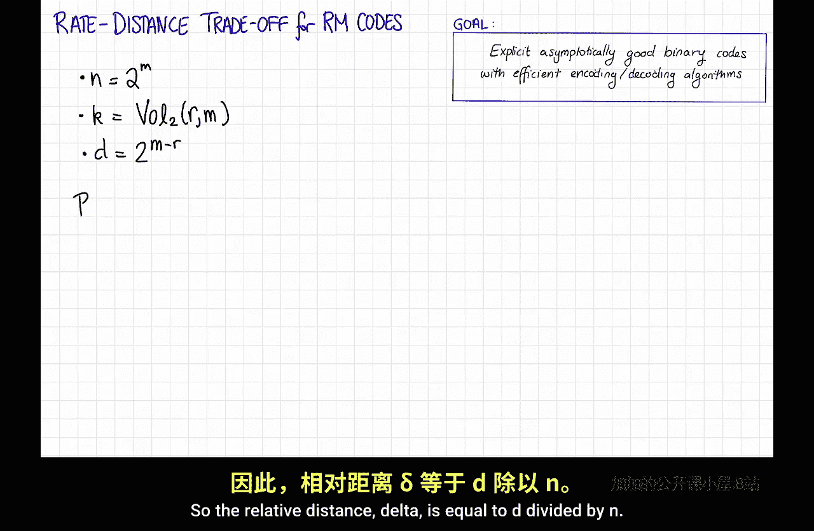
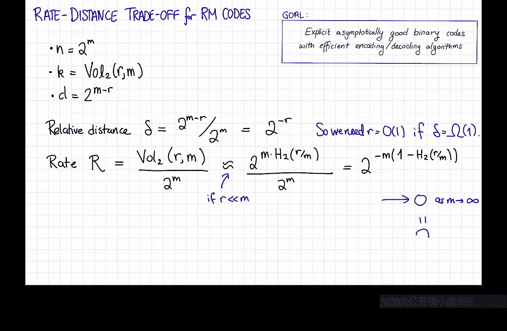

# 022：二进制里德-穆勒码

在本节课中，我们将学习另一种基于里德-所罗门码思想的二进制编码方案——二进制里德-穆勒码。我们将了解其定义、参数特性，并分析它是否满足我们对“好”码的期望。

## 定义与历史背景

上一节我们介绍了不同的二进制里德-所罗门码变体。本节中，我们来看看另一种称为二进制里德-穆勒码的变体。

以下是二进制里德-穆勒码的定义。作为一个历史旁注，里德-穆勒码实际上早于里德-所罗门码被发明，尽管我们是以相反的顺序介绍它们。里德-穆勒码由穆勒发明，并由里德在1954年提供了一种高效的解码算法。

二进制M元里德-穆勒码（度数为R）定义如下：
我们使用符号 **RM₂(m, R)**。它的定义方式与里德-所罗门码类似。它是所有向量的集合，这些向量是某个多项式F在一组评估点α₁到α₂ᵐ上的取值。其中，F是定义在二元域F₂上的一个M元多项式，且**度数至多为R**。这里的评估点α₁到α₂ᵐ，就是F₂ᵐ中所有可能的点。因此，每个αᵢ都是一个长度为M的二进制向量。

F是一个M元多项式。例如，F(x₁, x₂)是一个包含两个变量的二元多项式。多项式中可以包含这些变量的任意组合构成的单项式。多项式F的度数就是其中出现的任何单项式的最高次数。一个包含K个变量的单项式的次数就是K。

这看起来非常像里德-所罗门码，只不过我们处理的是多元多项式。

## 多元多项式的形式

为了更清晰地定义度数至多为D的多元多项式，任何这样的多项式——即定义在F₂上、变量为x₁到xₘ、度数至多为D的M元多项式——都具有以下形式：

**F(x₁, …, xₘ) = Σ_{S ⊆ {1,…,m}, |S| ≤ D} a_S · (Π_{i∈S} x_i)**

其中，系数a_S来自F₂。这就是此类多项式的一般形式。你选择一些系数，就得到了具有这些系数的多项式。

请注意，因为我们在F₂上运算，所有这些单项式中每个变量的次数至多为1。这是因为对于F₂中的任何x，都有**x² = x**。因此，包含x₁²或x₂⁵等项是没有意义的。如果我们在更大的域上运算，这些单项式可能会看起来更复杂一些。

## 码的参数

以上就是二进制里德-穆勒码的定义。这些码具有什么样的参数呢？

以下是里德-穆勒码的定义复述：

**RM₂(m, R) = { (F(α₁), …, F(α₂ᵐ)) | F ∈ F₂[x₁, …, xₘ], deg(F) ≤ R }**

让我们来确定其码长和维数。

*   **码长 (n)**：码字向量的长度是**2ᵐ**。
*   **维数 (k)**：维数是**Σ_{j=0}^{R} C(m, j)**。我们实际上对此有过一些记号，这就是在大小为2的字母表上，M维空间中半径为R的汉明球的体积。

这个公式的原因是，它等于我们在任意多项式中可以选择的系数数量。就像里德-所罗门码一样，思考里德-穆勒码编码映射的一种方式是：先选择系数a_S，然后用它们构造出多项式，最后在所有不同的评估点上计算这个多项式的值。因此，消息长度或维数就是我们能选择的系数数量，也就是集合{1,…,m}中大小至多为D的子集的数量，而这个求和式正是在计算这个数量。

## 码的距离

现在我们知道了二进制里德-穆勒码的码长和维数。那么它的距离呢？

为了理解二进制里德-穆勒码的距离，我们将使用一个称为**施瓦茨-齐佩尔引理**的工具。以下是该引理的内容：

设F是定义在F₂上的一个M元多项式，且**不恒等于0**（即并非所有系数都为0）。并假设F的度数至多为R。那么，在F₂ᵐ中满足**F(α) ≠ 0**的点α的数量**至少为2ᵐ⁻ᴿ**。

这个引理的风格可能看起来很熟悉。没错，莫雷多项式没有太多根。这个引理基本上是在说，低次多元多项式没有太多根。

关于证明，我们将跳过，但这是一个有趣的练习。提示：可以证明你能将F写成F = xₘ·F₁ + F₀的形式，其中F₀和F₁是M-1元多项式，然后对M进行归纳。

但假设这个引理成立，我们还要观察到这个引理是紧的。也就是说，存在一些次数为R的多项式使得这个不等式取等号。

为了看出其紧性，考虑多项式**F(x₁, …, xₘ) = x₁·x₂·…·x_R**。观察可知，这个多项式非零当且仅当x₁到x_R都等于1，而剩下的M-R个变量可以任意取值。因此，使得该多项式非零的可能性有**2ᵐ⁻ᴿ**种。

该引理及其观察的一个推论是：参数为m和R的里德-穆勒码的**距离恰好是2ᵐ⁻ᴿ**。确实，这个引理正是在说任何非零的里德-穆勒码字至少有2ᵐ⁻ᴿ个非零分量。由于它是线性码，这意味着距离至少是2ᵐ⁻ᴿ。而我们观察中的例子表明距离至多是2ᵐ⁻ᴿ，因此它等于这个值。

## 高效算法与目标回顾

现在我们理解了二进制里德-穆勒码的参数。那么高效的算法呢？

里德-穆勒码确实有高效的解码算法。我们可能在后面的视频中会看到，但现在先跳过。这是一个有趣的练习：尝试自己设计一个。

让我们回到驱动过去几个视频的目标：我们想要具有高效编码和解码算法的、显式的、渐进好的二进制码。

好的，二进制里德-穆勒码是显式的（我可以确切地告诉你它们是什么）。它们是二进制的。如果你相信我的话，它们确实有高效的编码和解码算法。

但是，它们是渐进好的吗？我们已经计算了它们的参数n、k和d。现在让我们计算相对距离和码率，看看这个权衡关系如何。

*   **相对距离 (δ)**：δ = d / n = 2ᵐ⁻ᴿ / 2ᵐ = **2⁻ᴿ**。特别地，如果我们希望它远离零，那么R需要是一个常数。
*   **码率 (R)**：参数为R和m的二进制里德-穆勒码的码率R = k / n。这就是在{0,1}ᵐ中半径为R的汉明球的体积除以码长n（即2ᵐ）。这看起来有点复杂，但幸运的是，我们已经在一定程度上理解了它的样子。至少当R不太接近m时，它大约等于 **2^{ -m · [1 - H(R/m)] }**，其中H是二元熵函数。

不幸的是，如果R是常数，随着m增长，这个值会非常快地趋近于零。具体来说，二进制里德-穆勒码也无法实现我们的目标，因为它们不是渐进好的。如果我们想要恒定的相对距离，码率就需要趋近于0。

然而，就像BCH码一样，里德-穆勒码实际上非常有用，在实践中被大量使用。特别是，尽管它们在最坏情况下的距离并不好，但它们在随机错误模型下实际上表现相当不错，而随机错误模型对于许多应用来说也是合理的。作为一个补充说明，完全理解二进制里德-穆勒码在随机错误下的性能仍然是一个悬而未决的问题。最近一些激动人心的研究已经解决了某些参数体系下的问题，但一般性问题仍然完全开放。

## 总结与预告

本节课的主要收获是：二进制里德-穆勒码是构造里德-所罗门式码的一种方法，它是低次多项式（恰好是二进制的）的取值。它们仍然非常酷且非常有用，但不幸的是，它们未能完全实现我们“渐进好码”的目标。

在下一个视频中，我们将看到另一种尝试使里德-所罗门码二进制化的方法，而这种方法将最终实现我们的目标。