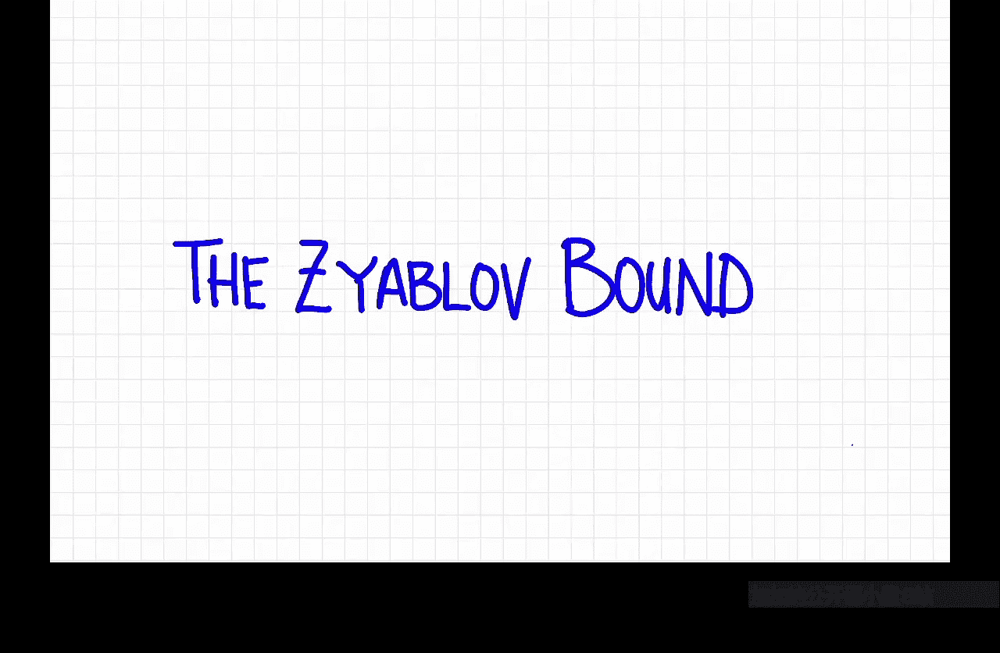

# 024：Zyablov界

在本节课中，我们将至少部分地实现我们的目标：构建具有高效算法的、显式的、渐近好的二进制码。同时，我们还将引入一个称为Zyablov界的概念。

## 概述

本节我们将学习Zyablov界。这个定理不仅保证了具有特定参数（码率与相对距离）的二进制线性码的存在性，更重要的是，它给出了这些码的**显式构造**方法。这意味着我们可以通过多项式时间算法来实际生成这些码。

## Zyablov界的陈述

对于任意 ε > 0，存在一族**显式**的二进制线性码，其码率 R 和相对距离 Δ 满足以下复杂的权衡关系：

**R ≥ sup_{R∈(0, 1-H₂(Δ)-ε]} [ R × (1 - Δ / H₂⁻¹(1 - R - ε) ) ]**

其中：
*   `H₂(x)` 是二进制熵函数：**H₂(x) = -x log₂(x) - (1-x) log₂(1-x)**
*   `H₂⁻¹(y)` 是其逆函数。
*   “显式”意味着存在一个关于码长 `n` 的多项式时间算法，可以生成该码的描述。

这个表达式看起来很复杂，我们将在证明过程中看到它的来源。首先，让我们在图上看看它是什么样子。

## 图形化理解

我们最喜欢的图是y轴为码率R，x轴为相对距离Δ的图（针对二进制字母表）。图中包含了我们已经知道的各种界，以及Zyablov界。

*   **Gilbert-Varshamov界**：这是我们已知的存在性最好的界，它告诉我们存在具有特定R-Δ权衡的码，但并未给出构造方法（非构造性的）。
*   **Zyablov界**：其曲线位于Gilbert-Varshamov界之下。该定理的关键在于，在这条曲线上，**不仅存在**具有此权衡的码，而且我们**可以显式地构造**它们。

在我们之前设定的目标（寻找具有高效编解码算法的、显式的、渐近好的二进制码）的背景下，Zyablov界实现了前半部分。它给出了显式的、渐近好的二进制码。实际上，这些码也具有高效的解码算法（我们将在后续视频中看到）。

现在，让我们来证明Zyablov界。

## 证明Zyablov界

我们将使用**级联码**来证明Zyablov界。首先快速回顾一下级联码的结构。

### 级联码回顾

一个级联码 `C` 由内码 `C_in` 和外码 `C_out` 构成，记作 `C = C_in ◯ C_out`。构造过程如下：
1.  将消息 `x`（属于小字母表 `Σ_in` 的 `k_in × k_out` 维空间）视为大字母表 `Σ_out` 上的 `k_out` 维向量。
2.  用外码 `C_out` 对该向量进行编码，得到一个码字 `y`。
3.  将 `y` 的每个符号（属于 `Σ_out`）视为 `Σ_in` 上的一个向量。
4.  用内码 `C_in` 分别对这些小向量进行编码。
5.  将所有编码结果拼接起来，得到最终的级联码码字 `c`。

### 构造选择

对于Zyablov界，我们按如下方式选择内码和外码：

*   **外码 `C_out`**：选择一个**里德-所罗门码**。其码率 `R_out` 和相对距离 `Δ_out` 满足 **Δ_out = 1 - R_out**（因为RS码达到了Singleton界）。
*   **内码 `C_in`**：选择一个**二进制线性码**，它位于**Gilbert-Varshamov界**上。即，其码率 `r` 和相对距离 `Δ_in` 满足 **r ≥ 1 - H₂(Δ_in) - ε**。

我们稍后再讨论如何实际获得这个内码。

### 分析参数

现在，我们来看待证明的定理所要求的几个方面：R-Δ权衡、二进制线性码、显式性。

**1. 码率-距离权衡**

级联码 `C` 的参数如下：
*   **相对距离 Δ**：等于内码和外码相对距离的乘积，即 **Δ = Δ_in × Δ_out**。
    *   代入我们的选择：`Δ_out = 1 - R_out`，并且从内码条件 `r = 1 - H₂(Δ_in) - ε` 可解出 `Δ_in = H₂⁻¹(1 - r - ε)`。
    *   因此，**Δ = (1 - R_out) × H₂⁻¹(1 - r - ε)**。
*   **码率 R**：等于内码和外码码率的乘积，即 **R = r × R_out**。
    *   从上面的距离公式 `Δ = (1 - R_out) × ...` 可以解出 `R_out = 1 - Δ / H₂⁻¹(1 - r - ε)`。
    *   代入码率公式得到：**R = r × [1 - Δ / H₂⁻¹(1 - r - ε)]**。

至此，我们看到定理中那个复杂表达式的来源。目前，内码码率 `r` 可以是任意值。为了得到最佳的R-Δ权衡，我们选择使表达式最大的 `r` 值，这就得到了定理中的上确界 `sup`。✅ 这便建立了定理中的码率-距离权衡。

**2. 二进制与线性**
*   根据构造，该码显然是**二进制**的。✅
*   可以证明，当里德-所罗门码的域大小为2的幂时，整个级联码是**线性**的。（这留给读者作为练习）✅

**3. 显式性**
这是不显然的部分。外码（RS码）是完全显式的。但内码 `C_in` 依赖于非构造性的Gilbert-Varshamov界，我们如何显式地获得它？

对我们而言，“显式”意味着存在一个关于最终码长 `n` 的多项式时间算法，能给出码的描述。只要我们能高效生成 `C_in` 的描述，整个级联码就是显式的。

假设外码RS码的求值点为有限域 `F_Q*` 的所有非零元，并令 `Q = 2^{k_in}`，其中 `k_in` 是内码的维数。这意味着 `k_in = log Q`，且外码长度 `n_out = Q - 1`。

以下是一个生成 `C_in` 描述的算法：

**算法思路：暴力搜索**
我们搜索所有可能的、具有指定码率 `r` 的二进制线性码（即搜索所有生成矩阵）。需要搜索的生成矩阵数量约为 `2^{k_in * n_in}`。由于内码码率 `r = k_in / n_in`，所以 `n_in = k_in / r`。因此搜索空间大小为 `2^{(k_in)² / r}`。

代入 `k_in = log Q`，得到搜索空间大小为 `2^{(log² Q) / r}`。

我们需要判断这个数量相对于最终码长 `n` 是大还是小。最终码长 `n = n_in * n_out ≈ (k_in / r) * Q`。由于 `Q = 2^{k_in}`，可以推导出 `n ≈ (Q log Q) / r`，进而得到 `log² Q ≈ log² n`。

因此，搜索空间大小约为 `2^{O(log² n)}`。这意味着算法总运行时间约为 `n^{O(log n)}`。这种运行时间被称为**拟多项式时间**，它非常接近但并非严格的多项式时间。

实际上，通过比这种朴素搜索更智能的方法，可以将运行时间降低到真正的多项式时间。我们在此不展开，课程笔记中提供了相关指引。

基于上述讨论（以及关于线性的练习），我们近似地认为显式性要求也得到了满足。✅

至此，我们完成了定理的证明，它确立了显式的、渐近好的二进制码的存在性。

## 补充说明

你可能会对这种“显式”的定义有所顾虑。即使存在多项式时间算法来告诉我一个码是什么，这也远不如像里德-所罗门码那样直接（可以直接写在幻灯片上）。实际上，通过精心选择级联码构造中的内码，可以得到**更加显式**的渐近好二进制码构造。如果你感兴趣，可以在课程笔记中找到更多相关内容。

## 总结

本节课我们一起学习了Zyablov界。我们了解到：
1.  Zyablov界给出了一个位于Gilbert-Varshamov界之下的、具体的码率-距离权衡曲线。
2.  关键突破在于，该曲线上的码是**可以显式构造**的，而不仅仅是存在。
3.  我们利用**级联码**结构，选择RS码作为外码，并（通过一个高效可计算的搜索）选择达到GV界的二进制码作为内码，从而证明了该界。
4.  这实现了我们寻找显式、渐近好二进制码目标的第一步。

在下一节课中，我们将讨论级联码的高效解码算法，这将引领我们完全实现最初设定的目标。