# 026：级联码解码（第二部分）🎯

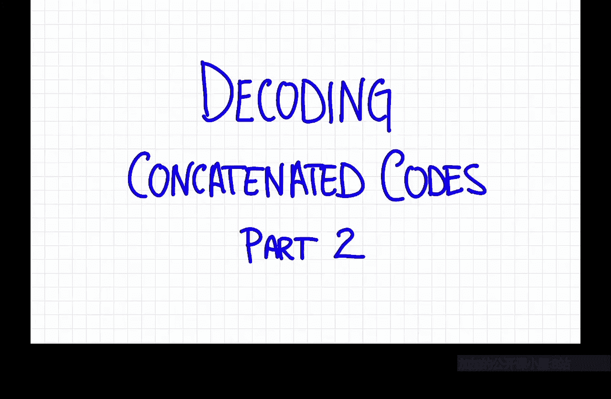

在本节课中，我们将继续学习如何解码级联码，目标是纠正最多达到其设计距离一半的错误。

## 概述

上一节视频结束时，我们提出了一个解码级联码的初步算法。但该算法只能纠正最多达到设计距离四分之一（`D/4`）的错误。然而，我们仍然希望达到设计距离的一半（`D/2`），这源于对两种极端情况的分析。

在第一种极端情况下，攻击者在每个“坏块”中引入的错误不多。我们之所以能成功，是因为可以通过纠正大量错误来识别出哪些是坏块，然后将它们视为删除（erasure），这让我们节省了一个因子2。

在第二种极端情况下，攻击者在每个坏块中引入了大量错误。这同样对我们有利，因为坏块的数量不多，这同样允许我们节省一个因子2。

因此，我们希望通过在这两种极端情况之间进行“插值”，从而在一般情况下也能节省这个因子2。这就是本节视频要采用的策略。

## 里德-所罗门码的有用事实

为了实现这种插值，我们将利用关于里德-所罗门码的以下有用事实。

**有用事实**：如果 `2E + S < D_out`，其中 `D_out` 是外码（里德-所罗门码 `C_out`）的距离，那么我们可以从 `E` 个错误和 `S` 个删除中高效地解码里德-所罗门码 `C_out`。

这个事实的证明是一个有趣的练习。提示是：你可以将高效的里德-所罗门码解码器当作一个黑盒来使用。

这个有用事实将允许我们在删除和错误之间进行插值，直观上，这相当于在上述两种极端情况之间进行插值。

## 初步算法构想

更具体地说，以下是我们将要使用的算法。请注意，这还不是最终算法，我们稍后会对其进行修改。

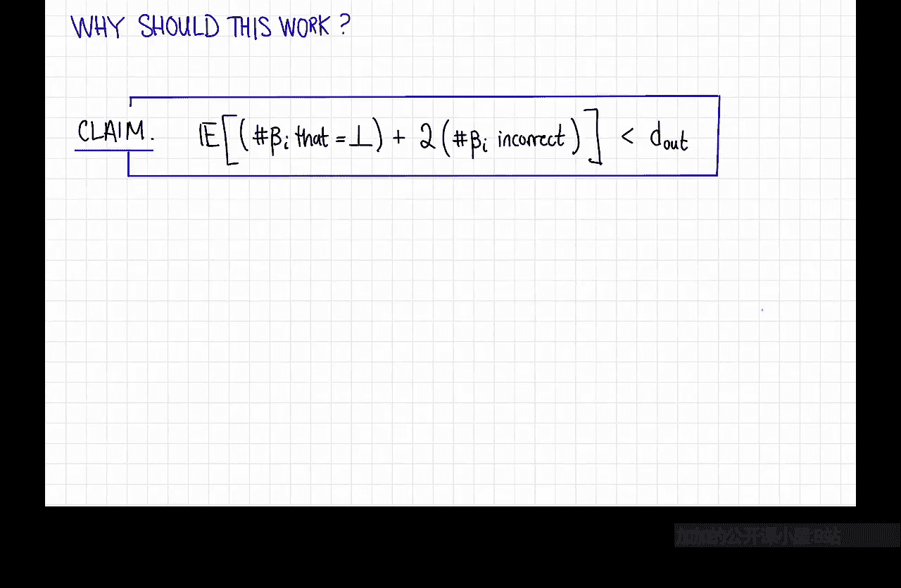

算法输入一个接收到的字 `W = (W_1, W_2, ..., W_{N_out})`，其中每个 `W_i` 是字母表 `Σ_in` 上长度为 `N_in` 的向量。我们承诺接收字 `W` 与某个级联码字 `C` 的汉明距离严格小于 `(D_in * D_out) / 2`。

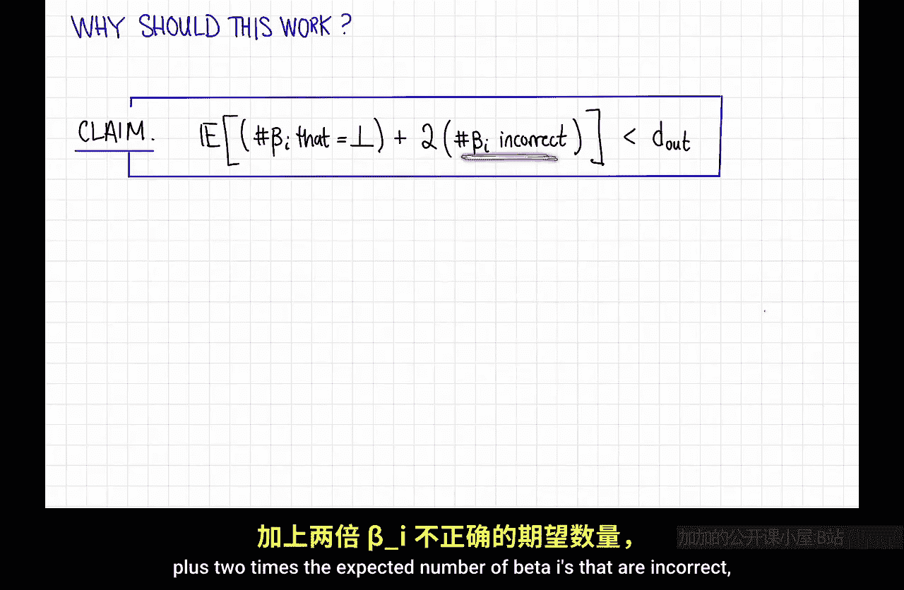

算法步骤如下：
1.  对于 `i` 从 `1` 到 `N_out`（即对于接收字的每个块）：
    *   对内码 `C_in` 在该块上进行解码。令 `W_i'` 为内码 `C_in` 中与块 `W_i` 最接近的码字。
2.  接下来，我们将做一些看似奇怪的操作：抛一枚硬币，进行随机化处理。
    *   以概率 `p_i = min(1, (2 * d_H(W_i, W_i')) / D_in)`，我们将参数 `β_i` 设置为 `⊥`（表示删除）。
    *   否则（以概率 `1 - p_i`），我们选择 `β_i`，使得内码对 `β_i` 的编码等于 `W_i'`（即我们修正后的块）。
3.  完成对所有符号的处理后，我们得到一个向量 `(β_1, β_2, ..., β_{N_out})`，其中一些是 `Σ_out` 中的元素，另一些是 `⊥`（删除）。
4.  最后，我们在这个向量上运行外码 `C_out` 的解码器（即利用前述“有用事实”中能处理删除和错误的解码器），并返回其结果。

这个算法实现了我们之前的直觉：如果我们需要纠正大量错误（即 `W_i` 离 `W_i'` 很远），那么攻击者很可能在这个块上做了手脚，我们应将其视为删除。否则，我们假设一切正常，将其视为（可能正确的）解码结果。

## 算法的关键性质

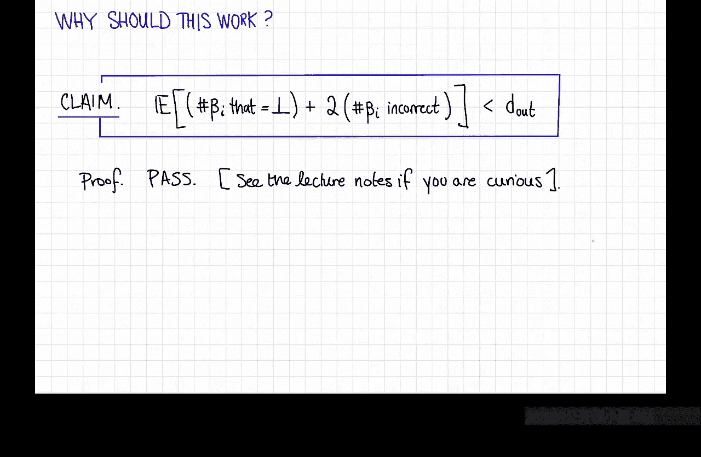

你可能会问，为什么是这个特定的概率表达式？为什么使用随机化算法？答案在于以下断言。

**断言**：`β_i` 等于 `⊥` 的期望数量，加上两倍的 `β_i` 不正确的期望数量，其和严格小于外码的距离 `D_out`。

特别地，这意味着**至少在期望上**，我们送入外码解码器的字 `(β_1, ..., β_{N_out})` 中，删除数量加上两倍错误数量的总和严格小于 `D_out`。而这正是该解码器能够成功解码所需的条件。

直观上，这个断言表明，至少在期望上，外码的解码器会成功。这个概率 `p_i` 的选择正是为了使这个断言成立。

## 从随机化到确定性算法

然而，断言只保证了“期望上”成功，我们需要的是一个总能工作的解码器，而不仅仅是期望上。

一种策略是多次重复该随机算法，以高概率获得正确结果。但我们将采用另一种方法：**去随机化**这个随机算法，从而得到一个确定性的算法。

首先，我们减少算法中的随机性。原算法中，每个 `β_i` 是否被标记为删除是独立决定的。现在，我们改为：
1.  均匀随机地选择一个参数 `θ ∈ [0, 1]`。
2.  对于每个块 `i`，如果 `θ < p_i`，则设置 `β_i = ⊥`；否则，设置 `β_i` 使得其编码为 `W_i'`。

这本质上等价于原算法，只是将随机性移到了循环外部，对每个 `β_i` 的决策使用了同一个随机源 `θ`。可以证明，修改后的算法仍然满足前述断言。

接下来是关键的去随机化步骤：我们不再随机选择 `θ`，而是**穷举所有可能的 `θ` 值**。对于每个 `θ`，我们运行上述流程，得到外码解码器输出的候选码字 `X̃`。如果 `X̃` 与接收字 `W` 足够接近，我们就返回 `X̃` 作为答案。

为什么这能行？因为根据断言，在 `θ` 的期望意义上，我们能得到正确答案。这意味着**存在**某个 `θ` 值能让我们得到正确答案。因此，如果我们穷举所有 `θ`，就一定能找到这个正确的 `θ`，并通过检查找到正确答案。

## 离散化处理

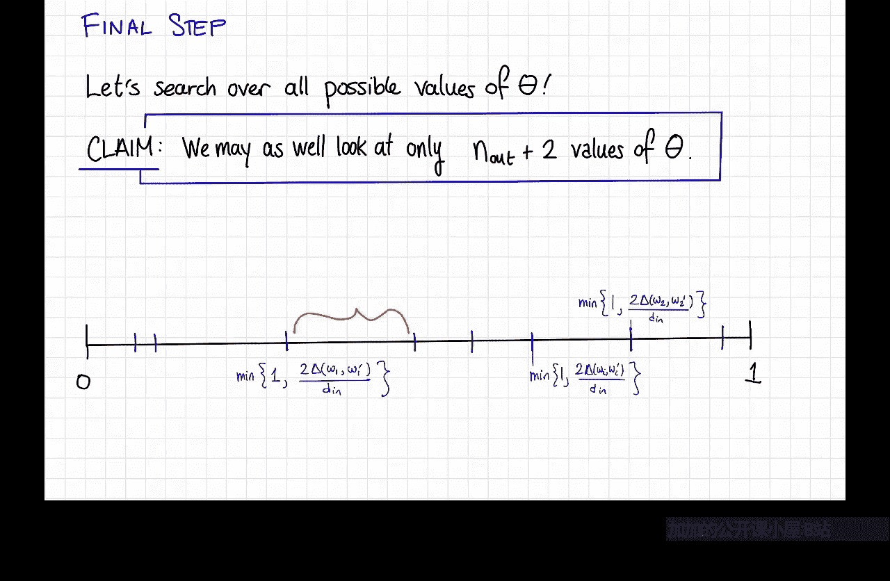

但 `θ` 在区间 `[0, 1]` 上有不可数无穷多个值，无法真正穷举。我们需要对其进行离散化。

关键在于，在这个算法中，`θ` 的具体值并不重要，重要的是它与每个概率 `p_i` 的比较结果（即 `θ < p_i` 是否成立）。考虑数轴 `[0, 1]`，上面有 `N_out` 个点 `p_1, p_2, ..., p_{N_out}`。这些点将区间划分为至多 `N_out + 1` 个子区间。对于落在同一个子区间内的所有 `θ`，它们在算法中的行为是完全相同的。

因此，我们不需要穷举所有 `θ`，只需从这 `N_out + 1` 个子区间中各选一个代表值（例如区间的中点或端点），然后穷举这 `N_out + 1` 个代表值即可。这完全等价于穷举整个连续区间。

## 最终算法：福尼广义最小距离解码器

整合以上步骤，我们得到最终算法：
1.  计算所有概率 `p_i = min(1, (2 * d_H(W_i, W_i')) / D_in)`。
2.  根据这些 `p_i` 值，确定 `N_out + 1` 个有代表性的 `θ` 值（例如所有 `p_i` 和 `0`、`1` 排序后，相邻值的中点）。
3.  对于每一个代表性的 `θ` 值：
    *   对于每个块 `i`：
        *   如果 `θ < p_i`，设置 `β_i = ⊥`。
        *   否则，设置 `β_i` 使得其编码为 `W_i'`。
    *   在外码 `C_out` 上运行能处理删除和错误的解码器，输入为 `(β_1, ..., β_{N_out})`，得到候选码字 `X̃`。
    *   如果 `d_H(W, X̃) < (D_in * D_out) / 2`，则返回 `X̃`。

这个算法被称为**福尼广义最小距离解码器**。它能够高效地解码级联码，纠正最多达到其设计距离一半的错误。

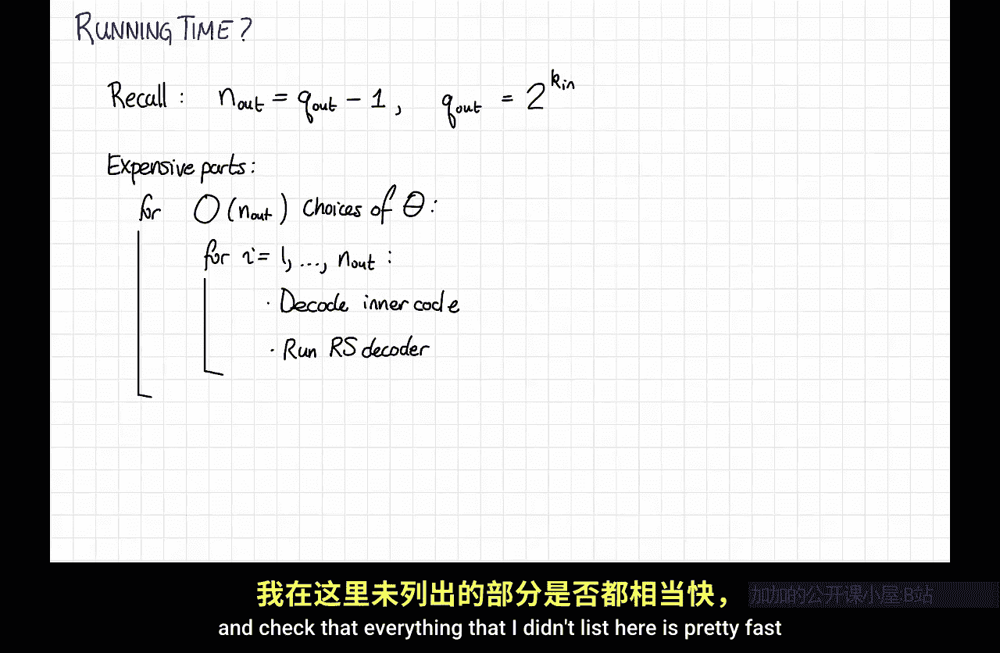

## 算法效率分析

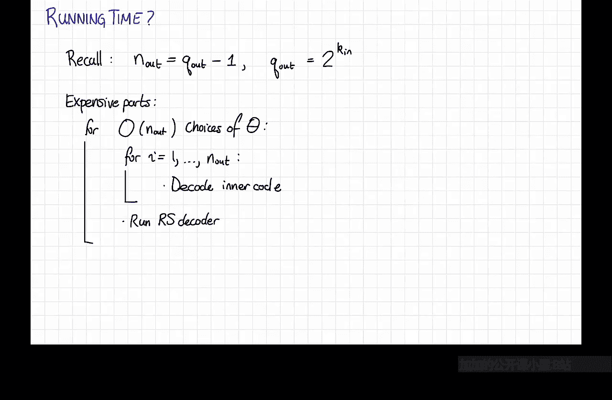

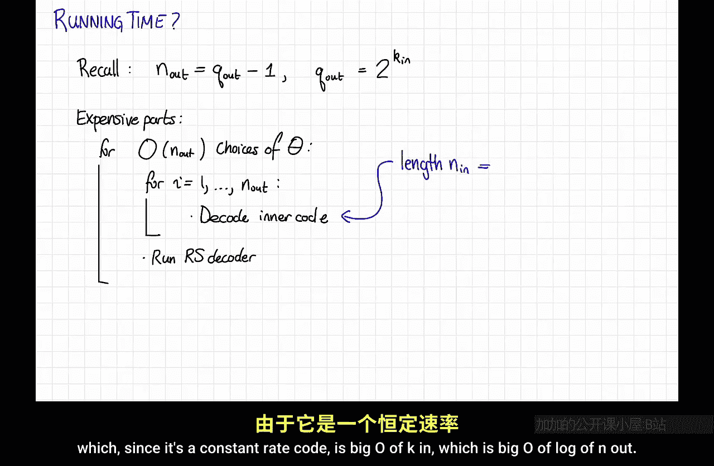

让我们简要分析该算法的运行时间，主要开销在于：
1.  **内码解码**：需要对 `N_out` 个块中的每一个进行解码。在我们的构造中，内码长度 `N_in = O(log N_out)`。即使使用暴力解码（遍历所有内码码字），其时间复杂度也是 `O(2^{K_in} * N_in)`。由于 `K_in = O(log N_out)`，所以 `2^{K_in}` 是 `N_out` 的多项式级。因此，每个块的内码解码时间是 `N`（总码长）的多项式。
2.  **外码解码**：运行里德-所罗门码解码器，其时间复杂度也是多项式级的。
3.  **循环**：外层需要循环 `N_out + 1` 次（即尝试所有代表性的 `θ`）。

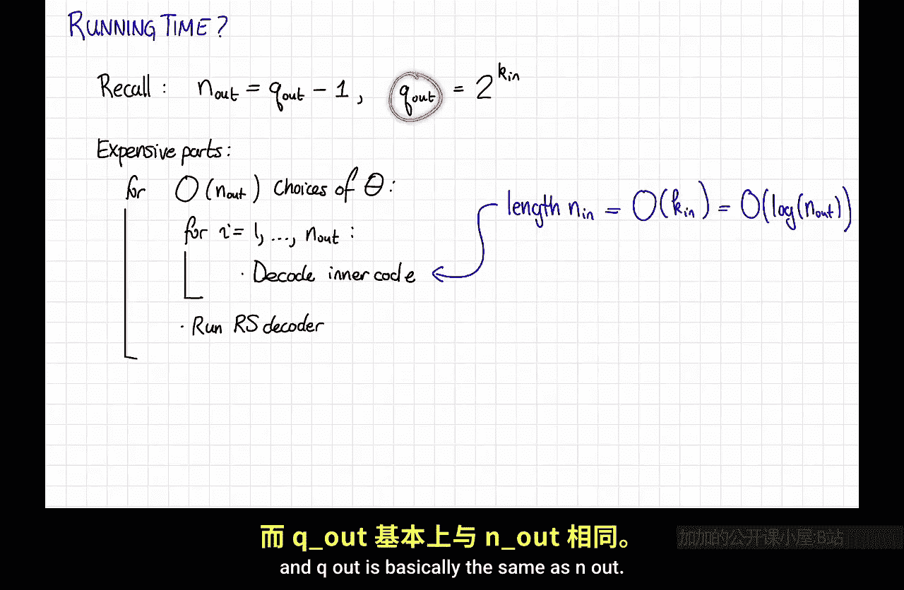

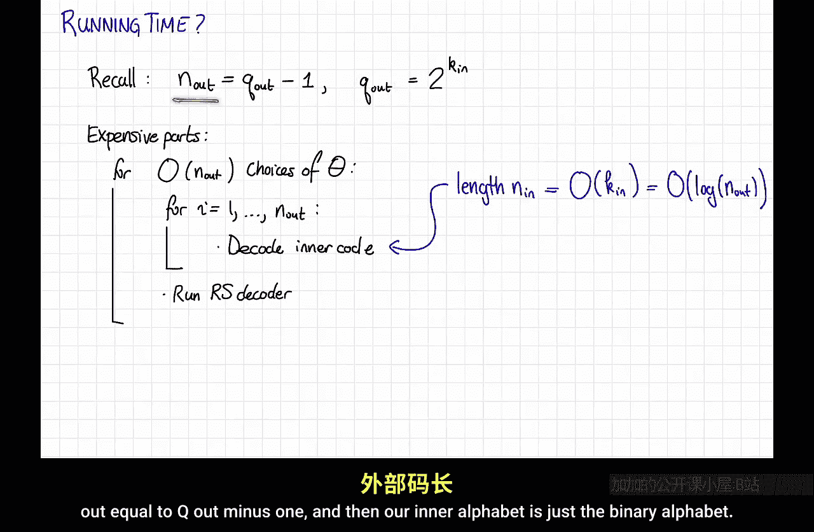

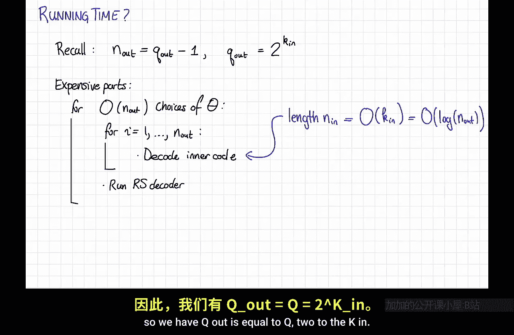

综合来看，整个算法的总运行时间是总码长 `N` 的多项式，因此是高效的。

## 总结与成果

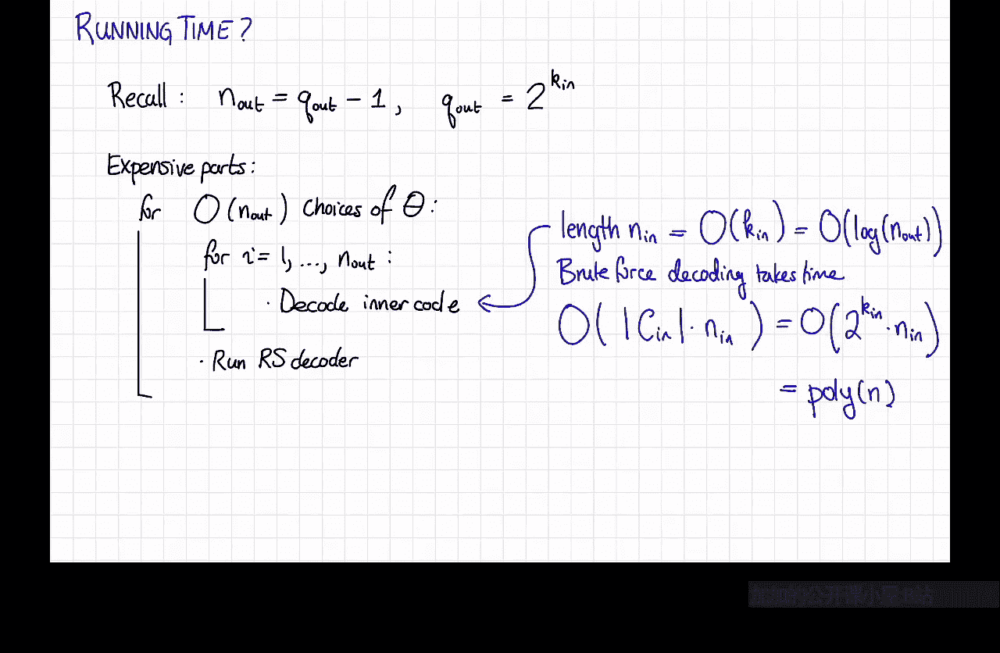

🎉 **成功！** 我们已经达成了新目标：现在我们拥有了**显式的二进制码**，其性能接近Zyablov界，并且拥有高效的解码算法，可以纠正最多达到其设计距离一半的错误。

我们通过级联码实现了这一目标：
*   **外码**：里德-所罗门码。
*   **内码**：达到吉尔伯特-瓦尔沙莫夫界的某个码。由于内码的块长很短（对数级），我们可以高效地找到并处理它。

解码过程需要一些技巧（福尼算法），并非我们最初设想的那么简单，但我们最终成功了。

## 当前知识图谱

总结一下我们目前关于二进制码的知识，以相对距离为横轴，码率为纵轴：
*   **吉尔伯特-瓦尔沙莫夫界**：告诉我们**存在**具有某种折衷关系的码，但我们不知道它们具体是什么，也不知道如何高效解码。
*   **Zyablov界**：告诉我们**存在**具有更好折衷关系的码。
*   **本节成果**：我们不仅证明了Zyablov界所承诺的码存在，而且可以**显式地构造**它们，并且能够**高效地解码**它们。这非常酷！

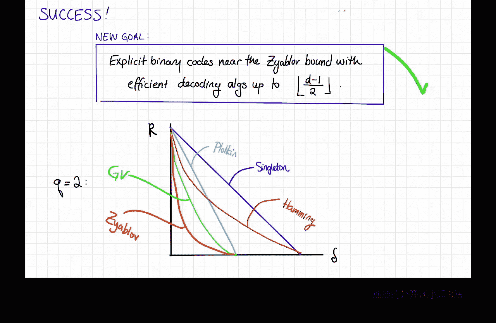

本节课我们一起学习了如何通过福尼广义最小距离解码算法，高效地解码级联码至其设计距离的一半，这是构造具有良好性能的显式纠错码的关键一步。