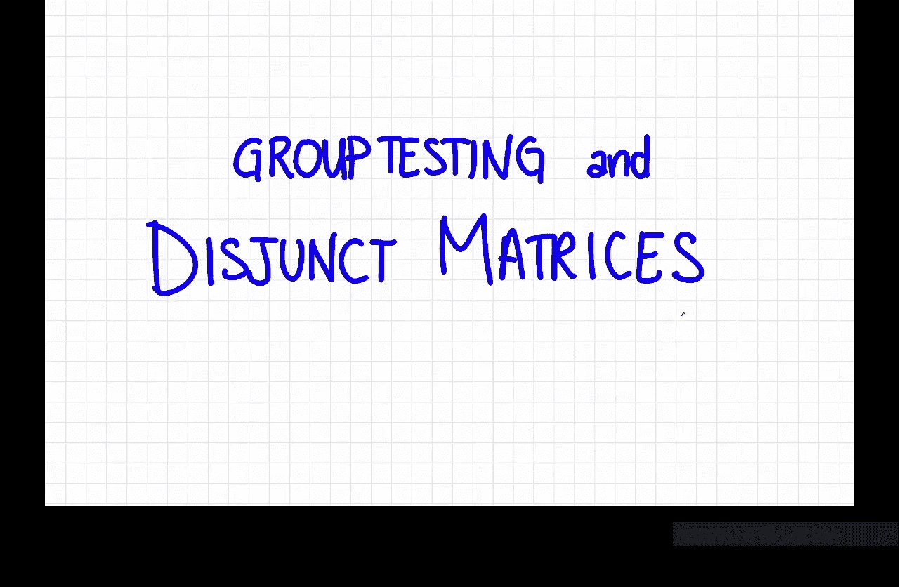
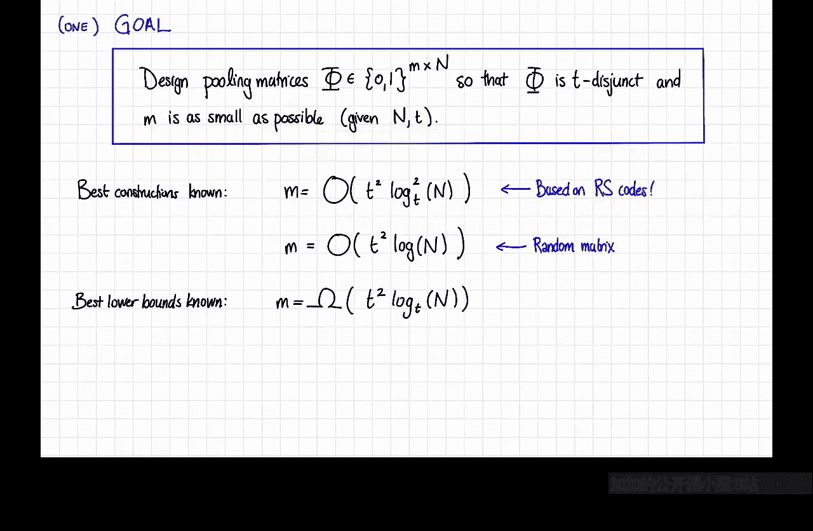

# 028：分离矩阵

在本节课中，我们将学习**分离矩阵**的定义，并理解它如何为群组检测问题提供解决方案。我们还将证明，一个 t-分离的矩阵可以可靠地识别出最多 t 个阳性个体。

## 分离矩阵的定义

上一节我们介绍了群组检测的概念。本节中，我们来看看**分离矩阵**，它将为我们提供工具，以理解基于里德-所罗门码的群组检测解决方案。

首先，回顾一下布尔代数 **B**，它包含元素 {0, 1}，其中“+”表示布尔或运算，“×”表示布尔与运算。同时，Φ 是一个**池化矩阵**，这意味着它是一个 M × N 的矩阵，其中 M 对应测试的数量，N 对应待检测的物品或人数。当且仅当我们将第 j 个人放入第 i 次测试时，矩阵 Φ 在 (i, j) 位置上的值为 1。

以下是 t-分离矩阵的定义：

> 对于一个池化矩阵 Φ，如果对于任意大小为 t 的列索引子集 Λ ⊆ {1, ..., N}，以及任意不在 Λ 中的列索引 j，都存在至少一行 i ∈ {1, ..., M}，使得：
> *   **Φ[i, j] = 1** （第 j 列在第 i 行有 1）
> *   并且对于所有 l ∈ Λ，**Φ[i, l] = 0** （Λ 中所有列在第 i 行都是 0）
>
> 那么，我们称矩阵 Φ 是 **t-分离** 的。

## 分离矩阵的重要性

为什么我们关心矩阵的分离性？事实证明，一个 t-分离的矩阵可以构建一个能够检测出最多 t 个阳性物品（或病人）的池化检测方案。

更正式地说，有以下定理：

> **定理**：如果池化矩阵 Φ 是 t-分离的，那么作为一个池化检测方案，它可以识别出最多 t 个阳性物品。

这意味着，对于任何权重（即“1”的个数）不超过 t 的布尔向量 **x**（长度为 N），给定布尔代数下的乘积 **Φ × x**，我们都可以恢复出 **x**。

让我们通过一个算法来证明这个定理。这个算法将根据 **Φ × x** 的结果来恢复 **x**。

以下是恢复算法：

> 对于每一个 j ∈ {1, ..., N}（即对于矩阵的每一列）：
> *   如果**所有**包含物品 j 的测试结果都是阳性，那么判定物品 j 为阳性。
> *   否则，判定物品 j 为阴性。

这个算法非常直观。它遍历所有可能的物品，并检查：如果某个物品参与的所有测试都呈阳性，那么它很可能是阳性；反之，只要它参与的任意一次测试呈阴性，就证明它不是阳性。

**证明**：
1.  如果物品 j 确实是阳性的，那么算法显然会判定其为阳性。
2.  假设物品 j 是阴性的。令 Λ 为真实的阳性物品集合（大小 ≤ t），且 j ∉ Λ。
3.  根据 t-分离性的定义，存在某一行 i，使得 **Φ[i, j] = 1** 且对于所有 l ∈ Λ，**Φ[i, l] = 0**。
4.  这意味着：物品 j 参与了测试 i，并且测试 i 中**没有**任何阳性物品。
5.  因此，测试 i 的结果将是阴性的，这为“物品 j 不是阳性”提供了证明。
6.  根据算法逻辑，当发现物品 j 参与的某次测试为阴性时，就会判定 j 为阴性。

因此，算法是正确的，定理得证。

## 新的目标与已知结果

这为我们设定了一个新的目标：设计 t-分离的池化矩阵 Φ，并且在给定总人数 N 和最大阳性数 T 的情况下，使得测试次数 M 尽可能小。

以下是已知的两个最佳构造方案：

*   基于**里德-所罗门码**的构造，可以达到 **M = O(T² log_T² N)**。
*   另一种构造可以达到 **M = O(T² log N)**。一个有趣的练习是：可以证明，以一个适当的概率随机生成矩阵，只要 M 大约为这个数量级，该矩阵就有很高的概率是 t-分离的。

这两种结果各有优劣，适用于不同的参数范围。据我们所知，它们都尚未达到理论最优值。目前已知的最佳下界是 **M ≥ Ω(T² log_T N)**，因此上述构造与下界之间还存在一些差距。

此外，还存在比我们刚才看到的“遍历所有元素”方法快得多的群组检测算法，有些算法的运行时间甚至接近测试次数 M 的线性级别，并且也基于编码理论。

## 总结

本节课中，我们一起学习了：
1.  **t-分离矩阵**的正式定义，它要求对于任何 t 个列的集合和其外的任一列，都存在一行能将该列与那 t 个列区分开。
2.  证明了 t-分离矩阵可以构建一个能**可靠识别最多 t 个阳性物品**的群组检测方案，并给出了具体的恢复算法。
3.  了解了当前关于构造 t-分离矩阵以最小化测试次数 M 的**已知最佳结果**，其中一种高效构造基于里德-所罗门码。

在下一节视频中，我们将重点介绍这种基于里德-所罗门码的构造，即著名的 Kautz-Singleton 构造。