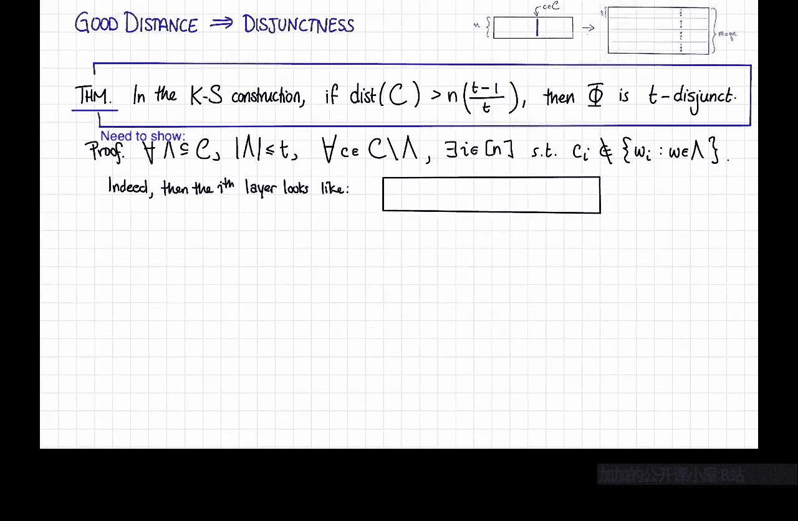
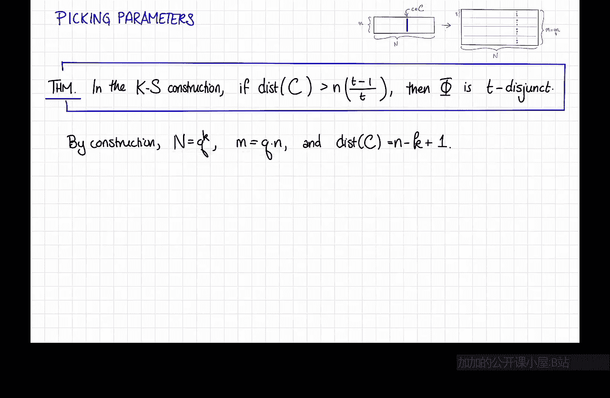
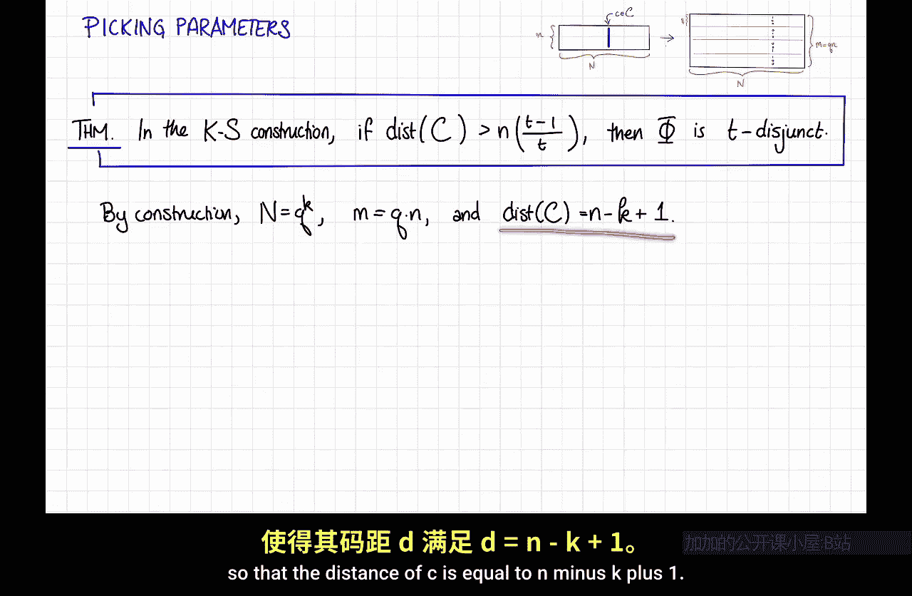
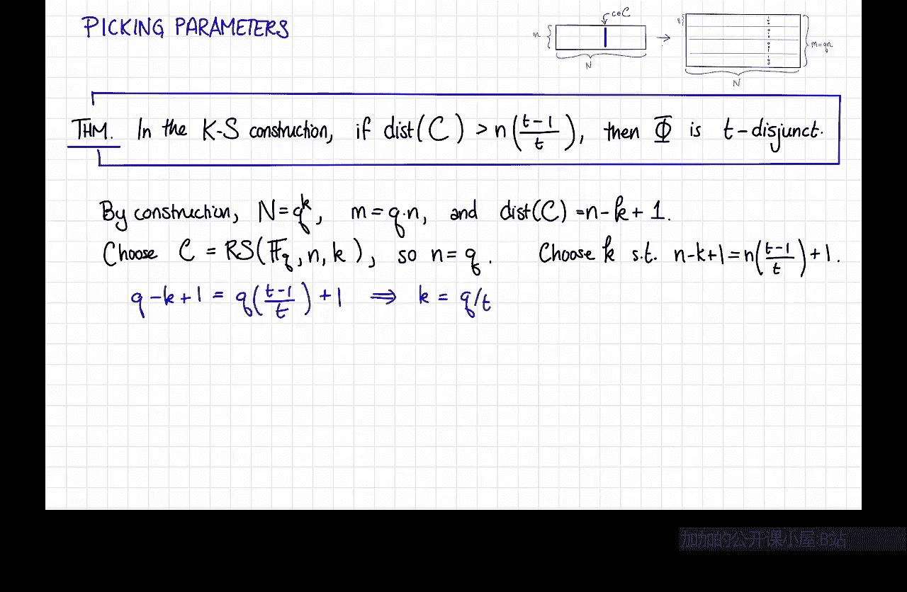
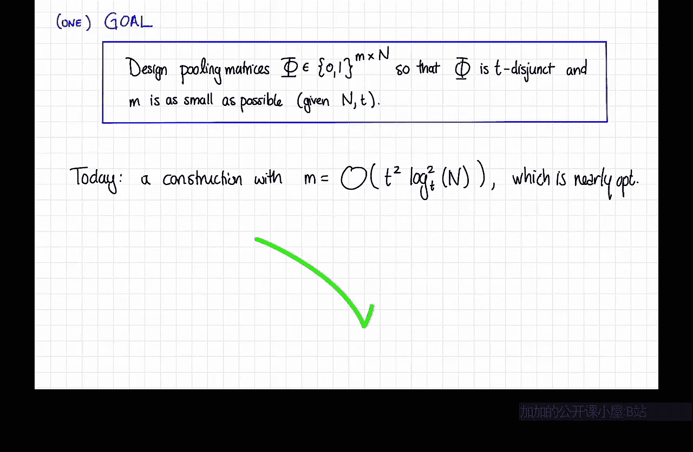

# 029：Kautz-Singleton构造

在本节课中，我们将学习如何利用编码理论来构建高效的组合测试矩阵。具体来说，我们将介绍一种名为Kautz-Singleton的构造方法，它使用里德-所罗门码来生成具有良好性质的分离矩阵，从而以接近最优的测试次数解决组合测试问题。

## 回顾与目标

在上一节视频中，我们介绍了组合测试问题，并了解到分离矩阵可以解决它。本节中，我们来看看一个利用里德-所罗门码来获得分离矩阵的优秀解决方案，即Kautz-Singleton构造。

回顾上一节末尾的目标：我们希望设计一个测试矩阵 **Φ**，它使用 **M** 次测试来检测 **N** 个物品，使得 **Φ** 是 **t-分离** 的，并且在给定 **N** 和 **t** 的情况下，**M** 尽可能小。

今天，我们将看到一个构造，其 **M = O(t² log_t² N)**。正如上一节所见，这几乎是理论最优的。

## Kautz-Singleton构造原理

以下是该构造的工作原理。

我们从一个任意的码开始。设 **C** 是一个 **q元码**，其码长为 **n**，维数为 **k**，最小距离为 **d**。

设物品总数 **N = qᵏ**，测试总数 **M = q × n**。

我们稍后会选择这些参数 **n, k, d, q**，但现在我们先让它们保持为变量，以便理解各部分如何组合。

给定这个码 **C**，我们将按以下方式构建测试矩阵。

首先，我们在有限域 **F_q** 上形成一个矩阵。这个矩阵的每一列都是码 **C** 的一个码字。因此，矩阵的尺寸是 **n × N**，定义在 **F_q** 上。每一列是 **C** 的一个码字，我们将所有不同的码字并排排列作为列，从而得到这个矩阵。

注意，尺寸是吻合的：**C** 的每个码字长度为 **n**，总共有 **qᵏ** 个这样的码字，而我们已经定义 **N = qᵏ**，所以所有可能的码字都是这个矩阵的列。

然而，这个矩阵不是二进制的。为了用于组合测试设计，我们需要将其转换为二进制矩阵。

转换方法如下：我们将 **F_q** 中的每个符号替换为一个长度为 **q** 的小二进制向量。也就是说，我们将矩阵中的每个符号“膨胀”为一个指示向量。

具体操作是，将 **F_q** 中的元素 **αᵢ** 映射为第 **i** 个标准基向量 **eᵢ**。例如，如果 **α₁** 映射为 **(1, 0, 0, …, 0)**，**α₂** 映射为 **(0, 1, 0, …, 0)**，依此类推，直到 **α_q** 映射为 **(0, 0, …, 0, 1)**。

这意味着，原始矩阵中的每一列将被转换为一组“膨胀”后的向量，每个向量中恰好有一个“1”，用于指示原始矩阵中对应位置是哪个域元素。

最终，我们将得到一个二进制矩阵，其尺寸为 **M × N**，其中 **M = q × n**。

## 构造的分离性定理

我们声称，只要码 **C** 具有良好的距离，这样得到的矩阵就是一个好的组合测试设计。以下是相关的定理。

**定理**：在刚刚描述的Kautz-Singleton构造中，如果码 **C** 的距离 **d** 满足：
**d > n(t-1)/t**
那么由此得到的矩阵 **Φ** 是 **t-分离** 的。

### 定理证明

我们需要证明以下性质：对于码 **C** 中任意大小不超过 **t** 的子集 **Λ**，以及对于任意不在 **Λ** 中的码字 **c ∈ C**，都存在一个位置索引 **i (1 ≤ i ≤ n)**，使得 **cᵢ** 的值不等于 **Λ** 中任何码字 **w** 在位置 **i** 的值 **wᵢ**。

这实际上是 **t-分离** 定义在该特定构造下的翻译。如果上述性质成立，那么在矩阵的对应“层”（即膨胀后的行）中，码字 **c** 对应的列在该位置会有一个“1”，而 **Λ** 中所有码字对应的列在该位置都是“0”，从而满足了分离矩阵的定义。

现在来证明这个性质。

考虑 **Λ** 中的码字和码字 **c**。根据码距离的定义，**Λ** 中的任意一个码字 **w** 与 **c** 最多在 **n - d** 个位置上相同（因为它们在至少 **d** 个位置上不同）。

**Λ** 中最多有 **t** 个码字。因此，所有 **Λ** 中的码字与 **c** 可能相同的位置总数，最多为 **t × (n - d)**。

根据定理条件 **d > n(t-1)/t**，我们可以推导出：
**t × (n - d) < t × [n - n(t-1)/t] = t × (n/t) = n**

这意味着，所有 **Λ** 中的码字与 **c** 可能相同的位置总数，严格小于总位置数 **n**。因此，必然存在至少一个位置 **i**，使得 **c** 在该位置的值与 **Λ** 中所有码字在该位置的值都不同。这正是我们需要寻找的 **i**。

证明完毕。

因此，为了得到一个好的组合测试矩阵，我们只需要一个具有良好距离的码。

## 应用里德-所罗门码

幸运的是，我们确实知道一种具有良好距离的码：里德-所罗门码。

现在，让我们选择一些参数来实例化这个定理，从而构建一个好的组合测试矩阵。

回顾一下，根据构造，我们有：
*   物品数 **N = qᵏ**
*   测试数 **M = q × n**

我们选择一个里德-所罗门码 **C**，使其距离 **d = n - k + 1**。事实上，我们选择使用所有 **q** 个评估点的RS码，这意味着其码长 **n = q**。

现在我们需要选择参数 **k** 和 **q**。

首先，我们需要码距 **d** 严格大于定理要求的 **n(t-1)/t**。因此，我们选择 **k**，使得：
**d = n - k + 1 = n(t-1)/t + 1**
这样严格不等式就能满足。

由于我们设 **n = q**，代入上式：
**q - k + 1 = q(t-1)/t + 1**
进行代数运算后可得：
**k = q / t**

现在，物品数 **N = qᵏ = q^{q/t}**。
重新排列这个等式，可以得到：
**q = t × log_q N**

测试数 **M = n × q = q²** （因为 **n = q**）。
将 **q** 的表达式代入：
**M = q² = t² × (log_q N)²**

我们希望用 **t** 和 **N** 来表示 **M**。注意到 **q = √M**，因此：
**M = t² × (log_{√M} N)²**
可以验证，这个等式意味着：
**M = O( t² (log_t N)² )**

这正是我们想要展示的结果。

## 总结

回到我们设计 **t-分离** 测试矩阵且 **M** 尽可能小的目标，我们现在已经看到了一个构造，其测试次数 **M = O( t² (log_t N)² )**。正如前一节提到的，这个值几乎是理论最优的。

本节课中，我们一起学习了编码理论技术在组合测试中的应用。我们看到了利用里德-所罗门码的一种具体方法，即Kautz-Singleton构造。实际上，编码理论技术还有许多其他方式可以帮助解决组合测试及其扩展和变体问题，我们可能在后续的视频中看到其中一些。