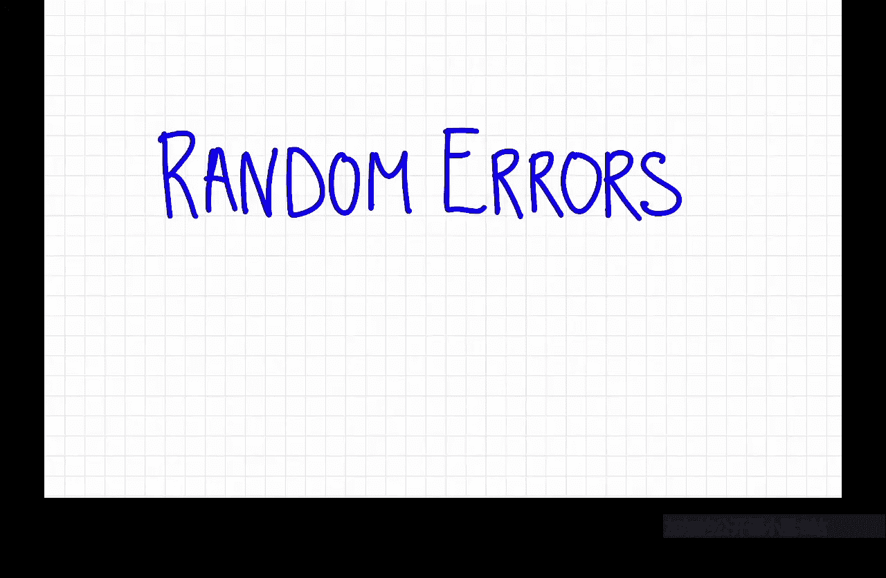
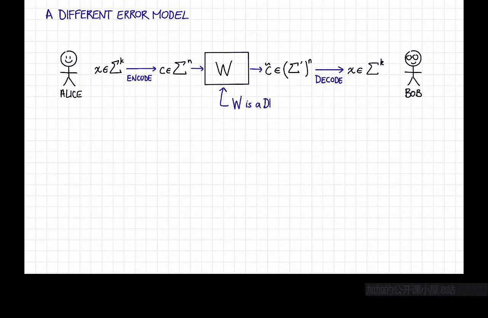

# 030：随机信道






## 📋 概述
在本节中，我们将学习随机信道模型。之前我们考虑的是由对手引入的错误，本节我们将快速了解错误随机引入的场景。

## 📡 随机信道模型
我们考虑以下错误模型。发送方爱丽丝有一个长度为 `K` 的消息 `X`，她将其编码成长度为 `n` 的码字 `C`。然后，码字 `C` 通过一个信道 `W`，得到一个被破坏的、长度为 `n` 的码字 `C̃`，其字母表可能变为 `Σ‘`。接收方鲍勃收到这个被破坏的码字，并希望能解码以恢复爱丽丝的消息 `X`。

这里的 `W` 是一个**离散无记忆信道**。


“离散”意味着输入和输出字母表都是有限的。“无记忆”意味着信道 `W` 独立地破坏码字中的每个符号，与其他符号无关。换句话说，`W` 由一个概率分布定义，描述了基于输入符号 `X` 得到输出符号 `Y` 的概率。

我们将其记为 `W(Y|X)`。这是给定输入 `X` 时，输出为 `Y` 的概率。其中，`Y` 属于输出字母表 `Σ‘`，`X` 属于输入字母表 `Σ`。我们假设 `W` 对码字 `C` 的每个符号独立地起作用。

## 🔧 信道示例
以下是两个常见的随机信道示例。

### 1. 二进制对称信道
我们将其记为 `BSC_p`，其中 `p` 是介于 0 和 1 之间的参数。该信道由以下概率分布给出：

```
P(Y|X) = p,     如果 X ≠ Y
         1 - p, 如果 X = Y
```

其中，`X` 和 `Y` 都属于字母表 `{0, 1}`。二进制对称信道的作用是：输入 `C` 的每一位以概率 `p` 被独立地翻转，以概率 `1-p` 保持不变。

### 2. 二进制擦除信道
我们将其记为 `BEC_p`，其中 `p` 是擦除概率。该信道由以下条件概率分布给出：

```
P(Y|X) = p,       如果 Y = ⊥ (擦除)
         1 - p,   如果 Y = X
         0,       其他情况
```

其中，输出字母表 `Σ‘` 为 `{0, 1, ⊥}`，输入字母表 `Σ` 为 `{0, 1}`。二进制擦除信道以概率 `p` 独立地擦除每个比特。

## 🎯 成功概率与信道容量
由于 `W` 是无记忆信道，即独立破坏每个符号，鲍勃无法指望每次都成功解码。存在一个虽小但为正的概率，所有符号都会被严重破坏。

因此，我们不追求在所有情况下都成功（这是对抗性错误模型的要求），而是希望以**高概率**成功。

我们有以下正式定义：设 `W` 是一个信道，`C` 是一个具有编码和解码映射的码。我们说，对于所有可能的消息 `X`，码 `C` 在信道 `W` 上的**失败概率**至多为 `δ`（0到1之间的数），如果满足：

```
P[ 解码器( W( 编码器(X) ) ) ≠ X ] ≤ δ
```

在对抗性错误模型中，我们的目标是研究码率和距离之间的最佳权衡。对于随机信道，我们同样想知道码率与在该信道上纠正错误能力之间的最佳权衡，并使用失败概率来定义它。我们想知道在失败概率非常小的情况下，通过该信道通信所能达到的最佳码率。

事实证明，存在这样一个极限，称为信道的**容量**。香农证明，每个离散无记忆信道 `W` 都有一个容量 `C`（一个介于0和1之间的数）。容量的意义是：对于低于该容量的码率，可以使失败概率趋近于零；而对于高于该容量的码率，则不可能。

此外，容量在信息论中有一个很好的表达式。具体来说，`C` 是输入随机变量 `X` 与输出随机变量 `Y` 之间的**互信息** `I(X;Y)`，在所有可能的输入分布上取得的最大值。

## 📝 总结
本节课我们一起学习了随机信道模型。我们介绍了离散无记忆信道的概念，并分析了两个具体例子：二进制对称信道和二进制擦除信道。与对抗性模型不同，在随机信道中我们追求以高概率成功解码，并引入了失败概率和信道容量的概念。信道容量定义了可靠通信的速率上限。在接下来的视频中，我们将更正式地阐述关于二进制擦除信道的香农定理并概述其证明。