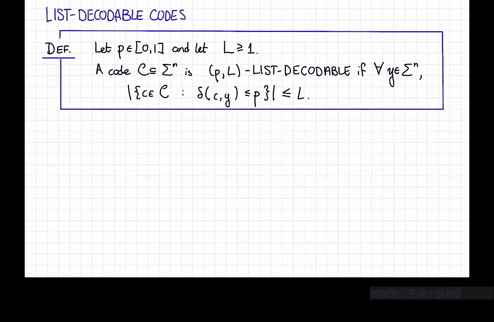
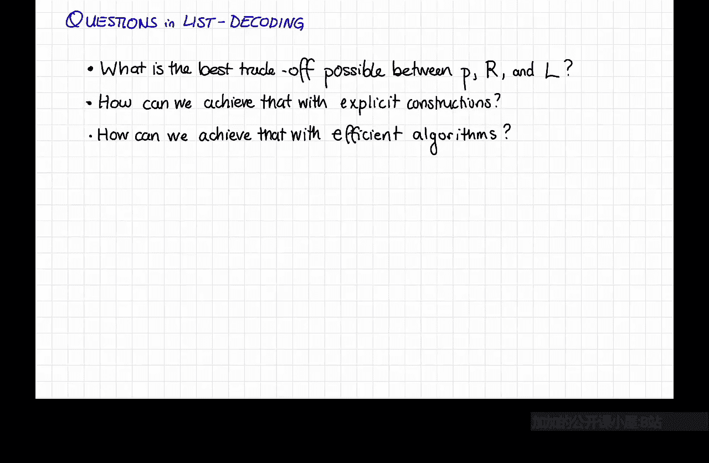
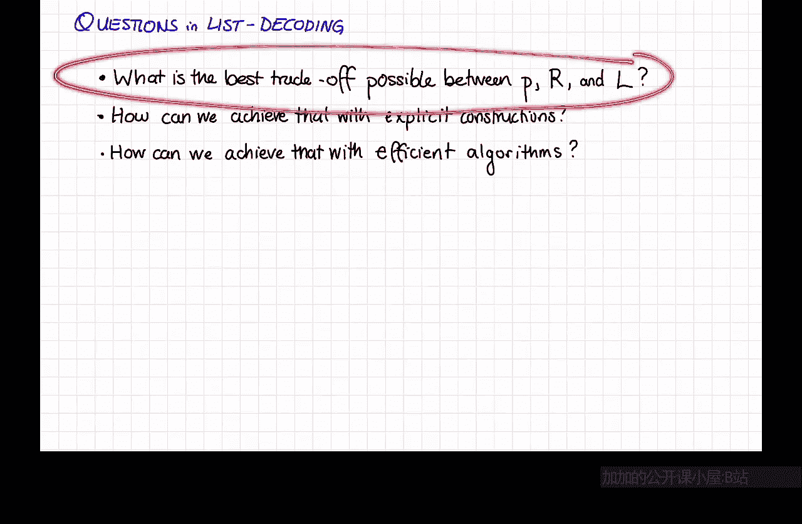

# 033：列表译码

在本节课中，我们将学习一个名为“列表译码”的新主题。

## 概述 📖

列表译码是传统“唯一译码”概念的一种推广。在唯一译码中，接收方需要从接收到的、可能包含错误的码字中，精确地恢复出发送方发送的原始信息。而在列表译码中，接收方被允许输出一个包含多个候选信息的“短列表”，只要原始信息包含在这个列表中即可。这种放宽的要求，使得通信双方能够容忍更多的错误。

## 列表译码的定义 📐

设 `P` 是一个介于 0 和 1 之间的参数，`L` 是一个大于等于 1 的整数。

我们说一个码 `C ⊆ Σ^n` 是 `(P, L)` 列表可译的，如果对于所有 `y ∈ Σ^n`，满足以下条件的码字 `c ∈ C` 的数量最多为 `L`：

**条件**：码字 `c` 与接收字 `y` 的相对距离不超过 `P`。

在这个定义中，`L` 被称为**列表大小**，`P` 被称为**列表译码半径**（有时简称为半径）。

## 理解定义：几何视角与通信视角 🔍

这个定义可以从两个角度来理解：几何视角和通信（Alice-Bob）视角。

### 几何视角

假设 `Σ^n` 是我们的整个空间，码 `C` 是其中的一些点（码字）。定义表明，如果码 `C` 是 `(P, L)` 列表可译的，那么对于空间中的**任意**一点 `y`，以 `y` 为中心、半径为 `P * n` 的汉明球内，所包含的码字数量不会超过 `L`。

### 通信视角（Alice-Bob模型）

在通信模型中，发送方 Alice 和接收方 Bob 之间有一个噪声信道。我们假设这是一个对抗性信道，最多可以损坏 `P` 比例的符号。

1.  Alice 将消息 `x` 编码为码字 `c` 并发送。
2.  Bob 接收到一个被损坏的码字 `y`。
3.  在列表译码中，Bob 的任务不是精确恢复 `x`，而是输出一个**短列表** `ℒ = {x₁, x₂, ..., x_L}`，并保证 Alice 发送的原始消息 `x` 在这个列表中。

从几何视角来看，Bob 可以通过找出所有落在以 `y` 为中心、半径为 `P` 的球内的码字（最多 `L` 个），来构造这个列表 `ℒ`。

## 列表译码与唯一译码的关系 🔗

列表译码推广了我们之前学习的唯一译码。实际上，当列表大小 `L = 1` 时，列表译码就退化为唯一译码。

**关系公式**：一个码是 `(P, 1)` 列表可译的，**等价于** 说该码的最小距离至少为 `2P`。

我们之前已经深入研究了如何获得良好的最小距离。因此，可以将列表译码视为当 `L` 大于 1 时，对唯一译码问题的一种推广。

## 为什么研究列表译码？ 🤔

研究列表译码主要有以下几个原因：

以下是几个关键原因：

1.  **更高的纠错能力**：正如我们将在后续课程中看到的，如果允许 Bob 返回一个短列表，Alice 和 Bob 能够容忍的错误比例（`P`）可以显著提高。在某些情况下，即使 Bob 只需返回一个大小固定的列表，他们也能容忍接近两倍的错误。这在唯一译码的背景下是非常有用的。
2.  **实际应用场景**：Bob 可能拥有一些额外的“边信息”来帮助他从列表中确定唯一答案。或者，在某些密码学假设下，Alice 可以将这些边信息作为码字的一部分发送给 Bob。
3.  **广泛的组合学应用**：列表可译码本身是一种非常有用的组合对象。它在伪随机性、计算复杂性理论和算法设计等领域都有重要应用。我们可能在后续视频中看到一些这样的联系。

## 核心研究问题 ❓

对于列表译码，我们可以提出与唯一译码类似的核心问题：

以下是三个主要的研究方向：

1.  **理论极限**：在列表大小 `L`、码率 `R` 和列表译码半径 `P` 之间，可能存在的最佳权衡关系是什么？
2.  **显式构造**：如何通过显式的编码构造来达到（或接近）这个最佳权衡？
3.  **高效算法**：如何设计高效的列表译码算法？即，Bob 在收到字 `y` 后，如何高效地恢复出所有在半径 `P` 范围内的（最多 `L` 个）码字？

## 挑战与机遇 ⚡

在唯一译码（即 `L = 1`）且针对最坏情况错误时，我们已经看到，即使是第一个问题（确定 `P` 和 `R` 的最佳权衡）也非常困难。

对于二进制码，`P` 和 `R` 在 `L=1` 时的最佳权衡关系至今仍未完全解决。因此，将这个问题推广到 `L > 1` 并期望得到更好的结果，看起来似乎是在自找麻烦。

但事实证明，当允许 `L` 稍大一些（例如一个较大的常数，或随 `n` 缓慢增长）时，我们实际上可以**精确确定** `P` 和 `R` 之间的最佳可能权衡关系。这个最佳权衡曲线，看起来就像我们在之前关于随机错误视频中看到的最佳权衡曲线。

这个关于列表译码中 `P` 和 `R` 最佳权衡的结论，被称为**列表译码容量定理**。我们将在下一个视频中详细学习它。

## 总结 📝

本节课我们一起学习了列表译码的基本概念。我们了解到列表译码是唯一译码的推广，它允许译码器输出一个候选列表，从而有可能容忍更多的错误。我们给出了列表可译码的正式定义，并从几何和通信两个角度进行了解释。最后，我们探讨了研究列表译码的意义，并引出了其核心研究问题及著名的列表译码容量定理，为后续学习奠定了基础。