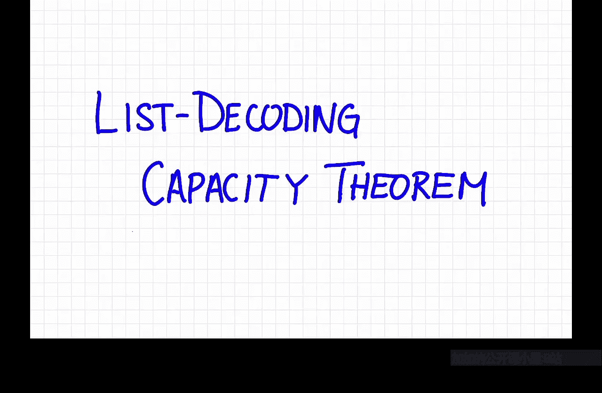
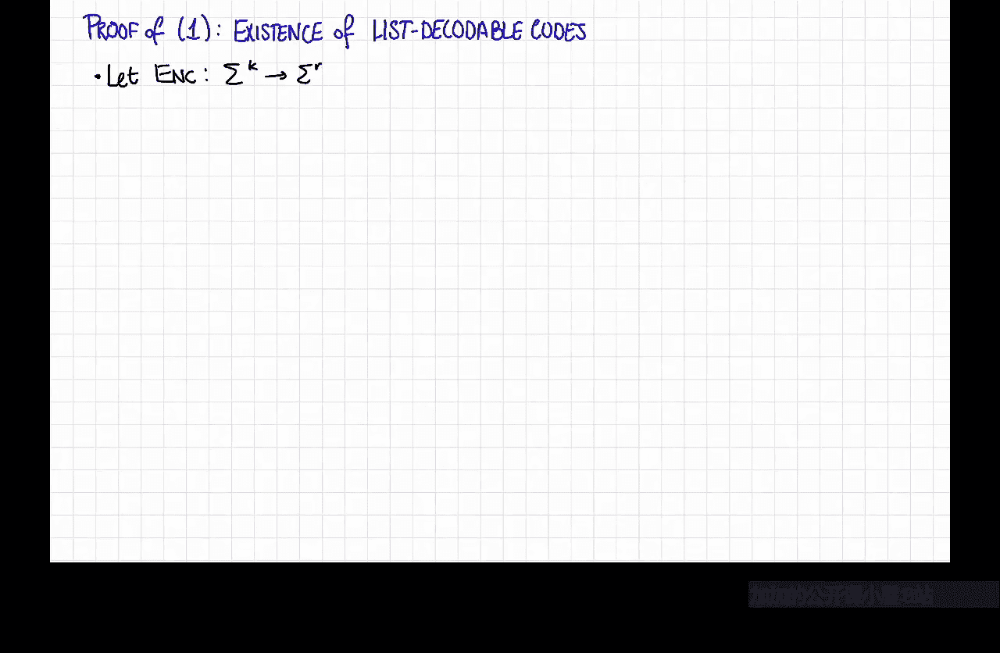
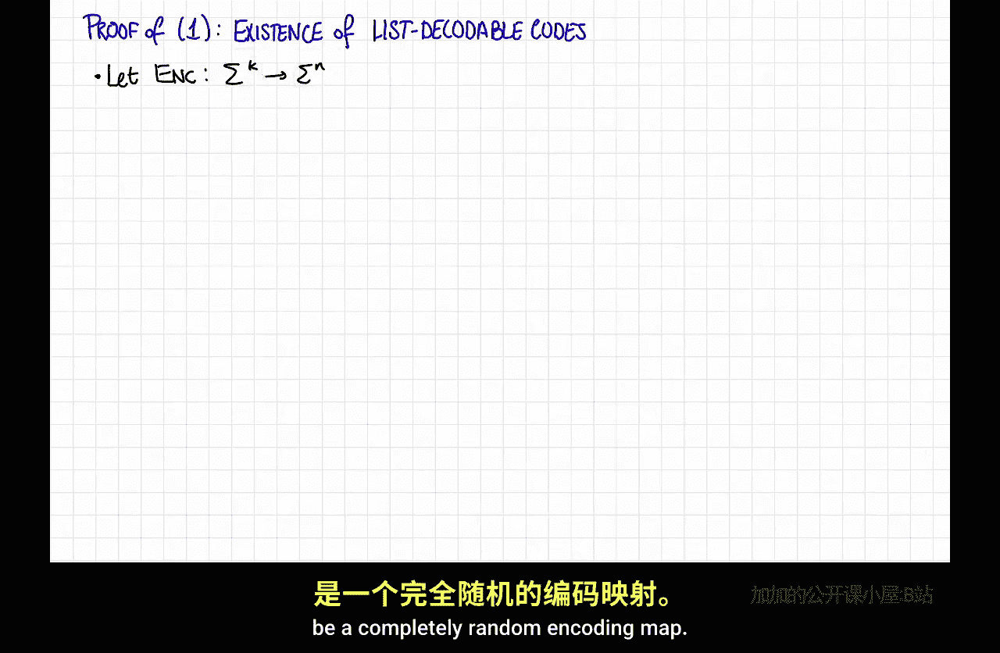
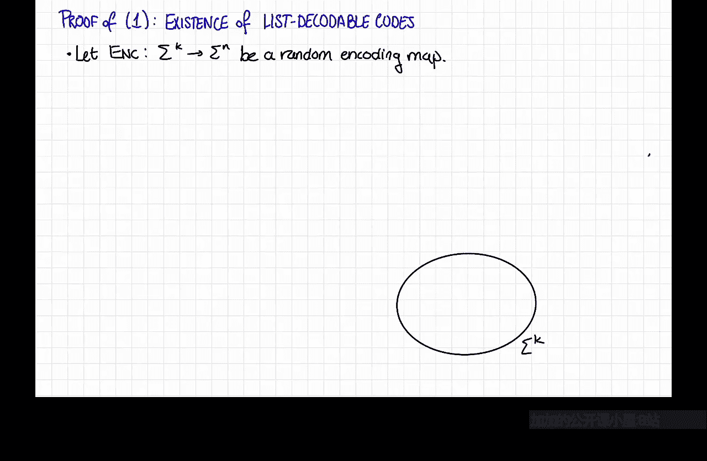
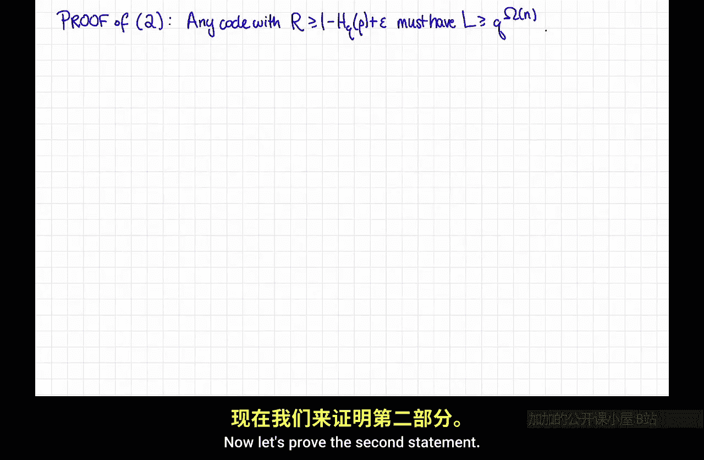
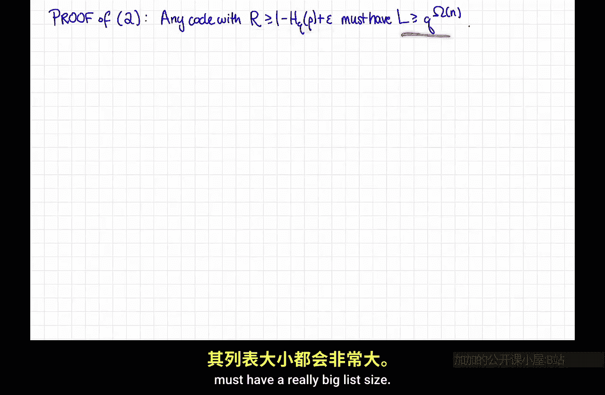
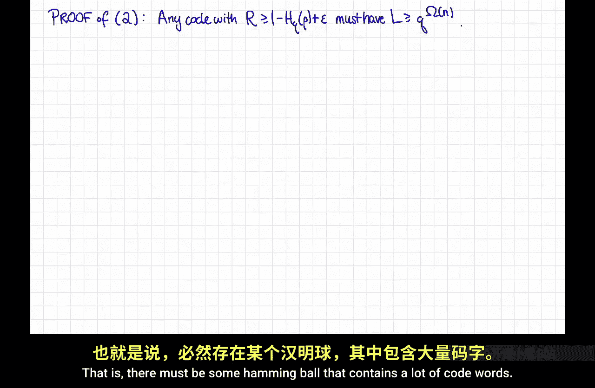
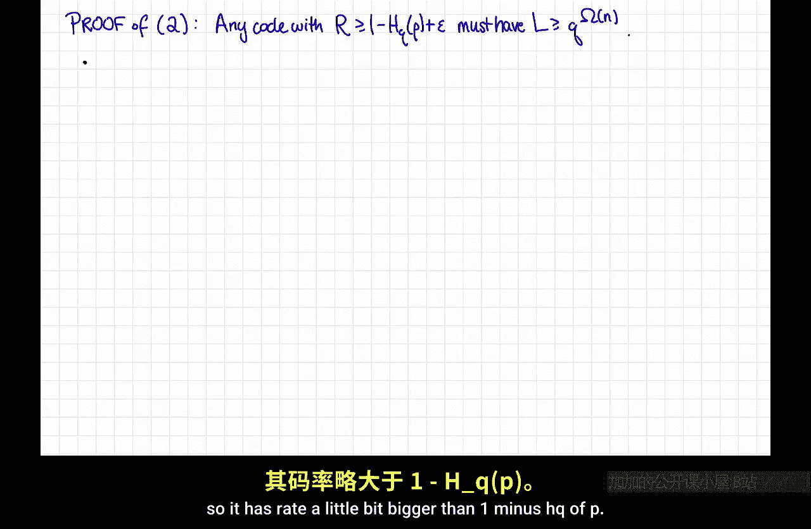
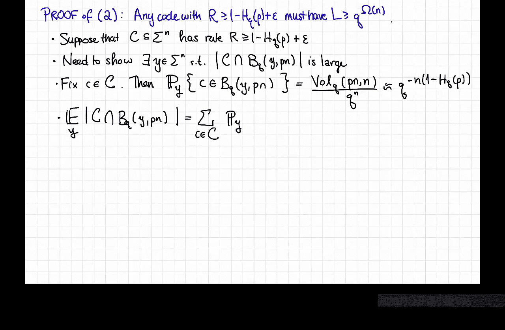

# 034：列表译码容量定理 📊

在本节课中，我们将学习列表译码容量定理。该定理精确地刻画了列表可译码的码在码率 **R** 和译码半径 **P** 之间的最佳权衡关系。

## 定理概述

列表译码容量定理非正式地指出，列表译码的容量，即码率 **R** 与半径 **P** 之间可能的最佳权衡，由公式 **R = 1 - H_Q(P)** 给出，其中 **H_Q** 是 **Q** 元熵函数。

更正式地，我们有以下定理。

令 **Q ≥ 2**，令 **0 < P < 1 - 1/Q**，并令 **ε > 0**。则以下两点成立。

第一点：如果码率 **R** 略低于阈值 **1 - H_Q(P)**，例如 **R = 1 - H_Q(P) - ε**，那么存在具有该码率、译码半径达到 **P** 的良好列表可译码。具体而言，存在一个 **Q** 元码族，它们是 **(P, O(1/ε))** 列表可译的。这里的 **P** 是列表译码半径，**O(1/ε)** 是列表大小 **L**。这表明，如果码率不太大，仅略低于此容量，那么存在在该码率下的码，使得任何半径为 **P * N** 的汉明球内最多包含 **O(1/ε)** 个码字。

第二点：如果码率略高于该容量，即 **R = 1 - H_Q(P) + ε**，那么任何具有半径 **P** 和列表大小 **L** 的列表可译码族，其列表大小 **L** 必须是指数级大的，至少为 **Q^(Ω(n))**。这第二点表明，如果码率过大，仅略高于容量，那么我们无法期望在列表译码能力上有任何像样的保证。在任何半径为 **P * n** 的汉明球内，总是会有指数数量的码字。

在证明这个陈述之前，让我们先解释一下这里的数量。它可能看起来有些熟悉。让我们回到之前看到的图。这里，**P**（错误比例）在 x 轴上，**R**（码率）在 y 轴上。我们看到列表译码容量定理给出的曲线 **1 - H_Q(P)**（此图针对 **Q=2**）与二元对称信道的汉明界和香农定理的曲线完全相同。

这里的启示是：如果鲍勃被允许在最坏情况错误的设置下返回一个短列表，那么爱丽丝和鲍勃可以做到与处理随机错误时一样好，尽管错误是最坏情况的。具体来说，我们可以让 **P** 无限接近 1/2，同时仍然保持正的码率，并拥有一个良好的列表可译码。

另一方面，普洛特金界指出，对于最坏情况错误，如果我希望 **P** 那么大（实际上，任何大于 1/4 的值），那么我就无法实现唯一译码。至少对于二元码，无法从 **P** 比例的最坏情况错误中唯一译码。

因此，这表明，如果爱丽丝和鲍勃愿意做出牺牲，只返回一个很短的列表，他们就能在可容忍的错误量方面获得巨大的增益。

## 证明第一部分：存在性

现在，让我们来证明列表译码容量定理。我们将从第一点开始，即存在良好的列表可译码。

我们将使用概率方法进行证明。我们将随机选取一个完全随机的码，并证明它以高概率满足要求。

令 **Enc: Σ^K → Σ^N** 为一个完全随机的编码映射。我们希望证明，只要码率略低于 **1 - H_Q(P)**，那么码 **C**（即这个随机编码映射的像）就是 **(P, L)** 列表可译的，且 **L** 不会太大。

为了证明这一点，让我们思考一下“不是列表可译的”意味着什么。这意味着存在某个集合 **Λ**，包含 **L+1** 条消息，它们全部被映射到某个汉明球内。也就是说，假设这里有 **L+1** 条消息，我的码 **C**（这个随机编码映射的像）在列表译码上失败，如果所有这些消息都映射到某个接收字 **y** 附近的点。

更详细地说，让我们固定这样一个 **Λ** 和这样一个 **y**。现在，计算这个坏事件发生的概率。任何一点落入这个球的概率，就是球的体积除以整个空间的体积。由于编码映射是完全随机的，这个点落入球的事件、那个点落入球的事件等等，都是独立的。因此，我可以计算所有这些点都落入球的概率，只需将这个概率提升到 **L+1** 次方。

现在，我们可以使用汉明球体积的便捷近似公式，得出这个概率小于等于 **2^{-n * (1 - H_Q(P)) * (L+1)}**。

现在我们需要对所有可能的 **Λ** 和所有可能的 **y** 进行并集界限。所以，存在这样的 **Λ** 和 **y** 使得坏事件发生的概率，根据并集界限，至多是：**C(Q^K, L+1)**（可能的集合 **Λ** 的数量）乘以 **Q^N**（可能的 **y** 的数量）再乘以这个概率。

现在，我将用 **Q^{K*(L+1)}** 来界定这个二项式系数 **C(Q^K, L+1)**。同时，我将利用 **K = R * n** 这一事实，将整个式子界定为 **Q^{n * (R + 1 - H_Q(P)) * (L+1) + 1}**。

现在，我们可以利用码率不太大的假设，说这个式子至多是 **Q^{n * (-ε) * (L+1)}**。只要 **L** 足够大，这就是 **Q^{-Ω(n)}**。具体来说，我们可以取 **L = O(1/ε)**，并且 **L** 仍然足够大。

因此，我们得出结论：一个随机码 **C** 以高概率是 **(P, L)** 列表可译的，特别是，这样的码存在。这就证明了列表译码容量定理的第一点。

## 证明第二部分：下界

上一节我们证明了良好列表可译码的存在性。本节中，我们来证明第二点，即任何码率稍大的码都必须有非常大的列表大小。也就是说，必须存在某个汉明球包含大量码字。

假设 **C** 就是这样一个码，其码率略大于 **1 - H_Q(P)**。我们需要证明，存在某个 **y**，使得以 **y** 为中心、半径为 **P * N** 的汉明球内包含大量码字。

我们的策略再次使用概率方法。我们将随机选择一个 **y**，并证明这个数量的期望值很大。这将意味着存在某个 **y** 使得这个数量很大。

为此，让我们考虑固定码 **C** 中的某个特定码字 **c**。现在，计算在随机选择 **y** 的情况下，**c** 落在这个汉明球内的概率。这里 **c** 是固定的，汉明球的中心是随机的，但我们也可以反过来思考：将汉明球视为固定的，而 **c** 是随机的。那么，这个事件发生的概率再次是汉明球的体积除以整个空间的体积。和之前一样，这大约是 **Q^{-n * (1 - H_Q(P))}**。

这只是针对单个码字。但现在我们可以利用这一点，结合期望的线性性质，来计算这个数量的期望值。我们有：随机 **y** 对应的汉明球内码字数量的期望值，根据期望的线性性质，等于码中所有码字 **c** 的概率（关于随机 **y**）之和。我们刚刚计算过，这个概率大约是 **|C| * Q^{-n * (1 - H_Q(P))}**。

**|C|** 有多大？**C** 的大小是 **Q^K**，即 **Q^{R*n}**。我们假设 **R** 至少这么大。所以，这个期望值至少是 **Q^{n * (1 - H_Q(P) + ε)} * Q^{-n * (1 - H_Q(P))}**。现在一些项抵消了，这正好等于 **Q^{ε * n}**，这确实是 **Q^{Ω(n)}**，正如我们所声称的。

这表明，在随机 **y** 的期望下，以 **y** 为中心的汉明球包含指数级多的码字，特别是，这样的 **y** 必然存在。这就证明了第二点，从而完成了整个定理的证明。

## 总结与展望

本节课中，我们一起学习了列表译码容量定理。该定理告诉我们，在假设列表大小是一个足够大的常数的情况下，列表译码在码率 **R** 和错误半径 **P** 之间的正确权衡关系。

然而，正如我们刚刚看到的，这个证明绝对不是构造性的，也没有提供高效的算法。在下一个视频中，我们将开始探讨如何通过显式构造来实现这个目标，或者至少实现一些非平凡的结果。