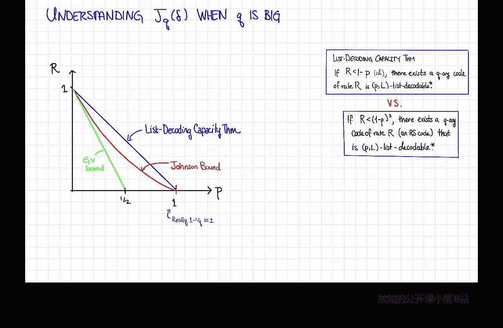

# 035：Johnson界


在本节课中，我们将学习Johnson界。该定理指出，任何具有良好距离的码，也具有良好的列表可译性。

上一节我们介绍了列表译码容量定理，本节中我们来看看Johnson界如何从距离的角度给出列表可译性的保证。

## Johnson界定理陈述

设 **J_Q(Δ)** 为以下量：
```
J_Q(Δ) = (1 - 1/Q) * (1 - √(1 - QΔ/(Q-1)))
```
令 **C ⊆ Σ^N** 是一个字母表大小为 **Q**、相对距离至少为 **Δ** 的码。

那么，Johnson界定理指出：如果列表译码半径 **P** 小于 **J_Q(Δ)**，则码 **C** 是半径为 **P**、列表大小为 **Q * Δ * N^2** 的列表可译码。

从定性角度看，Johnson界表明：如果一个码具有良好的距离，那么它就具有良好的列表可译性。我们注意到，这个被称为Johnson半径的量 **J_Q(Δ)** 是随 **Δ** 增大而增大的。这意味着，随着距离 **Δ** 变大，我们能保证列表大小可控的译码半径 **P** 也会变大。虽然我们可能希望列表大小比 **N^2** 更好（例如常数级），但对我们而言，任何关于 **N** 的多项式大小的列表都被认为是“可控的”。

## 与列表译码容量定理的定量比较

从定量角度看，Johnson界的表达式有些复杂。在本节剩余部分，我们将尝试定量比较Johnson界与上一节学习的列表译码容量定理。我们不会在本视频中证明Johnson界，但可以查阅讲义了解相关证明。现在，我们专注于理解这个量的含义以及它与已知结论的关系。

让我们从二进制情况开始，即 **Q = 2**。

### 二进制情况 (Q=2)

列表译码容量定理指出：如果码率 **R < 1 - H_2(P) - ε**，则存在一个码率为 **R**、列表大小为 **O(1/ε)** 的二进制码，它是 **(P, L)** 列表可译的。为了便于定量比较，我们暂时不关心具体的列表大小 **L**，只要它是多项式大小即可，并用星号(*)标记为“可控列表大小”。

Johnson界在二进制情况下的表述是：如果 **P < 1/2 * (1 - √(1 - 2Δ))**，那么任何距离为 **Δ** 的二进制码都是 **(P, L)** 列表可译的，且列表大小 **L** 可控。

为了比较这两个定理，我们需要将Johnson界也转化为一个关于码率 **R** 的陈述。我们可以利用已知的最佳码率-距离关系，即Gilbert-Varshamov界。

以下是具体步骤：

1.  Gilbert-Varshamov界指出，存在一个码率为 **R** 的码，其相对距离 **Δ** 满足 **R = 1 - H_2(Δ)**，或者说 **Δ = H_2^{-1}(1 - R)**。
2.  将这个 **Δ** 的表达式代入Johnson界关于 **P** 的条件中。
3.  然后，我们解出 **R**，得到一个形如“如果码率 **R** 足够小，则存在列表可译码”的陈述。

经过推导，我们得到：如果 **R < 1 - H_2(2P(1-P))**，则存在一个码率为 **R** 的二进制码，它是 **(P, L)** 列表可译的，且列表大小 **L** 可控。

现在，我们可以直接比较这两个陈述了，因为它们都具有“如果码率不太大，则存在列表可译码”的形式。

让我们将这两条曲线绘制在一起进行比较：

*   列表译码容量定理给出的曲线是：**R = 1 - H_2(P)**
*   Johnson界（结合GV界）给出的曲线是：**R = 1 - H_2(2P(1-P))**

正如预期，Johnson界给出的结果比列表译码容量定理要差。这不可能更好，因为容量定理既是存在性结果也是不可能性结果。然而，Johnson界确实允许我们将列表译码半径 **P** 一直提高到 **1/2** 并仍然获得正码率，这与容量定理一致。此外，Johnson界在某种意义上更通用，因为它不仅是一个存在性结果，还提示了如何实现：我们只需要构造一个具有良好距离的码。

### 大字母表情况 (Q 很大)

对于更大的 **Q**，我们可以重复这个练习。现在考虑 **Q** 很大（例如大于等于 **N**）的参数范围。

在这种设定下：
*   列表译码容量定理近似为：如果 **R < 1 - P**，则存在一个 **Q** 元码，它是 **(P, L)** 列表可译的。
*   Johnson半径近似为：**J_Q(Δ) ≈ 1 - √(1 - Δ)**。

同样，为了比较，我们需要将Johnson界转化为关于码率的陈述。对于大字母表，我们不需要借助Gilbert-Varshamov界，因为我们有能达到最佳码率-距离权衡的码，即Reed-Solomon码。

以下是具体步骤：

1.  对于Reed-Solomon码，有 **R = 1 - Δ**。
2.  将 **Δ = 1 - R** 代入近似的Johnson半径条件 **P < 1 - √(1 - Δ)**。
3.  解出 **R**，得到与容量定理可比较的形式。

经过推导，我们得到：如果 **R < (1 - P)^2**，则存在一个码率为 **R** 的 **Q** 元Reed-Solomon码，它是 **(P, L)** 列表可译的，且列表大小 **L** 可控。

再次绘制这两条曲线进行比较：

*   列表译码容量定理（大Q）给出的是一条直线：**R = 1 - P**
*   Johnson界（结合RS码）给出的是一条抛物线：**R = (1 - P)^2**

我们再次看到，Johnson界不如列表译码容量定理好。然而，它也有一些优点：
1.  它和容量定理一样，能保证列表可译性一直达到 **P = 1 - 1/Q**（在大Q下接近1）。
2.  列表译码容量定理是非构造性的（使用了随机码），而对于大Q，达到Johnson界曲线的码正是我们熟悉的Reed-Solomon码，因此我们有了明确的构造。
3.  下一讲，我们将学习如何对Reed-Solomon码进行高效的列表译码，直至这个界。

## 总结



本节课中我们一起学习了Johnson界。该定理将码的距离属性与列表可译性联系起来，指出任何具有良好相对距离 **Δ** 的码，在小于 **J_Q(Δ)** 的译码半径 **P** 下都是列表可译的，且列表大小是多项式级的。我们将其与列表译码容量定理进行了比较，发现虽然Johnson界给出的码率-半径权衡不如容量定理最优，但它具有构造性明确的优点（特别是对于大字母表，可直接使用Reed-Solomon码），并且同样允许译码半径接近理论最大值。这为实际构造列表可译码提供了重要的指导。