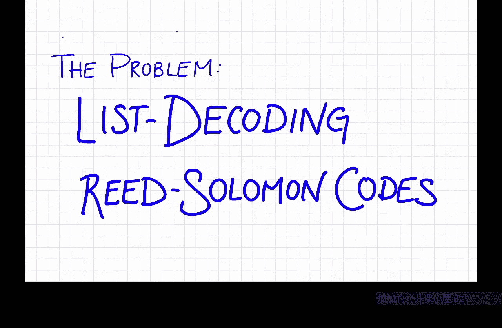
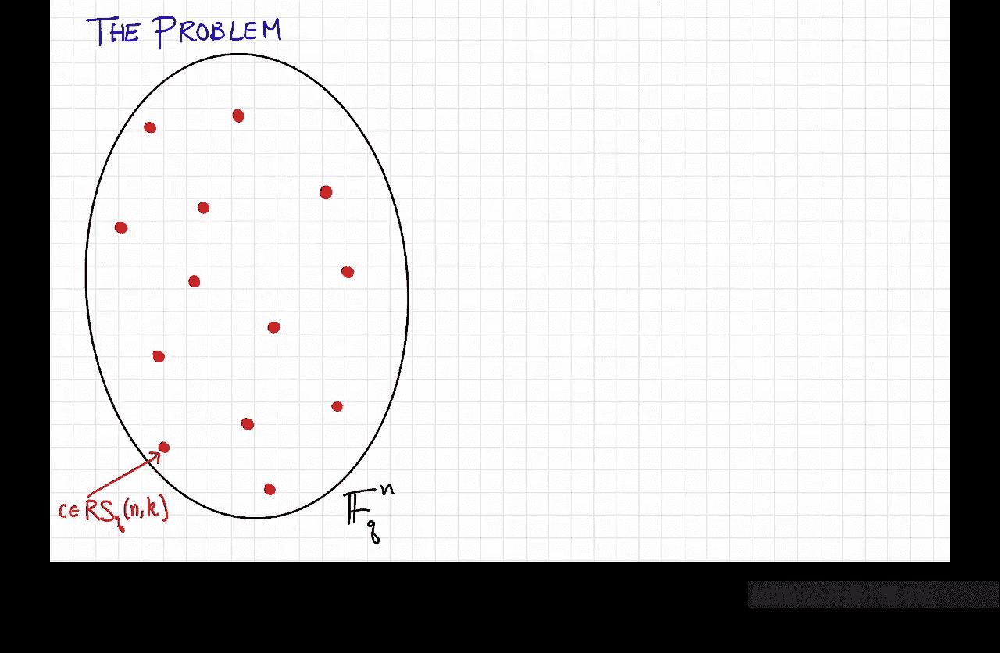

# 037：列表解码RS码的问题 📚

在本节课中，我们将学习列表解码里德-所罗门码的问题设定。我们将了解如何将解码问题转化为寻找与接收到的数据点高度匹配的低次多项式，并设定一个可实现的目标：解码到约翰逊界。

## 问题设定

上一节我们介绍了列表解码的基本概念，本节中我们来看看针对里德-所罗门码的具体问题。

假设这个大的区域代表所有可能的码字空间 **Fqn**，而这些红点代表某个里德-所罗门码的码字。设 **C** 为该里德-所罗门码，其定义如下：

**C = { (f(α₁), f(α₂), ..., f(αₙ)) | f ∈ Fq[x], deg(f) < k }**

其中，**α₁, ..., αₙ** 是有限域 **Fq** 中 n 个不同的元素，作为评估点。该码的码长为 **n**，维度为 **k**，码率为 **R = k/n**。

列表解码问题可以描述为：给定一个接收到的字 **y = (y₁, y₂, ..., yₙ) ∈ Fqn**，我们希望高效地找到所有与 **y** 足够接近的码字 **c ∈ C**。

## 解码半径的选择

那么，“足够接近”具体指多近呢？让我们通过一个图示来理解。

我们知道，里德-所罗门码的相对最小距离是 **1 - R**。如果我们观察一个半径为 **½(1 - R)** 的汉明球，根据唯一解码理论，该球内最多只包含一个码字。

列表解码的目标是观察一个稍大的球，并希望这个球内的码字数量不会太多，以至于我们仍然可以高效地列出它们。这个球的半径不能太大，否则球内可能包含指数级数量的码字，我们无法期望一个多项式时间算法来输出它们。

约翰逊界为我们提供了一个合适的半径。它指出，如果我们观察一个半径为 **1 - √R** 的球，那么我们可以保证球内的码字数最多是多项式级别的。

因此，我们的目标设定如下：给定接收字 **y**，我们希望高效地找到所有满足以下条件的码字 **c ∈ C**：

**Δ(y, c) ≤ 1 - √R**

其中 **Δ** 表示相对汉明距离。

## 等价的多项式表述

上述问题可以等价地转化为一个多项式插值问题。

具体来说，给定 **y**，我们希望高效地找到所有次数小于 **k** 的多项式 **f(x) ∈ Fq[x]**，使得对于至少 **√R * n** 个索引 **i**，有：

**f(αᵢ) = yᵢ**

换句话说，我们寻找那些在足够多的评估点（比例至少为 **√R**）上与接收到的数据 **y** 一致的低次多项式。

如果能实现这个目标，我们就说可以高效地将里德-所罗门码列表解码到约翰逊界。

## 总结

本节课中我们一起学习了列表解码里德-所罗门码的问题框架。我们明确了目标：给定接收向量 **y**，在多项式时间内，找到所有与 **y** 的相对汉明距离在 **1 - √R** 以内的码字，这等价于寻找与 **y** 在至少 **√R * n** 个点上一致的低次多项式。在接下来的课程中，我们将探讨实现这一目标的具体算法。