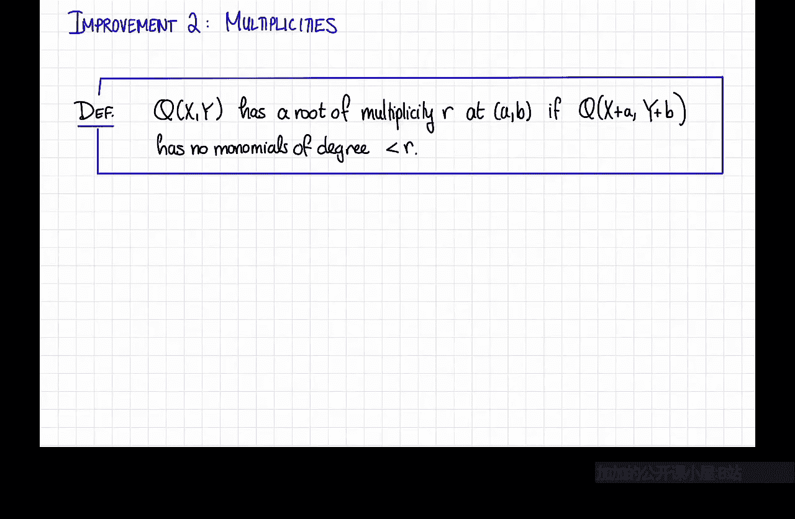
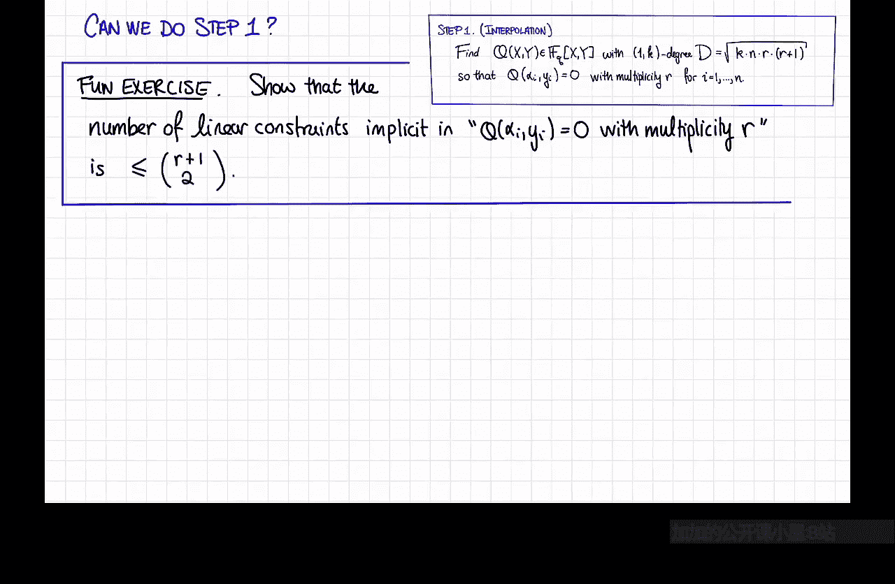

代数编码导论：4：Guruswami-Sudan算法

在本节课中，我们将学习Guruswami-Sudan算法。这是对上一节介绍的Sudan算法的改进，使我们能够高效地列表解码Reed-Solomon码，直至达到Johnson界。

在上一节中，我们介绍了Sudan算法，它能高效地列表解码Reed-Solomon码，解码半径接近Johnson界。本节中，我们将看到一种名为Guruswami-Sudan算法的改进版本，它能将解码半径完全提升至Johnson界。

首先，我们简要回顾一下高效解码Reed-Solomon码的背景。假设我们收到一个码字`y`。Berlekamp-Welch算法允许我们高效地进行唯一解码，其解码半径可达距离的一半，对于Reed-Solomon码，即`(1 - R)/2`。在这个半径内，保证最多只有一个码字，Berlekamp-Welch算法可以找到它。

在上一节中，我们看到的Sudan算法能够高效地列表解码，其解码半径更大，达到`1 - 2√R`。当码率`R`较小时，这个半径大于唯一解码半径。根据Johnson界，在这个更大的半径球内，最多只有多项式数量的码字，Sudan算法提供了一种高效找到它们的方法。

本节中，我们将尝试改进Sudan算法。我们将分两步进行。第一步，我们将看到一个用于教学目的的算法，它可以将解码半径略微提高到`1 - √(2R)`。第二步，我们将进一步将半径提高到`1 - √R`，即Johnson界。这最终的算法就是Guruswami-Sudan算法。

### 第一步改进：引入(1, k)度

我们的第一个改进，目标是达到半径`1 - √(2R)`，其关键在于改变我们衡量双变量多项式`Q`的“度”的方式。

为此，我们做出以下定义。

**定义**：单项式`x^i y^j`的 **(1, k)度** 定义为 `i + k * j`。

类似地，双变量多项式`Q`的 **(1, k)度** 定义为出现在该多项式中任何单项式的(1, k)度的最大值。

现在，基于这个定义，以下是达到`1 - √(2R)`的改进算法。与Sudan算法一样，它包含两个步骤：插值步骤和求根步骤。

**步骤1：插值**
找到一个双变量多项式`Q(x, y)`，使其(1, k)度满足：
`(1, k)-deg(Q) ≤ √(2 * k * n)`
同时，要求对于所有`i`从1到`n`，满足：
`Q(α_i, y_i) = 0`

**步骤2：求根**
返回所有满足`Q(x, f(x)) ≡ 0`的多项式`f`。

接下来，我们简要分析这个算法。证明思路与Sudan算法基本相同。

首先，我们需要证明步骤1是可行的（即这样的`Q`存在且可高效求解），然后证明步骤2是有效的。

**可行性分析（步骤1）**
我们需要证明，满足上述(1, k)度限制的多项式`Q`，其系数数量（变量数）大于约束条件数量。

*   **变量数**：一个(1, k)度至多为`D`的多项式，其系数数量严格大于 `D² / (2k)`。
*   **约束数**：我们有`n`个约束条件 `Q(α_i, y_i) = 0`。

在本算法中，我们设 `D = √(2 * k * n)`。因此，变量数 `> (√(2kn))² / (2k) = n`，恰好等于约束数`n`。由于变量数大于约束数，我们可以通过求解线性系统来完成步骤1。

**有效性分析（步骤2）**
我们需要证明，如果某个多项式`f`与接收字`y`在足够多的位置上一致，那么它将被算法返回。

定义 `R(x) = Q(x, f(x))`。我们希望证明`R(x)`恒等于0。我们通过证明`R(x)`的度数不高，但却有很多根来实现。

*   **`R(x)`的度数**：`deg(R) ≤ (1, k)-deg(Q) ≤ √(2 * k * n)`。
*   **`R(x)`的根**：如果`f(α_i) = y_i`，那么由插值条件`Q(α_i, y_i)=0`可知，`R(α_i)=0`。如果这样的`i`的数量 `t > √(2 * k * n)`，那么`R(x)`就有超过`√(2 * k * n)`个根。

由于一个非零多项式的根数不能超过其次数，而这里根数`t`大于次数上界`√(2kn)`，这迫使`R(x)`必须是零多项式。因此，`f`会被步骤2返回。

综上所述，这个改进算法能够高效地列表解码Reed-Solomon码，达到错误比例 `p = 1 - √(2R)`。列表大小`L`也是一个合理的值。

这样，我们成功将Sudan算法中的因子2从根号外移到了根号内，这是一个明确的改进。但我们还没有达到最终目标`1 - √R`，还需要另一个`√2`的改进。

### 第二步改进：引入重根

我们下一个改进是考虑**重根**。

**定义**：双变量多项式`Q(x, y)`在点`(a, b)`处有**重数**为`r`的根，如果多项式`Q(x+a, y+b)`不包含任何总次数严格小于`r`的单项式。

**示例**：假设`Q(x, y) = (x - α_i)² * (y - y_i)`。那么它在点`(α_i, y_i)`处有重数为3的根。因为`Q(x+α_i, y+y_i) = x² * y`，它没有总次数小于3的项。

为什么关心重数？直观上，它允许我们“用更少的代价获得更多的根”。在证明中，一个重数为`r`的根在“低次多项式不能有太多根”的分析中，可以算作`r`个根，这将为我们带来优势。

### Guruswami-Sudan算法

现在，我们介绍完整的Guruswami-Sudan算法。

首先选择参数`r`（小写）。增大`r`将在解码半径和列表大小之间进行权衡：`r`越大，越接近Johnson界，但列表大小也会增加。

设`t`是一个参数，满足：
`t > √( k * n * (1 + 1/r) )`
`t`表示我们希望返回的与`y`至少在`t`个位置上一致的多项式`f`的数量。当`r`趋于无穷时，`t`趋近于`√(k * n)`，这正是Johnson界对应的值。

算法同样包含两步：

**步骤1：插值**
找到一个双变量多项式`Q`，其(1, k)度`D`为：
`D = √( k * n * r * (r+1) )`
并且要求对于所有`i`从1到`n`，满足：
`Q(α_i, y_i) = 0` **且重数为`r`**。
这是与之前版本的关键区别：要求`Q`在这些点上以重数`r`消失。

**步骤2：求根**
返回所有满足`Q(x, f(x)) ≡ 0`的多项式`f`。
这样的`f`最多有`D/k`个，大约为 `r / √R`。只要`r`是常数且码率`R`是常数，列表大小就是常数。实际上，为了使`t`近似为`√(k*n)`，取`r`为关于`n`和`k`的多项式即可，此时列表大小也是多项式的。

**算法分析**

我们声称此算法能以错误比例 `p = 1 - √((1+1/r) * R)` 和列表大小 `L = O(r / √R)` 高效列表解码Reed-Solomon码。证明仍需说明步骤1可行且步骤2有效。

**步骤1的可行性**
我们需要计算约束数和变量数。
*   **约束数**：要求一个多项式在一点以重数`r`消失，带来的约束条件数量最多为 `C(r+1, 2) = r(r+1)/2`。对于`n`个点，总约束数 ≤ `n * r(r+1)/2`。
*   **变量数**：与之前相同，> `D² / (2k)`。

代入 `D = √( k * n * r * (r+1) )`，可得变量数 > `[k * n * r * (r+1)] / (2k) = n * r(r+1)/2`，这正好等于约束数上界。因此，我们可以通过求解线性系统完成步骤1。

**步骤2的有效性**
定义 `R(x) = Q(x, f(x))`。假设`f`在至少`t`个位置`i`上满足`f(α_i) = y_i`。

*   **`R(x)`的度数**：`deg(R) ≤ (1, k)-deg(Q) = D = √( k * n * r * (r+1) )`。
*   **`R(x)`的根（计重数）**：可以证明，对于每个满足`f(α_i) = y_i`的`i`，`(x - α_i)^r` 整除 `R(x)`。这是因为`Q`在`(α_i, y_i)`有重数`r`的根。因此，`R(x)`至少被 `∏ (x - α_i)^r` 整除，这个乘积多项式的次数为 `t * r`。

根据“低次多项式不能有太多根（计重数）”的原理，如果`R(x)`非零，其次数必须至少为 `t * r`。

现在比较：
*   算法要求 `t > √( k * n * (1 + 1/r) )`，所以 `t * r > r * √( k * n * (1 + 1/r) ) = √( k * n * r * (r+1) )`。
*   而`R(x)`的度数上界正是 `√( k * n * r * (r+1) )`。

因此，`t * r` 严格大于 `R(x)`的度数上界。这意味着`R(x)`不可能有`t * r`那么高的次数，所以它必须是恒等于零的多项式。因此，任何与`y`在至少`t`个位置上一致的`f`都会被步骤2返回。步骤2是有效的。

综上所述，Guruswami-Sudan算法是正确的，并且可以高效实现（步骤1解线性系统，步骤2有多项式时间方法）。

### 总结

本节课中，我们一起学习了Guruswami-Sudan算法，它给出了一个高效列表解码Reed-Solomon码直至Johnson界的算法。

我们从Sudan算法开始，它未能完全达到Johnson界，只达到了`1 - 2√R`。
我们进行了第一次改进，引入了(1, k)度的概念，这节省了一个`√2`因子，将半径提升到`1 - √(2R)`。
然后我们进行了第二次改进，引入了**重根**的概念，这使我们最终达到了`1 - √R`，即Johnson界。

你可能会想，是否有可能超越Johnson界进一步扩大解码半径？我们在之前的课程中看到，列表解码容量定理是超越Johnson界的。然而，对于Reed-Solomon码，能否高效地列表解码直至容量界，在很大程度上仍然是一个开放问题。不过，目前达到Johnson界已经是一个非常好的结果了。