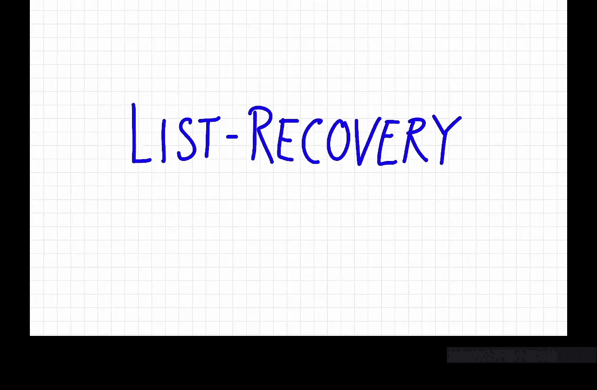
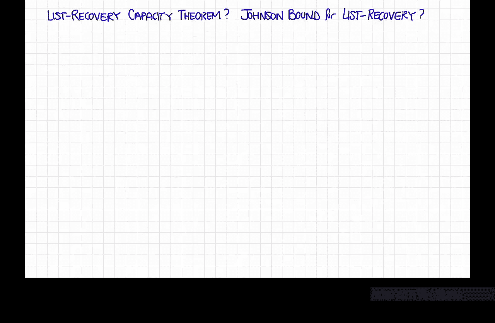
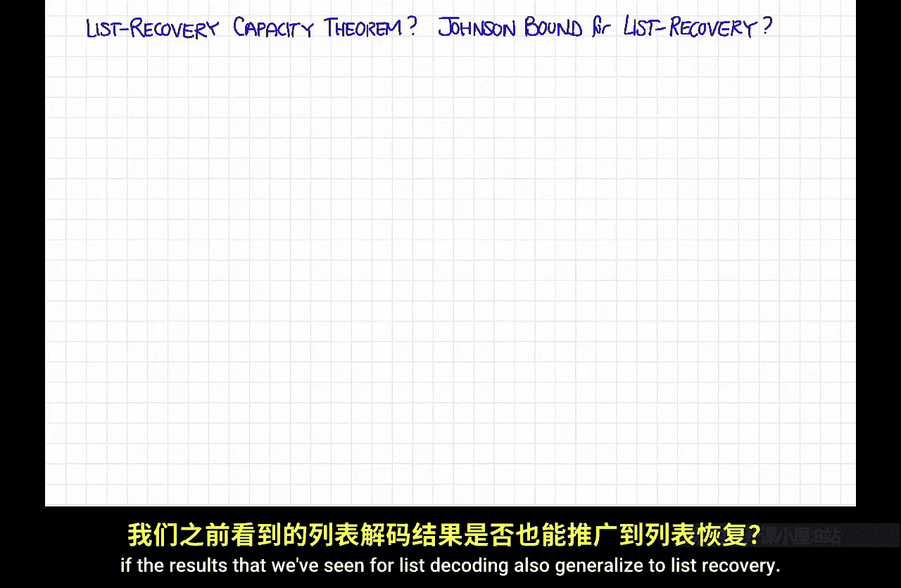
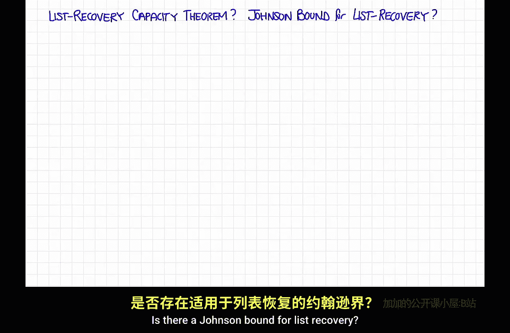
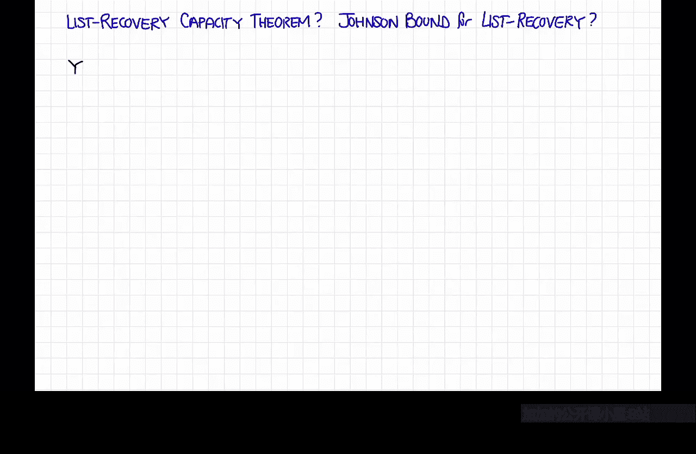
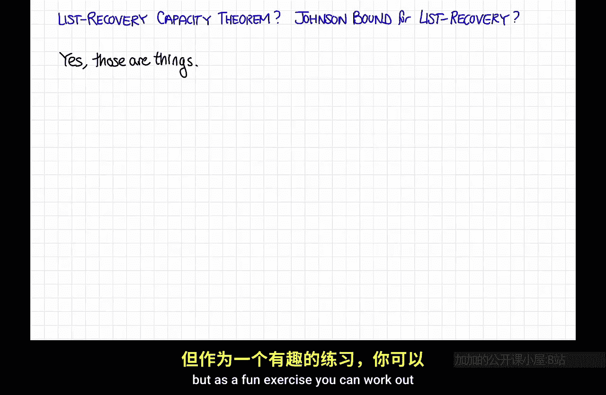
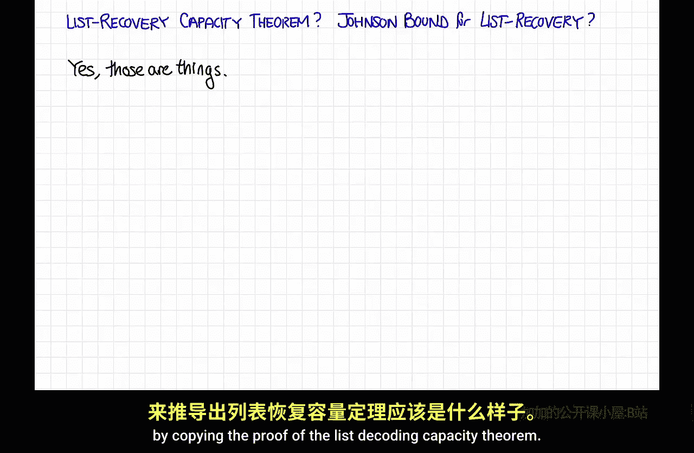
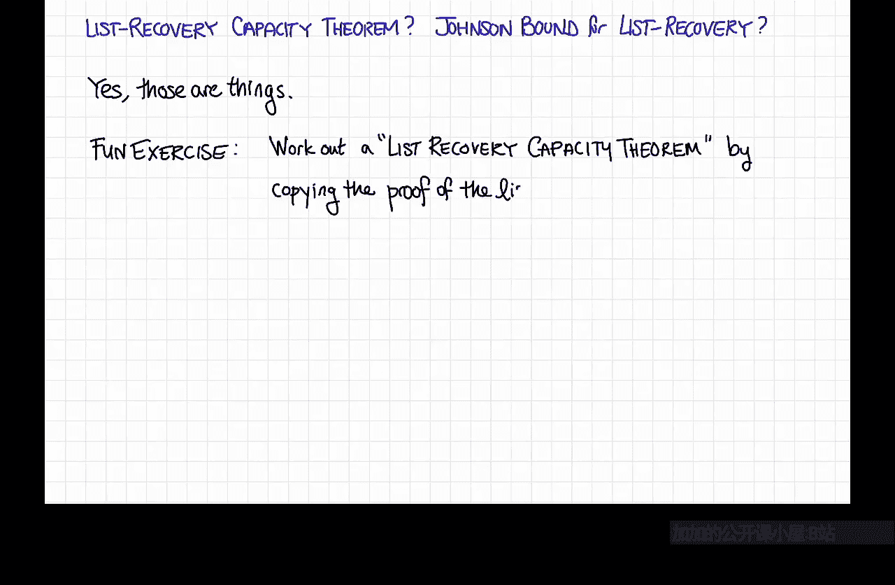
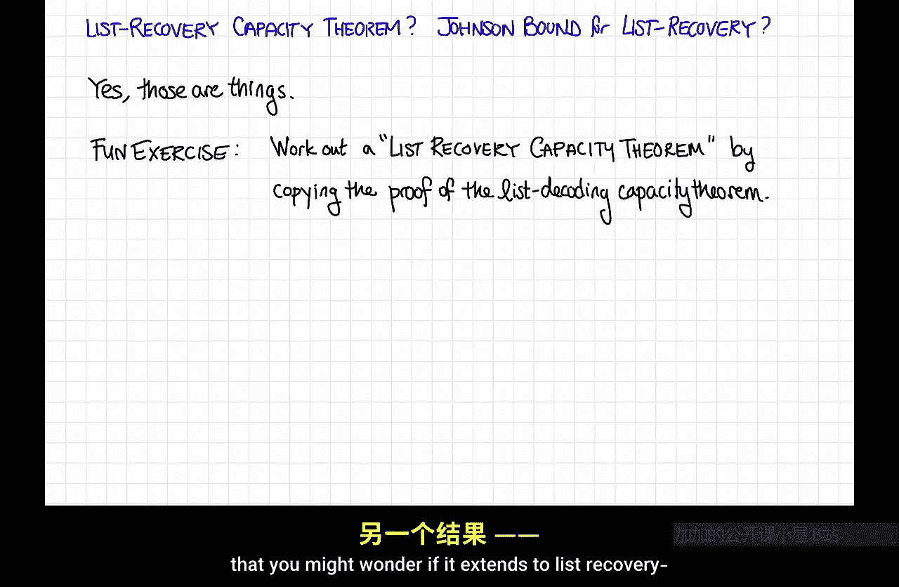
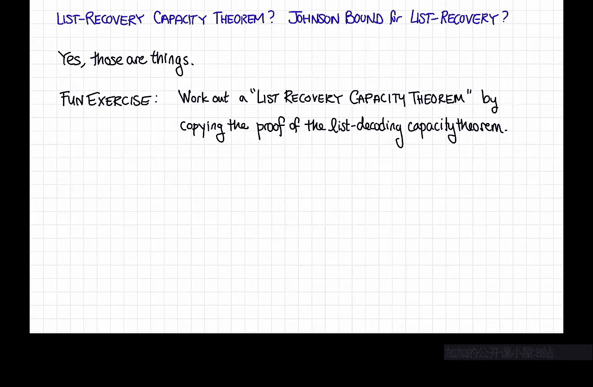

代数编码理论导论：1：列表恢复（List Recovery）介绍

在本节课中，我们将学习列表解码（List Decoding）的一个推广概念——列表恢复（List Recovery）。

列表恢复的定义如下。首先选择参数：大写的 **L** 和小写的 **l**，要求 **L ≥ l**，且两者均为大于等于1的整数。再选择一个介于0和1之间的参数 **P**。对于一个定义在字母表 **Σ** 上、长度为 **N** 的编码 **C**，如果对于所有大小不超过 **l** 的子集序列 **S₁, S₂, ..., S_N**（其中每个 **S_i ⊆ Σ**），满足以下条件的码字 **c ∈ C** 的数量不超过 **L**，则称该编码是 **(P, l, L) 列表可恢复的**。

条件为：码字 **c** 与列表序列不一致的位置数量最多为 **P × N** 个。用公式表示，即满足以下条件的码字数量不超过 **L**：
`|{ i | c_i ∉ S_i }| ≤ P × N`

为了理解这个定义，我们可以想象一个场景。假设有一个未知的码字 **c** 属于编码 **C**。我们不知道它的具体内容，但知道关于其每个符号的一些约束信息。例如，我们知道第一个符号 **c₁** 可能来自列表 **S₁ = {A, B, C}**，第二个符号 **c₂** 可能来自列表 **S₂ = {B, D, F}**，依此类推，直到第 **N** 个符号。我们的任务是，在编码 **C** 中找出所有满足这些约束的码字，即那些至少在一部分（具体是 **1-P** 比例）的位置上，其符号值落在对应列表中的码字。列表可恢复性要求这样的码字数量不超过 **L** 个。

现在，让我们对这个定义做几点观察。

以下是关于列表恢复定义的几点观察：

1.  **列表恢复是列表解码的推广**。具体来说，**(P, 1, L) 列表恢复** 等价于 **(P, L) 列表解码**。如果不理解，可以暂停思考一下。
2.  **当 P=0 时，列表恢复依然有意义**。此时，我们要求与所有列表完全一致的码字数量不超过 **L**。这是一种常见情况，此时我们省略参数 **P**，直接称之为 **(l, L) 列表可恢复**。
3.  **参数 L 必须大于等于 l**。即使定义中没有明确要求，这也是必然的。原因如下：对于任何编码，我都可以构造出大小为 **l** 的列表序列，使得至少有 **l** 个码字完全符合这些列表。构造方法是：任意选取 **l** 个码字，对于第 **i** 个位置，将所选 **l** 个码字在该位置的符号集合作为列表 **S_i**。这样，这 **l** 个被选中的码字自然满足所有列表约束。因此，定义中的 **L** 不可能小于 **l**。

上一节我们介绍了列表恢复的定义及其与列表解码的关系。本节中我们来看看一个自然产生的问题：我们之前关于列表解码的结论能否推广到列表恢复？

答案是肯定的。例如：
*   存在**列表恢复的容量定理**（List Recovery Capacity Theorem）。
*   存在**列表恢复的约翰逊界**（Johnson Bound for List Recovery）。

这些结论的证明思路与列表解码中的相应证明类似。作为一个有趣的练习，你可以尝试通过模仿列表解码容量定理的证明，来推导列表恢复的容量定理。

另一个我们为列表解码（特别是里德-所罗门码）看到的重要结果是**古鲁斯瓦米-苏丹算法**（Guruswami-Sudan algorithm）。你可能会问，这个算法能否扩展到列表恢复？

答案同样是肯定的。我们将在下一个视频中详细探讨这一点。

本节课中我们一起学习了列表恢复的概念，它是列表解码的推广。我们明确了其定义、关键参数，并指出了它与列表解码的关系。我们还了解到，列表解码中的许多核心结论，如容量定理和高效的解码算法，都可以相应地推广到列表恢复的设定中。