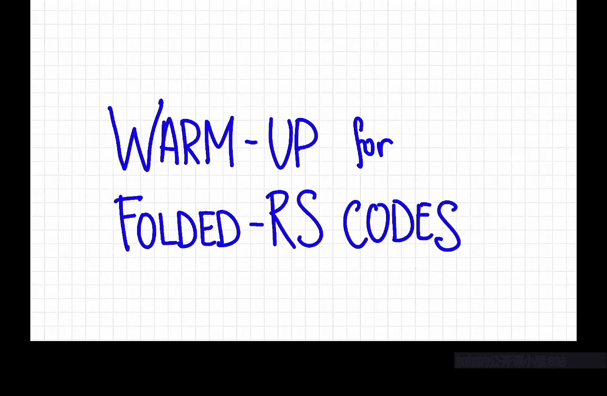
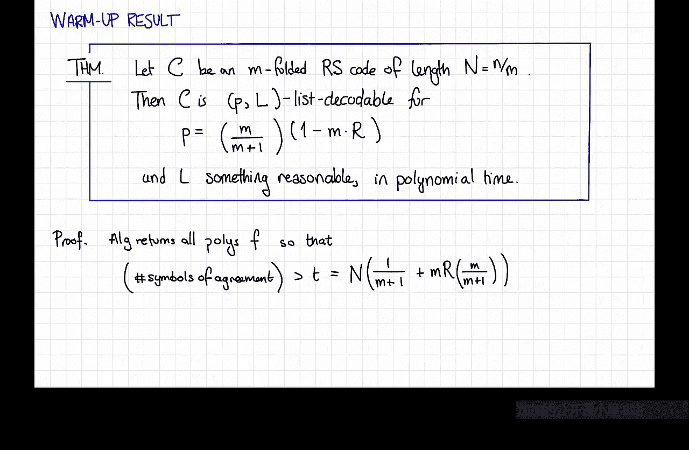

# 045：折叠里德-所罗门码的列表解码（初步）📚



在本节课中，我们将学习折叠里德-所罗门码列表解码的一个初步结果。这个结果虽然不能直接证明我们在上一视频末尾陈述的最终定理，但它为我们提供了一个起点，并展示了证明完整定理所需的核心思想。

## 定理陈述 📝

假设 `C` 是一个折叠参数为 `M` 的折叠里德-所罗门码，其长度 `N` 等于原始里德-所罗门码长度 `n` 除以 `M`，即 `N = n / M`。

那么，该折叠里德-所罗门码 `C` 是 `(p, L)` 列表可解码的，其中：
*   **列表解码半径** `p` 为：
    ```
    p = M/(M+1) * (1 - M * R)
    ```
*   **列表大小** `L` 是合理的。
*   解码算法可以在**多项式时间**内运行。

这个结果本身并不十分理想，因为我们希望 `p` 接近 `1 - R`，但无论 `M` 如何选择，上述公式都无法达到这个目标。然而，其证明过程将阐明后续证明完整定理所需的关键思路。

## 算法概述 🛠️

我们将通过给出一个具体的解码算法来证明这个定理。该算法分为两个主要步骤，这与我们之前见过的韦尔奇-伯利坎普算法、苏丹算法以及格里瓦米-苏丹算法的结构类似。

### 算法输入与输出

*   **输入**：
    1.  一个接收到的单词 `y`。它的形式与折叠码字相同：第一个符号是一个小向量 `(y_0, ..., y_{M-1})`，第二个符号是 `(y_M, ..., y_{2M-1})`，依此类推。
    2.  两个参数 `t` 和 `D`，我们稍后会确定其具体值。
*   **输出**：
    一个列表 `L`，其中包含所有满足以下条件的多项式 `f`（定义在有限域 `F_q` 上，且次数最多为 `k-1`）：
    ```
    对于超过 t 个索引 i，有：
    (y_{Mi}, y_{Mi+1}, ..., y_{Mi+M-1}) = (f(γ^{Mi}), f(γ^{Mi+1}), ..., f(γ^{Mi+M-1}))
    ```
    这里，`t` 是算法输入的一个参数，`γ` 是域中的本原元。

## 算法步骤详解 🔍

### 第一步：插值

在第一步中，我们需要找到一个具有特定形式的 `M+1` 元多项式 `Q`。

以下是第一步的具体要求：
1.  **多项式形式**：`Q` 的变量是 `x, y_1, ..., y_M`，其形式为：
    ```
    Q(x, y_1, ..., y_M) = A_0(x) + y_1 * A_1(x) + y_2 * A_2(x) + ... + y_M * A_M(x)
    ```
    其中：
    *   `A_0(x)` 的次数最多为 `D + k - 1`。
    *   对于 `j = 1, ..., M`，`A_j(x)` 的次数最多为 `D`。
2.  **插值约束**：对于所有 `i` 从 `0` 到 `n-1`，多项式 `Q` 必须在以下点上取值为零：
    ```
    Q( γ^{Mi}, y_{Mi}, y_{Mi+1}, ..., y_{Mi+M-1} ) = 0
    ```
    这个约束模仿了格里瓦米-苏丹算法中对 `Q` 的要求：变量 `x` 代表码字的第一个评估点，而 `y_j` 则取接收单词对应位置的值。

### 第二步：寻找根

在第二步中，我们需要找到多项式 `Q` 的特定“根”。具体来说，我们需要找到所有次数最多为 `k-1` 的多项式 `f`，使得当我们将 `Q` 中的变量进行如下替换后：
*   将 `y_j` 替换为 `f(γ^j * x)`（即 `f(γ * x), f(γ^2 * x), ..., f(γ^M * x)`）

得到的是一个关于 `x` 的一元多项式 `R(x)`，并且 `R(x)` **恒等于零**。

然后，算法将所有这样的多项式 `f` 作为列表返回。

## 算法可行性分析 ✅

与这类算法一样，我们需要回答两个关键问题：第一步是否可行？第二步是否是一个好主意（即能否保证找到所有应被解码的码字）？

### 第一步的可行性：系数与约束计数

我们通过比较多项式 `Q` 的系数（变量）数量和插值约束（方程）数量来分析。

*   **变量数量**：即 `Q` 中所有系数的总数。
    *   `A_0(x)` 的系数数量：`D + k`（因为次数最多为 `D + k - 1`）。
    *   每个 `A_j(x)`（`j=1..M`）的系数数量：`D + 1`。
    *   总变量数 = `(D + k) + M * (D + 1) = (M+1)D + (M + k)`。
*   **约束数量**：即插值点的数量，等于 `n`。

为了使线性方程组有非零解，我们需要**变量数大于约束数**。通过后续对参数 `D` 的巧妙选择（见下文），可以确保这一条件成立。因此，第一步是可行的。

### 第二步的有效性：低次多项式根的数量

我们需要证明：任何与接收单词 `y` 在超过 `t` 个位置上一致的正确码字多项式 `f`，都会使得第二步中构造的多项式 `R(x)` 恒等于零。

论证如下：
1.  **`R(x)` 的次数**：由于 `Q` 的特殊形式以及 `f` 的次数限制，可以证明 `R(x)` 的次数最多为 `D + k - 1`。
2.  **`R(x)` 的根**：每当 `f` 与 `y` 在第 `i` 个符号上一致时，根据第一步的插值约束，`γ^{Mi}` 就是 `R(x)` 的一个根。因此，如果一致的位置数超过 `t`，则 `R(x)` 至少有 `t+1` 个根。
3.  **结论**：一个次数最多为 `D + k - 1` 的多项式，如果其根的数量超过了它的次数，那么它必须是零多项式。因此，只要我们选择的参数 `t` 满足 `t ≥ D + k - 1`，就能保证所有应被解码的 `f` 都会使 `R(x) ≡ 0`，从而被算法找到。

## 参数选择与定理证明 📐

为了使整个论证成立，我们需要精心选择参数 `t` 和 `D`。

*   **选择 `D`**：我们令
    ```
    D = floor( (n - k) / (M + 1) )
    ```
    这个选择恰好能保证第一步中变量数大于约束数的条件。
*   **选择 `t`**：我们令
    ```
    t = N * ( 1/(M+1) + (M*R * M)/(M+1) )
    ```
    其中 `R = k/n` 是原始码的码率，`N = n/M` 是折叠码的长度。这个选择确保了 `t ≥ D + k - 1`，从而满足了第二步有效性的条件。

现在，让我们完成定理的证明。算法成功返回了所有与接收单词 `y` 在超过 `t` 个符号上一致的多项式 `f`。换句话说，算法能处理所有错误符号数不超过 `N - t` 的情况。


因此，算法的**列表解码半径** `p`，即能容忍的最大错误比例，为：
```
p = (N - t) / N = 1 - t/N
```
将上面选择的 `t` 代入并化简，即可得到定理中声明的表达式：
```
p = M/(M+1) * (1 - M * R)
```
至此，我们完成了对这个初步定理的证明。

## 总结与展望 🎯



本节课中，我们一起学习了折叠里德-所罗门码列表解码的一个基础算法及其证明。我们了解到：
1.  算法通过**两步走**：先插值一个多元多项式 `Q`，再寻找能使某个衍生一元多项式 `R(x)` 为零的所有候选多项式 `f`。
2.  其核心思想依然是**比较系数与约束的数量**，以及利用**低次多项式不能有太多根**这一事实。
3.  通过精心选择参数 `D` 和 `t`，我们证明了算法能以 `p = M/(M+1) * (1 - M * R)` 的半径进行列表解码。

然而，正如开头所指出的，这个结果中的解码半径 `p` 并不令人满意，它无法接近理想的 `1 - R`。在下一个视频中，我们将改进这个想法，引入更强大的技术，以获得我们真正想要的、接近信道容量的列表解码结果。