# 048：哈达玛码的局部校正

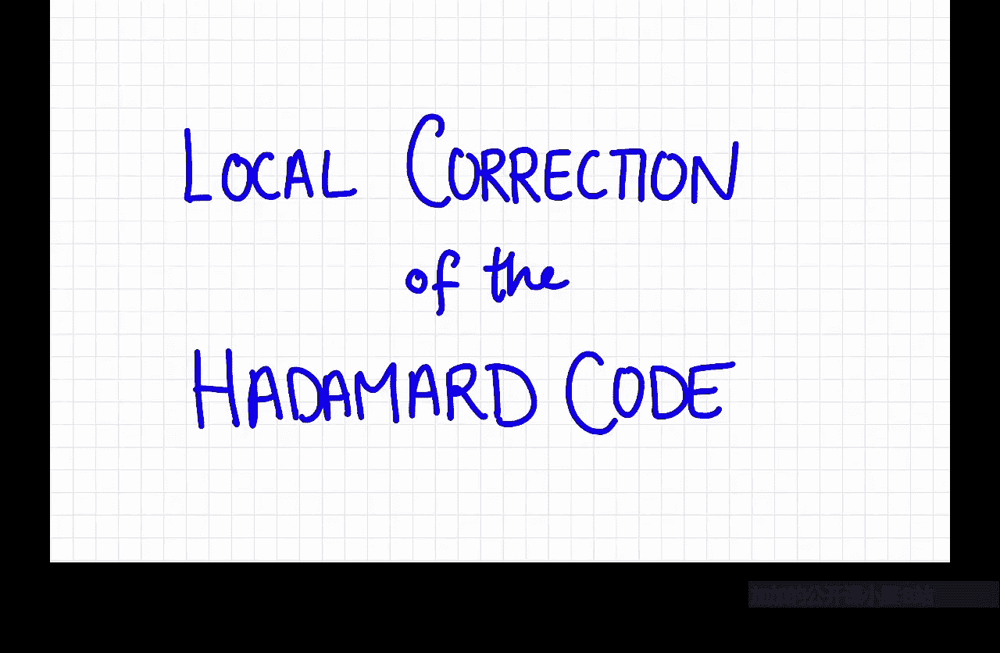

在本节课中，我们将学习第一个局部可校正码的例子——哈达玛码。我们将了解哈达玛码的定义、性质，并学习一个仅需两次查询即可对其进行局部校正的算法。

## 哈达玛码的定义

哈达玛码的维度为 **M**，长度为 **2^M**，其定义如下：

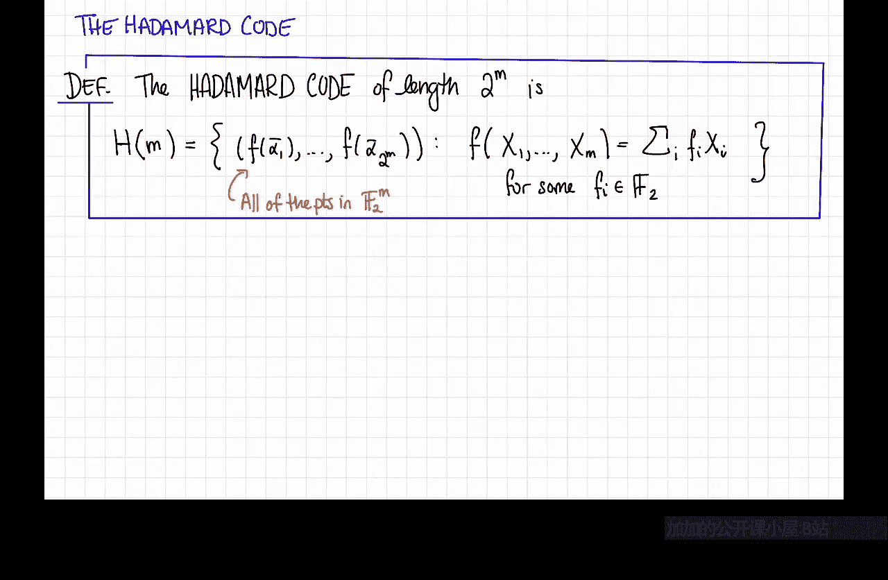

它是所有形如 **F(α₁), F(α₂), …, F(α_{2^M})** 的向量的集合。

其中，**αᵢ** 是域 **F₂^M** 中的所有点，而函数 **F** 具有以下形式：

**F(x₁, x₂, …, x_M) = Σ_{i=1}^M f_i * x_i**

这个函数可以看作是系数向量 **f** 与变量向量 **x** 的内积。由于 **f_i** 有 **2^M** 种可能的取值，因此这样的函数 **F** 也有 **2^M** 个，所以该码的维度为 **M**。码的长度为 **2^M**，因为共有 **2^M** 个评估点。

因此，该码的码率为 **M / 2^M**，这个值非常小。就码率而言，这不是一个很好的码。

然而，这个码的距离特性非常好。你可以验证，该码的距离是 **2^{M-1}**，或者说相对距离是 **1/2**。因此，该码的距离非常大。

这个码适用于那些需要很大距离而对码率要求不高的应用场景。

## 哈达玛码作为局部可校正码

我们讨论哈达玛码的原因是，它恰好也是一个局部可校正码，其查询复杂度仅为 **2**。

接下来，我们将通过给出一个局部校正算法来证明哈达玛码是一个局部可校正码。

### 问题设定

该算法的输入包括：
1.  对一个被损坏的码字 **G** 的查询访问权限。
2.  我们想要评估的某个坐标的索引 **α**。

更具体地说：
*   **G** 是一个函数，它接收 **F₂^M** 中的输入，并输出 **F₂** 中的一个比特。**G** 接近我们码中的某个函数 **F**，即 **G** 与 **F** 之间的汉明距离（两个函数不同的点数）最多为 **p * 2^M**，其中参数 **p** 严格小于 **1/4**。
*   **F** 对应我们的码字，其形式符合哈达玛码的定义。
*   我们的目标是输出对 **F(α)** 的一个猜测，并且希望这个猜测以较高的概率正确。

### 局部校正算法

以下是校正算法，非常简单：

1.  随机选择一个 **β ∈ F₂^M**。
2.  返回 **G(β) + G(β + α)**。

该算法仅对损坏的码字 **G** 进行了两次查询：在点 **β** 和 **β + α**。然后，它将这两个查询结果相加并输出。

### 算法正确性分析

我们的码字对应一个函数 **F**，其形式为：
**F(x) = Σ_{i=1}^M f_i * x_i = <f, x>**

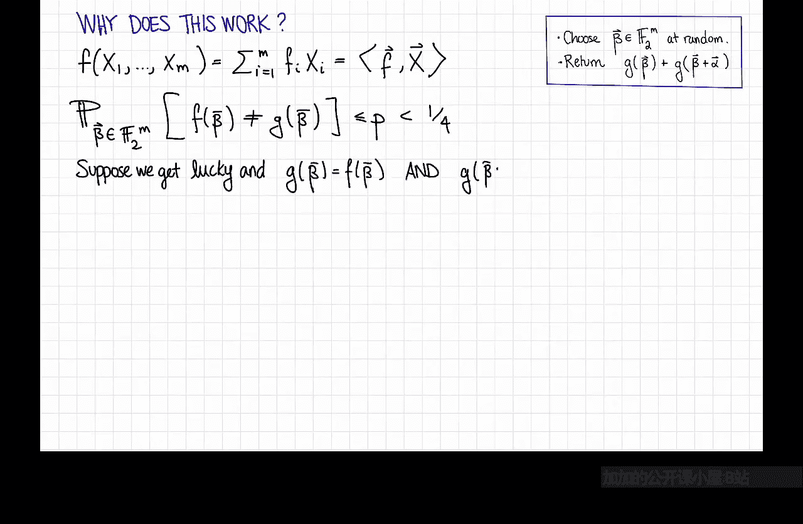

当我们随机选择 **β** 时：
*   **F(β) ≠ G(β)** 的概率至多为 **p**（根据假设）。
*   同样，**F(β + α) ≠ G(β + α)** 的概率也至多为 **p**，因为对于固定的 **α**，**β + α** 在 **F₂^M** 中也是均匀随机的。

如果我们“幸运地”同时满足 **F(β) = G(β)** 和 **F(β + α) = G(β + α)**，那么算法的输出将是：
**G(β) + G(β + α) = F(β) + F(β + α) = <f, β> + <f, β + α> = <f, β> + <f, β> + <f, α> = <f, α> = F(α)**

这正是我们想要的结果。

根据并集界，我们“幸运”的概率至少为 **1 - 2p**。因此，算法的失败概率至多为 **2p**。

### 定理总结

我们已经证明了以下定理：
长度为 **2^M** 的哈达玛码，对于任何 **p**，都是一个 **(p, 2, 2p)** 局部可校正码。

特别地，当 **p < 1/4** 时，失败概率 **2p < 1/2**，这提供了非平凡的校正保证。

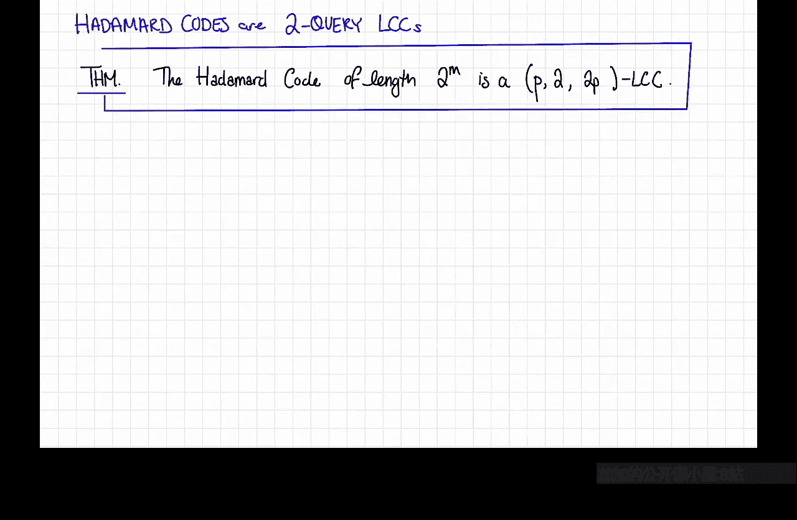

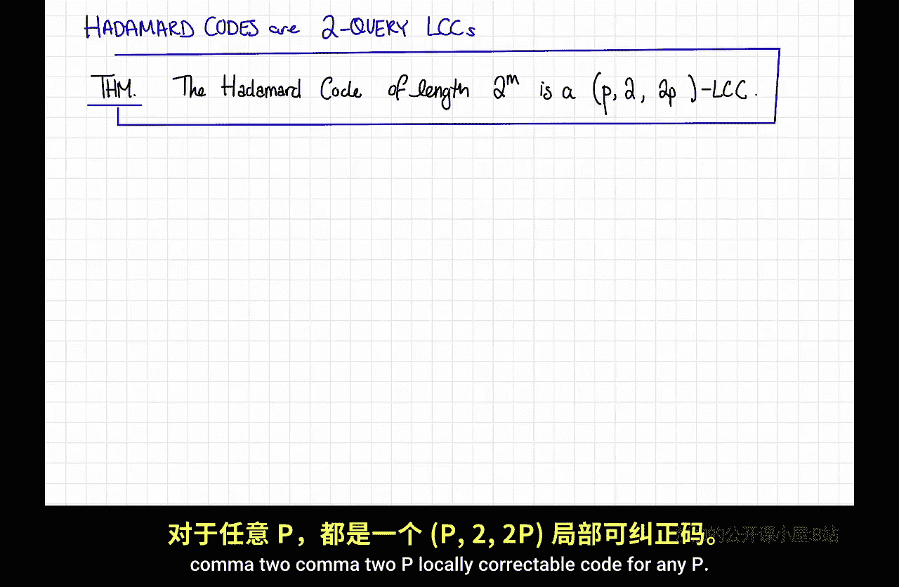

## 算法观察

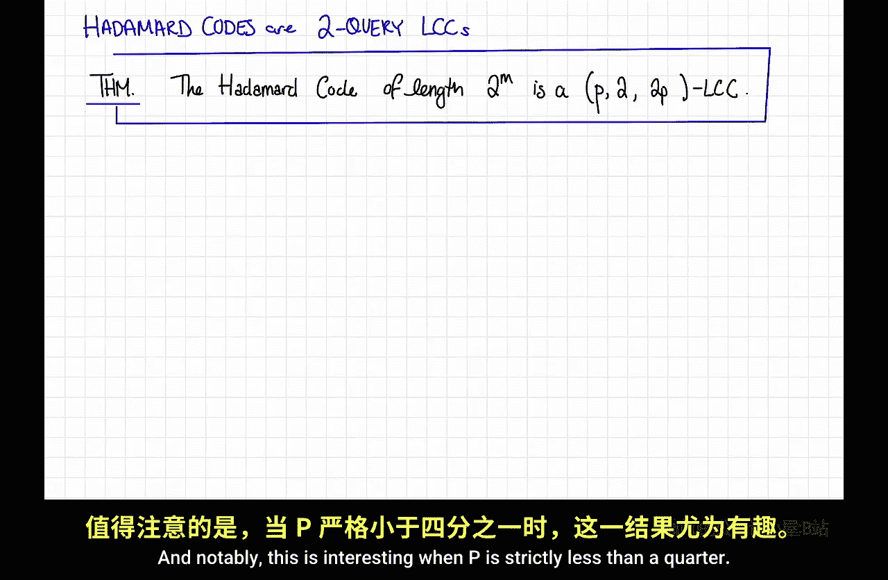

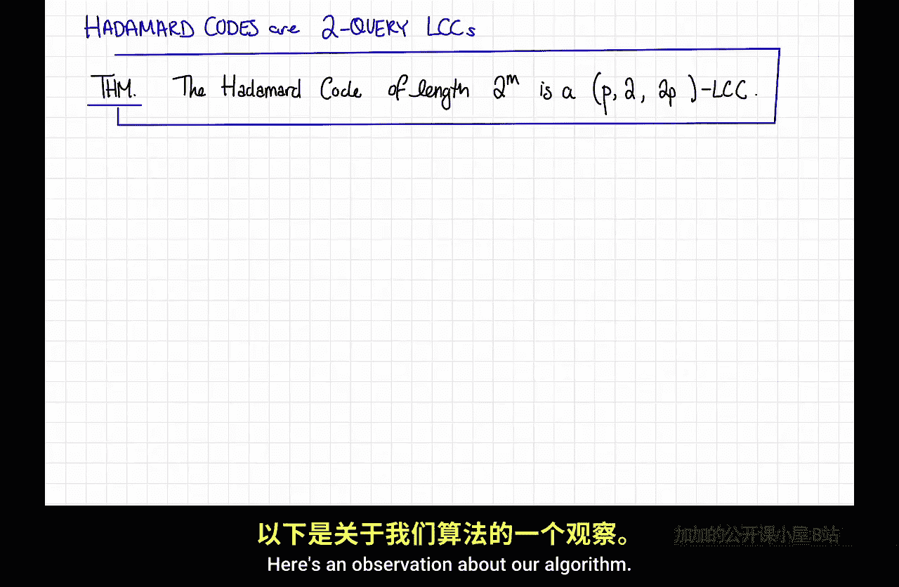

我们的算法和分析之所以有效，是因为两个查询各自单独来看，其分布都是均匀随机的。然而，这两个查询合在一起并不是独立的，它们高度相关：它们的和始终等于我们想要查询的值 **α**。

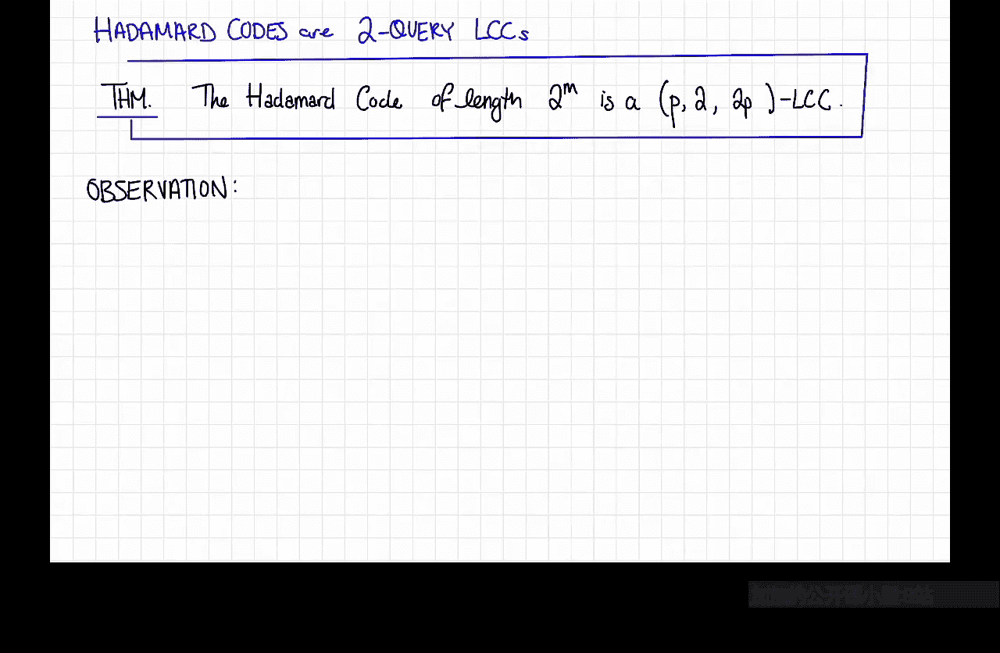

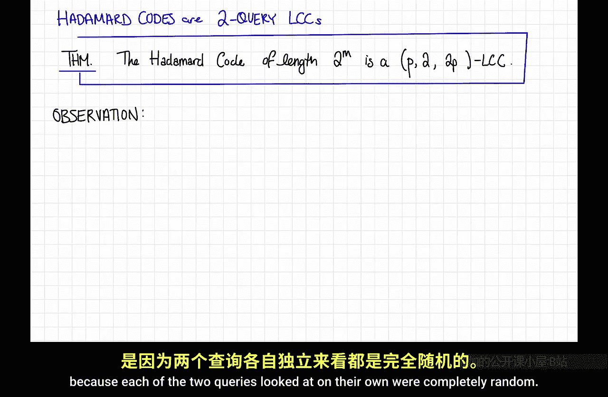

这将是局部可校正码中的一个常见主题：
*   每个查询单独来看应该是均匀随机的（或接近均匀随机），否则对手可能会针对性地破坏它。
*   然而，通过构造查询的联合分布，使得每个查询单独是随机的，但联合分布并非均匀随机，我们就能在“欺骗”对手的同时，为自己获取有用的信息。

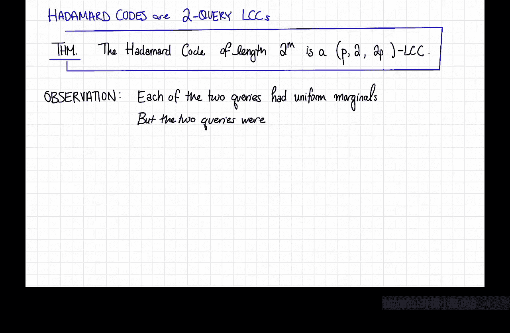

## 延伸思考

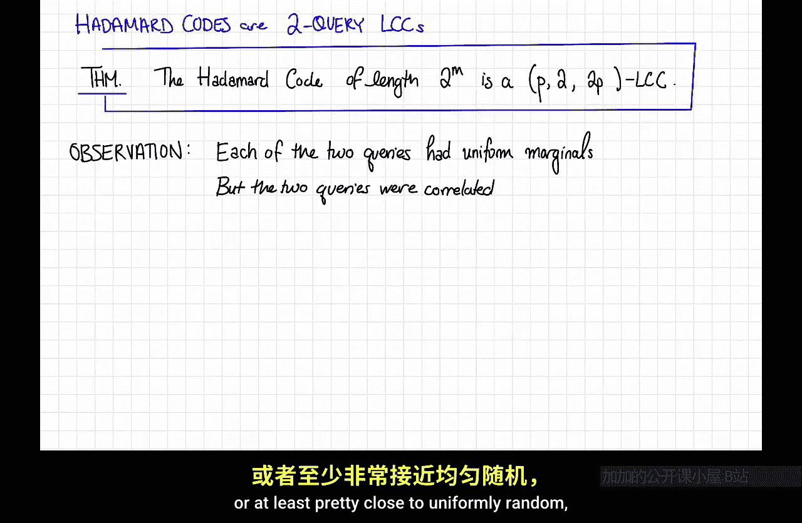

这个定理可能引出一个问题：我们有一个查询复杂度仅为 **2** 的优秀局部可校正码，但其码率非常糟糕。我们可能会问：能否做得更好？

即，是否存在一个参数 **p** 为常数、失败概率 **γ** 非平凡的 **2** 查询局部可校正码，其码率比哈达玛码更好？具体来说，我们能否让码长渐进地小于 **2^{消息长度}**？

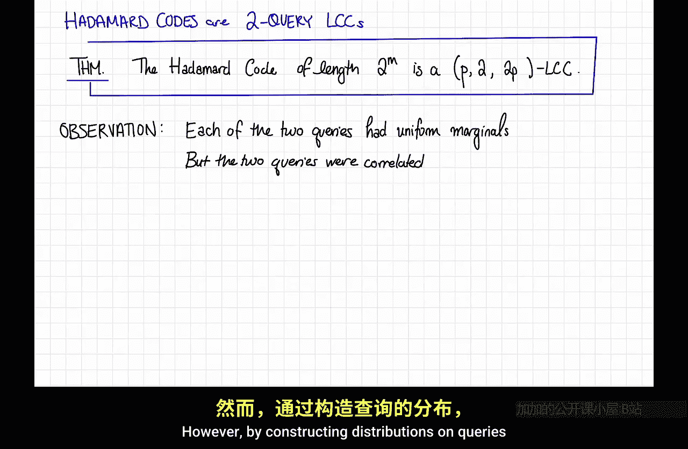

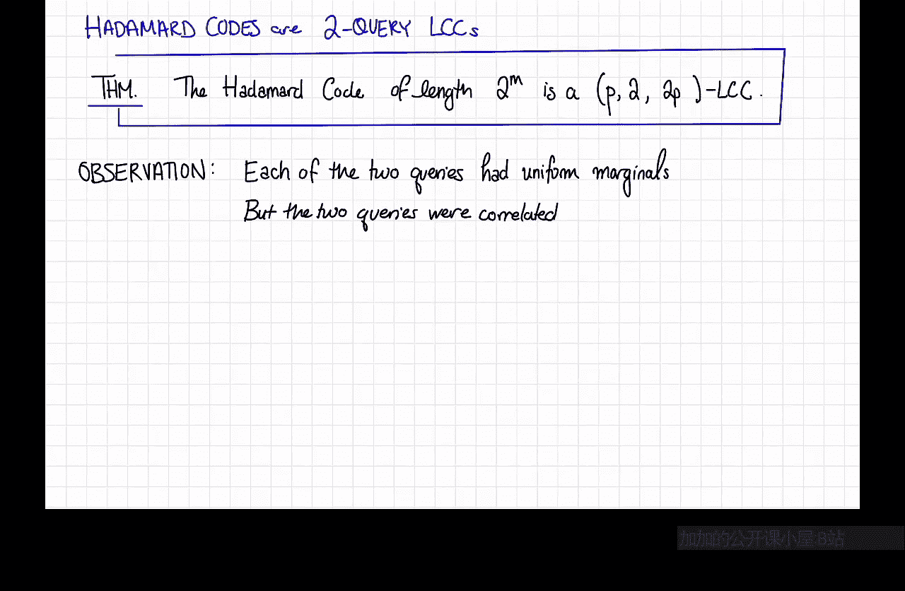

这听起来要求不高，但事实证明，对于 **2** 查询的局部可校正码，我们实际上无法做得比这好太多。

然而，如果我们允许查询复杂度略高于 **2**，我们将能够获得更好的结果。我们将在下一个视频中看到这一点。

## 总结

本节课中，我们一起学习了：
1.  **哈达玛码的定义和基本性质**：它是一个码率低但距离大（相对距离为1/2）的线性码。
2.  **哈达玛码的局部校正**：我们介绍了一个简单而高效的算法，仅需两次随机查询即可高概率地恢复码字中任意位置的值，证明了哈达玛码是一个 **(p, 2, 2p)** 局部可校正码。
3.  **算法背后的关键思想**：利用查询点的随机性和相关性（其和固定为目标点）来对抗错误，同时保证校正的有效性。
4.  **对更高码率LCC的展望**：我们认识到仅用两次查询难以显著提升码率，这为后续学习查询复杂度更高的局部可校正码做好了铺垫。