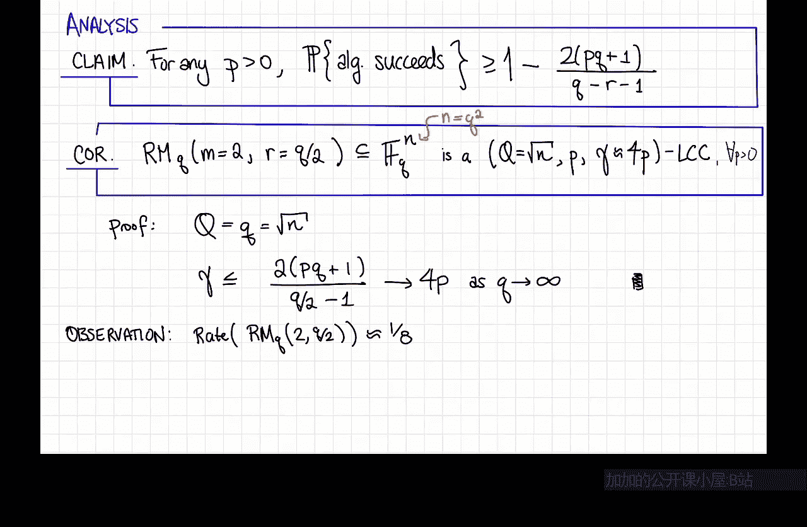
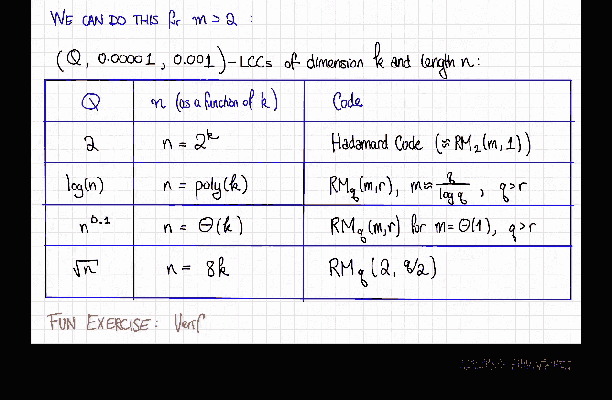

# 049：局部纠正里德-穆勒码

在本节课中，我们将学习里德-穆勒码的局部纠正算法。我们将看到，通过查询码字中沿一条随机线上的点，并利用里德-所罗门码的解码能力，可以高效地恢复被损坏码字中的单个符号。

---

## 定义与回顾

上一节我们介绍了里德-所罗门码，本节中我们来看看它的多元推广——里德-穆勒码。

首先，我们给出里德-穆勒码在任意域 **Fq** 上的定义。设 **m** 为变量个数，**r** 为总度数上限。

**定义**：参数为 **(m, r)** 的 **q** 元里德-穆勒码 **RM_q(m, r)** 定义如下：
1.  令 **α_1, …, α_{q^m}** 为域 **F_q^m** 中所有向量（顺序任意但固定）。
2.  考虑所有定义在 **F_q** 上、变量数为 **m**、总度数不超过 **r** 的多项式集合。
3.  将每个这样的多项式在所有点 **α_i** 上求值，得到的向量即为一个码字。

用公式表示，码 **C** 为：
**C = { (f(α_1), …, f(α_{q^m})) | f ∈ F_q[x_1, …, x_m], deg(f) ≤ r }**

以下是关于此定义的两点说明：
*   **与里德-所罗门码的关系**：当 **m = 1** 时，里德-穆勒码退化为里德-所罗门码。具体来说，**RM_q(1, r)** 等价于定义在 **F_q** 上、码长 **n = q**、维度 **k = r + 1** 的里德-所罗门码。
*   **与哈达玛码的关系**：在 **F_2** 上、变量数为 **m**、次数为 **1** 的里德-穆勒码，与之前介绍的哈达玛码非常相似。主要区别在于哈达玛码仅考虑无常数项的线性多项式，而里德-穆勒码允许包含常数项。

因此，里德-穆勒码的定义统一并推广了我们之前见过的两种编码。

---

## 局部纠正的基本思想

本节我们将看到，里德-穆勒码是局部可纠正码。让我们从双变量（即 **m = 2**）的情形开始理解其核心思想。

我们可以将一个码字可视化为一个正方形网格，每个网格点对应一个求值点 **(α, β) ∈ F_q × F_q**。网格点 **(α, β)** 处存储的值是某个低次二元多项式 **f** 在该点的求值结果 **f(α, β)**。

假设我们想恢复被损坏码字中位置 **(α, β)** 的值 **f(α, β)**。一个敌手可能已经损坏了比例为 **p** 的符号，甚至可能包括我们想要查询的点。

为了恢复，我们考虑一条穿过点 **(α, β)** 的随机直线。在有限域上，这样一条直线可以参数化表示为：
**L(z) = (α + σz, β + τz)**, 其中 **(σ, τ) ∈ F_q^2 \ {(0,0)}** 为随机选择的“斜率”。

关键观察在于：当我们把二元多项式 **f** 限制在这条直线 **L** 上时，我们得到了一个关于单变量 **z** 的多项式 **h(z) = f(L(z))**。由于 **f** 的总度数不超过 **r**，因此 **h(z)** 的次数也不超过 **r**。

现在，如果我们沿着这条直线查询被损坏的码字，得到的将是一个被轻微损坏的低次单变量多项式（里德-所罗门码字）的求值点集合。这正是我们熟悉的问题：从损坏的求值点中解码里德-所罗门码。

因此，基本思路是：**查询沿一条随机直线的点，然后使用里德-所罗门解码器来纠正线上的错误，从而恢复出原点 **(α, β)** 的值**。

---

## 双变量里德-穆勒码的局部纠正算法

基于上述思想，以下是针对域 **F_q** 上、次数为 **r** 的双变量里德-穆勒码的局部纠正算法。

**算法输入**：
1.  对一个函数 **g: F_q^2 → F_q** 的查询权限。该函数 **g** 与某个次数 ≤ **r** 的多项式 **f** 在至少 **(1-p)** 比例的点上一致。
2.  我们想要查询的点 **(α, β)**。

**算法目标**：以高概率输出 **f(α, β)** 的正确值。

**算法步骤**：
1.  **选择随机线**：均匀随机地选择斜率 **(σ, τ) ∈ F_q^2 \ {(0,0)}**，构造穿过 **(α, β)** 的直线 **L(z) = (α + σz, β + τz)**。
2.  **查询线上点**：对于所有 **z ∈ F_q**，查询 **g(L(z))**，得到序列 **\tilde{h}(z) = g(L(z))**。
3.  **里德-所罗门解码**：在序列 **\tilde{h}** 上运行里德-所罗门解码器（例如 Berlekamp-Welch 算法），寻找一个次数 ≤ **r** 的多项式 **h**，使得 **h** 与 **\tilde{h}** 的汉明距离严格小于 **(q - r)/2**。
4.  **输出结果**：如果找到这样的 **h**，则输出 **h(0)**。

**算法原理**：如果算法成功（即线上错误不多），那么找到的 **h(z)** 将等于 **f(L(z))**。因此，**h(0) = f(L(0)) = f(α, β)**，这正是我们想要的结果。

---

## 算法成功概率分析

算法并非总能成功。如果我们不幸选择了一条包含过多错误的直线，里德-所罗门解码就会失败。

**成功条件**：算法成功当且仅当直线 **L** 上的错误数量不超过 **⌊(q - r)/2⌋**。这是次数为 **r** 的里德-所罗门码的解码半径。

**成功概率下界**：对于任意错误比例 **p > 0**，该算法成功的概率至少为 **1 - (2p(q+1))/(q - r - 1)**。

**证明概要**：
1.  **计算线上错误的期望值**：线上点总数是 **q**。点 **(α, β)** 可能被损坏。对于其他 **q-1** 个点，由于直线是随机选择的，每个点都是 **F_q^2** 中的均匀随机点，因此该点被损坏的概率不超过 **p**。利用期望的线性性质，线上错误数量的期望值 **E[errors]** ≤ **1 + p(q-1) < pq + 1**。
2.  **应用马尔可夫不等式**：设 **T = ⌊(q - r)/2⌋** 为最大可容忍错误数。算法失败（即错误数 > **T**）的概率为：
    **Pr[failure] ≤ E[errors] / T ≤ (pq + 1) / ((q - r - 1)/2) = (2p(q+1))/(q - r - 1)**。

因此，算法成功的概率至少为 **1** 减去上述值。

---

## 一个重要推论

基于上述分析，我们可以得到一个具体的、具有良好参数的局部可纠正码。

**推论**：对于任意 **p > 0**，考虑定义在 **F_q** 上、变量数 **m=2**、次数 **r = q/2** 的里德-穆勒码。该码的码长 **n = q^2**，字母表为 **F_q**。
它是一个局部可纠正码，具有以下参数：
*   **查询复杂度**：**q = √n**。
*   **可容忍错误比例**：**p**（一个小于 1/4 的小常数）。
*   **失败概率 γ**：约等于 **4p**（当 **n** 很大时）。
*   **码率 R**：约等于 **1/8**。

**说明**：
1.  **查询复杂度**：算法查询一条直线上的所有点，共 **q** 个。由于 **n = q^2**，故 **q = √n**。
2.  **失败概率**：将 **r = q/2** 代入成功概率公式，得到失败概率上界约为 **4p**。
3.  **码率**：维度 **k** 是满足 **a + b ≤ q/2** 的单项式 **x1^a x2^b** 的数量，其数量约为 **q^2/8**。因此码率 **R = k/n ≈ (q^2/8) / q^2 = 1/8**。

这个结果非常出色：我们得到了一个具有**常数码率（约1/8）**、能处理**常数比例错误**、且查询复杂度仅为 **O(√n)** 的局部可纠正码。虽然查询复杂度比哈达玛码的 **2** 要大，但它远小于 **n**，并且码率从指数级小提升到了常数级。

---

## 推广至多变量与参数权衡

上述“随机线”思想可以自然地推广到变量数 **m > 2** 的里德-穆勒码。通过选择 **F_q^m** 中的随机直线并执行相同操作，我们可以在不同的参数之间进行权衡。

下表展示了通过选择不同的变量数 **m** 和次数 **r**，里德-穆勒码所能达到的各类局部可纠正码的参数范围：

| 目标查询复杂度 (Q) | 所需码长 (n) 与维度 (k) 的关系 | 对应里德-穆勒码参数选择 |
| :--- | :--- | :--- |
| **2** | **n ≈ 2^k** (指数级) | **m** 任意, **r = 1** (类似哈达玛码) |
| **log n** | **n = poly(k)** (多项式级) | **m ≈ q / log q**, **r** 相应选择 |
| **n^ε** (小常数 ε) | **n = O(k)** (线性级，常数很大) | **m** 为常数，**r** 相应选择 |
| **√n** | **n ≈ 8k** (线性级，常数较小) | **m = 2**, **r = q/2** (本节案例) |

以下是关于此表的几点说明：
*   **查询复杂度为2**：这对应于哈达玛码，其码长是指数级的，码率极低。
*   **查询复杂度为log n**：使用里德-穆勒码可以达到，且码长仅是维度的多项式倍。据我们所知，这是目前最好的构造。
*   **查询复杂度为n^ε**：通过选择合适的常数 **m**，可以让码长 **n** 与维度 **k** 呈线性关系，但系数随 **ε** 减小而急剧增大。
*   **查询复杂度为√n**：这就是我们本节详细讨论的双变量情况，在常数码率下实现了次线性的查询复杂度。

对于某些参数区间（例如查询复杂度为 **n^ε**），存在比基本里德-穆勒码更优的构造，可以获得接近 **1** 的码率。这通常通过对里德-穆勒码进行巧妙的推广来实现。

---

## 总结

本节课中我们一起学习了里德-穆勒码的局部纠正。
1.  我们首先回顾并定义了多元域上的里德-穆勒码。
2.  我们以双变量情形为例，阐述了其局部纠正的核心思想：**通过查询一条随机直线，将多元多项式求值问题转化为单变量（里德-所罗门码）的解码问题**。
3.  我们给出了具体的局部纠正算法，并分析了其成功概率。
4.  我们得到了一个重要的具体实例：一个码率约 **1/8**、查询复杂度 **O(√n)**、能容忍常数比例错误的局部可纠正码。
5.  最后，我们看到了这一思想可推广至多变量，从而在不同的查询复杂度和码率/码长之间进行灵活的权衡，使得里德-穆勒码成为构建各类非平凡局部可纠正码的强大工具。