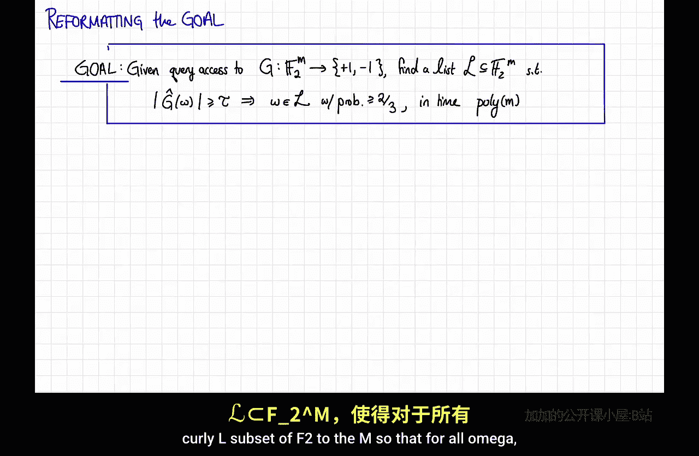
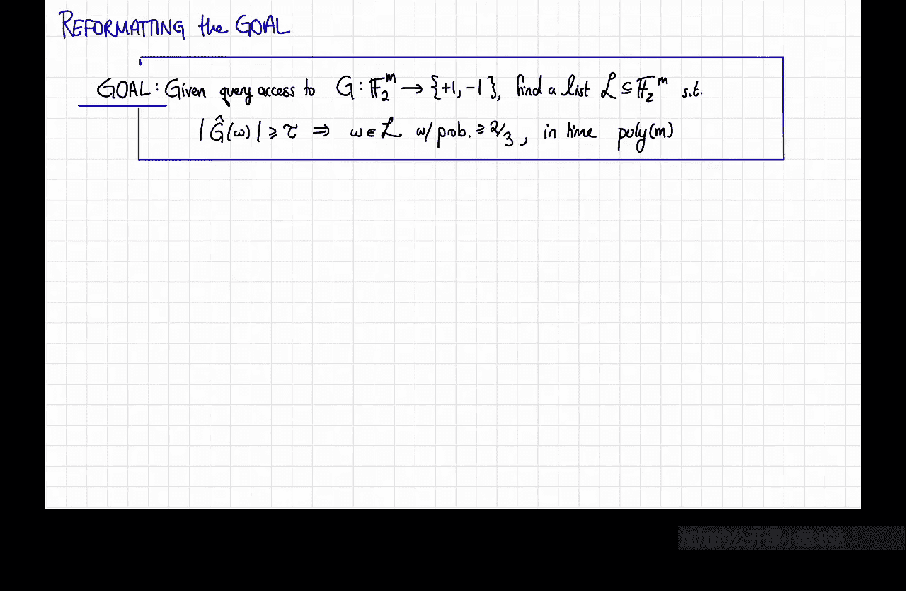
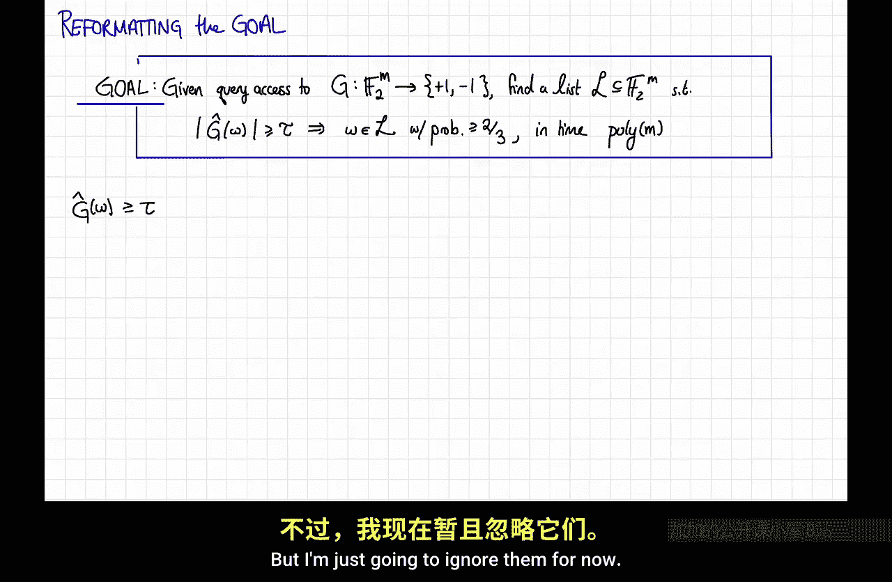
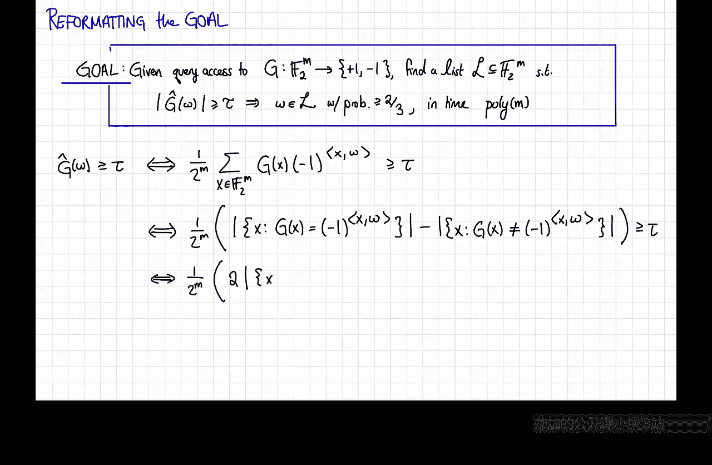
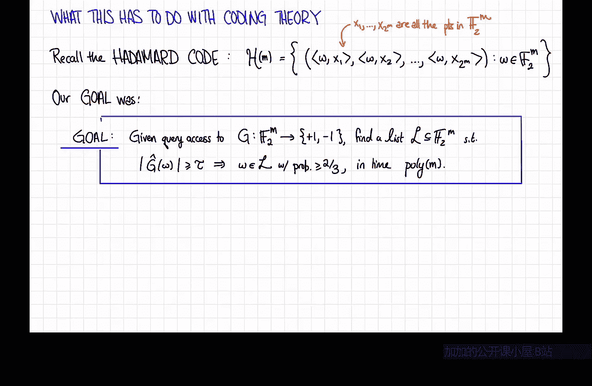

代数编码导论：1：动机：学习布尔函数

在本节课中，我们将学习如何将列表解码和局部解码的概念结合起来，探讨局部列表解码。我们将通过一个学习布尔函数的应用问题来引出这个主题。

在之前的课程中，我们介绍了列表解码和局部解码。本节中，我们来看看如何将这两个概念结合，形成局部列表解码。我们将通过一个学习布尔函数的应用问题来引出这个主题。

以下是本视频要讨论的核心问题。假设存在一个函数 **G**，它接收一个定义在 **F₂** 上的长度为 **M** 的向量，并输出 **+1** 或 **-1**。你可以任意查询 **G** 在任意 **X** 上的值，但最初你并不知道 **G** 的具体形式。你的目标是尽可能快地学习 **G**，或者至少学习它的一个近似 **G̃**。

理想情况下，你希望学习过程的时间复杂度是 **M** 的多项式。具体来说，你不能简单地查询 **G** 在所有 **X** 上的值，因为那样需要 **2ᴹ** 的时间，这不是 **M** 的多项式。显然，如果 **G** 可以是任意函数，那么查询它在某个 **X** 上的值并不能告诉我它在另一个 **X** 上的值。因此，我们必须对 **G** 施加一些结构，才能使学习成为可能。

一种有用的施加结构的方法是假设 **G** 在傅里叶域中是稀疏的。为了更清晰地定义这一点，我们需要一些额外的定义。

以下是定义在 **F₂** 上的傅里叶变换，针对像上一张幻灯片中那样的函数 **G**。**G** 在 **F₂** 上的傅里叶变换记为 **Ĝ**，它是另一个从 **F₂ᴹ** 到实数的函数，定义如下：

**Ĝ(ω) = (1 / 2ᴹ) * Σ_{x ∈ F₂ᴹ} [ G(x) * (-1)^{<x, ω>} ]**

如果你熟悉复数域上的傅里叶变换，这看起来可能有些熟悉。特别是，它类似于复数域上的离散傅里叶变换，只不过我们用 **(-1)^{<x, ω>}** 代替了 **e^{-iπ...}** 这样的项。

与复数域类似，这个定义也满足一些相似的性质。特别是，我们有一个逆变换，可以将 **G(x)** 写为：

**G(x) = Σ_{ω ∈ F₂ᴹ} [ Ĝ(ω) * (-1)^{<x, ω>} ]**

这些 **Ĝ(ω)** 被称为傅里叶系数。我们还有帕塞瓦尔定理，它表明傅里叶变换不影响 **L²** 范数。更精确地说：

**(1 / 2ᴹ) * Σ_{x ∈ F₂ᴹ} G(x)² = Σ_{ω ∈ F₂ᴹ} Ĝ(ω)²**

在这个设定中，由于 **G(x)** 是 **±1**，所以左边恰好等于 1。

这就是傅里叶变换。如果你之前没见过这个定义，本视频中重要的是这个方程：我们可以将 **G(x)** 写成这些简单函数 **(-1)^{<x, ω>}** 的线性组合，系数就是傅里叶系数 **Ĝ(ω)**。这很好，因为这些函数非常简单易懂，允许我们将任何函数表示为简单易懂函数的线性组合。

现在，让我们回到学习布尔函数 **G** 的问题。如前所述，我们需要对 **G** 施加一些结构。

以下是我们要施加的结构。正如上一张幻灯片所示，我们可以将 **G(x)** 展开为那些简单函数的线性组合。我们假设只有少数系数是大的，而大多数系数是小的。也就是说，我们假设 **G** 是一个简单函数，本质上它只是不多于这些简单函数的线性组合。

在这种情况下，我们可以将 **G** 近似地写为仅由那些大系数对应的函数组成的线性组合。也就是说，我们丢弃所有 **|Ĝ(ω)|** 小于某个常数 **τ > 0** 的项。我们的目标将是尽可能快地估计那些大的 **Ĝ(ω)**，同样希望时间复杂度是 **M** 的多项式。

更详细地说，以下是这个特定问题的目标。假设 **τ** 是某个大于零的常数。给定对 **G(x)** 的查询权限（**G** 具有这样的傅里叶展开，使得大多数傅里叶系数很小），我们希望返回一个由 **（ω, y_ω）** 对组成的列表 **ℒ**，使得如果傅里叶系数 **Ĝ(ω)** 很大（大于 **τ**），那么 **ω** 就出现在我们的列表中。此外，对于列表中出现的所有 **ω**，我们的估计值 **y_ω** 应近似等于 **Ĝ(ω)**。我们希望在 **M** 的多项式时间内找到这个列表。注意，这意味着列表本身的大小不能超过 **M** 的多项式，否则仅仅返回它就需要更长的时间。

如果我们能做到这一点，并且满足类似这样的假设，那么我们就能够估计这个展开式，从而估计这个函数。

讨论这个问题时，我们发现它与编码理论中的一个问题相关。为了将其转化为你可能认得出的编码理论问题，让我们开始调整这个目标。

我们要做的第一个简化源于以下观察：给定一个固定的 **ω ∈ F₂ᴹ**，我们可以从不太多的样本中相当快地估计出 **Ĝ(ω)**。原因是 **Ĝ(ω)** 的定义是一堆形如 **G(x) * (-1)^{<x, ω>}** 的项的平均值，每一项都是 **±1**。我们可以通过采样 **G(x)** 来计算出其中任何一项。因此，我们可以通过随机抽取这些项的一个子集，采样它们，并取平均值来估计这个平均值。事实证明，如果你取不太多的样本，那么以高概率，这将是对这个平均值的一个相当好的估计。

这意味着我们的目标可以简化为仅仅找到使得 **Ĝ(ω)** 很大的 **ω** 的集合，因为一旦我们找到这个集合，我们就可以相当快地估计它们中的每一个。

更精确地说，我们可以如下修改我们之前的目标：首先，我不再需要返回 **（ω, y_ω）** 对，我可以只返回 **ω**。其次，我不需要在这里估计 **Ĝ(ω)**。我将通过允许对 **G(x)** 的查询访问是随机化的，来给自己多一点灵活性，并要求这个要求只以高概率成立。例如，对于每个傅里叶系数很大的 **ω**，我们希望 **ω** 以至少 **2/3** 的概率出现在这个列表中。像往常一样，这里的 **2/3** 是任意的；如果我们能以 **2/3** 的概率做到，我们只需重复几次就能以 **0.99999** 的概率做到。

以下是清理后的目标版本：给定对我们函数 **G: F₂ᴹ → {±1}** 的查询权限，找到一个列表 **ℒ ⊆ F₂ᴹ**，使得对于所有满足 **|Ĝ(ω)| > τ** 的 **ω**，**ω** 以至少 **2/3** 的概率最终出现在列表中。此外，我们希望在 **M** 的多项式时间内找到这个列表。特别是，列表的大小不能超过 **M** 的多项式。

我们仍然不太清楚这与编码理论有什么关系，尽管可能越来越接近了。我们正在寻找一个可能与某些函数高度一致的“事物”列表。为了使其精确，让我们进一步调整这个要求。

为简单起见，我将去掉绝对值。基本上，你可以做我现在要做的事情，只是前面加一个负号，然后把两者结合起来，就会得到绝对值。但我现在先忽略它们。

让我们考虑条件 **Ĝ(ω) ≥ τ**。我们可以写出 **Ĝ(ω)** 的定义，并看到这等价于这个大和大于等于 **τ**。现在，回想一下这里的 **G(x)** 是 **±1**。这意味着这个和中的每一项也是 **±1**，取决于 **G(x)** 是否等于符号翻转项 **(-1)^{<x, ω>}**。

这意味着我们可以这样写这个条件：我们可以用使得 **g(x)** 等于 **(-1)^{<x, ω>}** 的 **x** 的数量来替换这个和。在这种情况下，和中的项等于 **1** 减去使得 **g(x)** 不等于 **(-1)^{<x, ω>}** 的 **x** 的数量，此时和中的项等于 **-1**。注意，这正好等于 **2ᴹ** 减去那个数量，因为要么相等，要么不相等。

因此，我们可以将这个条件重写如下：即，我刚刚用 **2ᴹ** 减去那个数量替换了它。现在我们可以移动一些符号，得到以下条件：使得 **g(x)** 等于 **(-1)^{<x, ω>}** 的 **x** 的比例略大于二分之一，大于等于 **1/2 + τ/2**。

现在，我将定义一个新函数 **g(x)**，它是大 **G(x)** 的 **0/1** 版本。即，如果 **G(x) = +1**，则 **g(x) = 0**；如果 **G(x) = -1**，则 **g(x) = 1**。在这种记法下，上述条件等价于：使得 **g(x)** 等于 **<x, ω>** 的 **x** 的比例大于二分之一，具体来说，大于等于 **1/2 + τ/2**。

那么，这与编码理论有什么关系呢？基本上，这表示我们的目标是找到所有这样的 **ω**，使得评估向量 **<x, ω>** 与某个函数 **g**（我们称之为接收字 **g**）之间的一致率很高，略大于二分之一。换句话说，我们想找到所有 **ω**，使得如果我们考虑所有这些内积组成的向量，它与 **g** 的距离不太大。这听起来有点像列表解码。如果你还记得之前的视频，它可能有点像列表解码哈达玛码。

更详细地说，让我们回顾一下之前视频中哈达玛码的定义。**H(m)** 等于向量的集合：对于所有 **ω ∈ F₂ᴹ**，有 **（<ω, x₁>, <ω, x₂>, ..., <ω, x_{2ᴹ}>）**，其中 **x₁, x₂, ..., x_{2ᴹ}** 是 **F₂ᴹ** 中所有点按某种顺序的枚举（顺序无关紧要）。也就是说，哈达玛码是所有向量的集合，这些向量由 **F₂ᴹ** 上的某个线性函数在所有点上的取值构成。

现在，我们可以用关于哈达玛码的编码理论目标来重新表述上一张幻灯片的目标。我们在上一张幻灯片看到，条件 **Ĝ(ω) ≥ τ** 等价于条件：使得 **g(x)** 等于 **<x, ω>** 的 **x** 的比例略大于二分之一，大于等于 **1/2 + τ/2**。

用哈达玛码的语言来说，另一种表述方式是：接收字 **g**（这里 **g** 表示在所有点上评估 **G** 得到的向量）与在哈达玛码下 **ω** 的编码（即这个向量）之间的相对距离略小于二分之一，小于等于 **1/2 - τ/2**，其中 **τ > 0**。

也就是说，我们被授予对接收字 **g** 的访问权限，并且我们想要找到所有形式为 **ω** 的编码的码字，使得 **g** 与 **ω** 的编码之间的距离至多为 **1/2 - τ/2**。我们希望以 **M** 的多项式时间完成这个任务。所以我们的目标是对哈达玛码进行列表解码：我们想要找到所有位于接收字某个球内的码字。

关键是我们希望仅通过少量查询在局部完成这个任务。特别是，我们这里的时间预算是 **M** 的多项式，这相对于码的块长度是亚线性的。记住，码的块长度是 **2ᴹ**。因此，我们甚至没有时间查看整个码字。这就是为什么我们必须局部地进行解码。在下一个视频中，我们将看到如何实现这个目标。

本节课中，我们一起学习了如何将一个学习布尔函数的问题转化为对哈达玛码进行局部列表解码的编码理论问题。我们首先定义了傅里叶变换，并假设目标函数在傅里叶域中是稀疏的。然后，我们逐步将学习问题转化为寻找与接收字有高一致性的码字列表的问题，并强调了在亚线性时间内（即局部地）完成此任务的需求。这为下一节讨论具体的局部列表解码算法奠定了基础。