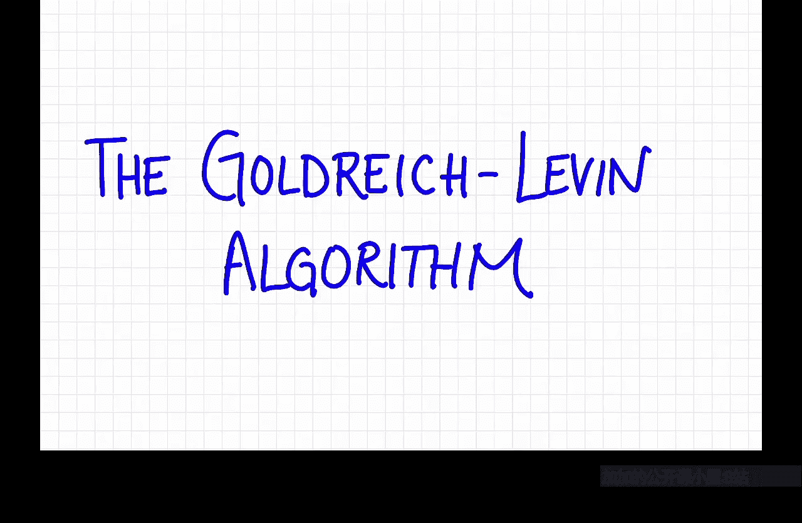
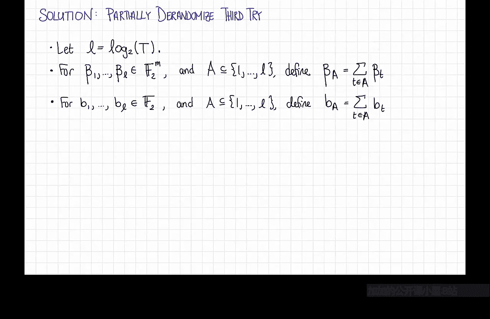
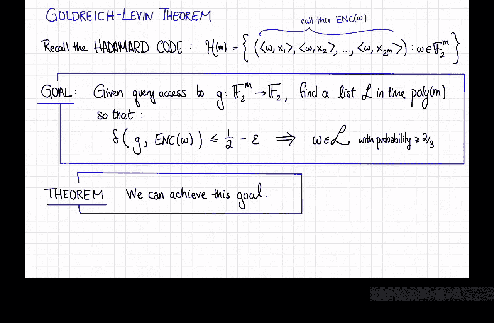

# 051：Goldreich-Levin 算法

在本节课中，我们将学习 Goldreich-Levin 算法。该算法能够在亚线性时间内对 Hadamard 码进行列表解码，从而解决我们在上一节课末尾提出的问题。

## 回顾与目标

上一节我们介绍了 Hadamard 码的定义，它由所有在 F₂^m 上的线性函数的求值向量组成。我们的目标是在亚线性时间内对其进行列表解码。

具体来说，给定对一个函数 G: F₂^m → F₂ 的查询访问权限，我们的目标是找到一个列表 ℒ，其计算时间关于 m 是多项式的。对于任意满足 `dist(G, Enc(w)) ≤ 1/2 - ε` 的 w，我们希望 w 以至少 2/3 的概率出现在列表 ℒ 中。

请注意，我们要求亚线性时间，因为 Hadamard 码的码字长度是 2^m，而我们必须在关于 m 的多项式时间内找到列表，这意味着我们甚至没有时间查看整个接收到的码字。

## 第一次尝试：基于局部解码算法

我们首先尝试使用之前学过的 Hadamard 码的局部解码算法来解决这个问题。

以下是算法步骤。我们被给予对函数 G 的查询访问权限，目标是找到某个 w，使得在 Hadamard 码下，`Enc(w)` 与 G 的汉明距离至多为 p（p 是某个参数）。在第一次尝试中，我们假设 `p < 1/4`。

1.  随机均匀地选取向量 β₁, ..., β_T ∈ F₂^m，其中 T 是一个稍后确定的参数。
2.  对于每个 i ∈ {1, ..., m}，执行以下操作：
    *   对于每个 t ∈ {1, ..., T}，计算 w_i 的一个估计值 `w̃_i^{(t)}`。计算方法是：`w̃_i^{(t)} = G(e_i + β_t) + G(β_t)`。这是之前学过的两查询局部校正算法。
    *   根据之前视频的分析，这个估计值等于 w_i 的概率至少为 `1 - 2p`。
    *   由于 `p < 1/4`，这个成功概率严格大于 1/2。我们重复 T 次独立实验，通过多数表决来提升成功概率。
3.  对于每个 i，取所有 `w̃_i^{(t)}` 的多数表决结果作为最终的 `w̃_i`。
4.  将所有 `w̃_i` 组装成向量 `w̃`。

使用切比雪夫不等式可以证明，当 `p < 1/4` 时，`w̃` 不等于正确 w 的概率是 `O(1/T)`。通过对所有 m 个 i 取并集，失败概率至多为 `O(m/T)`。如果我们选择 `T = O(m)`，可以使这个概率小于 1/3。

因此，对于任何满足 `dist(Enc(w), G) ≤ p` 且 `p < 1/4` 的 w，这个算法将以至少 2/3 的概率返回那个 w。

这个算法的问题在于，我们的目标 p 值应接近 1/2（即 `1/2 - ε`），而这里我们受限于 `p < 1/4`。当 p 接近 1/2 时，可能不再有唯一的码字在距离 p 内，因此我们需要列表解码。

## 第二次尝试：借助“魔法精灵”

作为热身，我们假设可以访问一个“魔法精灵”，它心中有一个满足条件的 w。

算法步骤如下：
1.  如前所述，随机选取 β₁, ..., β_T。
2.  向精灵询问比特 b₁, ..., b_T，其中 `b_t = <w, β_t>`（w 是精灵心中的向量）。
3.  对于每个 i 和 t，计算 `w̃_i^{(t)} = b_t + G(e_i + β_t)`。
4.  同样进行多数表决并组装成 `w̃`。

分析表明，由于精灵总是给出关于 w 的正确信息，这一步的成功概率变为 `1 - p`（之前是 `1 - 2p`）。因此，只要 `p < 1/2`，多数表决失败的概率就是 `O(1/T)`。通过选择 `T = O(m)`，我们可以使整体失败概率小于 1/3。

这个算法允许 p 任意接近 1/2。但显然，我们无法访问这样的魔法精灵。

## 第三次尝试：穷举所有可能的精灵

一个自然的想法是：穷举所有可能的精灵（即所有可能的答案序列），并生成一个列表。

算法步骤如下：
1.  随机选取 β₁, ..., β_T。
2.  初始化列表 ℒ 为空集。
3.  穷举所有可能的答案序列 `(b₁, ..., b_T) ∈ F₂^T`。
    *   对于每个序列，假设精灵会给出这些答案，并运行第二次尝试的算法，得到一个候选向量 `w̃`。
    *   将 `w̃` 加入列表 ℒ。
4.  返回列表 ℒ。

对于任何满足条件的 w，存在一个与之对应的精灵答案序列。当算法迭代到那个序列时，根据第二次尝试的分析，`w̃` 等于 w 的概率很高。因此，w 将以高概率出现在最终列表 ℒ 中。

然而，这个算法的运行时间不再关于 m 是多项式的。为了达到高成功概率，我们需要 `T = O(m)`，但穷举所有 `2^T` 个序列需要 `2^Ω(m)` 的时间，这过于缓慢。

## 最终算法：使用成对独立性

问题的关键在于，在第二次尝试的分析中，切比雪夫不等式只需要 β_t 之间是**成对独立**的，而不需要完全独立。我们可以用更少的随机向量，通过线性组合来生成大量成对独立的向量，从而减少需要穷举的精灵答案数量。

设 `L = log₂ T`。我们只随机选取 L 个向量 β₁, ..., β_L ∈ F₂^m。对于任意子集 A ⊆ {1, ..., L}，定义 `β_A = Σ_{t∈A} β_t`。可以证明，这样生成的 `{β_A}` 是成对独立的，并且共有 `2^L = T` 个这样的向量。

类似地，对于任意比特序列 `(b₁, ..., b_L) ∈ F₂^L` 和子集 A，定义 `b_A = Σ_{t∈A} b_t`。

最终的 Goldreich-Levin 算法如下：
1.  随机选取 β₁, ..., β_L ∈ F₂^m，其中 `L = O(log m)`（因为 `T = O(m)`）。
2.  初始化列表 ℒ 为空集。
3.  穷举所有可能的“精简精灵”答案序列 `(b₁, ..., b_L) ∈ F₂^L`。
    *   对于每个序列，构造一个“精灵”，对于每个子集 A，其输出为 `b_A`。
    *   使用这个精灵和成对独立的向量集 `{β_A}`，运行第二次尝试的算法，得到一个候选向量 `w̃`。
    *   将 `w̃` 加入列表 ℒ。
4.  返回列表 ℒ。

**算法分析：**
*   **正确性**：对于任何满足 `dist(Enc(w), G) ≤ 1/2 - ε` 的 w，存在对应的 `(b₁, ..., b_L)` 序列（由 `b_t = <w, β_t>` 定义）。当成对独立的向量 `β_A` 和由此构造的精灵答案 `b_A` 被使用时，第二次尝试的分析依然成立。因此，w 将以高概率出现在列表 ℒ 中。
*   **运行时间**：内部算法（第二次尝试）运行时间是 `poly(m)`。外层循环需要穷举 `2^L = 2^{O(log m)} = poly(m)` 个序列。因此，总运行时间是 `poly(m)`。

## 总结

本节课我们一起学习了 Goldreich-Levin 算法。我们首先回顾了在亚线性时间内列表解码 Hadamard 码的目标。接着，我们从基础的局部解码算法出发，通过引入“魔法精灵”的概念和利用成对独立性的技巧，逐步构建出了最终的算法。该算法对于任何满足 `dist(Enc(w), G) ≤ 1/2 - ε` 的 w，都能以至少 2/3 的概率在 `poly(m)` 时间内将其包含在输出列表中，从而实现了 Hadamard 码的局部列表解码。这一定理在布尔函数学习等领域有重要应用，我们将在下节课继续探讨。