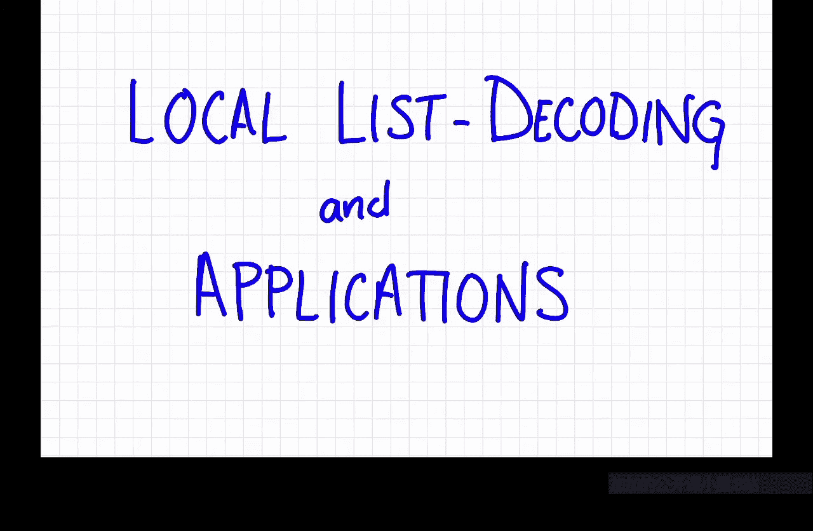
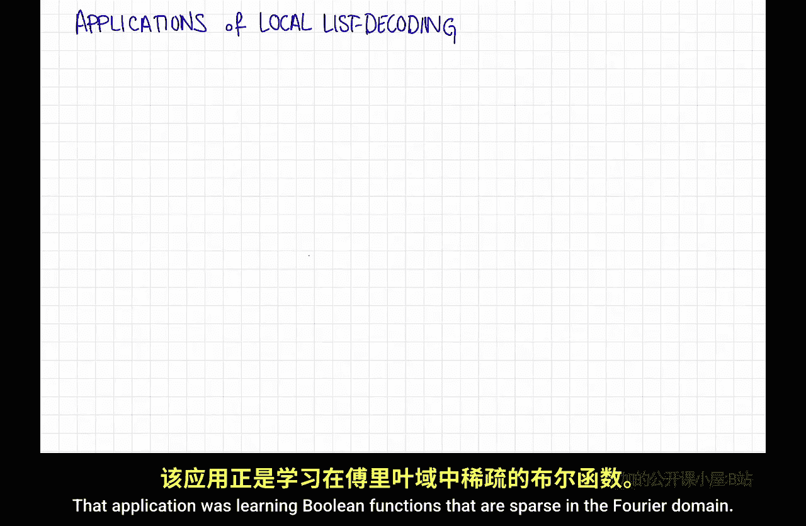
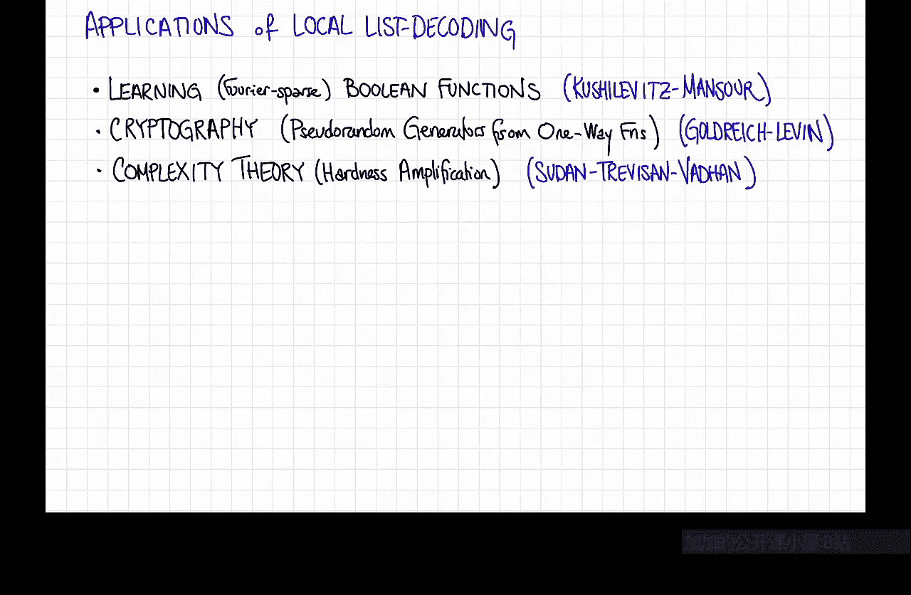

# 052：局部列表解码 🧩

在本节课中，我们将正式定义局部列表解码，并探讨其若干应用。我们将结合图示来解析这个定义，并回顾之前视频中已经见过的一个局部列表解码算法实例。

## 概述

局部列表解码结合了局部解码和列表解码的思想。它允许解码算法在仅查询接收到的码字的一小部分的情况下，输出一个可能包含多个候选码字的列表，并且对于列表中每个接近接收字的码字，都存在一个对应的“局部解码器”能以高概率恢复该码字的任意指定符号。

## 局部列表解码的正式定义

我们称一个码 **C ⊆ Σᴺ** 是 **(Q, P, L) 局部列表可解码**的，如果存在一个随机化算法 **A**，它能输出最多 **L** 个其他算法 **B₁, B₂, ..., B_L**，并满足以下条件：

首先，明确每个算法 **Bᵢ** 的输入输出类型。对于每个 **i** 在 **1** 到 **L** 之间：
*   算法 **Bᵢ** 的输入是一个介于 **1** 和 **N** 之间的整数 **j**。
*   **Bᵢ** 拥有对接收字 **z ∈ Σᴺ** 的预言访问权限。
*   给定对 **z** 的预言访问和输入 **j**，**Bᵢ** 最多向 **z** 进行 **Q** 次查询。
*   它的输出是对某个码字第 **j** 个符号的猜测。

其次，对于所有 **z ∈ Σᴺ** 和所有与 **z** 的相对汉明距离在 **P** 以内的码字 **c ∈ C**（即 **Δ(c, z) ≤ P**），都存在一个 **Bᵢ** 能很好地局部解码该码字。更精确地说：
*   存在一个 **i**（介于 **1** 和 **L** 之间），使得对于所有索引 **j**（介于 **1** 和 **N** 之间），算法 **Bᵢ** 在拥有对 **z** 的预言访问权限下，输入 **j**，输出 **cⱼ** 的概率至少为 **2/3**。

这个定义包含了许多量词，接下来我们将用图示来分解它。

## 通过图示理解定义

我们的图示结合了列表解码和局部解码的示意图。

在列表解码中，对于任何向量 **z**，在以 **z** 为中心、半径为 **P** 的汉明球内，最多有 **L** 个码字。假设图中 **L = 3**，那么接近 **z** 的码字只有三个：**c₁, c₂, c₃**。

在局部解码中，Bob 只对底层码字的某一个符号感兴趣，并通过向 Alice 发送的（可能损坏的）码字进行少量查询来找出它。

现在的区别在于，在这个场景中，没有单一的“正确”码字，而是有三个。因此，我们不能只有一个 Bob，而是需要 **L** 个 Bob（图中是三个）。每个 Bob 对应一个可能的正确码字：
*   **Bob₁** 对应 **c₁**，他的职责是在输入 **j** 时，通过查询 **z**，以高概率返回 **c₁** 的第 **j** 个符号。
*   **Bob₂** 对应 **c₂**，负责恢复 **c₂** 的第 **j** 个符号。
*   **Bob₃** 对应 **c₃**，负责恢复 **c₃** 的第 **j** 个符号。

这些 **Bobᵢ** 就对应定义中的算法 **Bᵢ**。对于每个接近 **z** 的码字 **c**，都存在一个对应的 Bob，其任务就是充当该码字的一个良好的局部解码算法。

## 一个我们已经见过的例子：Goldreich-Levin 算法

在回顾定义时，你可能已经注意到，我们实际上已经见过一个局部列表可解码码的例子。具体来说，我们在上一个视频中看到的 Goldreich-Levin 算法，其核心部分就是一个针对**哈达玛码**的局部列表解码器。

我们可以用更接近上述定义的方式重写该算法：

**算法描述：**
我们被给予对某个函数 **g** 的查询访问权限，我们希望恢复所有满足“**w** 的哈达玛编码与接收字 **g** 的相对距离在 **P** 以内”的 **w**。也就是说，我们希望每个这样的 **w** 能以至少 **2/3** 的概率出现在输出列表中。

算法步骤如下：
1.  抽取一些随机变量。
2.  初始化一个空列表。
3.  循环遍历一组比特向量 **b₁, ..., b_L**。
4.  对于每个 **w**，如果建议 **b₁, ..., b_L** 与 **w** 一致，那么存在一个“精灵”算法 **B_{b₁,...,b_L}**（现在我们称它为 **Bob**），使得 **B_{b₁,...,b_L}** 在输入 **j** 时，能以高概率输出 **w** 与 **eⱼ** 的内积（即哈达玛码编码 **w** 的第 **j** 位）。
5.  我们调用这个 **Bob** 来恢复 **w** 的所有 **M** 个比特，从而组装出 **w**，并将其加入列表。

其中，蓝色标注的步骤正是一个符合之前定义的局部列表解码器。

因此，我们在上一个视频中实际证明的是：**哈达玛码是 (Q, P, L) 局部列表可解码的**，其中半径 **P** 可以是任何严格小于 **1/2** 的数，查询复杂度 **Q** 和列表大小 **L** 都是 **M** 的多项式。

## 局部列表解码的应用

局部列表解码看似一个特殊的定义，但实际上它有广泛的应用。我们已经见过一个应用，它也是我们几个视频前开始整个讨论的起点。

### 应用一：学习傅里叶域稀疏的布尔函数

让我们回顾一下几个视频前的设定。我们有一个函数 **G: 𝔽₂ᴹ → {+1, -1}**，并将其写成傅里叶展开形式。如果 **G** 的傅里叶谱足够“尖峰”（即大多数系数很小，少数几个很大），那么从查询中近似 **G** 本质上等同于找到所有满足“**ω** 的哈达玛编码与 **g**（**G** 的 `{0,1}` 版本）的相对汉明距离 ≤ (1/2 - τ/2)”的 **ω**。而这正是我们的局部列表解码器让我们做的事情。

对于这个应用，我们确实同时需要“局部”和“列表”两部分：
*   我们需要“局部”性，因为期望的运行时间是 **M** 的多项式，而这是亚线性于码长 **2ᴹ** 的。
*   我们需要“列表”性，因为我们想要达到的译码半径需要接近 **1/2**。如果只做唯一解码，我们只能达到 **1/4**。

在布尔函数学习的语境中，我们之前看到的针对哈达玛码的局部列表解码算法被称为 **Kushilevitz-Mansour 算法**。

### 应用二：密码学（Goldreich-Levin 定理）

当我们介绍哈达玛码的局部列表解码算法时，我称它为 Goldreich-Levin 定理。实际上，Goldreich 和 Levin 最初感兴趣的应用来自密码学。

**Goldreich-Levin 定理**指出：单向函数蕴含伪随机生成器。事实证明，这个陈述可以从哈达玛码的局部列表可解码性推导出来。更多细节请查阅课程讲义。

### 应用三：复杂性理论（硬度放大）

基于之前对局部可校正码的讨论，你可能会想到另一个候选码：**里德-穆勒码**。事实上，里德-穆勒码也可以被局部列表解码，这应用于复杂性理论。

特别是，Sudan、Trevisan 和 Vadhan 展示了如何局部列表解码里德-穆勒码，并将其用于**硬度放大**。即，他们可以利用这一点，将一个平均情况下难以计算的函数，转化为一个最坏情况下难以计算的函数。这对复杂性理论和伪随机性有重要意义。同样，更多细节请参考相关论文。

## 总结

本节课我们一起学习了局部列表解码的正式定义。我们通过图示将其分解，并认识到 Goldreich-Levin 算法实质上是哈达玛码的一个局部列表解码器。最后，我们探讨了局部列表解码在多个领域的应用，包括学习布尔函数、密码学（Goldreich-Levin 定理）以及复杂性理论中的硬度放大。尽管局部列表解码的定义初看可能有些刻意，但它实际上自然出现在众多应用中，并催生了一些非常精妙的算法。