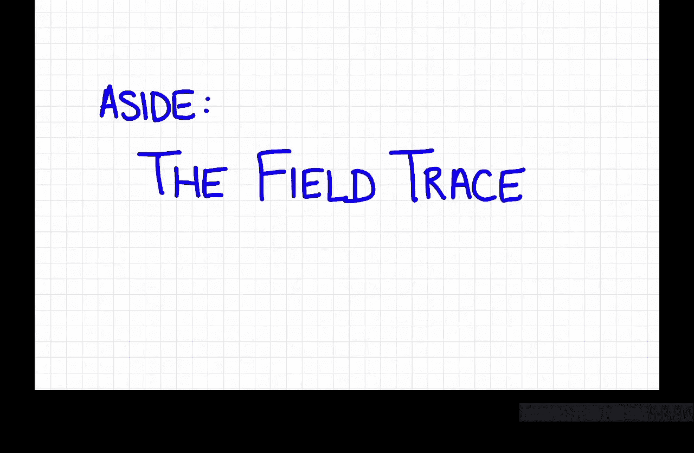
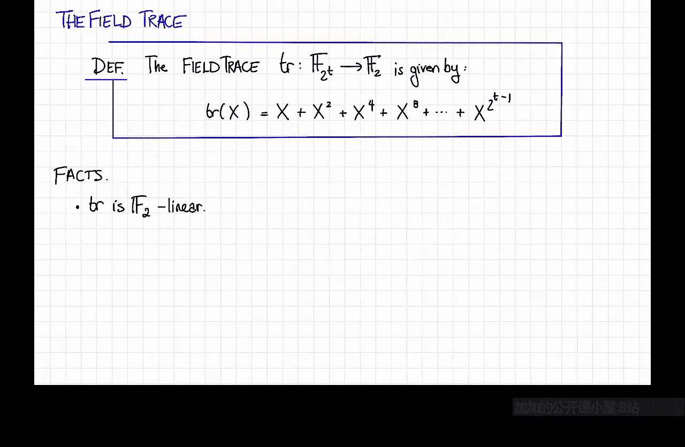
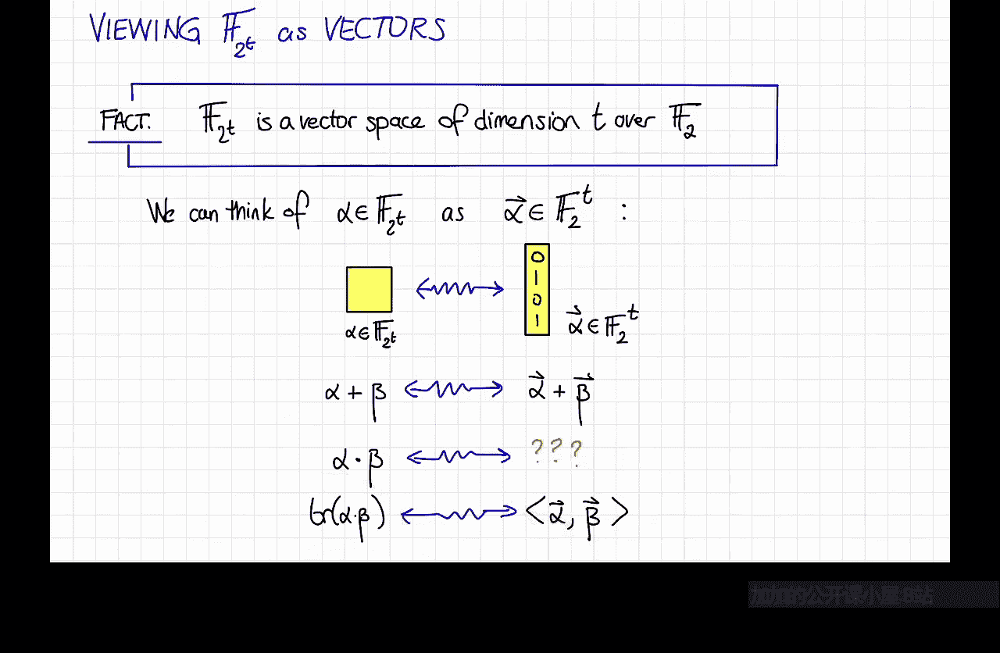

代数编码理论导论：2：域迹（Field Trace）

在本节课程中，我们将快速介绍一个称为“域迹”的数学工具。这个工具在后续证明里德-所罗门码是良好的再生码时，将发挥重要作用。

为了引出域迹的定义，并理解我们将如何使用它，我们需要一个预备知识：**F_{2^t}** 是一个在 **F_2** 上的 **t** 维向量空间。

这意味着，我们可以将大域 **F_{2^t}** 中的一个元素 **α**，看作是一个长度为 **t**、元素在 **F_2** 中的向量，我们记作 **α⃗**。

这里用波浪线（~）表示，**F_{2^t}** 的加法结构与 **F_2^t** 的加法结构是相同的。也就是说，存在一种对应关系，使得 **F_{2^t}** 中的加法 **α + β**，对应于 **F_2^t** 中向量版本的加法 **α⃗ + β⃗**。

然而，这个波浪线对应关系并不保持乘法结构。也就是说，如果我们想将 **F_{2^t}** 中的两个元素 **α** 和 **β** 相乘，目前尚不清楚这对应于 **F_2^t** 中向量版本的何种运算。

不过，在向量空间 **F_2^t** 中，有一种运算“闻起来”很像乘法，那就是**内积**。目前，我们还不清楚这个内积运算对应回 **F_{2^t}** 中的什么操作。

有了这些铺垫，我们现在可以定义并初步解释域迹了。

域迹的定义如下：它是一个从 **F_{2^t}** 映射到 **F_2** 的函数，记作 **TR**。其定义为：
**TR(x) = x + x^2 + x^4 + x^8 + ... + x^{2^{t-1}}**

这看起来只是一个多项式，但它具有一些非常好的性质。

以下是关于域迹的一些重要事实。

首先，域迹是 **F_2** 线性的。这意味着对于 **F_{2^t}** 中的任意 **α** 和 **β**，都有：
**TR(α + β) = TR(α) + TR(β)**

要理解这一点，可以利用我们在特征为2的域中已知的性质：**(α + β)^2 = α^2 + β^2**。由于定义中所有指数都是2的幂，反复应用这个性质即可证明。

域迹的第二个有用性质是，它的像（值域）就在 **F_2** 中。也就是说，对于大域 **F_{2^t}** 中的任意元素 **α**，**TR(α)** 的值只能是0或1。

这里有一个简短的证明：考虑 **TR(α)^2**。利用平方可以分配到每一项的性质，我们得到：
**TR(α)^2 = α^2 + α^4 + ... + α^{2^{t-1}} + α^{2^t}**
在域 **F_{2^t}** 中，任何元素的 **2^t** 次方都等于其自身，即 **α^{2^t} = α**。因此，上式最右边一项变回 **α**，整个式子恰好等于 **TR(α)**。这意味着 **TR(α)^2 = TR(α)**。在 **F_2** 中，只有0和1满足“等于自身平方”这个条件，因此 **TR(α)** 必须是0或1。

第三个重要性质是，域迹在某种意义上“捕获”了所有具有上述性质的函数。具体来说，所有从 **F_{2^t}** 到 **F_2** 的 **F_2** 线性函数 **φ**，都具有以下形式：
**φ(x) = TR(α * x)**
其中 **α** 是 **F_{2^t}** 中的某个元素。

这可能会让你联想到向量空间 **F_2^t** 上的线性函数。在 **F_2^t** 上，所有从 **F_2^t** 到 **F_2** 的 **F_2** 线性函数，都具有内积的形式：
**φ( x⃗ ) = < α⃗, x⃗ >**
其中 **α⃗** 是 **F_2^t** 中的某个向量。

这表明，我们可以将域迹看作是一种**内积的类比**。

回到我们最初的动机，现在我们确实有了一个对应关系。我们应该将向量 **α⃗** 和 **β⃗** 的内积，本质上理解为 **TR(α * β)**。事实上，我们总是可以选择 **F_{2^t}** 的一个基，从而在 **F_{2^t}** 和 **F_2^t** 之间建立一个对应关系，使得这里的波浪线（~）实际上成为一个等式。

好了，以上就是对域迹的快速介绍。在下一节视频中，我们将使用域迹来将里德-所罗门码视为再生码。特别是，将域迹视为向量内积的一种代理（proxy）的观点，将非常有助于我们的理解。

在本节课中，我们一起学习了域迹的定义和三个核心性质：**F_2** 线性性、值域在 **F_2** 中，以及它如何表征所有到 **F_2** 的线性函数。我们还建立了域迹与向量内积之间的类比关系，为后续课程内容奠定了基础。