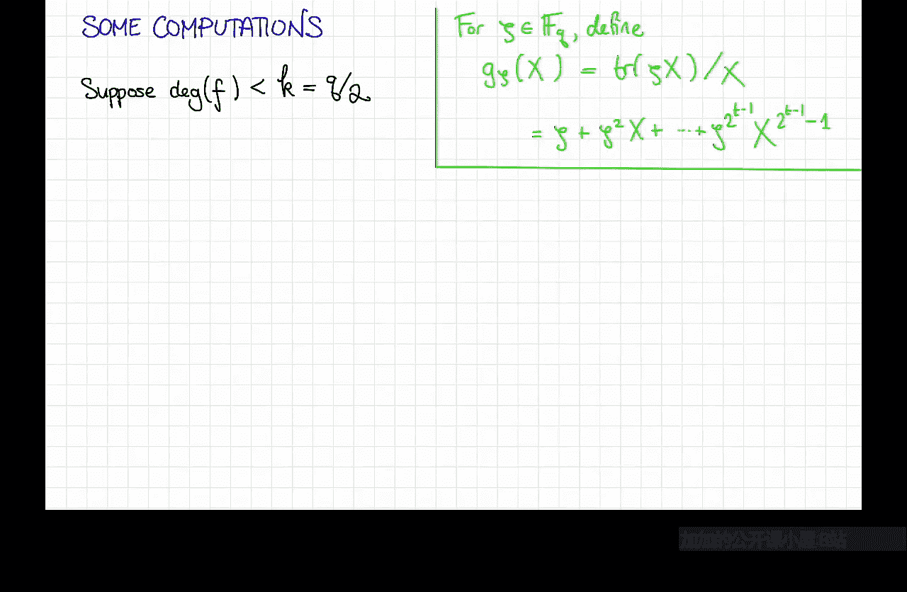

# 055：RS码作为再生码

在本节课中，我们将学习如何将里德-所罗门码用作再生码。我们将展示，当使用特定参数的RS码存储数据时，如果一个存储节点失效，替换服务器仅需从每个存活节点下载一个比特，就能恢复失效节点上的数据。

## 目标与方案对比

假设我们的数据使用一个里德-所罗门码存储，其参数如下：
*   块长度 **n = Q = 2^t**
*   维度 **k = n/2 = 2^(t-1)**

我们的目标是：当一个节点失效时，替换服务器Bob能够从剩余的n-1个存活节点恢复失效数据，并且希望通信开销尽可能小。

我们将展示的方案是：Bob仅需从每个存活节点下载**1个比特**。

**方案优劣对比：**
*   **本方案**：修复带宽为 **n-1** 比特。
*   **朴素方案**：Bob需要联系k个节点，从每个节点下载一个域元素（需要t比特表示）。因此总带宽为 **k * t = (n/2) * log n** 比特。

本方案相比朴素方案，带宽节省了约 **log n / 2** 倍。随着n增大，这个优势非常显著。虽然我们聚焦于k=n/2、下载1比特的简单场景，但此基本思想非常灵活，可以推广到其他参数。

## 预备知识与有用事实

在展示具体方案前，我们先回顾两个有用的事实。

**事实一：** 对于有限域 **F_q** 上的任意两个多项式 **F(x)** 和 **G(x)**，如果它们的次数都严格小于 **q/2**，那么有：
`∑_{α ∈ F_q} F(α) * G(α) = 0`

**证明思路：** 因为F(x)*G(x)的次数严格小于q-1，而我们已经知道对于所有 **i < q-1**，有 `∑_{α ∈ F_q} α^i = 0`。将F*G的每一项线性分解后应用此性质即可得证。

**事实二：** 迹函数 **Tr: F_{2^t} → F_2** 是 **F_2**-线性的。即对于任意x, y ∈ F_{2^t} 和 a, b ∈ F_2，有 `Tr(a*x + b*y) = a*Tr(x) + b*Tr(y)`。

上一节我们介绍了两个关键的数学事实，本节中我们将利用它们进行一些核心计算。

## 核心推导与方案构建

首先，我们定义一个多项式 **g_ζ(x)**。对于域 **F_q** 中的任意元素 **ζ**，定义：
`g_ζ(x) = Tr(ζ * x) / x`

根据迹的定义 `Tr(y) = y + y^2 + y^4 + ... + y^{2^{t-1}}`，我们可以将g_ζ(x)展开为：
`g_ζ(x) = ζ + ζ^2*x + ζ^4*x^3 + ... + ζ^{2^{t-1}} * x^{2^{t-1} - 1}`

现在，假设我们的消息多项式 **F(x)** 的次数严格小于 **q/2**（在本例中，q/2 = k，这符合RS码的编码要求）。

根据事实一，对于G(x) = g_ζ(x)，我们有：
`F(0) * g_ζ(0) + ∑_{α ∈ F_q, α≠0} F(α) * g_ζ(α) = 0`

由于我们工作在特征为2的域上，减法等于加法，因此可以将F(0)*g_ζ(0)移到等式右边：
`F(0) * g_ζ(0) = ∑_{α ∈ F_q, α≠0} F(α) * g_ζ(α)`

代入g_ζ(x)的定义 `g_ζ(α) = Tr(ζ * α) / α`，我们得到：
`F(0) * ζ = ∑_{α ≠ 0} F(α) * (Tr(ζ * α) / α)`

接下来，我们对等式两边同时取迹函数 **Tr(·)**。利用迹的F_2线性性质（事实二），我们可以将迹操作移入求和符号内，并且因为Tr(ζ * α)是F_2中的元素（0或1），可以提到Tr外面：
`Tr(F(0) * ζ) = ∑_{α ≠ 0} Tr(ζ * α) * Tr(F(α) / α)`

至此，我们已经得到了修复方案的核心公式。

## 修复方案详解

基于上一节推导出的公式，我们现在可以描述完整的修复方案。假设失效的节点存储的是 **F(0)**。

**修复步骤：**
1.  对于每一个存活的节点α（存储着值F(α)），它计算一个比特：**s_α = Tr(F(α) / α)**，并将这个比特发送给修复节点Bob。
2.  Bob收到所有n-1个存活节点发来的比特 `{s_α}`。
3.  对于Bob想要恢复的F(0)，他可以选择任意的ζ ∈ F_q。为了完全恢复F(0)，他需要对一组基向量（例如标准基e1, e2, ..., et）分别进行计算。
4.  对于选定的ζ，Bob计算：`Tr(F(0) * ζ) = ∑_{α ≠ 0} Tr(ζ * α) * s_α`。
    注意，`Tr(ζ * α)`是Bob本地已知的系数（因为ζ和α已知），`s_α`是从节点收到的比特。这是一个在F_2上的线性组合。
5.  通过让ζ遍历F_{2^t}在F_2上的一组基（共t个线性无关的ζ），Bob可以得到t个线性方程：`Tr(F(0) * ζ_i) = b_i`，其中b_i是计算出的比特。
6.  这t个方程定义了F(0)的迹函数在不同方向上的投影。由于迹函数在F_2上是非退化的双线性型，这等价于获取了F(0)（视为一个t维F_2向量）与每个基向量的内积。因此，Bob可以解出F(0)的每一个比特，从而完全恢复这个域元素。

**方案优势：** 每个存活节点仅发送**1比特**信息。Bob通过执行一些本地线性计算，就能恢复出失效节点上完整的t比特数据（即F(0)）。

这个方案可以很容易地进行修改，以恢复存储在其他评估点（如F(1), F(γ)等）的数据。通过选择不同的多项式g_ζ，也可以调整方案以适应不同的码率参数k。

## 总结与扩展视角

本节课中我们一起学习了如何将里德-所罗门码构造为高效的再生码。

我们展示了一个具体的方案：在参数为 `[n=2^t, k=2^{t-1}]` 的RS码中，当单个节点失效时，修复节点仅需从每个存活节点下载**1比特**信息，即可恢复失效数据。这相比需要下载 `(n/2)*log n` 比特的朴素修复方案，带宽效率有显著提升。

这个推导过程巧妙地结合了有限域上多项式求和的特性与迹函数的线性性质。更重要的是，在许多参数设置下，RS码可以被证明是线性MDS码中最优的再生码。

最后，我们也可以跳出编码理论的框架来看待这个结果：它本质上是一种**低带宽多项式插值算法**。即使不考虑分布式存储的应用背景，这个能够用极少量信息恢复多项式特定点值的算法本身也是一个非常巧妙的结果。