代数编码导论：课程总结：课程回顾与核心思想 🎓

在本节课中，我们将对《代数编码导论》系列课程进行全面的回顾与总结。我们将梳理从纠错码基础到高级应用的核心概念，并提炼贯穿整个课程的核心思想。

---

### 概述

本课程系统性地介绍了代数编码理论。我们从纠错码的基本概念出发，探讨了线性码、各种码的界，并深入研究了里德-所罗门码及其衍生码。此外，我们还学习了多种解码范式及其在通信、存储、密码学等领域的广泛应用。

---

### 纠错码基础

首先，我们学习了纠错码的基础知识。

我们了解到，一个码本质上是字母表 Σ 上的一个点集，即 **C ⊆ Σ^n**。

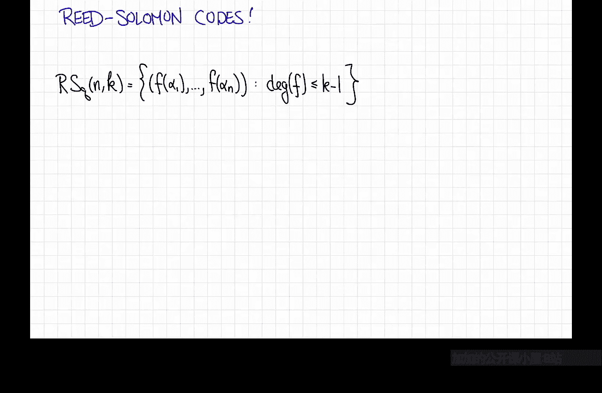

如果码具有良好的距离（即任意两个码字之间的最小汉明距离）和良好的码率（即码字数量足够多），那么即使在有噪声的信道中，通信双方也能进行高效通信。

---

### 线性码与基本工具

接着，我们讨论了线性码，并引入了两个核心工具：生成矩阵 **G** 和校验矩阵 **H**。这两个矩阵在理解和操作线性码及其算法时非常有用。

---

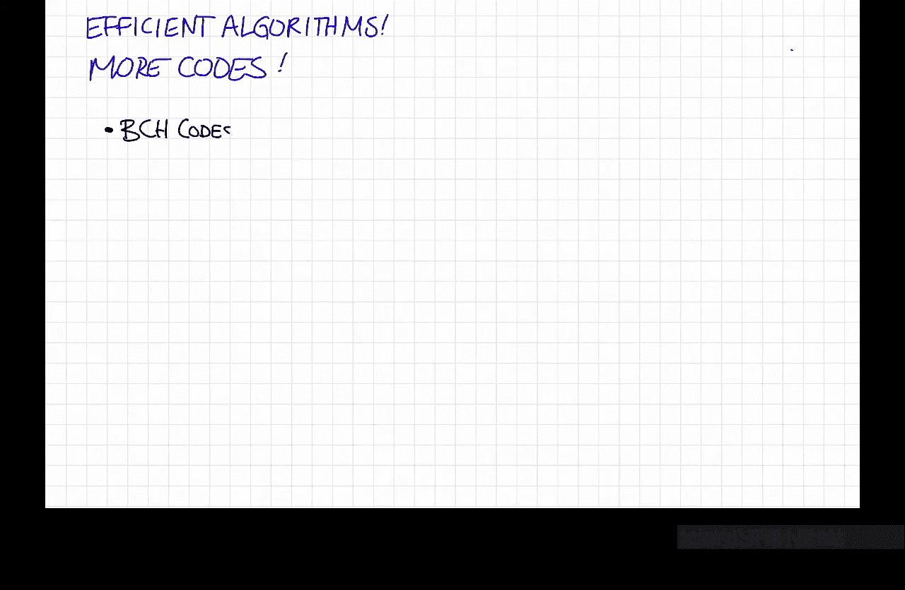

### 码率与距离的权衡

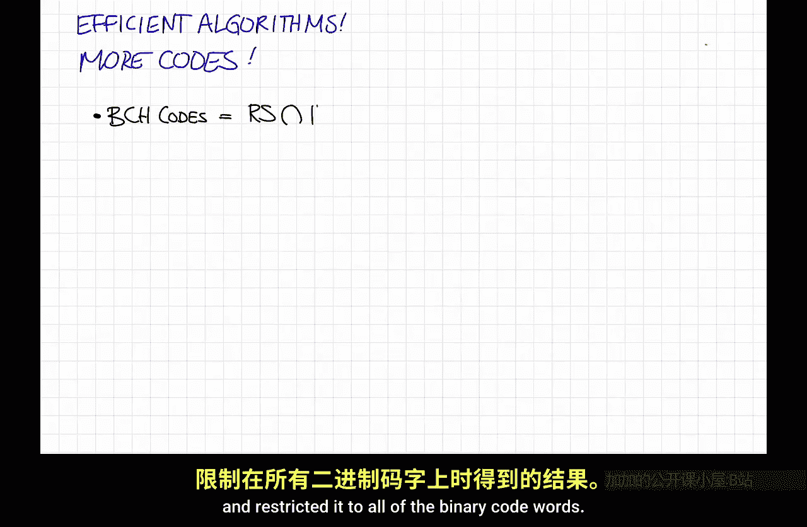

我们还探讨了码率与距离之间的基本权衡关系。

我们学习了许多界，例如汉明界、普洛特金界和辛格尔顿界，这些都是关于码性能的**不可能性**结果。

同时，我们也看到了一些**可能性**结果，如吉尔伯特-瓦尔沙莫夫界和扎布洛夫界。这些结果共同揭示了不同码在码率与距离之间所能达到的最佳权衡。

然而，对于二进制码而言，其最佳权衡曲线仍然是**开放问题**。

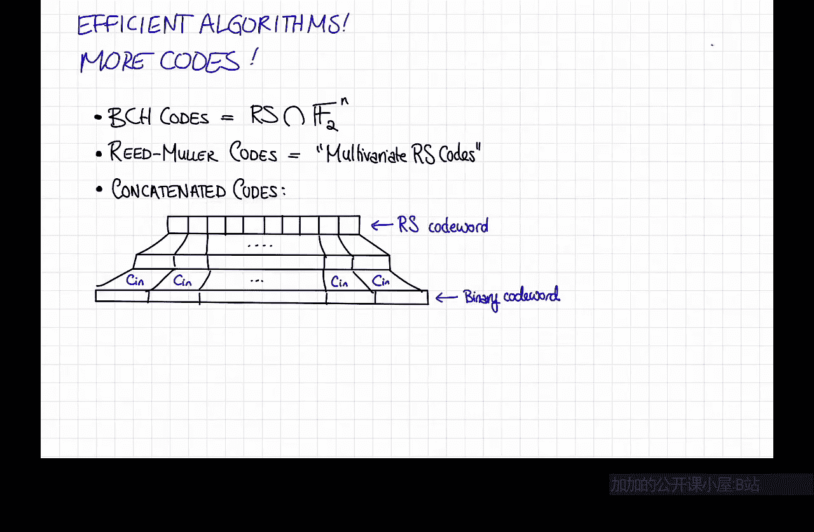

---

### 里德-所罗门码

对于随着分组长度 **n** 增大的大字母表，我们确实知道存在能达到码率与距离最优权衡的码，那就是**里德-所罗门码**。

里德-所罗门码定义为低次多项式在多个点上的**求值向量**。

它们之所以能在码率与距离之间取得如此好的权衡，原因在于本课程中反复使用的一个核心事实：**低次多项式没有太多根**。

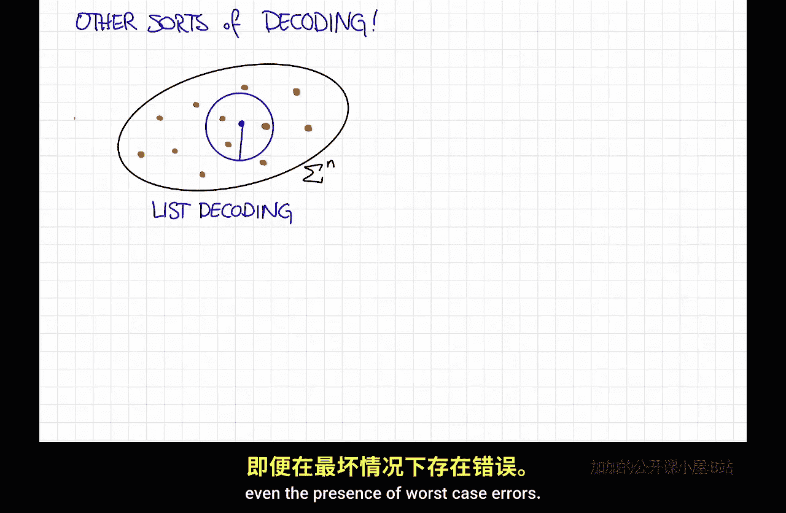

此外，里德-所罗门码拥有高效的解码算法，例如伯利坎普-韦尔奇算法。该算法能够成功，同样是因为**低次多项式没有太多根**。

---

### 基于里德-所罗门码的衍生码

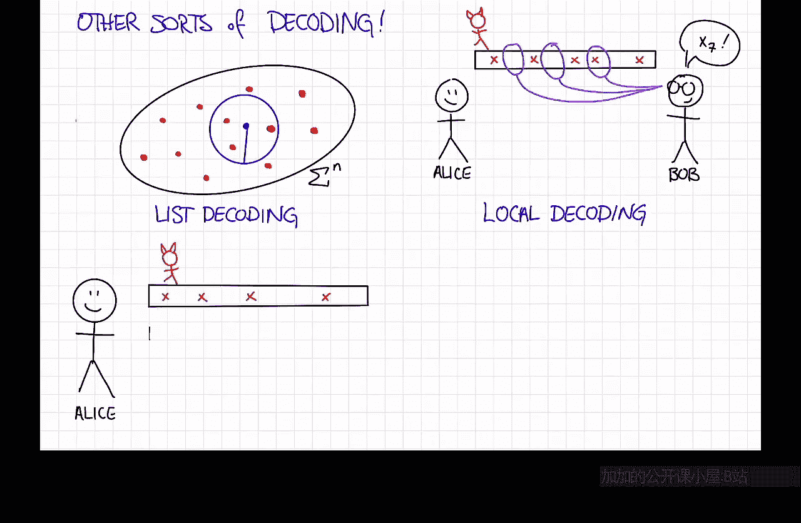

通过基于或操作里德-所罗门码，我们还得到了其他几种码及其高效算法。

以下是几种重要的衍生码：

*   **BCH码**：将里德-所罗门码限制在所有二进制码字上得到的码。
*   **里德-穆勒码**：可以看作是里德-所罗门码的**多元扩展**。
*   **级联码**：允许我们将一个大字母表上的码（如里德-所罗门码）与一个内码级联，从而得到一个更小字母表上的码。其过程是：从一个里德-所罗门码字开始，将其视为多个比特块，然后用某个内部的二进制码对每个块进行编码，最终得到一个大的二进制码字。我们看到了几种解码级联码的算法，可用于纠正随机错误和最坏情况错误。
*   **折叠里德-所罗门码**：将里德-所罗门码转换为一个在更大字母表上的码，但具有更好的**列表解码**能力。

---

### 其他解码范式

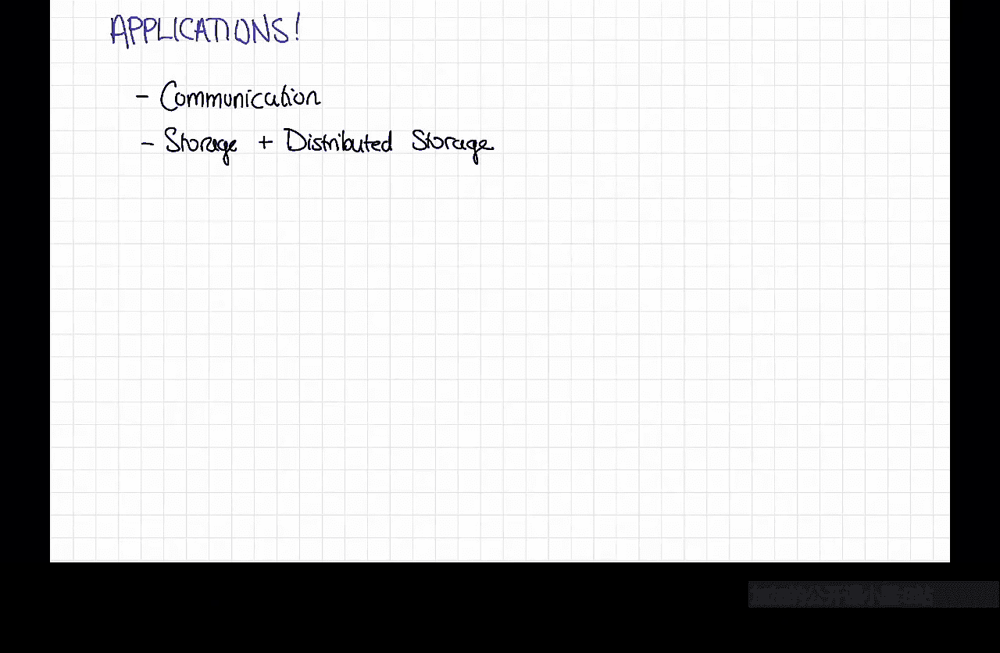

除了传统解码，本课程还介绍了一系列其他解码概念。

*   **列表解码**：目标是找到所有接近接收字的码字，即使可能存在多个这样的码字。我们看到了几种算法，如戈帕拉-苏丹算法和折叠里德-所罗门码的列表解码算法，它们都依赖于**低次多项式没有太多根**这一事实。
*   **局部解码**：在这种模式下，即使存在最坏情况错误，解码者鲍勃也希望在**亚线性时间**内了解爱丽丝消息的某些信息（例如单个比特）。哈达玛码和里德-穆勒码支持局部解码。
*   **局部列表解码**：结合了局部解码和列表解码的概念。我们看到了哈达玛码的局部列表解码算法。
*   **再生码**：这是一种不同形式的局部性。在再生码中，仅缺失一个符号，鲍勃的任务是尽可能少地从码字的其余部分下载信息来恢复缺失的符号。里德-所罗门码本身就是非常出色的再生码。

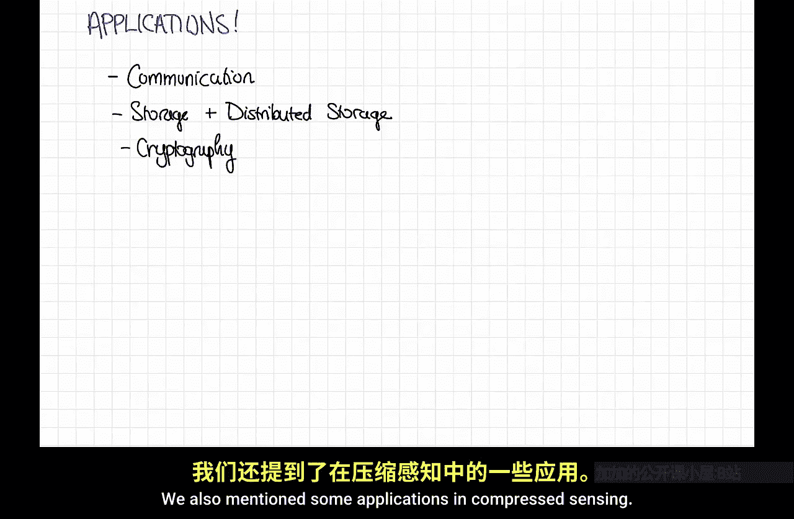

---

### 纠错码的应用

在整个课程中，我们还看到了纠错码的多种应用。

*   **原始动机**：通信。
*   **自然应用**：数据存储。再生码就是专为分布式存储设计的。
*   **超越通信与存储的应用**：
    *   **密码学**：例如梅尔-赫尔曼密码系统。
    *   **压缩感知**。
    *   **流算法**：如频繁项发现问题。我们看到了两种使用里德-所罗门码来获得更快速算法的方法。
    *   **群组测试**：使用里德-所罗门码获得良好的群组测试方案。
    *   **学习理论**：我们对哈达玛码进行局部列表解码的算法，为我们提供了从查询中学习傅里叶稀疏布尔函数的算法。

此外，还有许多其他应用在本课程中未能涵盖。

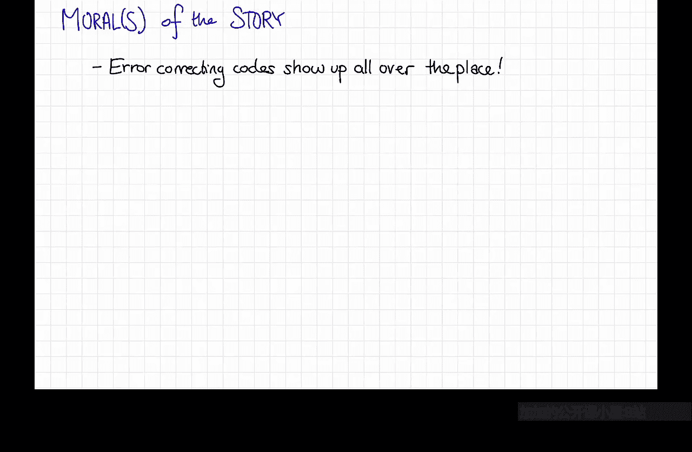

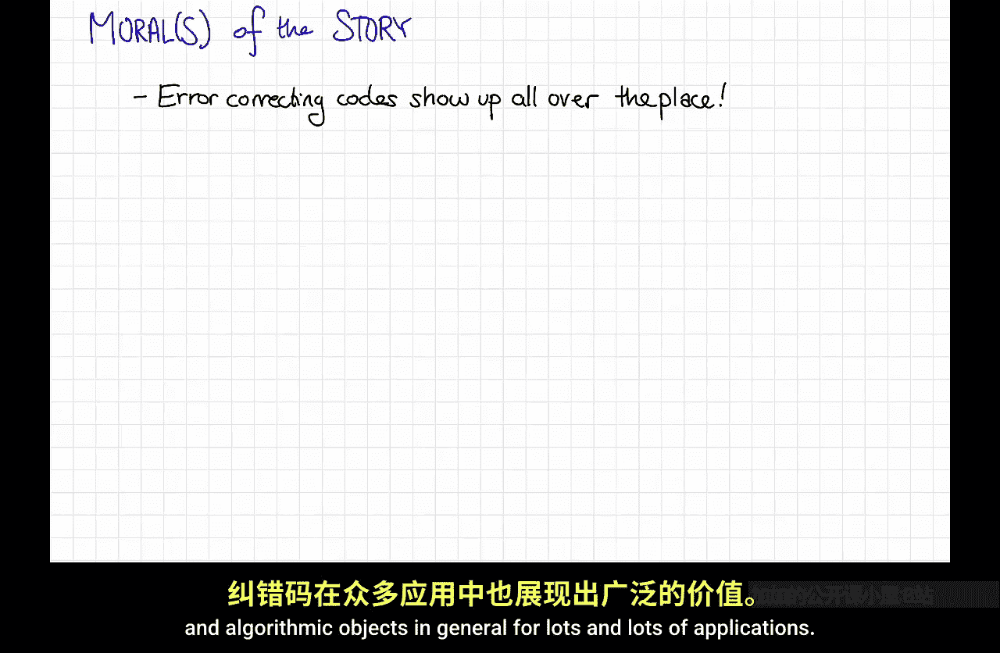

---

### 核心启示

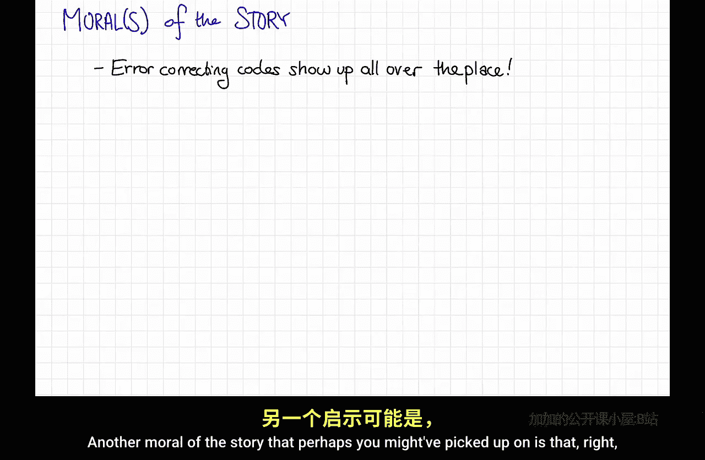

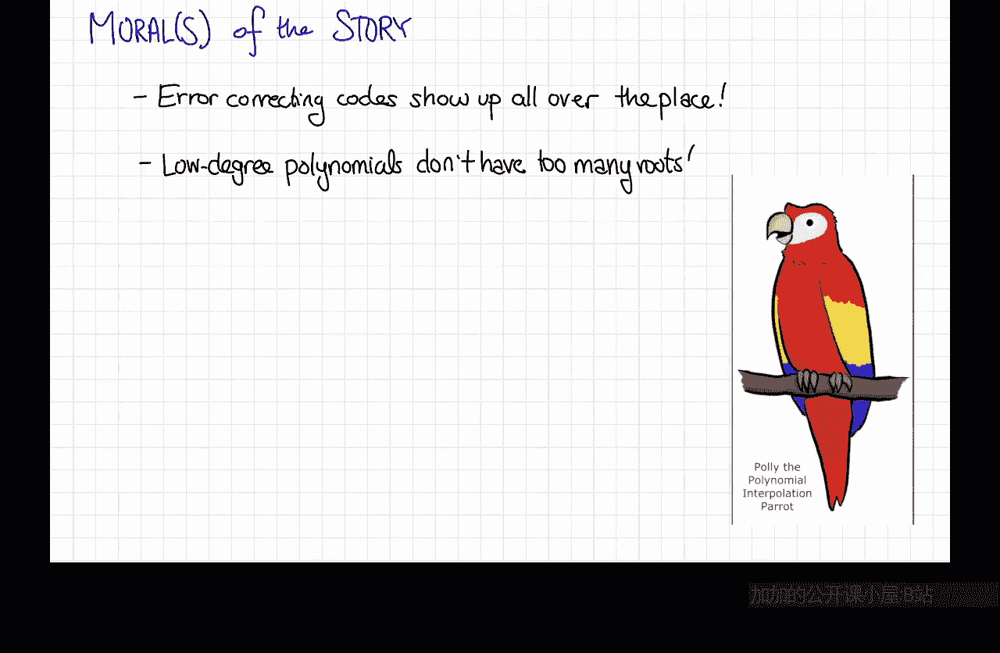

那么，本课程的核心启示是什么？

1.  **纠错码无处不在**。它们在通信和存储中极其有用，但作为通用的组合与算法对象，它们在众多应用中都发挥着重要作用。
2.  **低次多项式没有太多根**，这一事实在各种应用中都非常有用。

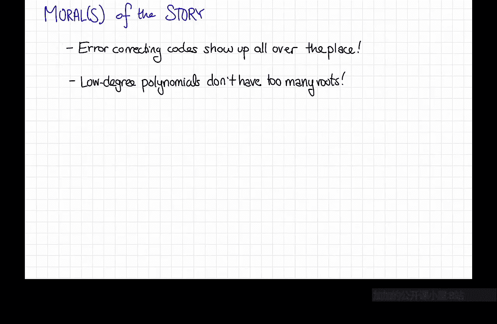

---

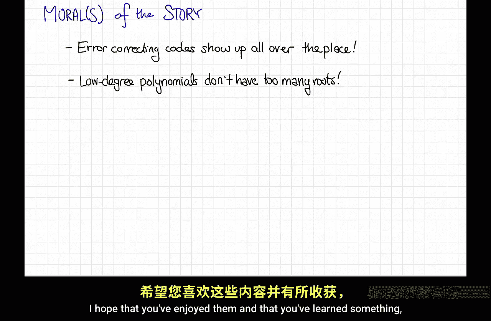

### 总结

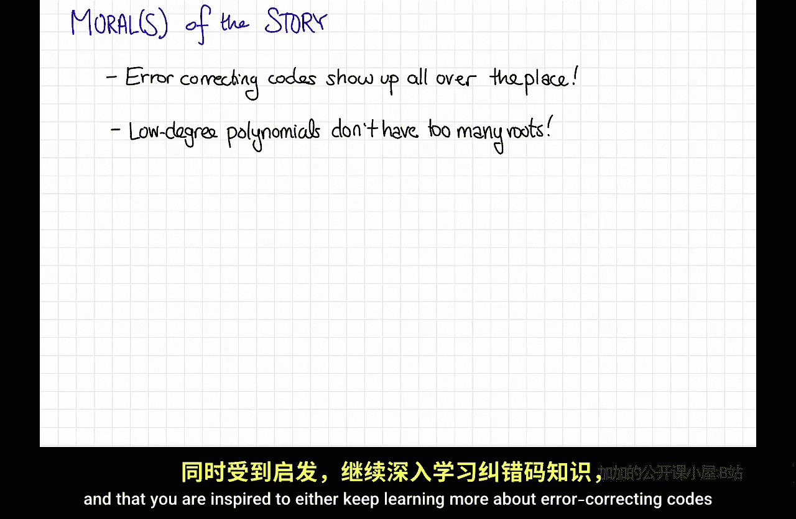

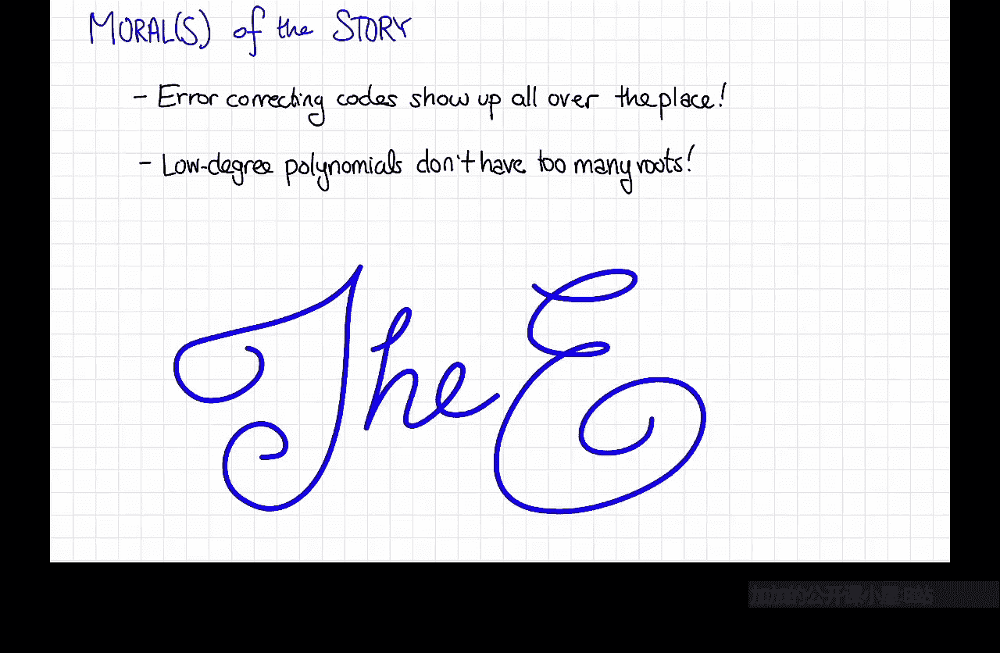

本节课中，我们一起回顾了《代数编码导论》的核心内容。我们从纠错码的基本定义出发，遍历了线性码、各种性能界、强大的里德-所罗门码家族、多种解码范式，以及纠错码在多个领域的广泛应用。希望本课程能激发你继续深入学习纠错码，或在你的工作中应用这些强大的工具。