# 斯坦福大学【中英⚡代数编码导论｜Introduction to Algebraic Coding Theory】 p02 p1 1 Video 2： Definitions and Examples -BV16sRYYTEwg_p2-

Now that we've seen some informal motivation for coding theory， let's see some formal definitions。

We start with the formal definition of a code。So， definition。A code， C。Of block length。En。😡。

Over an alphabet。Sigma。Is just a subset of sigma to the N。Here， n is a positive integer。

And sigma is some finite set， for example， zero and one。The elements。

Little C in the code big C are called code words。Okay， so far。

 this is not a very interesting definition。 A code C is just a subset of vectors of length， N。

Whose coefficients come from some finite alphabet sigma。Before we see how this can get interesting。

 let's see a few examples just to make sure we get the basic idea。First example， consider the code C。

Which is equal to the set of three strings。Hello， world。Brunnch time。All the time。

This is a perfectly good code。It's a code of block length 10。Over an alphabet。识吗？

Which is just all of the capital letters， A，B， C， dot dot up to Z。Just as a quick aside。

 sometimes instead of block length， I'll just say length。Okay。

 so while example one is perhaps perfectly descriptive of most of the things I want to say most of the time。

 it's not a very interesting example of a code。Here's another example。

 which is a little more interesting。C is this set of vectors。

So these are eight vectors of length  four， each of them over the alphabet 01。So， this。Is it code？

Of block length or just length 4。Over sigma equal to 01。Another terminology note。

 when Sigma is equal to 01 like this， we say that the code is a binary code。Okay。

 so hopefully at this point， you understand this definition of a code。But you might be wondering。

 what is the relationship between this definition and the Allison Bob story that we told earlier。

So if you remember earlier， we had this setup where。

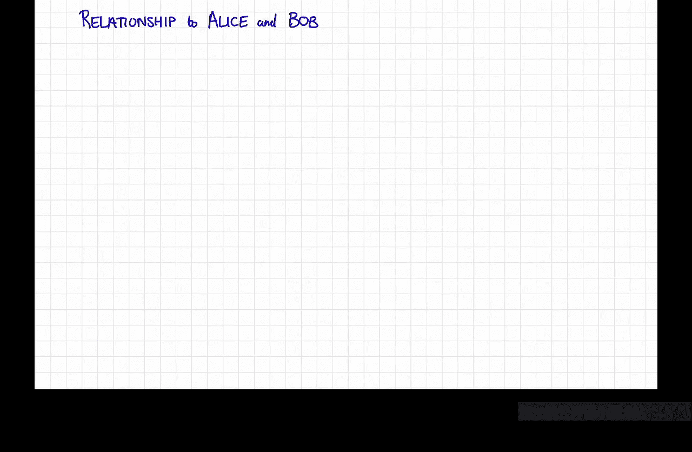

We have a message， X。In let's say， sigma to the K。And we encode it。Into some code word C。

In sigma to the N。

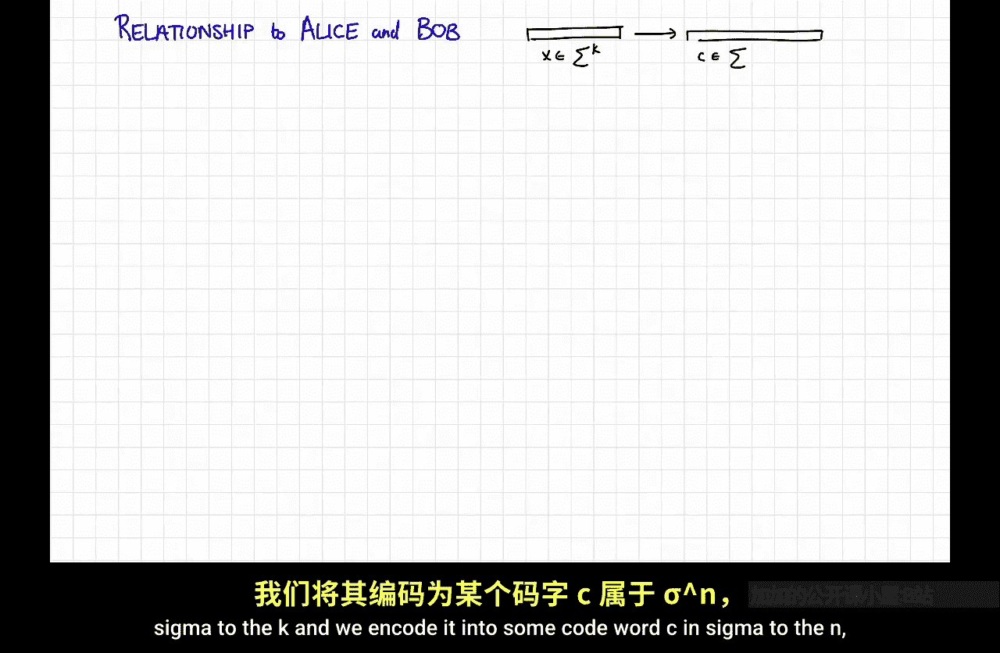

And then something bad happens to it。And we get some corrupted code word。See， twiddle。

And our job or Allison Bob's job。Is to figure out X， given access to C twiddle。

So to see how the definition of a code has anything to do with this picture。

Let's return to that second example。I'm going to copy and paste it down here so you can see it。

To see what this example and this definition of a code has to do with this picture。

Consider the encoding map。Innc。Which maps。0，1 to the three。To0，1 to the4。Which is given by。Ac of x1。

X2， x 3 is equal to。X 1， x 2， x 3， and then x 1 plus x 2 plus x 3 mod 2。For example。

Innc of the vector。0，1，1。Is equal to 0，1，1，0。Since 0 plus1 plus 1 is equal to 0， mod 2。Now。

 looking at this example。You can see that the code C here is actually the image of this encoding map。

Okay， so that sort of explains what the definition of a code has to do with this part here。

We have some message of length K， and we encode it into a code word of length N。

 And the thing that we're calling a code is just the set of all allowable code words here。

 All of the possible things you could get when you iterate over all of the possible messages X。

How about this second bit， The part where something bad happens， and we want to fix it。

This second example down here can actually do that， to some extent。More precisely， this example。

Can correct。One erasure。Let me explain what this means， by example。

Suppose you see the corrected code word， see twiddle。Which is equal to0。A big mess。0，1。And I ask you。

 what was the original code word。That is， I'm going to promise you that these symbols that you actually see are correct。

 but just someone went and accidentally took a red pen over this one。

I'm going to pause for a second to let you take a look at this code C。

And figure out what should go here。You can pause the video also。

 I guess I I don't really need to pause。But I guess I'm going to， anyway。Okay。

 hopefully you've figured out that this missing bit must be a one。

And the reason is that this thing plus this thing plus this thing。

 mod 2 has to be equal to this thing， which is one。

 And the only way that can happen is if this thing were a one。So that means that you or Bob。

 the receiver。If you receive this corrupted code word， can。

Correctly deduced that this missing bit was a one。 and therefore， Alice's original message was 0，1，0。

What just happened here was an erasure。What an erassure means。Is that some bit got erased。

 We know which bit it is。 We just don't know what the actual value was。Similarly。

 this example can also detect one error。Again， let's see what this means by example。

Suppose that you see the corrupted code word， see twiddle。Is equal to 0，0，0，1。

And I tell you that either everything's fine or one of the bits got flipped。

That's what we call an error when one bit is wrong， but we don't know which one。Okay。

 so what happened here？Is everything fine or did something go wrong？ And if something went wrong。

 what went wrong。Once again， let's pause for a sec for you to think about it。Okay。

 so you've probably realized that something went wrong because this is not a legitimate code word。

A legitimate code word should have this bit be the sum of these mod2， and it's not。However。

 you have probably also realized that you can't actually figure out which bit was flipped。

 It could have been any of them。So in this case， we say that the code can detect one error because it knows that something went wrong。

 but it can't necessarily correct one error。In the next example。

 we'll see a code that can actually correct one error。

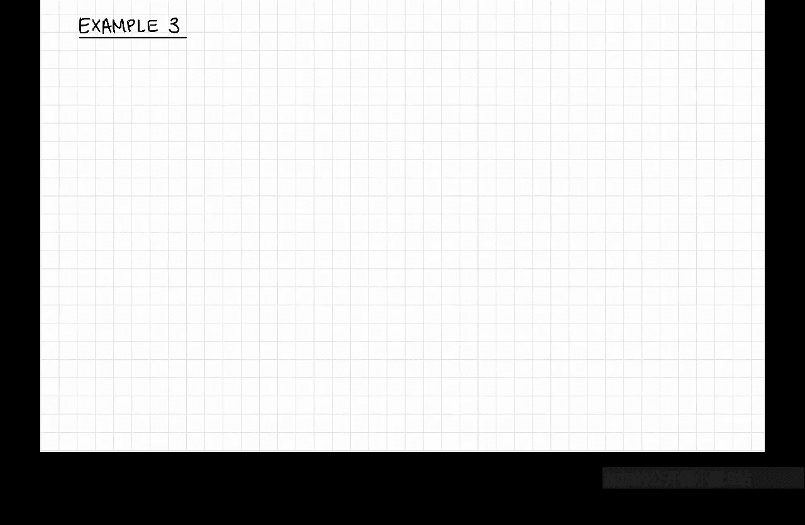

So let's consider the encoding map。Ink。

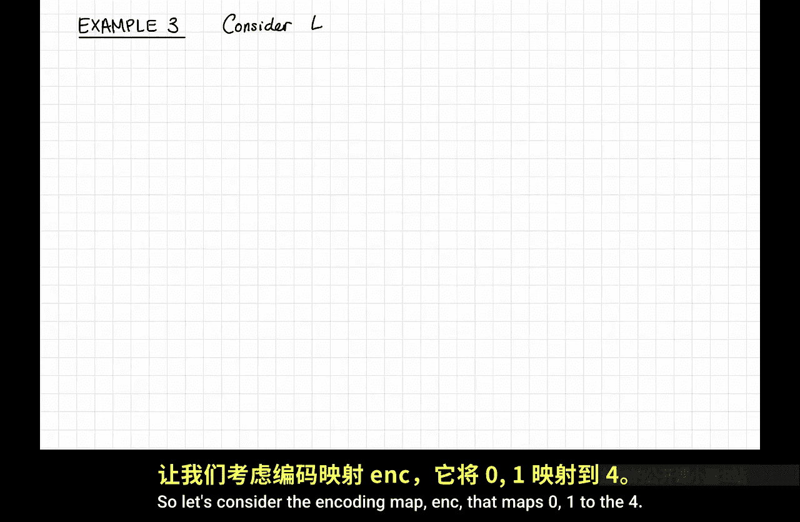

The maps。0，1 to the 4。To 0，1 to the7。That is given by。Innc。Of x1。X 2， x 3。X 4。Is equal to x 1， x2。

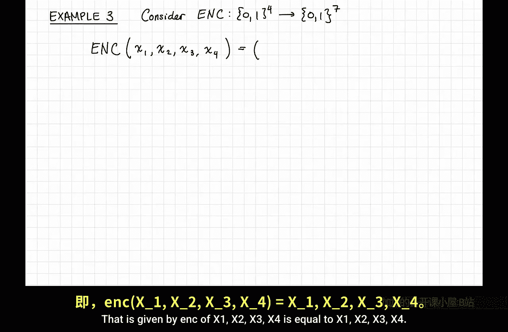

X 3。X 4。And then。The next bit is going to be。

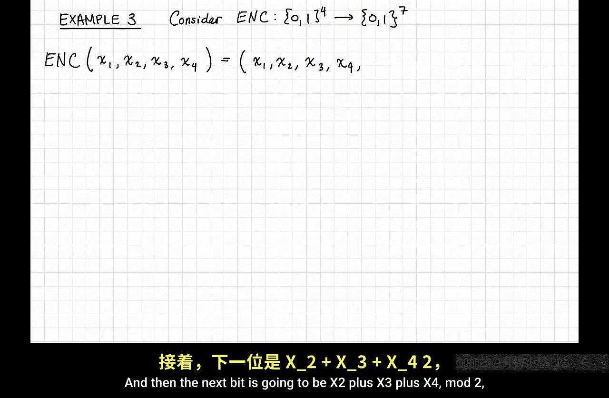

X 2 plus x 3。Plus， x4。Moud 2。The next bit is x1。

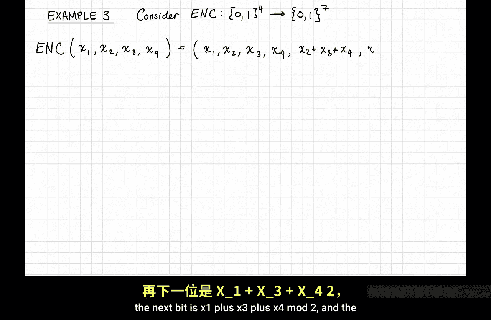

Plus x 3 plus x 4 mod 2。 And the next bit is x1 plus x2 plus x 4， also mod 2。Now。

 let's let our code be the image of this encoding map as before。

So that means that C is a binary code of block length 7。This may look kind of funny。

 but there's a nice way to visualize it。Let's imagine， Three circles。A blue one。A red one。

And a yellow 1。 And let's imagine that theyre overlapping like this。Now。

 one way to visualize this encoding map here is the following。Let's take our message。 So that's 4 Bs。

 X1， x 2， x3 and x4。 And let's write them in these cells like this。 So here's x1。Here's x2。

Here's x 3。And here's x 4 in the middle。Now each of these bits， we call them parity bits。

Corspond to each of these empty cells out here。For example， we have C5， the fifth bit。

 It's this one here。Is equal to x2。Plus， x 3。Plus， x 4。Which are the other things in this red circle。

Similarly， C 6。Is going to be equal to x1 plus x 3。Plus， x 4。All of the things in this circle here。

And C，7。Is going to be equal to x1 plus x2 plus x4。Apologies that I did not make my circles。

 particularly symmetric。 So I had to shove a little bit to get this to fit in there。 Oh， well。

 it's good enough。Okay， so I claim that this code。Can correct one error。Let's see it by example。

So here's a question。 Suppose that I tell you that at most one error is going to happen to a code word of this form。

 So that is one of these bits is going to get flipped at most one of these bits is going to get flipped。

And what you see。After that happens。s 0，1，1，1，0，1，0。The question is。What is C。

 the code word that this came from。So once again， why don't you pause the video now and try to figure it out。

 Decode this， is this already a legitimate code word and if not。

 what went wrong and how would you fix it？Okay。So hopefully you've come to the conclusion that the answer is yes。

 something did go wrong。And the correct code word is 0，1，0，1，0，1，0。That is。

 this third bit here is the one that got flipped。So how could you have figured this out？ Well。

 one way is by looking at these circles here。The bits we were given。Were。0，1，1，1。0，1，0。

And we know that each of these circles， the bits in them have to have some linear relationship。

This symbol needs to be the X or of this symbol。 this symbol in this symbol。

 Another way to say that is that when I take all of the symbols in a circle and add them together mod 2。

 I better get 0。So if we look at our circles here。And the corrupted code words C twiddle。

 We see that that's not true。 Something's gone wrong。This circle checks out the blue one。

But these two circles。Both have a problem。 They both have an odd number of ones in them。 So when。

 for example， I add up these four things， I get1 mod2， not zero mod2。

So I know that this circle has something wrong with it， and this circle has something wrong with it。

 And so what's the one bit that those two circles have in common， Well， it's this one。

So that means that this bit must have something wrong with it。

And this was the bit that corresponded to the third bit here。

So that means that what we need to do is erase this。And turn that one into a0。

And that's going to give us our corrected code word。You might be worried。 O， well。

 that was one way to fix it。 Is there some other way。It turns out that in this case， there。

 there is not any other way to fix it If you're only going to flip 1 bit。

I'll let you think about that， but we're going to return to it later and show it a little more formally in just a minute。

Okay， so this is pretty cool。 We've now seen a code。

 And now we know what that is that can correct one error。 But this might seem a little bit ad hoc。

 Is there always going to be some circle drawing based solution to this problem。😊。

In order to make this seem a little bit less ad hoc and to build up some theory around it。

 we're going to introduce a few more definitions。Our first definition is of heming distance。

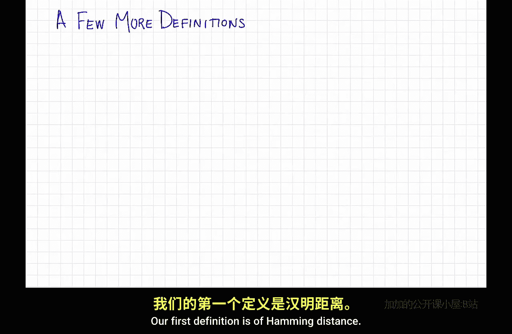

We say that。The heming distance。

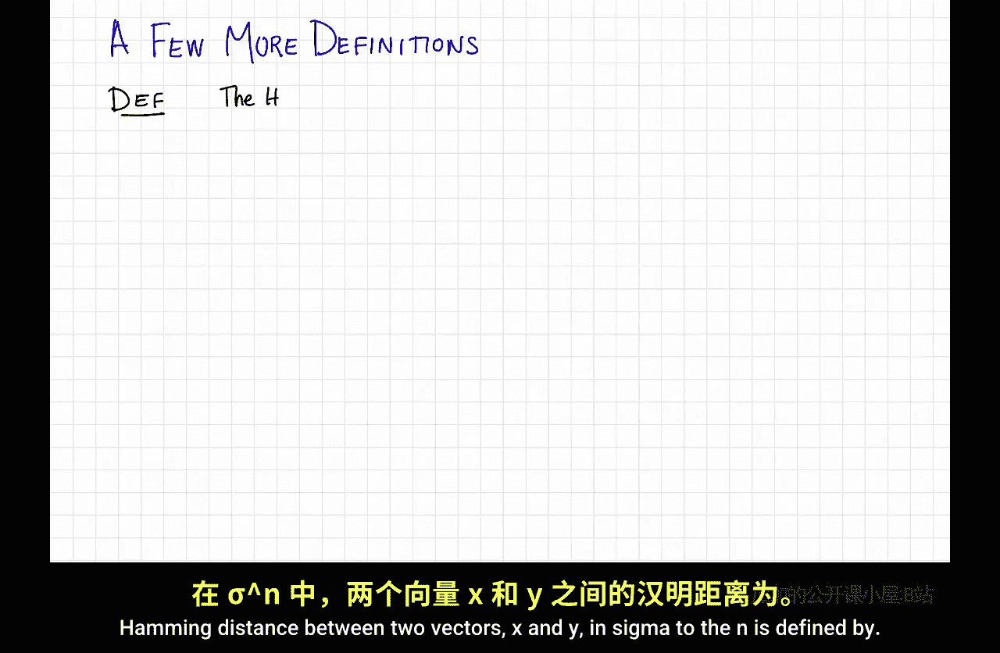

Between two vectors， x and Y in sigma to the n。Is defined by。

 I'm going to use the symbol Delta between x and y。Is equal to the sum from I equals1 to n。

Of the indicator variable， which is one， if X I is not equal to Y I。And zero otherwise。That is。

 the hamming distance between x and Y is just the number of positions on which the vector's X and Y differ。

Just as quick aside， the hamming distance is indeed a metric if you know that definition。

 in particular， it obeys the triangle inequality， which will come in handy in a moment。

We can also define a relative version of hamming distance。

 So we say that the relative hamming distance。Between two vectors。

 x and y in sigma to the n is defined as little delta of x Y。

 So I'm going to use little delta to denote relative hand distance。

And this is just the hem distance normalized by n。 So this is big delta of X， Y。Divided by n。

Or1 over n times the sum from I equals1 to n of the indicator variable that is one if X I is not equal to y I。

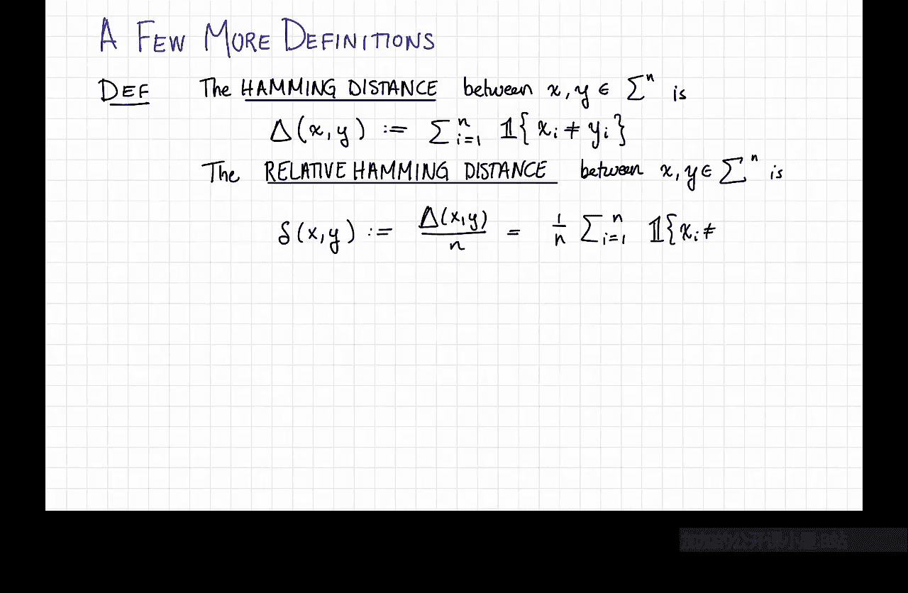

So the relative ham distance between x and y is just the fraction of positions on which they differ。

A related definition。Is that of the minimum distance of a code。So， the minimum distance。Of a code， C。

Subsid of sign to the end。Is defined as the minimum。Over， C， not equal to C prime。In sea。

Of the he distance between C and C prime。So you just look at every pair of distinct vectors。

 C and C prime that live in C every pair of distinct code words。

 And you ask what is the hamming distance between them and then take the smallest such distance。

Just as an aside， sometimes I'll just call this the distance of the code instead of the minimum distance。

Why do we care about these definitions， As we'll see in a moment。

It turns out that a code with large minimum distance。Could be used to correct errors。In more detail。

 here's a theorem。A code。With minimum distance， D。

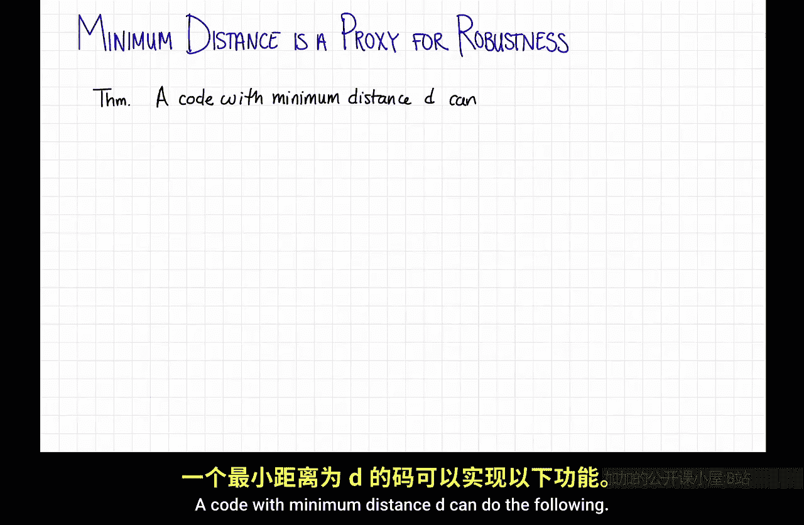

Can do the following。It can correct。Up to d-1 eraers。

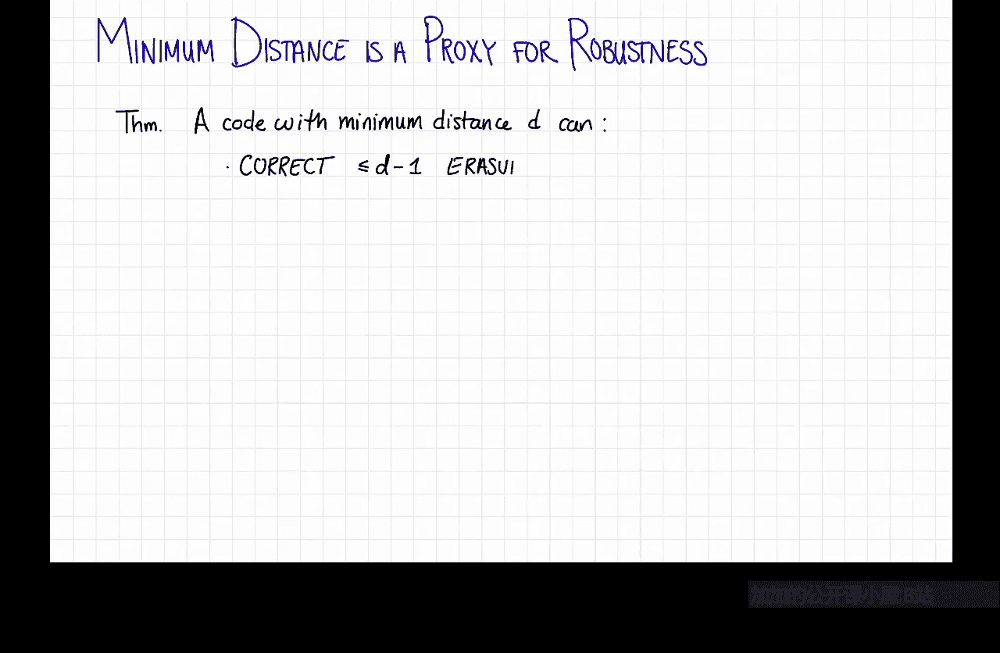

It can detect。Up to D -1 errors。And it can correct。Up to the floor of D -1 over2 errors。

Let's give an informal proof of this by algorithm slash picture。For the picture。

 imagine that here is the correct code word。 C， the one that Alice meant to send。

And here's some other code word。See prime that were worried that Bob might confuse foresee。

And let's consider a couple of different sets surrounding C。First， let's consider the set。

 which I'll draw as a circle here。This is a hamming ball of radius D-1 over2 or the floor of that。

And by that， I mean that this is the set of points， x。In sigma to the end。

Such that the hamming distance between C and X。Is less than or equal to the floor of D -1 over 2。

Let's also consider the handming ball of radius D minus1。Maybe it looks something like this。

Notice that because this code has minimum distance， D。

This other code word C prime has to live outside of this ball。

We can also draw the ball of radius D -1 over 2。 the floor of that around seat prime。

 Maybe that looks something like this。Notice that again。

 because the distance between C And C prime is at least D， these two orange balls are disjoint。

 They do not overlap。With this picture in mind， let's return to this theorem。For these two things。

Consider the algorithm。Return the code word C in big C。

Such that the hamming distance between C and the corrupted code word C twiddle is minimized。

Note that this algorithm is not necessarily efficient， but we'll come to that later。

For this bullet point， let's consider the algorithm。

If C Twiddle happens to be a legitimate code word。Then， say， it's fine。Saint no error。Else。Say error。

And I claim that both of these algorithms work to do these things。

Provided that the minimum distance is at least deep。So why do they work， Let's look at our picture。

Let's look first at this one， correcting up to D-1 over two errors。

Suppose that Alice meant to send this code word C。And up to D-1 over two errors got introduced into it。

Then what Bob sees is C Twiddle， which maybe lives here。

The key is that because this ball and this ball are disjoint。

 C Twiddle definitely lives in this ball。 So therefore， it definitely does not live in this ball。

Therefore， if I return the code word that is closest， it's always going to go to this one。

 never to that one。Similarly， let's consider this thing detecting up to D -1 errors。

So suppose that up to D-1 errors occur。 So now C twiddle might be maybe all the way over here。

If Alice meant to send this codeward C。In this picture。

 we can see why it's impossible to figure out what Alice meant to say。

C Twiddle could have arisen from C prime or it could have arisen from C。 There's no way to tell。

However， because sea prime is outside the green ball。

And sea Twiddle is going to land inside the green ball。

 We know that sea Twiddle can't make it all the way to see Prime。Therefore。

 the only way that C twiddle could end up being a code word is if C twiddle is C itself。

And in that case， this algorithm down here does the correct thing。 If C twiddle is a code word。

 then it must be C itself， and it says no error。 Otherwise， C Twiddle can't be a code word。

 and we're going to return error， as expected。So that explains why this one works and why this one works。

I haven't yet said why this one works。 It's not quite as easy to draw on this picture。

 but the logic is basically the same。 So I'll leave that as a fun exercise for you。

So let's return to our examples， or at least examples， two and three。

 the two examples that weren't silly。

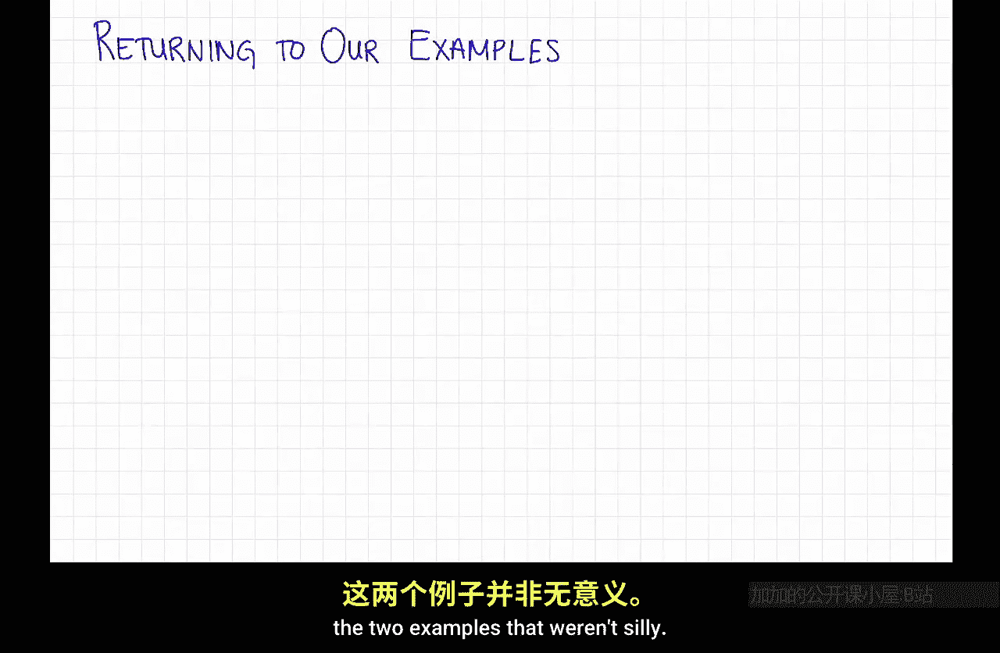

So example 2， this is the one where we add just a single parity check。

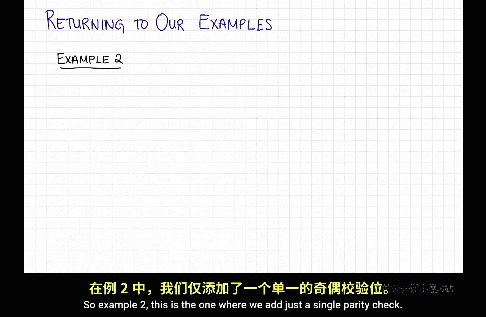

You can check that this example has distance2。And as we saw， it can correct up to one erasure。

 and it can detect up to one error。So that checks out with our previous the。

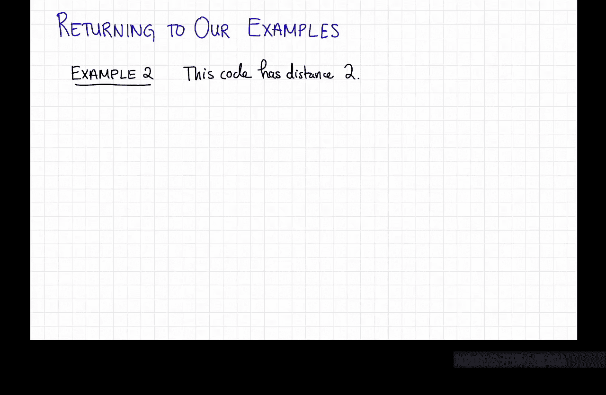

In our example 3， this was the one with the circles。

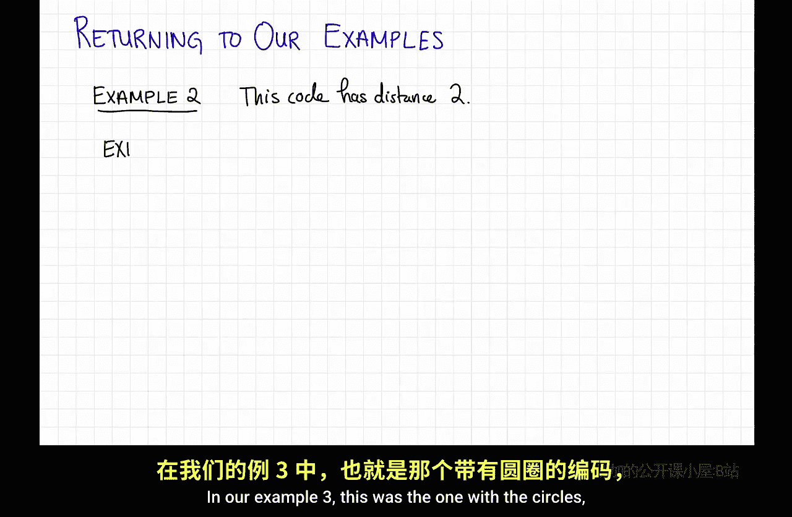

This code turns out to have distance 3。

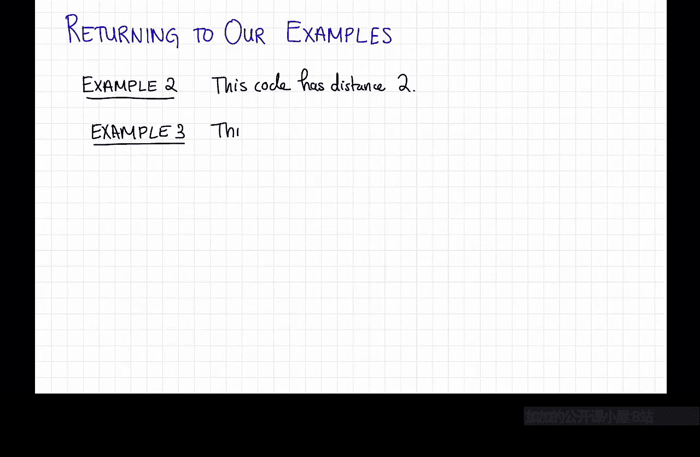

I'm not going to prove this right now。 Actually， we'll prove this in a later video once we have a little bit more machinery because then there'll be a really slick proof。

 but it's not too hard to prove for yourself， or at least convince for yourself just by staring at those circles for a little while。

 So I encourage you to go back and stare at those circles and convince yourself that this code does indeed have distance 3。

But if you believe that this code has distance 3， it explains why it can correct one error。

In particular， when we did that exercise before and corrected one error in this example 3 code。

We might have worried that we didn't find a unique solution。

 We found a code word that was within one and C twiddle， but might there have been more。

The fact that this code has distance 3 shows that no， there's not going to be any other one。

 We found the correct answer。And in general， the code can correct one error。

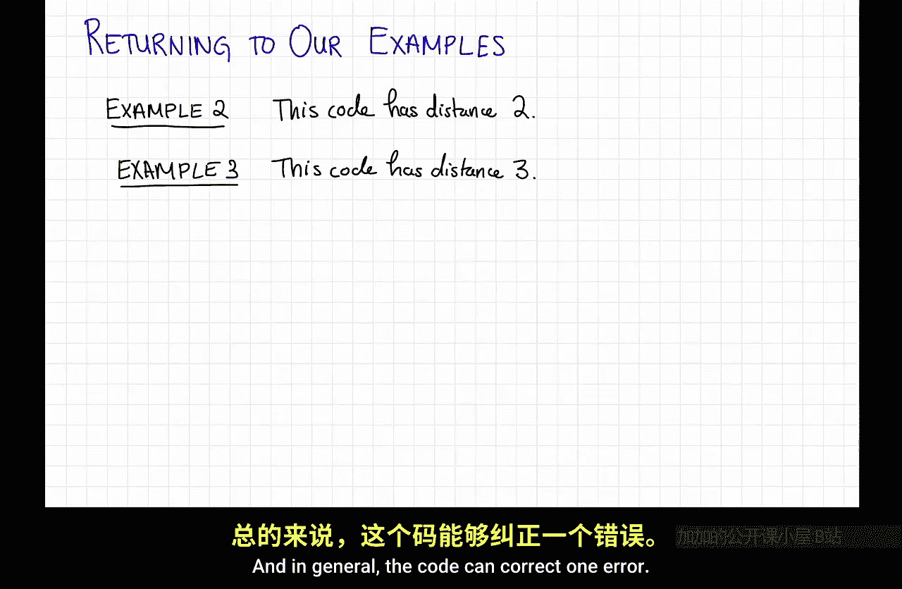

At this point。Let's return to this slide。 This is the slide that we had from the previous short video when we were trying to talk about what is it that we want out of an encoding map。

Now that we have some of these definitions， we can be a little bit more precise about this。

That is one reasonable definition of something bad。Is。Up to d minus1 over 2。Errors。Or。Up to D-1。

 erasures。And。What do we want to recover， What information about X do we want。

 Let's say we want all of X。

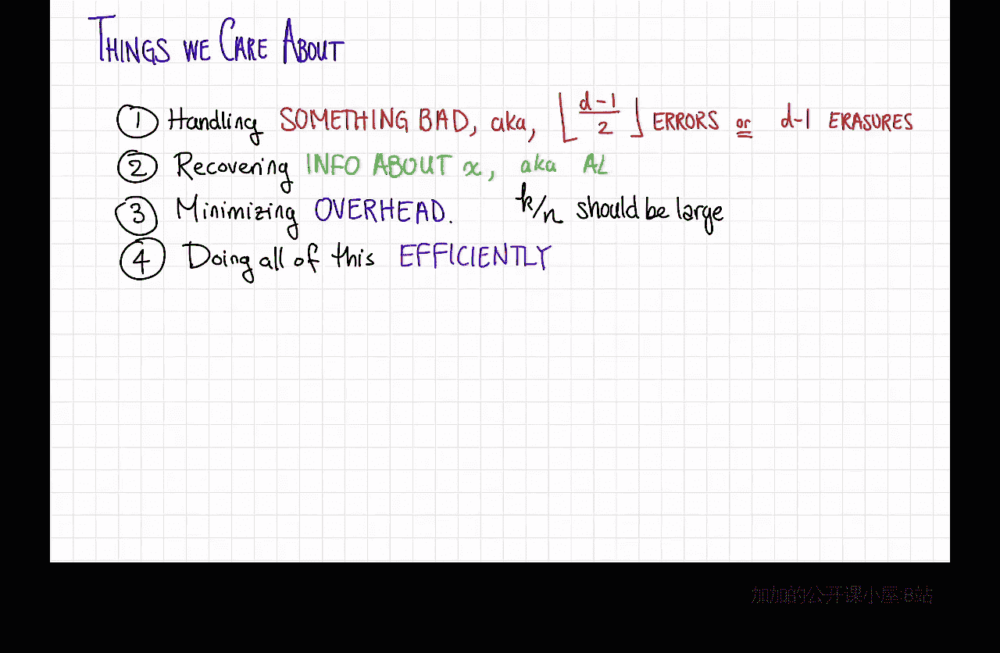

It's a pretty reasonable thing to want。If that's our definition of something bad and information about X。

Then we can replace one and2 with。One plus 2。We want the code。To have minimum distance。Di。

And then we can just erase these original deserta。Okay。

 so this is simplifying the things that we care about。Now。

 we just want a code with minimum distance D that minimizes overhead and possibly does it efficiently。

What we're going to do next is to talk about what precisely we mean by minimizing overhead。

 So we defined it here。 But let's give that a name and introduce a few more definitions。

Real quick before we move on to that， just a quick aside。

Asking for minimum distance D means that we're asking to be able to correct up to D minus-1 erasureers。

Or D -1 over two errors， as we just discussed。And one thing that was implicit in our discussion。

Is that we were imagining that any D-1 erasureers might occur or that any D-1 over 2。

 the floor of that errors might occur。We were kind of imagining a worst case outcome that we wanted to protect against。

 So imagine that Alice comes up with her code word that she's going to send to Bob。

 and then some all powerful and nefarious adversary decides which bits or which symbols of that code word to erase or corrupt。

This is a very strong guarantee。That's great because it's a very strong guarantee。On the other hand。

 it's not so great because it means that。Perhaps that guarantee is too strong to ask for。

 Perhaps the trade offs that we're going to get in terms of overhead and efficiency might not be worth it。

There are plenty of other models of errors， which are not so nefarious。 For example。

 you might expect the channel could flip some bits at random or something like that。

That's also an extremely reasonable model， it's very well studied。

 and we're going to return to it later in this course。But for now， we're going to focus on。

Minimum distance， which means that when I say correcting D -1 erasureers or D-1 over two errors。

 what I mean is。Worst case， erasureers。And worst case errors。O。With that aside done。

Let's move on to talking more about what we mean about overhead。

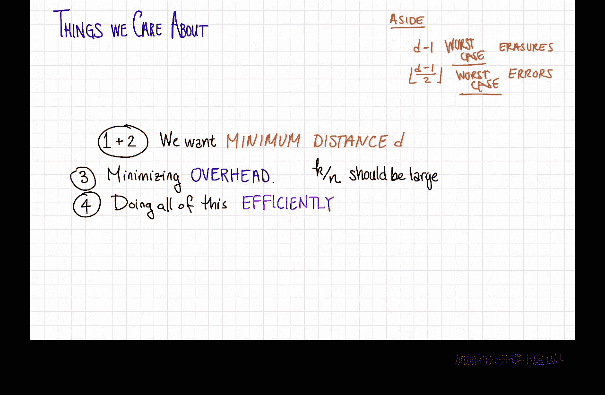

Horay， yet more definitions。We're going to define the message length of a code。

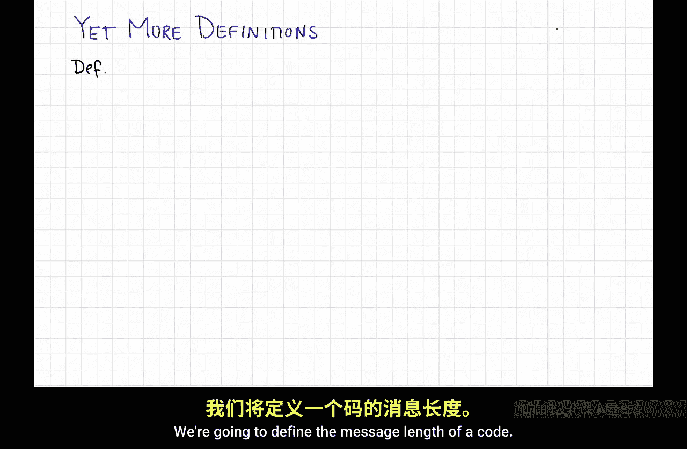

Xi。Over an alphabet Sigma。Is to find to be K。

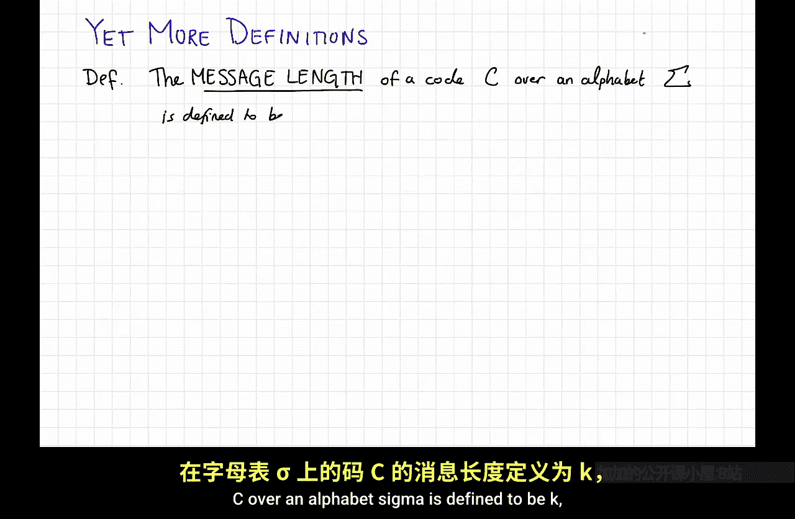

Which is equal。To the log base size of sigma of the size of C。Just a side note。

 the message length is sometimes also called the dimension。

For reasons that will become clear in a couple of videos。All right， so if you were paying attention。

 you've probably realized that we've already defined message length and K when we talked about encoding maps。

 but this is some definition of message length and K that just has to do with the size of the code and the alphabet that it's over。

 nothing about encoding maps。However， I claim that these are the same definition that this makes sense with our operational understanding of an encoding map。

Indeed， suppose we start with some message x。Over sigma of length K。

And we encode it with some encoding map。Into a code word C。In C。Now。

 let's observe that there are size of sigma to the K possible messages。

And there are a size of C possible code wordss。So if we start with a code， just a set。

 but no encoding map。We can define an encoding map just by assigning some message to every single code word as long as there's the same number of messages as code words。

For there to be the same number of messages as code words。

We need size of sigma to the K to be equal to the size of C。

And taking log base size of sigma of both sides。This means that k is equal to the log base size of sigma of the size of C。

Which is exactly our definition here。So this definition is completely in line with this operational view that we had before。

Now that we know what the message length is， we can define the rate of a code。

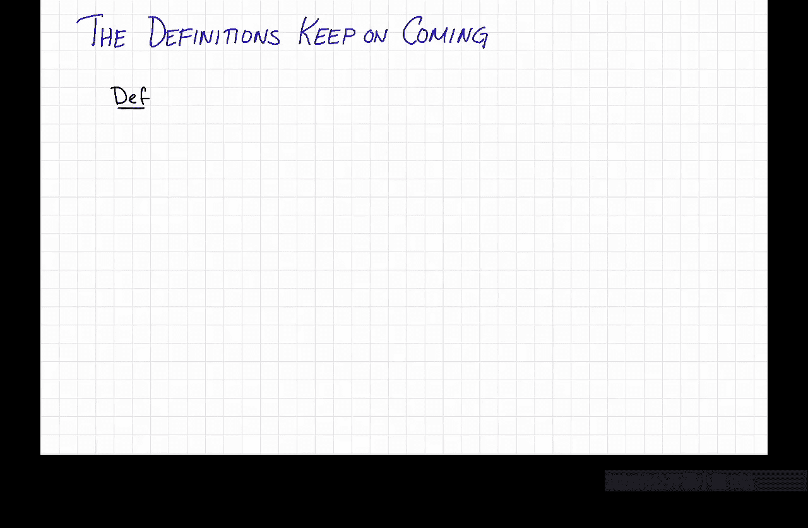

We see the rate。Of a code， C。Over an alphabet sigma of block length n。Is R？

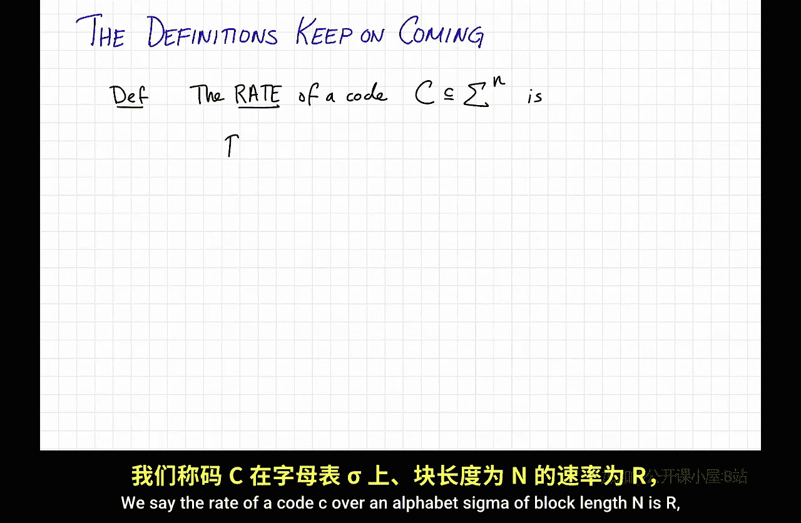

Equals。logg base size of sigma。Sizes C。Divided by n。

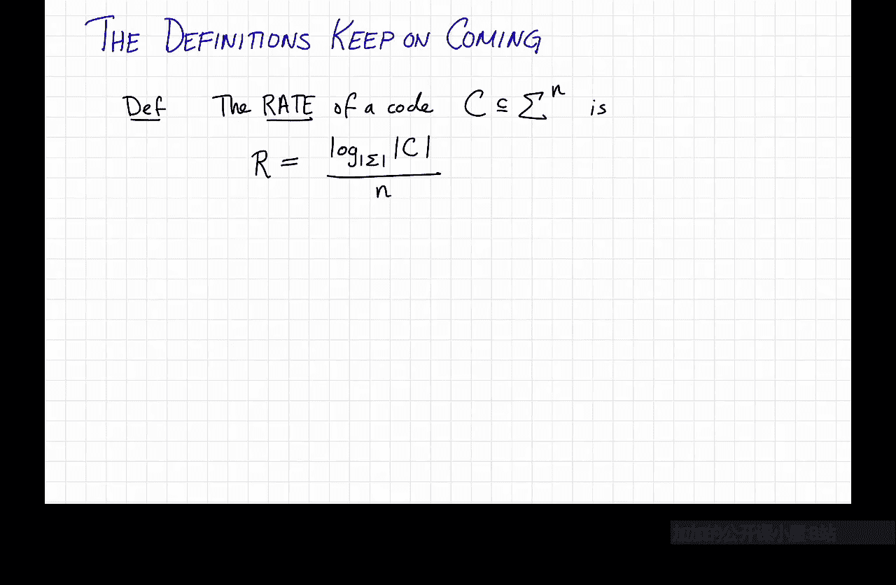

Which is equal to the message length k。Divided by the block length n。

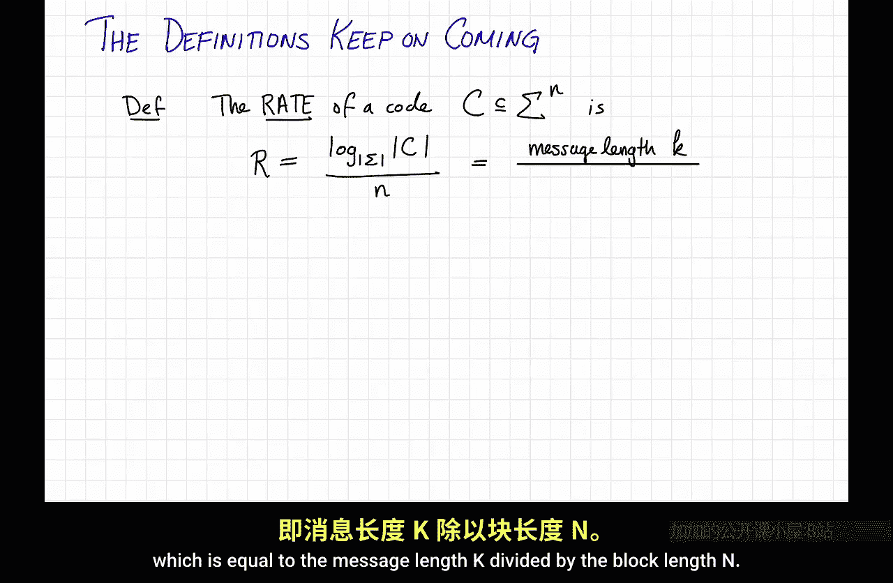

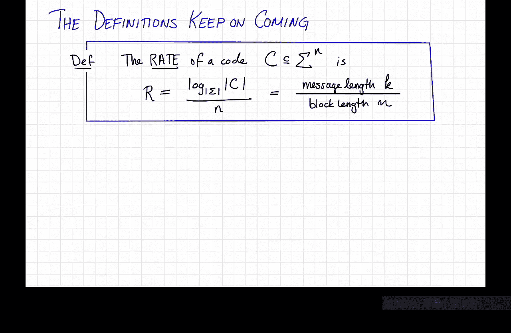

So the rate R。Is a number between 0 and 1。

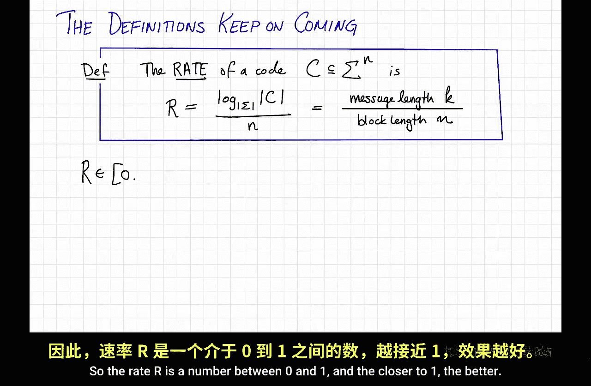

And the closer to one， the better。So if R is big。That's good。That means there's not much overhead。

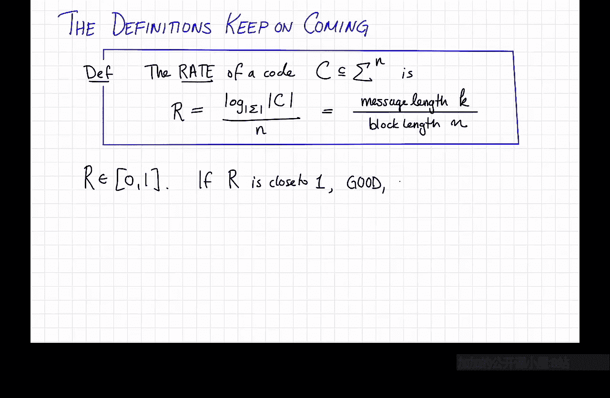

In particular， it means that the message length is not that much shorter than the block length。

On the other hand， if R is small。Close to 0。

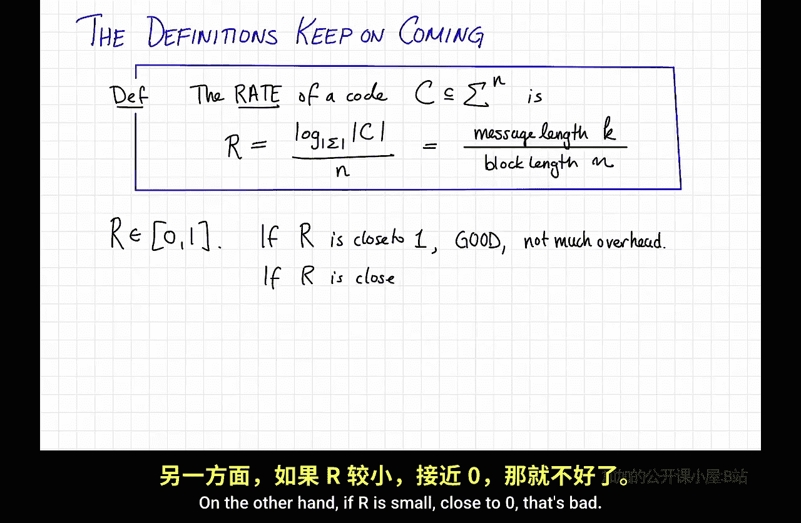

That's bad。That means there's lots of overhead。One more quick definition。

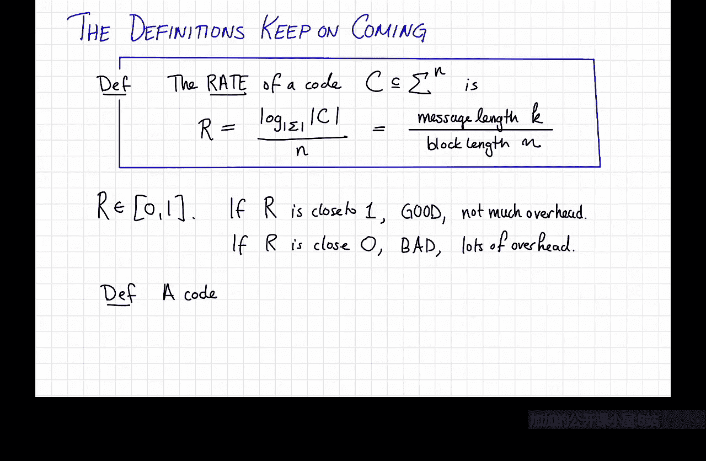

A code。With distance D。Message length， K。And block length N。Over an alphabet sigma。Is called。An in。K。

Di。Sub size of sigma code。So this is just the notation that we'll use to gather together all of the important parameters when describing a code。

Now， I understand that it's basically impossible to。

Keep the order of these symbols straight if you haven't seen this before or until you've seen it for a long time。

 But I'm always going to use N to mean the block length， K to mean the dimension。

 D to mean the distance。And sigma to mean the alphabet。

And I'll try to avoid using this notation without using these letters， along with it。So hopefully。

 that will help make things clear。Okay， but returning to this definition here of the rate。

We see that the rate basically captures this notion of overhead that we were talking about before。

Thus， if we return to this slide from before。This bullet point3 here， minimizing overhead。

We can erase this and replace it with maximizing rate。Or rate as close to one as possible。

So cleaning up this slide a little bit。And summarizing。

The things we care about is we want a code with minimum distance D。

And rate as close to one as possible。Ideally， with efficient algorithms。

Let's put efficient algorithms on the back burner for just a minute。

 or really for a couple of videos， we'll come back to it。Because already。

 this here raises a really interesting question。And the question。Is。What is the best trade off。

Between rate。And distance。If we could answer this question。

 we could understand how much overhead is necessary in order to correct worst case errors or erasureers。

As you might expect， because it's pretty fundamental。 We sort of arrived at it in just one video。

This question has been thought about for a long time。

 So you might expect that we would know the answer by now。However。

 it turns out that this question is still open。At least for binary codes。

 we don't know the answer to it。However， there is lots that we do know about this trade off。

 and in the next short video， we'll start exploring some of those things that we do know。

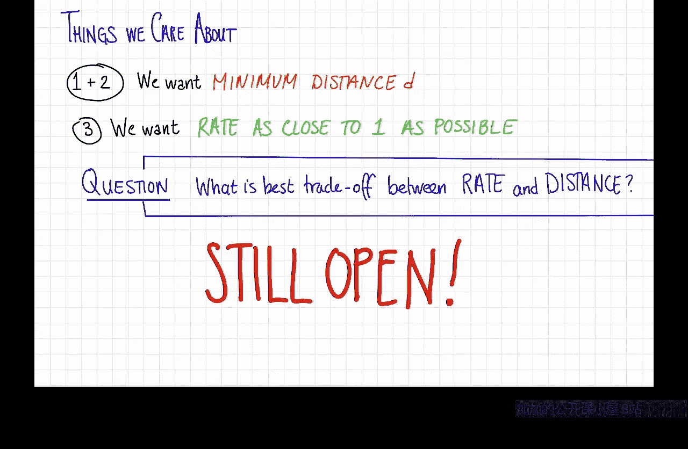