# 斯坦福大学【中英⚡代数编码导论｜Introduction to Algebraic Coding Theory】 p03 p2 1 Video 3： The Hamming Bound -BV16sRYYTEwg_p3-

In this video， we'll see our first bound on the trade off between rate and distance known as the hammerming bound。

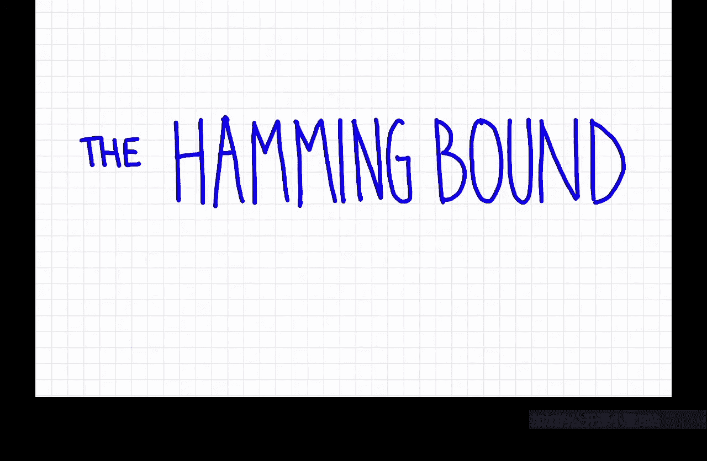

Last time， we left off with the question。What is the best trade off between rate and distance？

The heming bound establishes some limitation on how good this trade off can be。Here's the basic idea。

Suppose that this box here。Is all of sigma to the end。

And suppose that we have some code with distance D。 And these are the code words of our code。Now。

 let's consider the balls of radius D-1 over 2 around each one of these code words。

Let's say they look like this。Just as we saw before。

 all of these balls are going to be disjoint from each other because they have radius D-1 over 2。

 the floor of that。 And every pair of these points is at least D apart since C has distanced D。

So the idea of the haming bound is the following。We have here。C， size of C， disjoint hamming balls。

Of radius。D-1 over 2。But somehow， they all have to fit in this space， Sigma to the end。

So we can't have too many of these hamming balls or else they wouldn't all fit。 Therefore。

 we can't have too many code words。 Therefore， the rate of the code can't be too big。

It turns out that this simple logic can actually yield a bound that is pretty good in some situations。

In order to turn this idea into a quantitative bound， we need a few more definitions。First。

 let's define a hamming ball。 I've been using this term a little bit so far。

 Hopefully you get the idea informally， but let's formally define it。The hemming ball。

In sigma to the end。Of radius E。About some point， x in sigma to the n。Is defined as。

B subsigma to the N。Of x comma E。Equals the set。Of all points， Y in sigma to the n。

So that the haming distance between x and Y。Is at most E。The volume。The heming ball。

Is just the size of that hamming ball。 I'm going to use the notation Va sub size of sigma of E comma N to denote this。

 So this is just the number of points in this haming ball B subsigma to the n of x comma E。

This might look a little bit funny since this side of the definition has an X in it。

 and this side does not。But fortunately， this is O because the size of this hamming ball does not actually depend on X。

So I guess to make this definition more legit， we should replace this x with a0 or something like that。

 Just fix our favorite x。Just as an aside， sometimes when I write this notation。

 I might omit the sigma to the end when it's clear from context。And I'll try not to。

 but I might also accidentally switch up the order of these parameters， but I'll try not to。

 Hopefully， whenever I write something like this， it'll be clear from context。 what I mean。

 what's the center and what's the radius。 I might also， instead of an E。

 write a number between 0 and 1 to indicate relative hamming distance rather than absolute hamming distance。

Okay， so we have this definition of volume。 What actually is it。 Well， we can write down a formula。

The volume of the Qary haming ball。Of radius E in dimension N。

So here we're just taking sigma to be some alphabet of size Q。In general， throughout this class。

 Q is typically going to be the size of sigma。So， this is just one。Plus， and choose one times Q -1。

Plus， and choose 2。Times Q-1 squared。 plus， dot， dot， dot， plus。And choose E。Times Q -1。To the E。

And the reason for that is so this one here， this is counting the all0 vector that is all of the vectors of weight0 with zero non zero elements。

This term is counting all of the elements with weight 1。

This term is counting all of the elements with weight，2， and so on。Another quick definition。

When I say the weight of a vector， I mean， the number of non zeros。So。For vector x。In sigma to the N。

 where sigma contains 0。The weight of x is just the number of nonzero entries of x。Typically。

 we're going to think of sigma as either the numbers0 through  Q minus-1 or as something called a finite field。

 which we'll define in a future video， but in either case， zero is going to be an element of sigma。

Okay， so armed with these definitions， let's return to our previous idea about deriving a bound on the best trade off possible between rate and distance。

 So the idea was this picture， not too many disjoint hamming balls can live in Sigma to the end。

Let's see。Be a subset of sigma to the end。 So it's a code of length n over the alphabet sigma。

And let's say it has distance D。And message length K。And let's let Q be the size of sigma。

Then following the intuition that we had before from this picture， we must have that C。

Times the volume。The Qary volume。Of a hamming ball of radius D -1 over 2。In dimension N。

Has to be less than or equal to Q to the n。This here is the total volume taken up by all those disjoint balls。

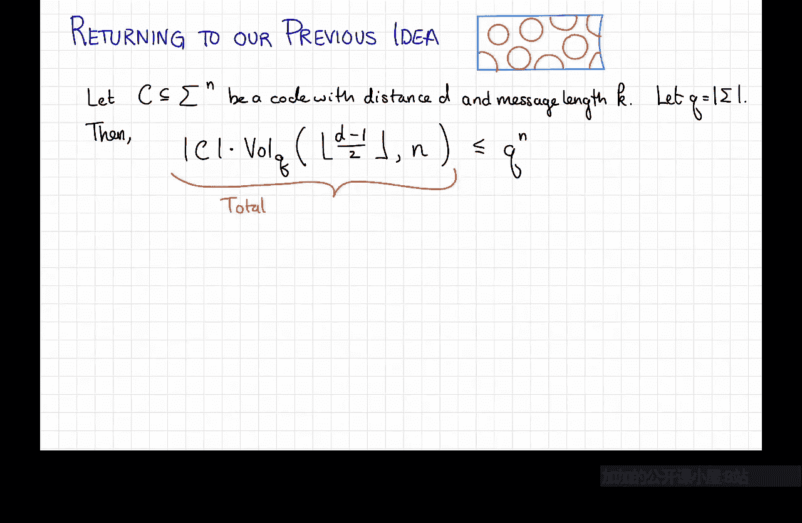

And this is the volume of the whole space sigma to the n。

Taking the log base cu of both sides of this equation。We see that。The log base Q of the size of C。

Plus， the log base Q。The Qary volume。Of a hemming ball of radius D -1 over 2 in n dimensions。

Is less than or equal to n。Reranging this。We see that the rate of the code。Which remember。

 is defined to be。Log base Q of the size of C， divided by N。Has to be less than or equal to1 minus。

The log base Q of this volume。Divided by n。So this here。Gives us a bound on the rate。

In terms of the distance。So the distance shows up here。And here's the rate。

And this is called the Hamming Bo。To see the heming bound in action。

 let's return to example 3 from the previous video。This was the code with the circles。

 It's also called the hamming code。

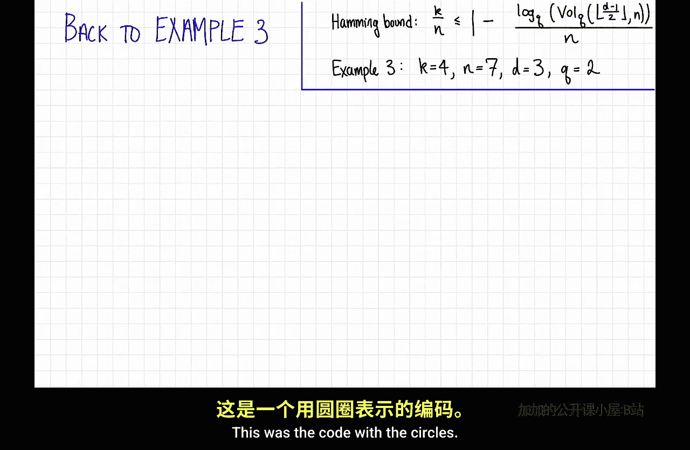

So here I've copied over the hamming bound that we got on the previous slide。

 and I've also recorded the parameters that we had from that example 3。 So if you'll remember K。

 the message length was 4 and the block length was 7。 D， The distance was equal to 3。

 and Q the alphabet size was equal to 2。 So let's see how well the humming bound does。

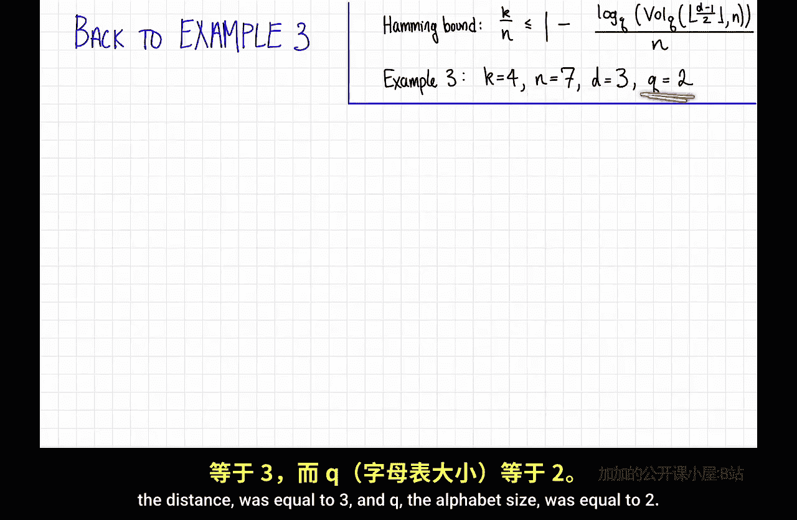

Let's start by computing this volume here。

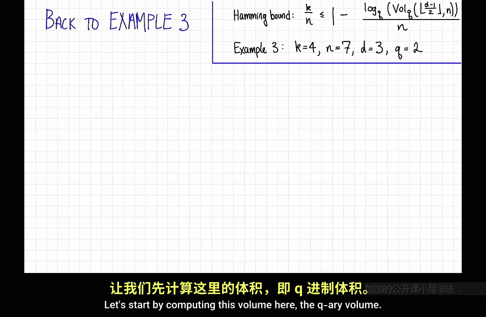

The Qie volume。

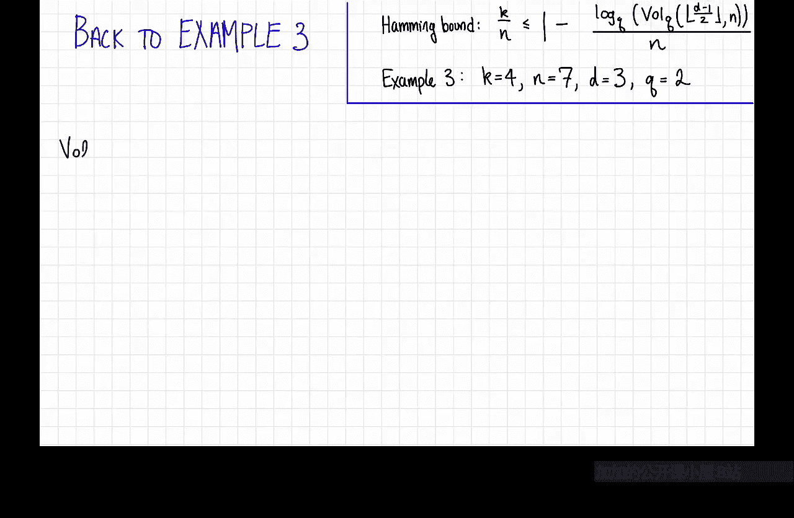

Of the hamming ball of radius D-1 over 2 in n dimensions。

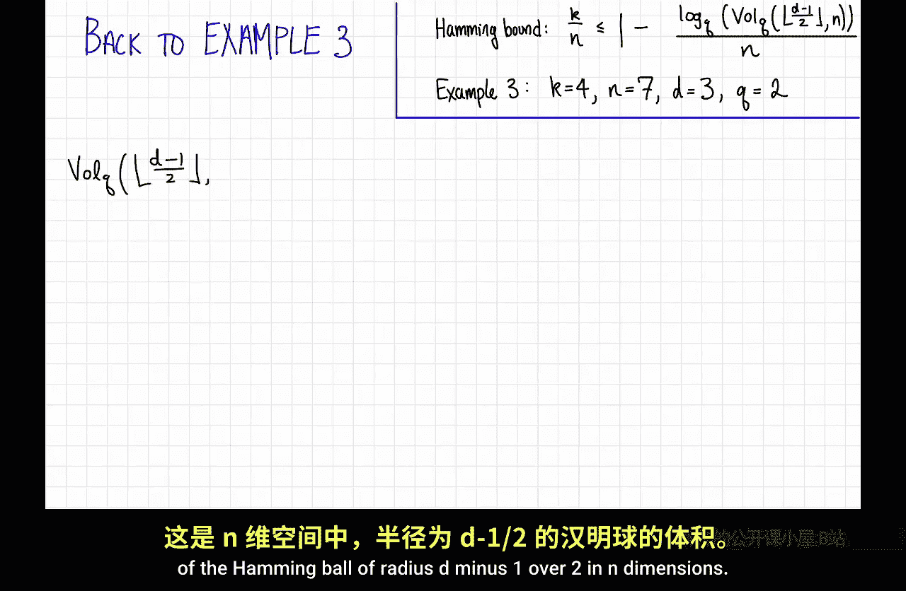

For our particular example， this is the volume over alphabetta size 2 of a heming ball of radius 1。

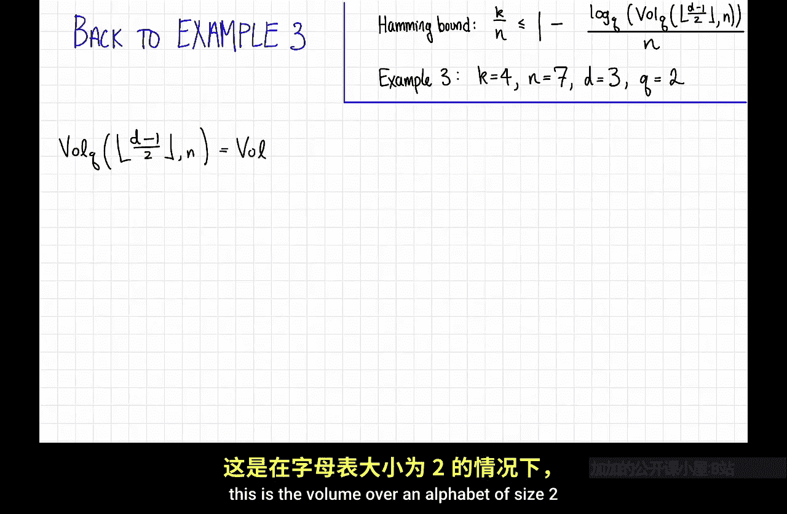

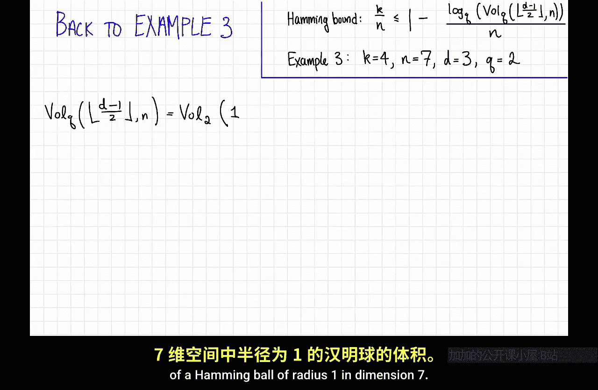

In dimension 7。And using that formula that we got on the previous slide。

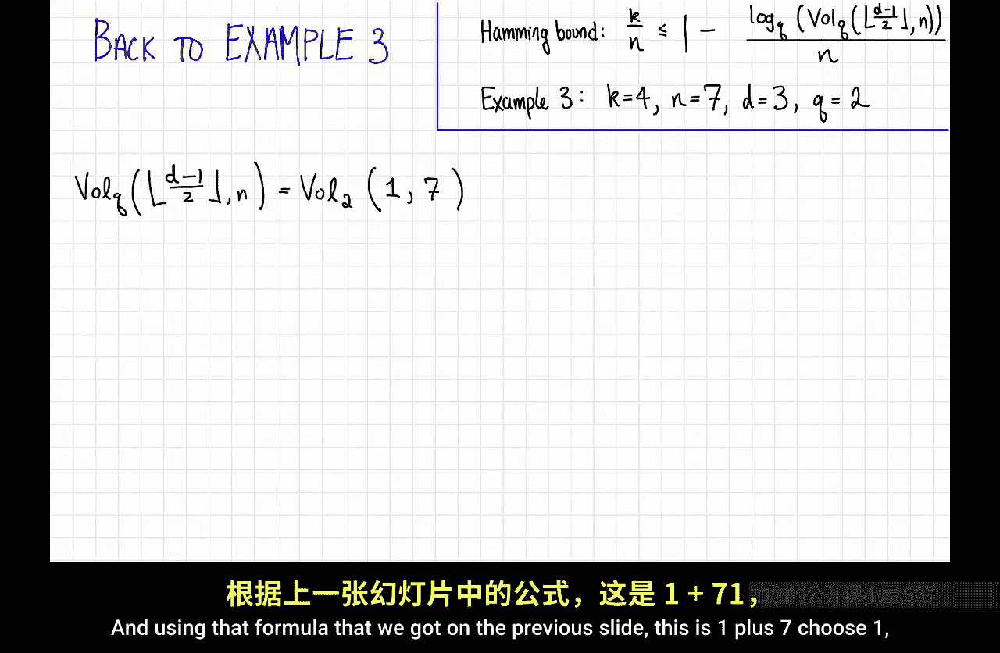

This is one。Plus，7， choose1。

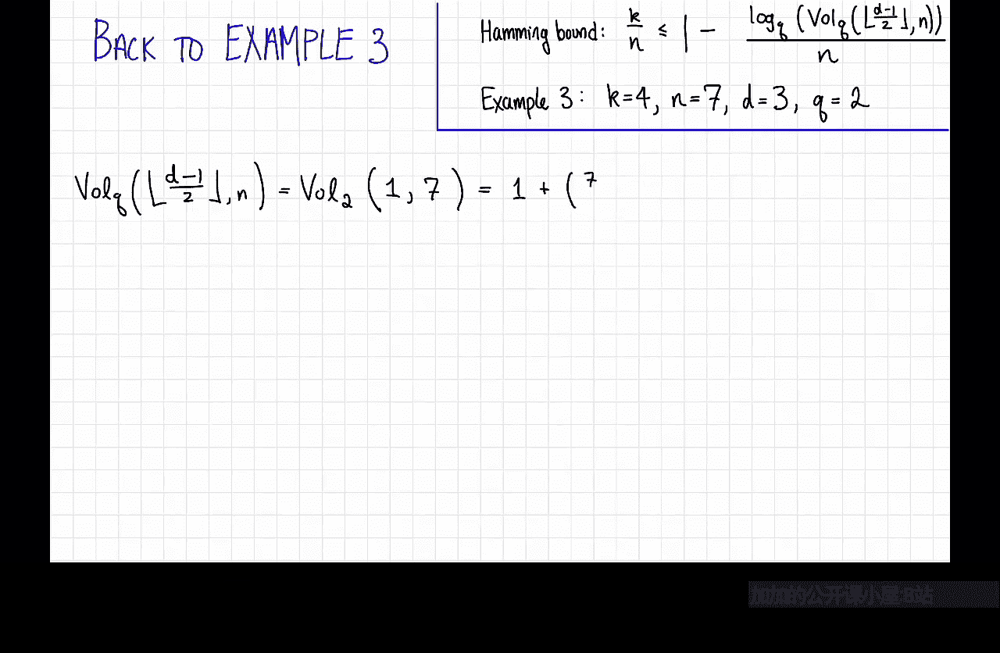

Which is 8。Thus， we can write down what the heming bound says here。 It says that K over n。

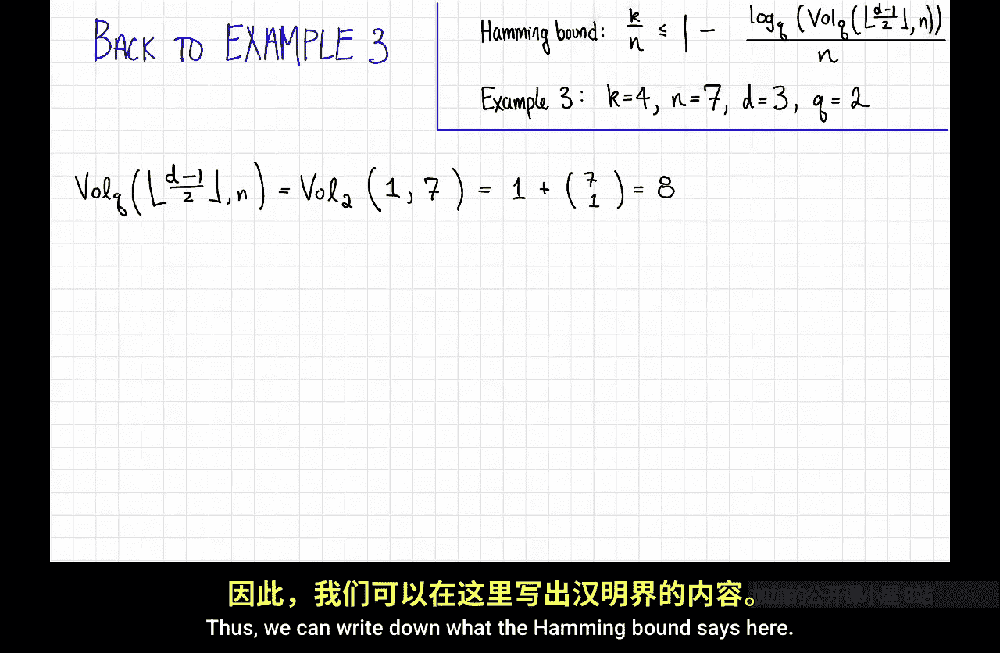

For this setting of parameters cannot be any larger。

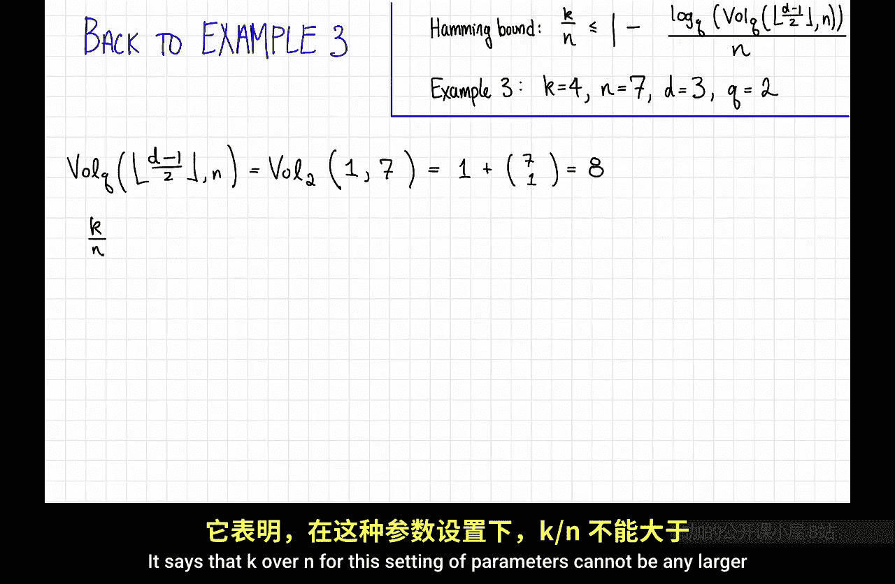

Then one minus。The log base 2 of 8。That's 3。Divided by n。 That's 7。So this is equal to4 seventh。

But notice that， for example，3。Actually， K over n is equal to 4/7。So it means that in this case。

 the hemming bound is tight。So what does it mean for the haming bound to be tight， Well。

 that means that this code， this example 3 that we saw with the circles。

 achieves the best possible trade off between rate and distance。

 at least when K equals 4 and equals 7 Q equals 2。That's pretty neat。 Okay。

 so that just about wraps it up for this video。 But I want to leave you with a question to ponder。

And the question is， can you come up with other codes so that the hem down is tight？

Such codes would be provably optimal， at least in their trade off between rate and distance。

In particular， can you generalize this example three that we saw。

 or can you come up with some completely different code with these same parameters or with different parameters？

Will address this question to some extent， in a future video。

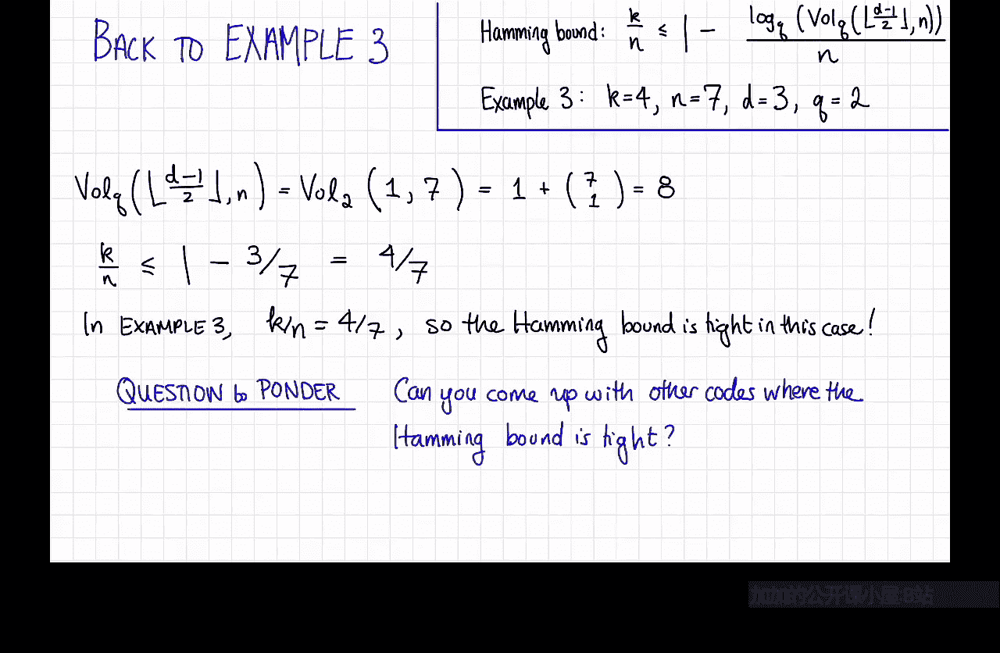