# 代数编码导论：03：汉明界


在本节课中，我们将学习编码理论中的第一个基本界限——**汉明界**。这个界限描述了编码的**码率**和**最小距离**之间必须满足的权衡关系。

上一节我们提出了“码率与距离的最佳权衡是什么”的问题。本节中，我们来看看汉明界如何为这种权衡设定一个基本的限制。

## 核心思想

假设整个空间是 **Σⁿ**（所有长度为 `n`、字母表为 `Σ` 的字符串集合）。我们有一个最小距离为 `d` 的码 `C`，其码字分布在这个空间中。

现在，考虑以每个码字为中心、半径为 `⌊(d-1)/2⌋` 的汉明球。由于码的最小距离为 `d`，这些球彼此之间是**不相交**的。

汉明界的基本逻辑是：我们有 `|C|` 个不相交的汉明球，它们都必须容纳在总空间 **Σⁿ** 中。因此，汉明球的数量（即码字数量）不能太多，否则空间将无法容纳。这意味着码率不能太高。

为了将这个直观想法转化为定量的界限，我们需要几个定义。

## 定义与公式

首先，我们正式定义**汉明球**。

对于字母表 `Σ`，在空间 **Σⁿ** 中，以点 `x` 为中心、半径为 `e` 的汉明球定义为：
```
B_{Σⁿ}(x, e) = { y ∈ Σⁿ | Δ(x, y) ≤ e }
```
其中 `Δ(x, y)` 表示 `x` 和 `y` 之间的汉明距离。

汉明球的**体积**（包含的点数）记为 `Vol_q(e, n)`，其中 `q = |Σ|` 是字母表大小。体积与中心点 `x` 无关。

对于一个大小为 `q` 的字母表，半径为 `e`、维度为 `n` 的 `q` 元汉明球体积公式为：
```
Vol_q(e, n) = Σ_{i=0}^{e} C(n, i) * (q-1)^i
```
其中 `C(n, i)` 是组合数。这个公式的每一项分别计算了与中心点汉明距离为 `0, 1, ..., e` 的向量数量。`(q-1)^i` 项是因为在 `i` 个不同的位置上，每个位置可以有 `(q-1)` 种非零取值（假设字母表包含 `0`）。

另一个有用的定义是向量的**权重**，即向量中非零元素的个数。

## 推导汉明界

现在，我们回到之前的直观图景来推导界限。

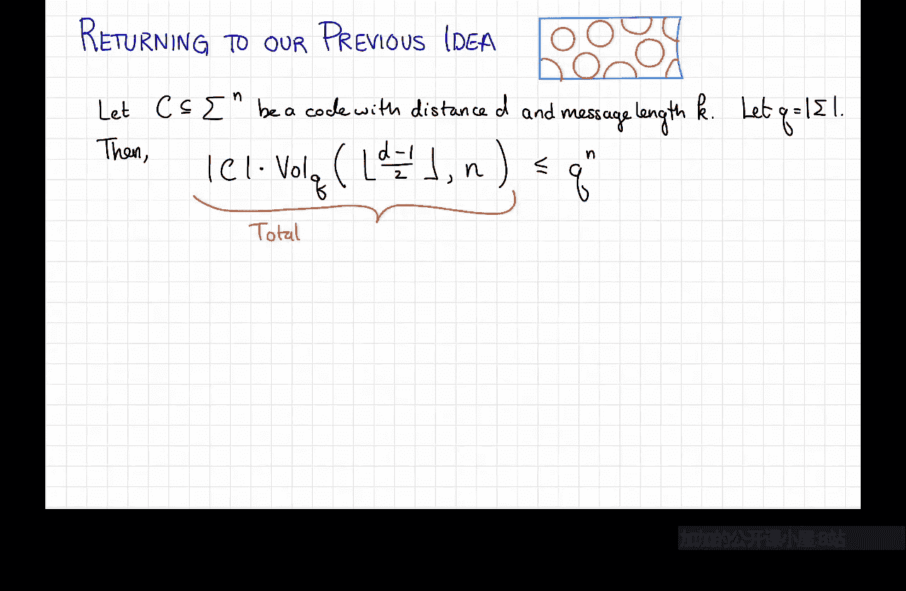

设 `C ⊆ Σⁿ` 是一个长度为 `n`、字母表大小为 `q` 的码，其最小距离为 `d`，消息长度为 `k`。

根据之前的讨论，所有不相交的汉明球（半径为 `t = ⌊(d-1)/2⌋`）的总体积不能超过整个空间的体积：
```
|C| * Vol_q(t, n) ≤ qⁿ
```
对不等式两边取以 `q` 为底的对数：
```
log_q(|C|) + log_q(Vol_q(t, n)) ≤ n
```
重新排列，并回忆码率 `R` 的定义为 `R = log_q(|C|) / n`，我们得到汉明界：
```
R ≤ 1 - [ log_q(Vol_q(⌊(d-1)/2⌋, n)) / n ]
```
这个公式给出了在给定最小距离 `d` 和长度 `n` 下，码率 `R` 所能达到的上限。

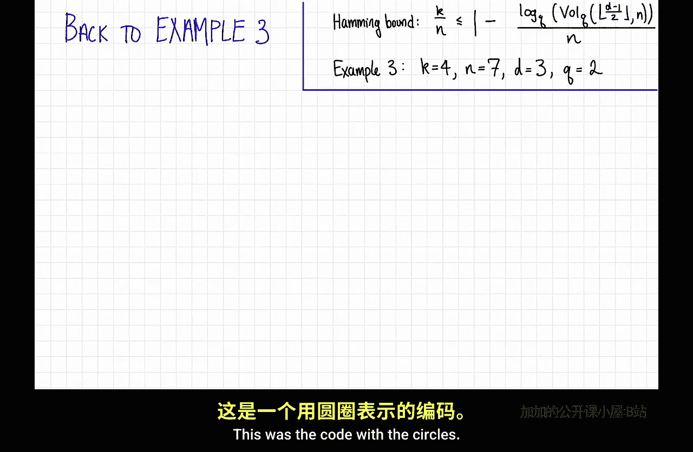

## 实例分析：汉明码

为了观察汉明界的作用，我们回顾上一讲的**例3**（即汉明码）。

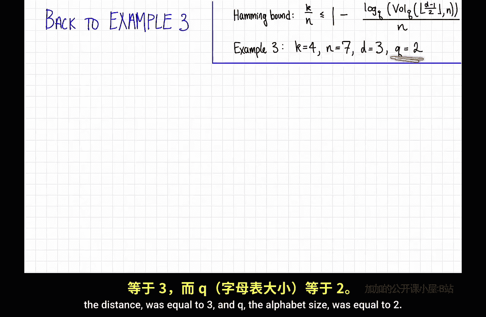

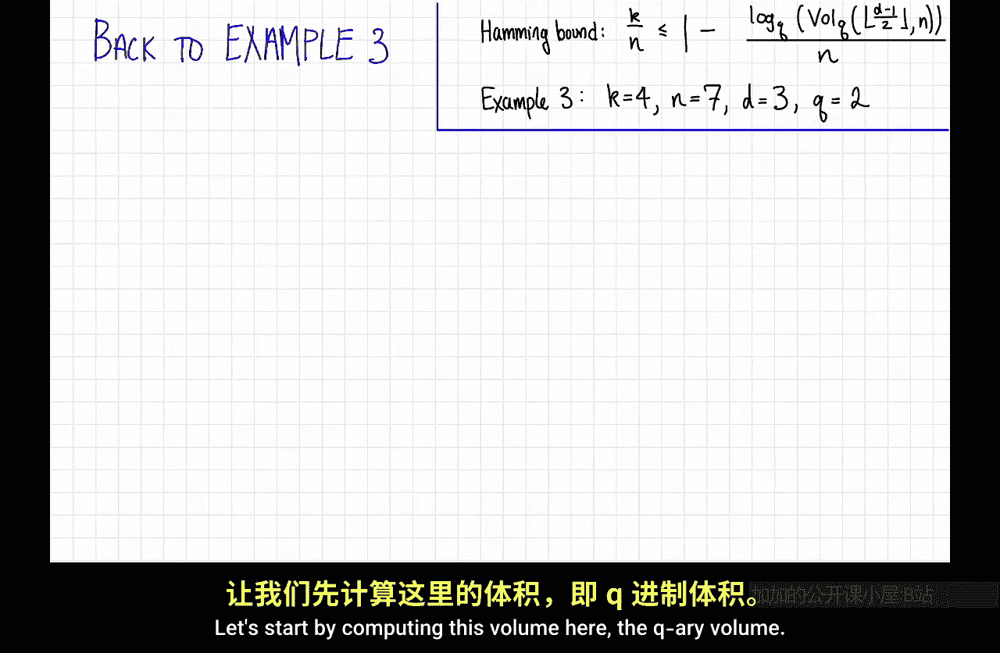

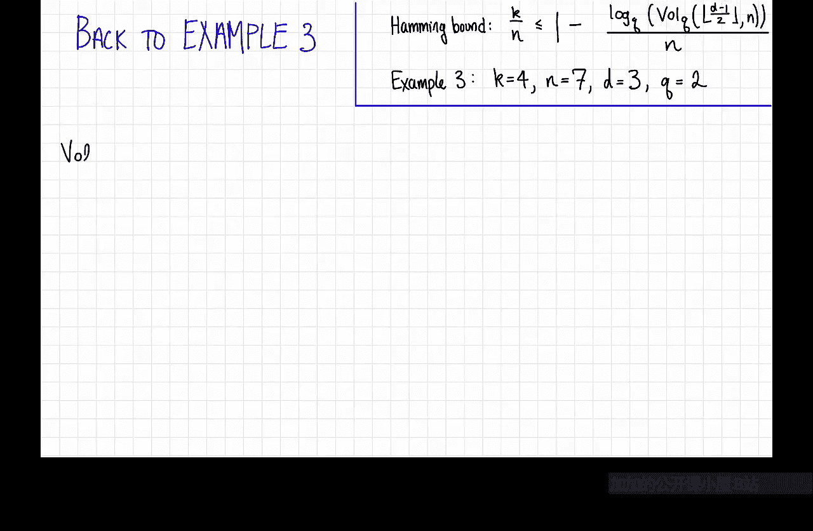

以下是该码的参数：
*   消息长度 `k = 4`
*   分组长度 `n = 7`
*   最小距离 `d = 3`
*   字母表大小 `q = 2`

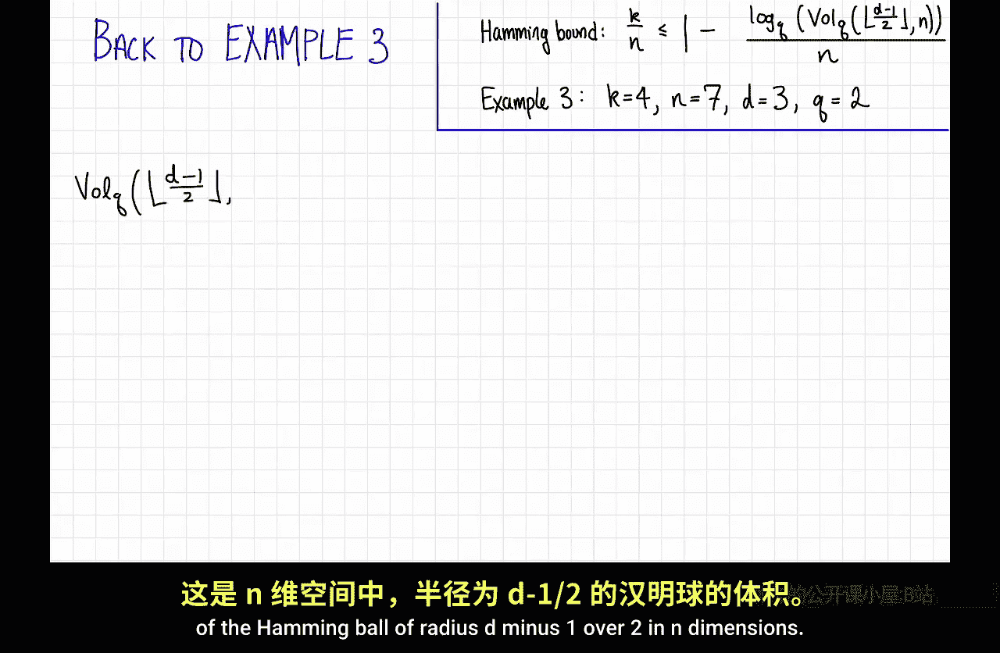

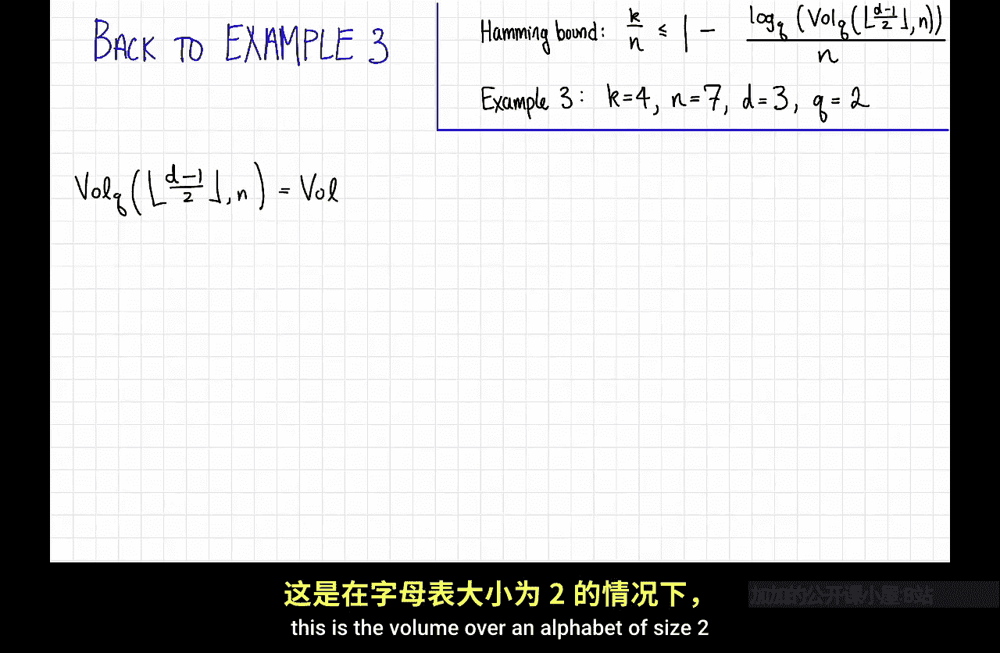

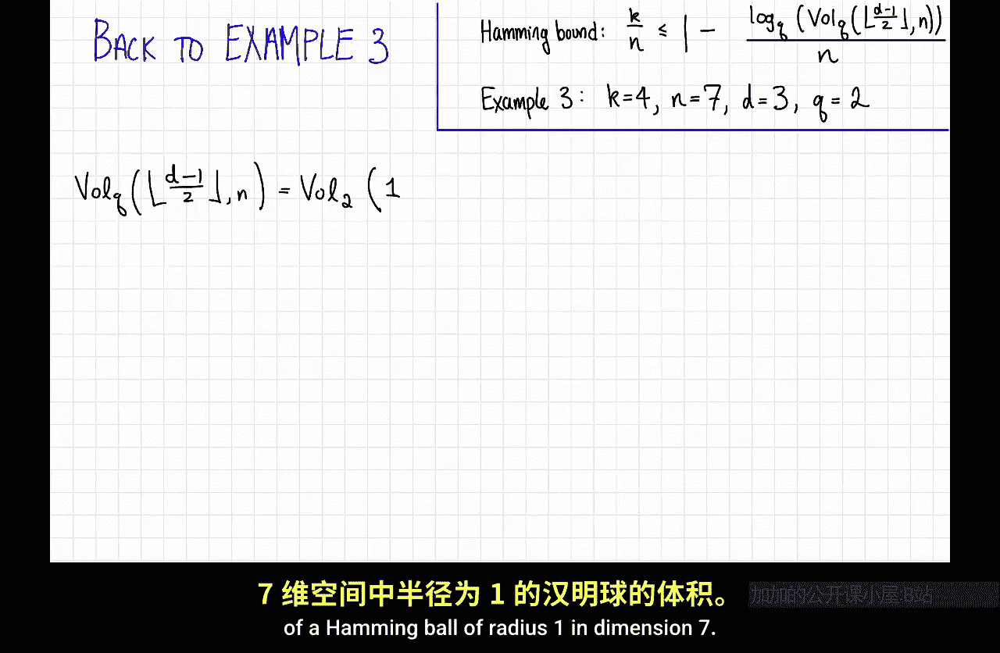

让我们计算汉明界给出的限制。

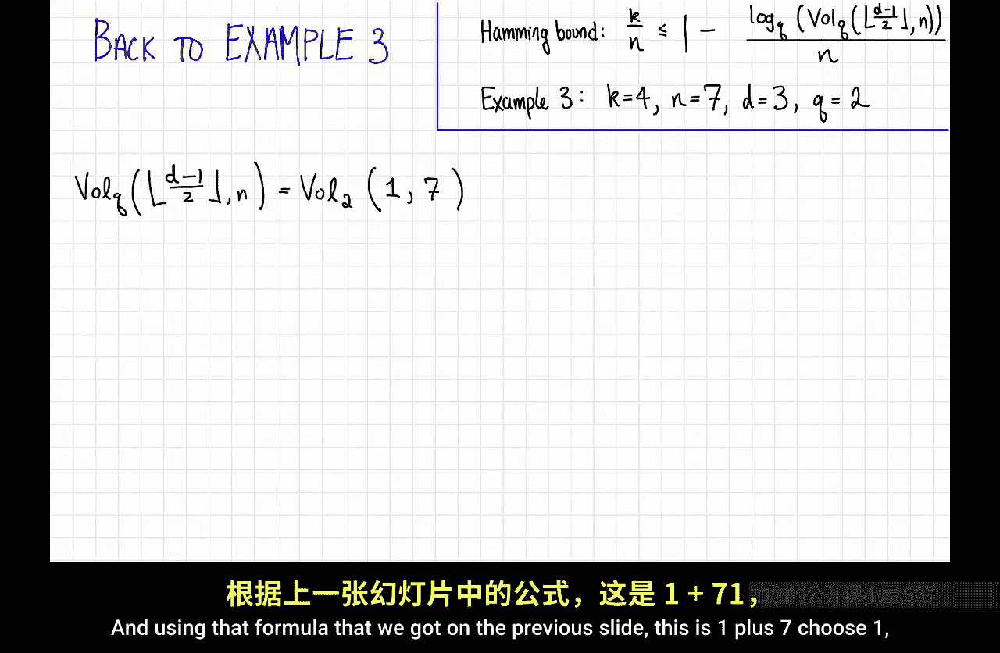

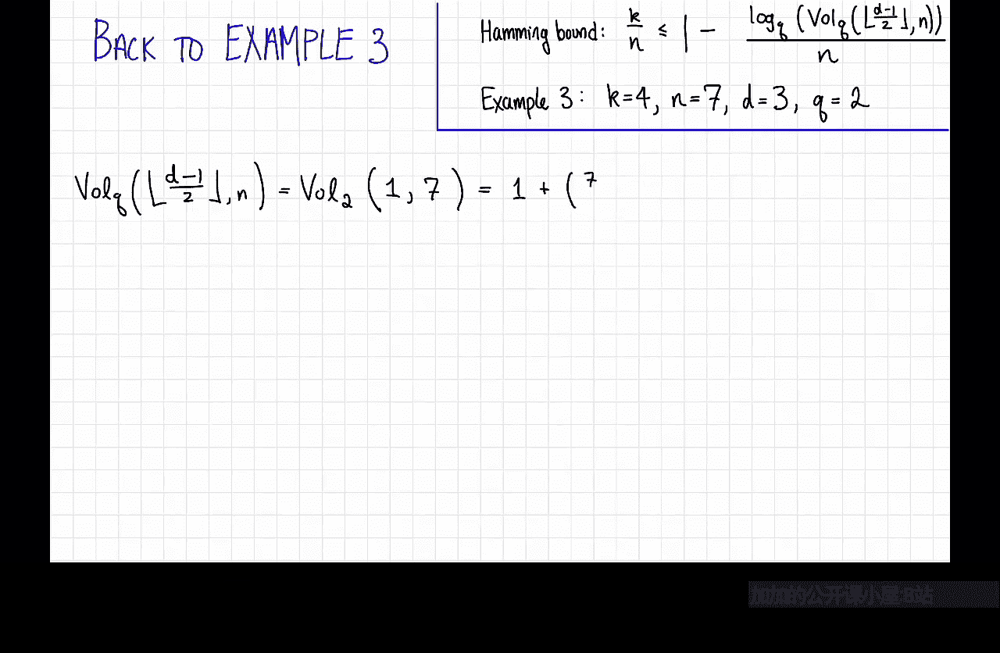

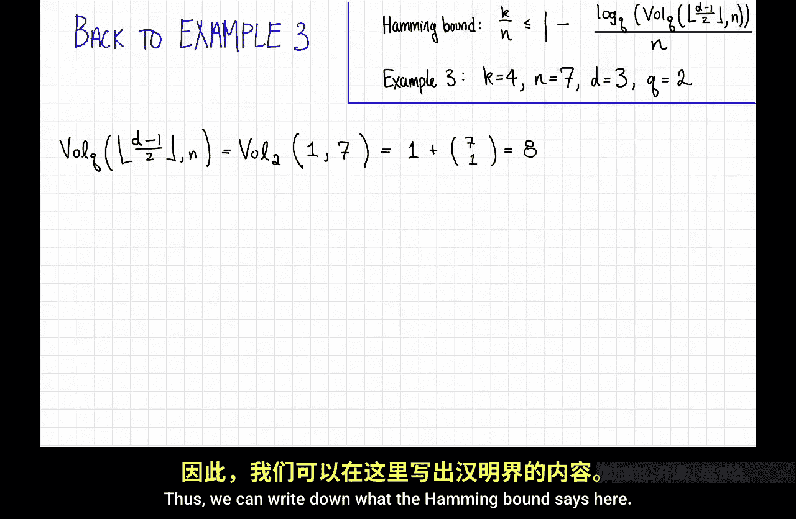

首先，计算半径为 `t = ⌊(3-1)/2⌋ = 1` 的汉明球体积：
```
Vol_2(1, 7) = C(7,0) * (1)^0 + C(7,1) * (1)^1 = 1 + 7 = 8
```
然后，代入汉明界公式：
```
R ≤ 1 - (log_2(8) / 7) = 1 - (3 / 7) = 4/7
```
对于这个汉明码，其实际码率 `R = k/n = 4/7`，**恰好达到了汉明界给出的上限**。

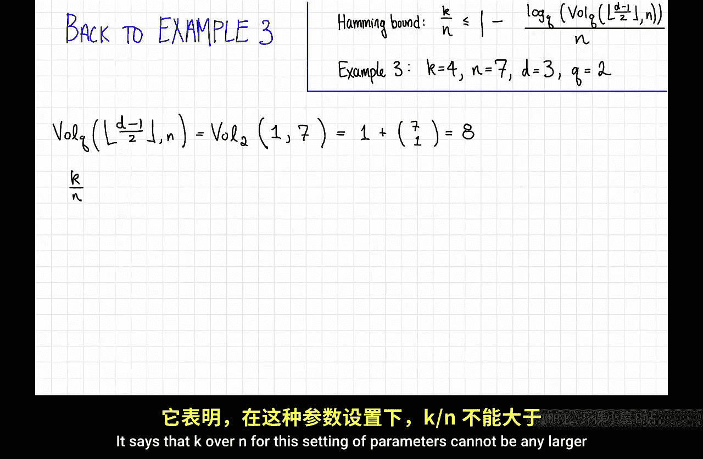

这意味着，对于参数 `(n=7, k=4, d=3, q=2)`，汉明码在码率与距离的权衡上达到了理论最优。这样的码被称为**完美码**。

## 总结与思考

本节课中，我们一起学习了**汉明界**。我们通过“不相交的汉明球必须容纳在总空间中”这一直观概念，推导出了码率 `R` 与最小距离 `d` 之间必须满足的不等式关系。汉明界为编码的性能设定了一个基本限制。

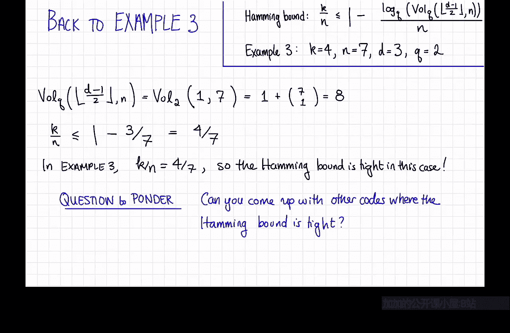

通过分析汉明码的例子，我们发现它达到了汉明界，因而是最优的。这引出了一个有趣的问题：**能否构造出其他达到汉明界的“完美码”？** 这样的码在给定的参数下具有理论最优的纠错能力。我们将在后续课程中部分探讨这个问题。