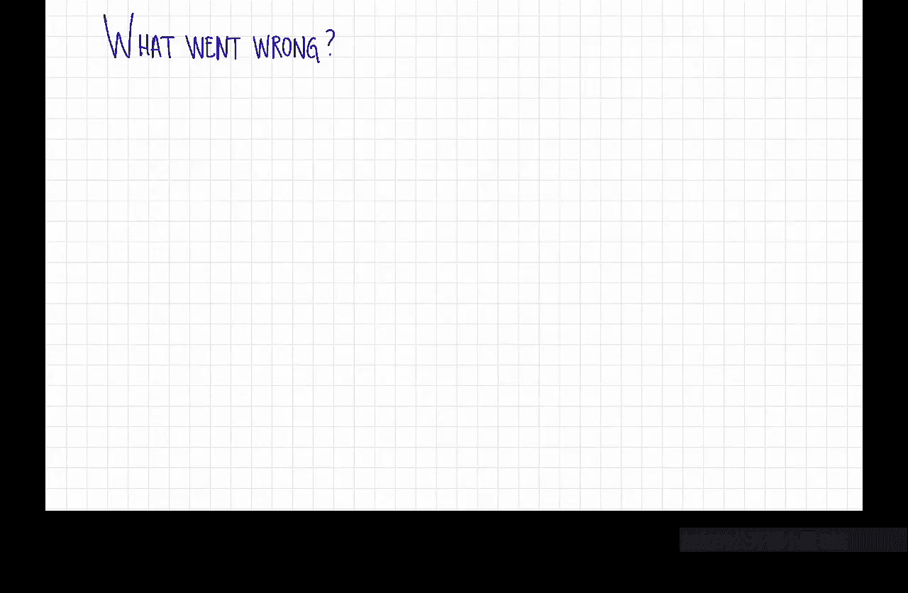
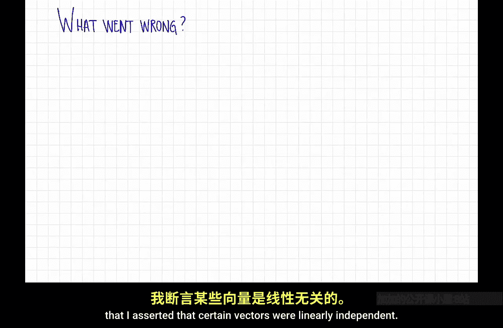
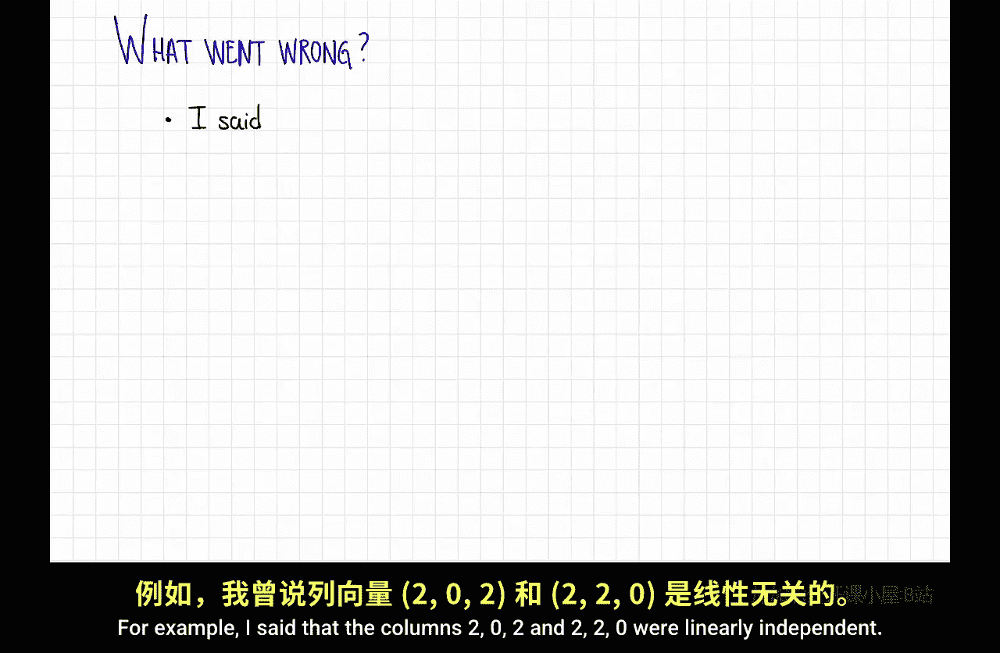
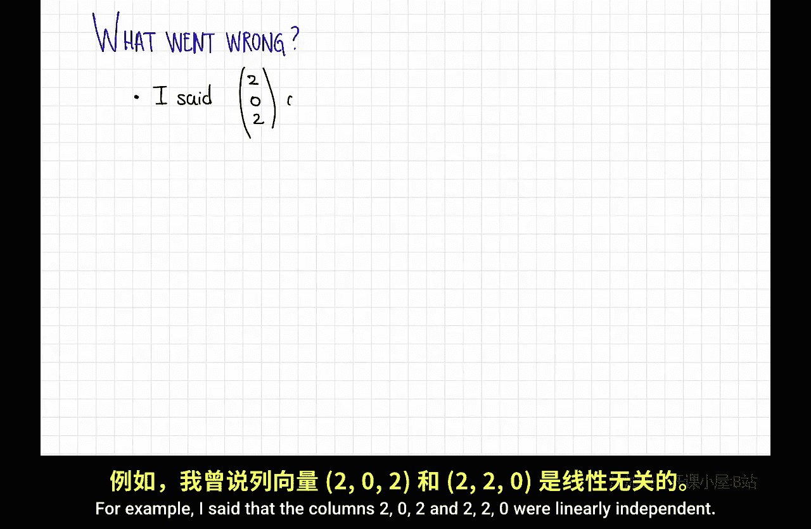
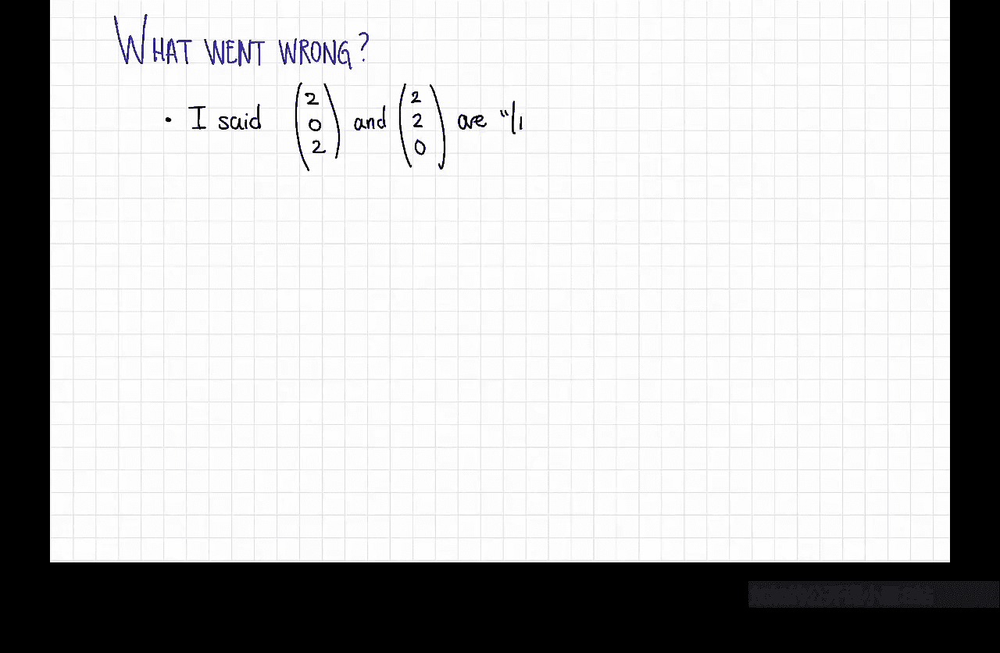
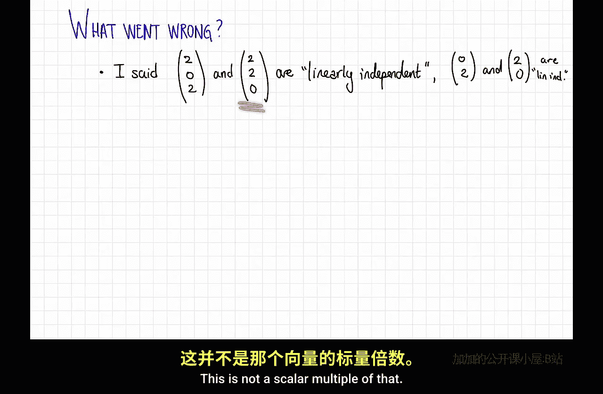
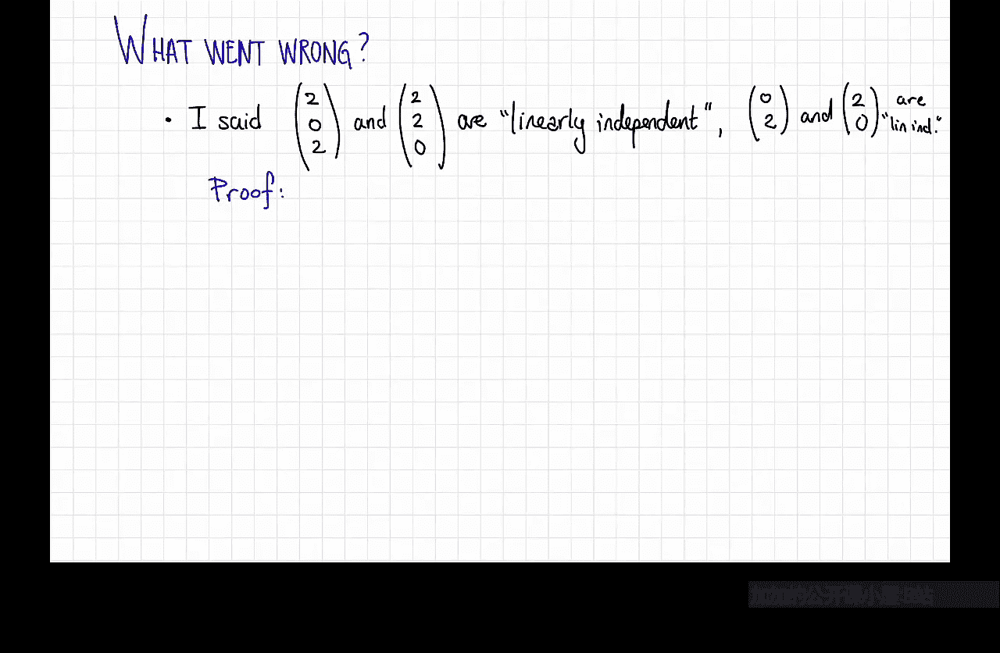
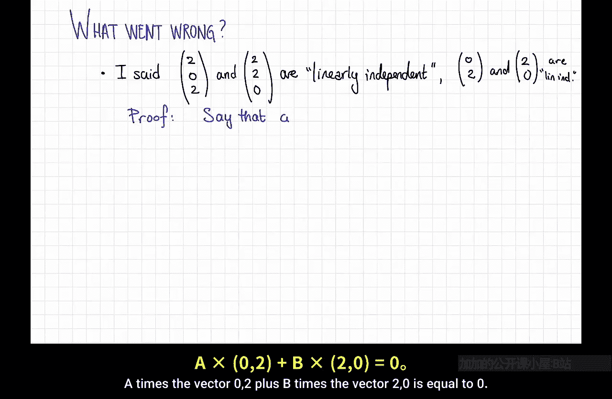
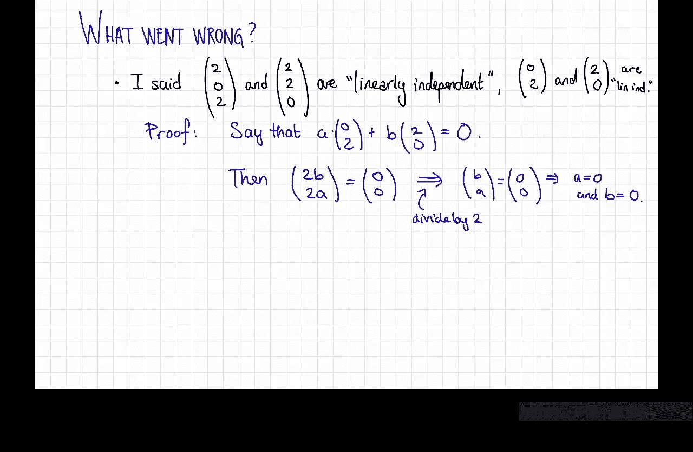

# 斯坦福大学【中英⚡代数编码导论｜Introduction to Algebraic Coding Theory】 p05 p4 2, Video 2： A Cautionary Tale -BV16sRYYTEwg_p5-

In the previous video， we saw that convenient stuff happens if linearar algebra quote unquote works mod2。

In this video， we'll see a quick example about why we shouldn't necessarily take that for granted。

 In particular， things seem to be a bit more complicated Maud 4。So here's an example。

 suppose that sigma are alphabet。Is 0，1，2，3， and we're working mod 4。Let's consider the matrix G。

 This is going to be our generator matrix， which is equal to 2，0，0，2，2，2。And let's let H。

BG transposed， so H is 2，0，2，0，2，2。Now， consider the code， C。With generator matrix G。

That is C is the set of G times x mod 4。For all x in 0，1，2，3。Squared。Now， see。

Is a code with message length K equals 2。Block length n equals 3。Over the alphabet sigma。

Let's try to do the same sort of thing we did in the previous video with the hamming code with this coat。

So notice that for this H。We have H。Times G。Is equal to 8，4，4，8。Which is equal to 0，0，0，0， modd 4。

That means that H is a legit parity check matrix for C。That is， for all code words C in my code C。

H time C。Is equal to H times G times x。For some appropriate message X。Which is equal to 0 modd 4。

This implies， as before。That C is contained in the kernel of H。Okay。

 so now we have a code C over an alphabet of sized4。

With this generator matrix and this parity check matrix。But something's a little bit funny。First。

The dimension。Of the kernel of H。If we were to follow the logic that we had in the previous video should be 3 minus2。

 which is equal to1。That's because if we look at this matrix H。

 it sure looks like these two rows are linearly independent。 So H should have rank 2。

 and 3 -2 is equal to 1。On the other hand。The dimension of C。Should be equal to2。

That's because C is the column span of this matrix G。

And these two columns also sure look like they are linearly independent。 So should have rank 2。

But then that doesn't quite add up because we have a dimension 2 space contained in a dimension 1 space。

So something is a little weird there。But okay， let's， let's ignore it。 let's just press on。

 Let's continue with the same computation that we tried to do before。

 Let's try to figure out the distance of this code by looking at its parity check matrix。

If we do that， we'll see that something continues to be funny。

If we repeat the logic that we had in the previous video。

 that same logic holds here to show that the distance of this code is at least three。

And that follows if we were to apply the previous logic。

 since no two columns of H are linearly dependent。At least maybe it looks like they're not。

But consider the code word G。Times the vector 1，1。This is equal to the vector 2，2，4。

 which mod 4 is equal to the vector 2，2，0。Which has weight， too。

So that implies that the distance of this code C。If we were to follow the logic from the previous example is less than or equal to2。

So now we conclude that。3 is less than equal to2， also somewhat concerning。Okay。

 so what's going on here？

So perhaps you saw this as I was walking through the argument。

 I said a number of false things or things that didn't really make sense。

 The main thing I said that didn't make sense was that I asserted that certain vectors were linearly independent。

For example， I said that the columns。

2，0，2。

And 2，2，0 were linear nearlyly independent。

And I asserted that the columns。For example， zero2。And 2，0 are linearly independent。

So if we forget for a second that we're working modd 4， this seems pretty reasonable。

 This is not a scalar multiple of that。 This one's not a scalar multiple of that。

But if we actually dig out the formal definition of linearly independent。We'll see what goes wrong。

For example， if I wanted to formally show that these are linearly independent， what would I do。

So here's a proof that's doomed to failure。Suppose that there is some non trivialvi linear combination of these that's equal to 0。

To say that。For example， a times the vector 02 plus B times the vector 20。

Is equal to zero？Then we conclude that to B to A， that vector is equal to the vector 0，0。Which。

 if we divide both sides by 2。Implies that the vector B A equals the vector 0，0。

Which implies that a equals 0 and B equals 0。Hence。

 this was not actually a non trivial linear combination。Therefore。

 these vectors are linearly independent。

So this proof is just fine over the real numbers， for example， but it's wrong， modd 4。

The reason is that dividing by 2 modd 4 doesn't really make sense。And indeed。

 it is the case that we can have a non trivial linear combination of these things that's equal to 0。

For example。Two times the vector 0，2 plus 2 times the vector 2，0。Is equal to the vector 44。

 which is equal to the vector 0，0 mod 4。So what went wrong before is that I was asserting these guys were linearly independent from each other just because they weren't scalr multiples of each other。

 but that doesn't actually work modd4。So all of this is just to say that we should be a little bit cautious。

When we start doing this linear algebra stuff mod 2。In the next video。

 we'll explore exactly what needs to be true for that to be legit。

