# 斯坦福大学【中英⚡代数编码导论｜Introduction to Algebraic Coding Theory】 p06 p5 2, Video 3： Finite Fields -BV16sRYYTEwg_p6-

In the last video， we saw that we should be careful about doing linear algebra over finite sets。

 For example， the integers mod 4。In this video， we'll see that it works fine as long as we are working over something called a finite field。

If you are already familiar with finite Field， you can safely skip this video。

Let's start with an informal definition of a finite field or actually an informal definition of a field first。

 so informally。A field。Is a set of elements。That you can add。Subtract， divide and multiply。

Like you want to。Okay， that's a pretty informal definition。 We'll get to a formal one in a moment。

But if that's the informal definition of a field， then the informal definition of a finite field。

Is just a finite set of elements。That you can add， subtract， divide and multiply like you want to。

Let us make that definition a little bit more formal。Definition。A field， F。

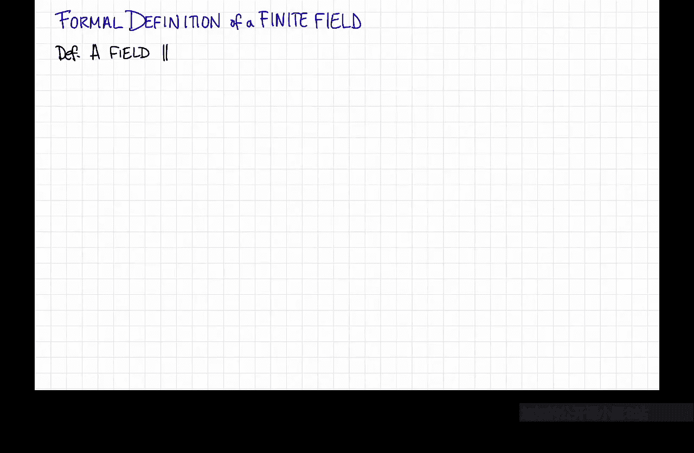

And I'm almost always going to use this blackboard bold F to denote a field。It's a set of elements。

Along with operations。Plus， and times。That I'm going to call addition and multiplication so that the following things hold。

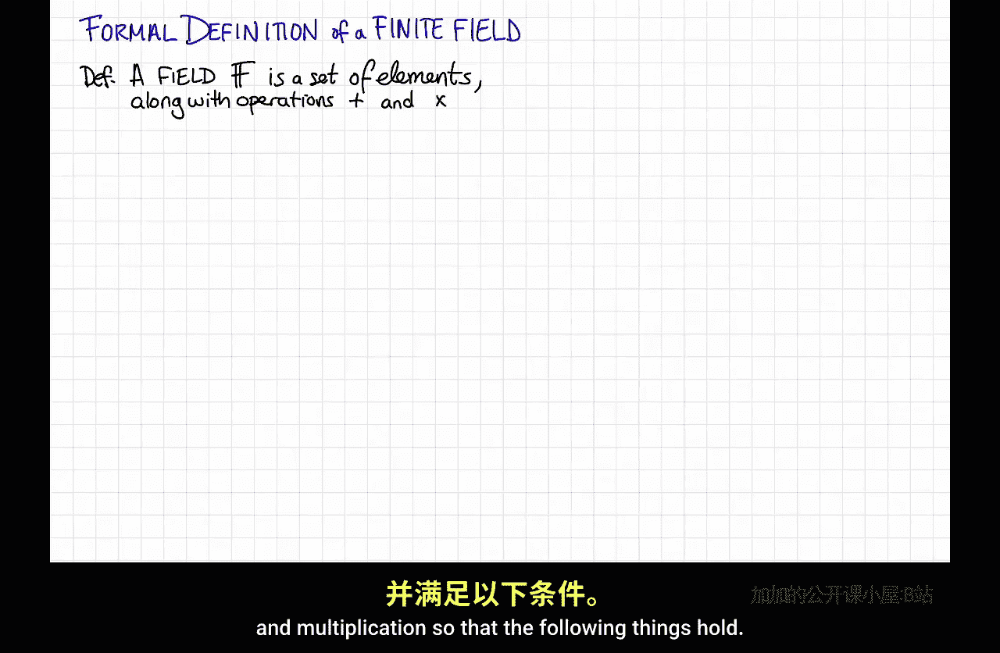

So I'm going to write all of these things down and then we'll talk about them。

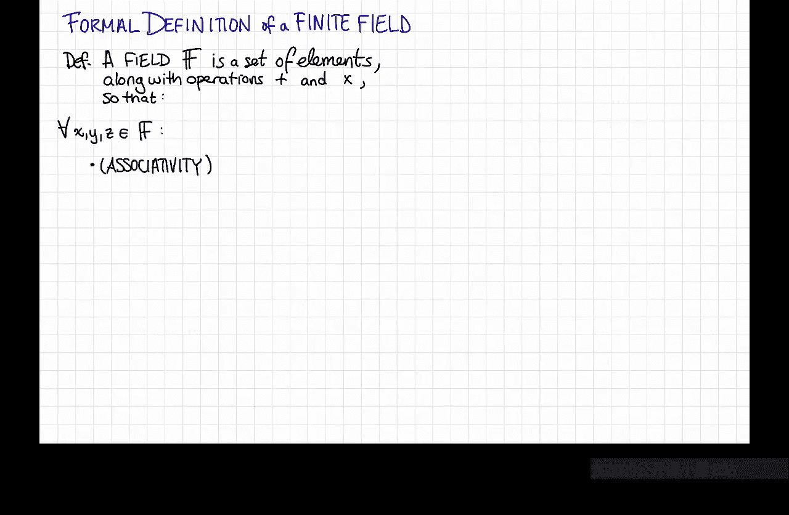

Okay， here are the things we want to hold。The first is associivity。

This says that both addition and multiplication are associative， just like your use to them being。

The second is commutivity。This says that both addition and multiplication are commutative。

 just like you're used to them being。 that is x plus y is the same as y plus x。

 X times y is the same as y times x。The third is the distributive law。

 which says that the distributive law works。 So x times y plus c is equal to x times y plus x times z。

The next one is the existence of identities。So there should be an additive identity that we're going to call 0 and a multiplicative identity that we're going to call  one。

So that for any x， x plus 0 is equal to itself。And x times 1 is equal to itself。Finally。

 we're going to ask for inverses。That is for all x in F。

There is some y in F so that x plus y is equal to 0。

So this y here is called the additive inverse of x。And will denote it by minus x。

We also want multiplicative inverses。 That is for all x and F that are not 0。

There should be some multiplicative inverse y in F so that x times y is equal to 1。So here。

 y we'll call this the multiplicative inverse， and we'll sometimes write this as1 over x。

Or as x inverse。This might seem pretty abstract。 So let's step through an example。

Gonna make kind of a table here。So here is an example of a field。An example。Is the numbers 0，1，2，3，4。

With the relationships plus。Is just plus modd 5。And times is just times 15。

So just all arithmetic mod 5。Now， it stepped through。Each one of these axioms。The first one。

 associivity， this holds since plus and times are both associative to begin with。

 And they're still associative modd 5。 So let's put a check there。Similarly。

 commutivity holds and the distributive law holds。If you want to be careful。

 you can go and check that these hold for addition and multiplication mod 5。

 that would probably build some character。The next thing is， we need identities。In this case。

 we have them。 the additive identity is just 0， and the multiplicative identity is just one。

And since x times 1 is equal to x for any x， that's still true mod 5。

 and x plus 0 is equal to x for any x。 That's still true mod 5。 So that holds。

The tricky bit is inverses。To verify that everything has a multiplicative inverse and an additive inverse。

 we can just kind of go through all of the elements。So observe that one plus4。Is equal to 0， mod 5。

So that means that one in four are additive inverses of each other。

And 2 plus 3 is also equal to 0 mod 5。 So 2 and 3 are additive inverses of each other。

 and 0 is its own additive inverse。Okay， so every element has an additive inverse with've accounted for 1。

2，3，4，0。Have about multiplicative inverses。Well， we can observe that one times1。Is equal to one。

 So one is its own multiplicative inverse。Two times 3 is also equal to 1 mod5。

 So 2 and3 are multiplicative inverses of each other。And 4 times 4 is also equal to 1 mod 5。

 So 4 is its own multiplicative inverse。Okay， so everything has a multiplicative inverse as well。

 Great。 So now we can put a check here。 We have inverses。Since all of these deserrata are satisfied。

 this here is a legitimate finite field。Okay， so that's an example。 Let's see a non example。

So I'm going to erase this， and then we'll try a different example。

So here's a non example that we've already encountered。Our non example is 0，1，2，3。Moud 4。

So that is exactly the same as before， except replace the5 with a4。

 So my plus and times are going to be plus in times mod 4。Okay， let's check all of our axioms。

 We still have associivity， commutivity and the distributive law。 We still have identities，0 and 1。

But we no longer have inverses。We still have additive inverses。

 but we don't have multiplicative inverses for every element。In particular。What is the inverse of 2。

We can check that two has no inverse just by multiplying it by all of the things。

2 times 0 is equal to 0 modd 4。2 times 1 is equal to2 modd 4。Two times 2 is equal to zero mod 4。

 and two times 3 is equal to2 mod 4。In particular， there is nothing so that two times that thing is equal to 1 mod 4。

 So2 does not have a multiplicative inverse。 So this is not a field。Okay， so now hopefully。

 we understand the definition of a field。And just as before， a finite field。

Is just a finite set of elements that satisfy these things。Just as a quick note about notation。

I'm almost always going to denote plus， as plus。And I'm going to denote times either as an X or a little dot or just writing two things next to each other the same way that we do over the reels of the integers。

Now that we know what finite fields are。And we've seen an example in an non example。

 We might ask more generally what is a finite field and when do finite fields exist。

 It turns out that there is a very clean answer to this question。

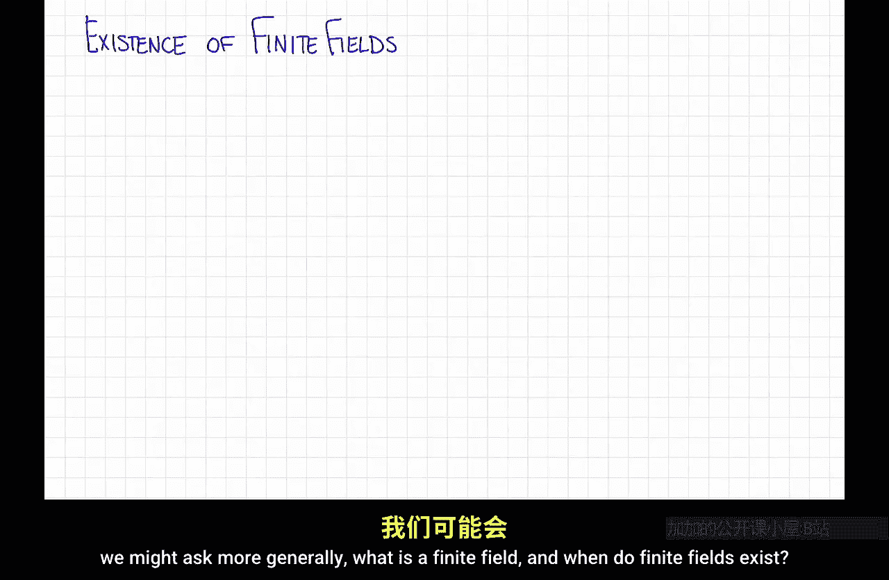

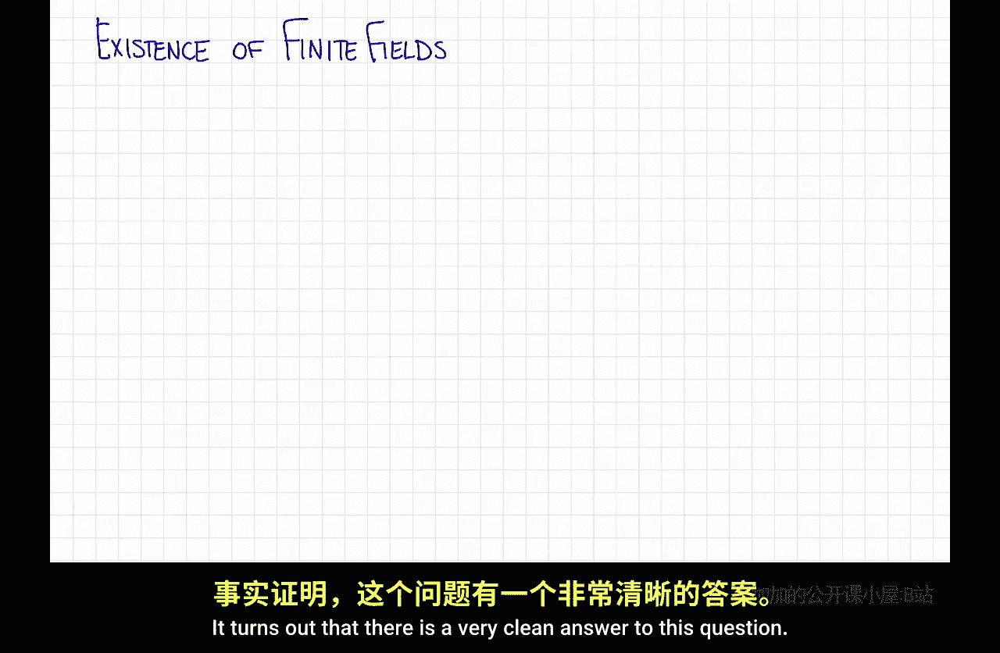

So， here's a theorem。For every prime power。

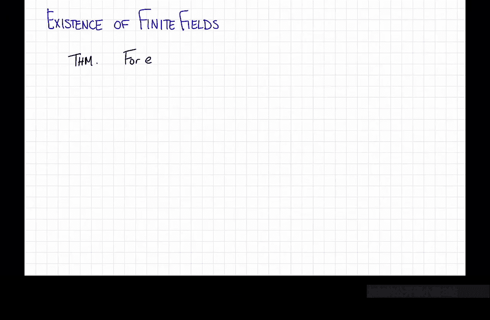

P to the T。 So here P is prime。

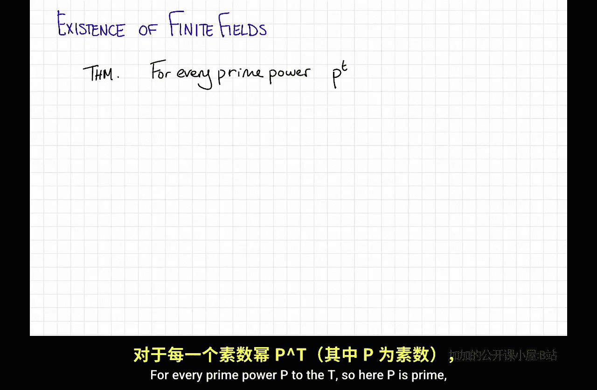

There is a unique， finite field。With P to the T elements。In this course。We will call this field。

F sub P to the T。You might also see it denoted。As G， F P of the T， G F stands for Galo Field。Further。

 there are no other finite fields。You might be wondering what unique means here。

 I put a little asterisk on it。 Unique basically means that it's unique up to appropriate symmetries and relabeling of the elements and stuff like that。

With some jargon， it means unique up to isomorphism。

But it means that there's essentially only one field structure for every prime power。

And for any number that is not a prime power， there are no finite fields with that many elements。

We're going to skip the proof of this theorem。 The proof is a bit beyond the scope of this course。

 but you can check out an abstract algebra text if you're interested。 One useful fact。

Which we've already seen for the example of the integers mod 5。Is that for a prime P。

The finite field of size P。Is equal to the numbers 0 up to p-1。

With addition and multiplication mod P。In particular， the numbers 0，1，2，3，4， mod 5， form a field。

The number is 0，1 mod 2 form a field。 That's convenient because we already saw that as an example。

The number is0，1，2，3，4，5，6，7，8，9，1011 12， mod 13， form a field and so on。

A warning is that for T not equal to one。The finite field of size P to the T。Is not equal。2。

The numbers mod P to the T。We already saw an example of this with the numbers 0，1，2，3， modd 4。

4 is a prime power。 It's two squared。 So there is some field of size 4， but that's not it。

Fun exercise。 Try to come up with the multiplication and addition table for the finite field of size4。

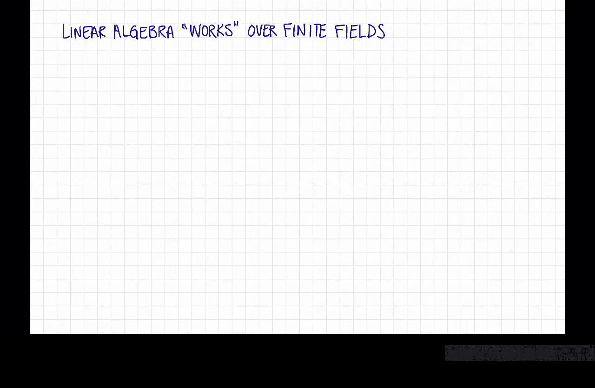

In the context of the previous few videos， one reason why we care about finite fields for this course is that linear algebra quote unquote works over finite fields。

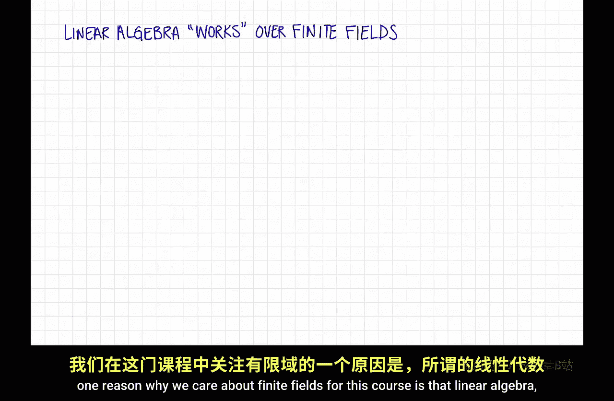

By that， I mean， that all or at least most of the definitions that you know and love from linear algebra over the reels or the complex numbers make sense over a finite field。

Here are a few examples。So let F be a finite field。Then we can define the vector space F to the n。

As just the set of all vectors， X1。Up to X N。Such that X， I lives in F for all I。

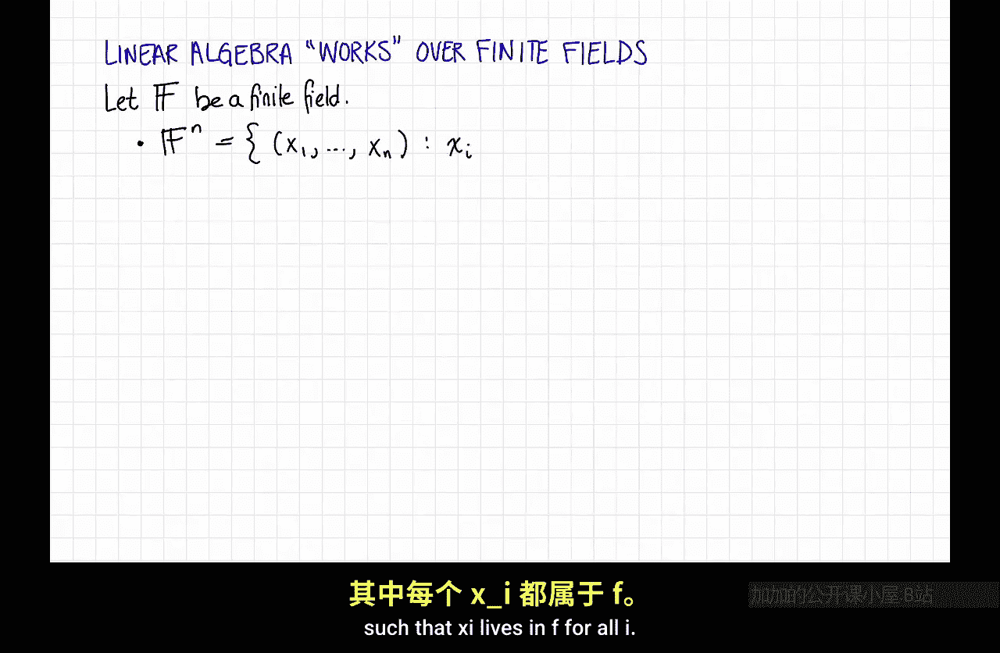

It makes sense to talk about subspaces of F to the N。

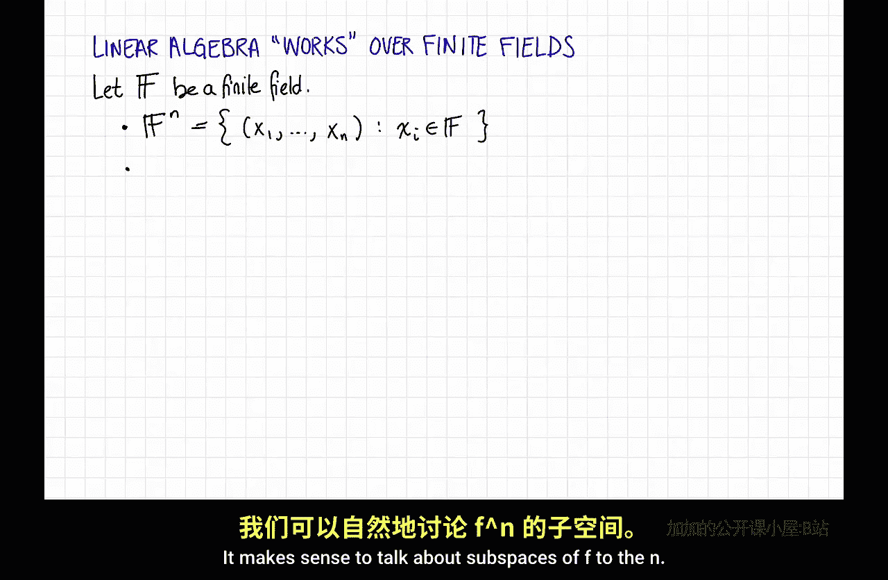

We say that a subspace。V。And if the end， it's just a set that's closed under addition in scalar multiplication。

That is for all V and W in V。And for all scalarrs， Lambda in the field F。

V plus lambda W should also be in my subspace V。We can define linearly independent vectors。

 So if we have vectors V1 dot tat dot up to V T。In F to the end。

We say that these vectors are linearly independent。아。If for all scrs， lambda 1。

 dot ta dot up to lambda T in F。So that they are not all zero。

The sum over I of lambmbda I times V I is not equal to 0。That is。

 these vectors are linearly independent if they have no non trivial linear combinations that are equal to 0。

We can define a basis for a subspace。So we say a basis。For a subspace， V subset of F to the N。

Is a set of vectors V1。Up to V。 T。In we。So that the following things hold。First。

 these vectors should be linearly independent。As per the previous definition。

And the span of these vectors。Should be equal to V。I realized that I've forgotten to define span。

 So let's do that now。For vectors V1 dot a dot up to V T。En F to the end。Bepan。V1 up to VT。

Is equal to the set。Of all linear combinations of those vectors。

With coefficients that come from the field F。And finally， the dimension of a subspace V。

Is just the number of elements in any basis of V。It's not entirely obvious that dimension is well defined here。

 Why is it that all the bases have to have the same number of elements。

 But it turns out that it is well defined， and it's a good exercise to try to prove this for your self using the definition of a field。

So in the sense that all of these definitions are probably pretty familiar to you and make plenty of sense over finite fields。

 linear algebra still quote unquote， works over finite fields。

You can check that other linear algebraic definitions and algorithms that you might know。

 for example， Gaussian elimination or something like that also work just fine over finite fields。

There are some things that are a little funny， however。For example。

 most of your geometric intuition from linear algebra over the reels。 For example。

 about angles and stuff like that， is not going to hold here。Just as a side note。

 it is possible to do some linear algebra over things that are not fields。

 but it's not as simple or as nice。 If you want to learn more about this。

 you can look up the word modules in an abstract algebra textbook。But for this course。

 we're going to stick with finite fields。