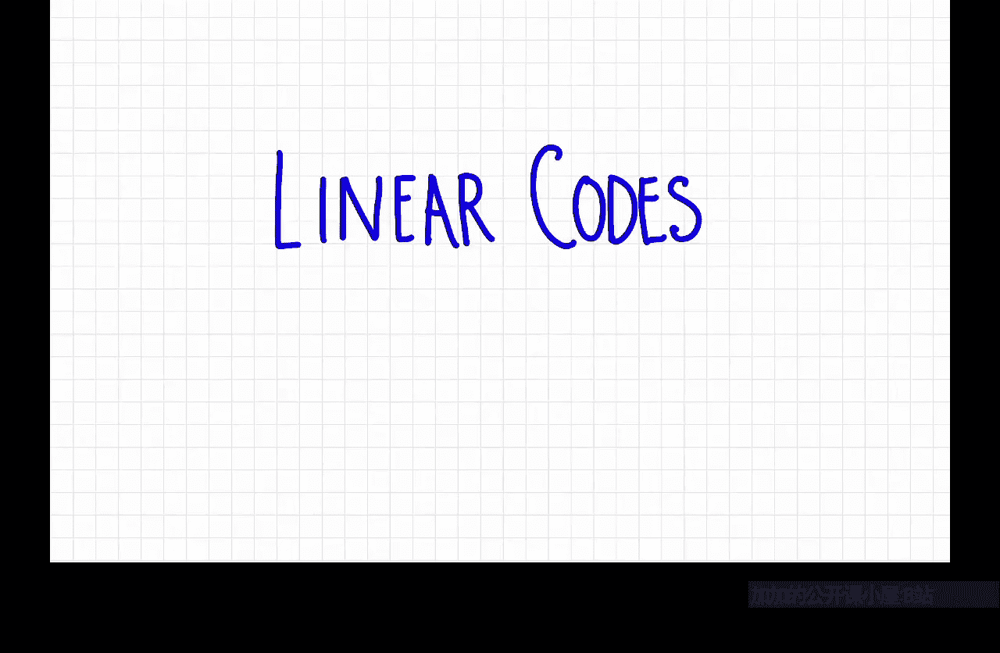
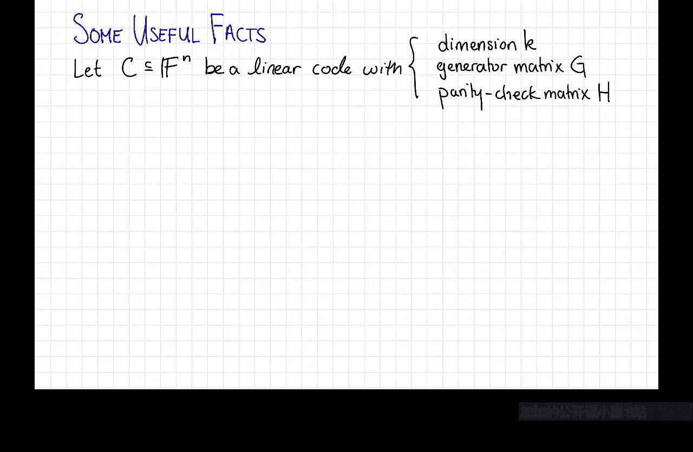
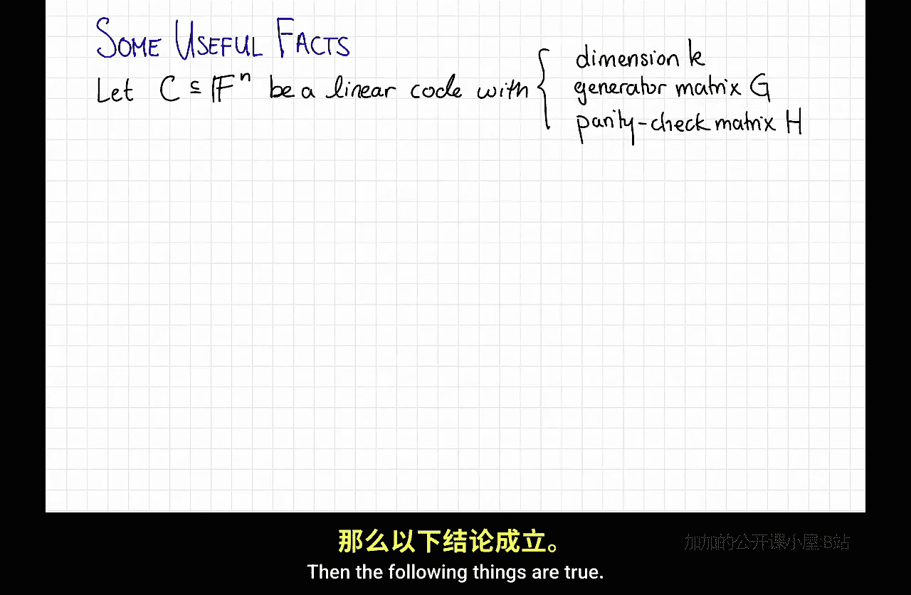
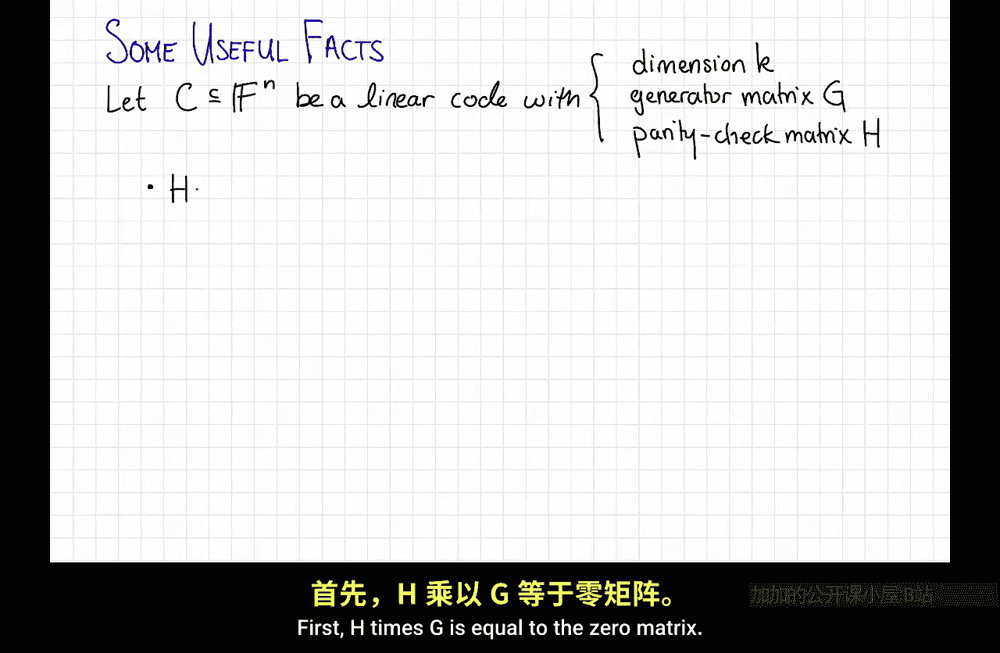
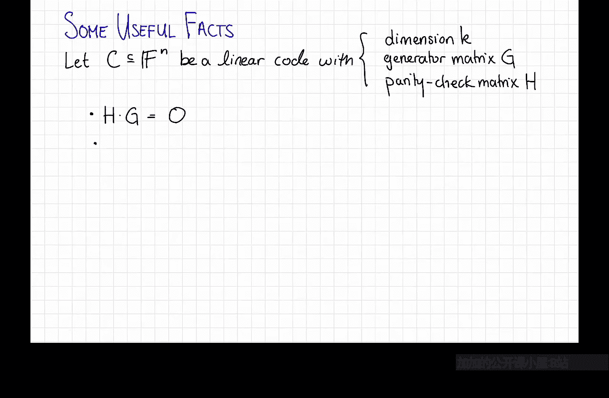
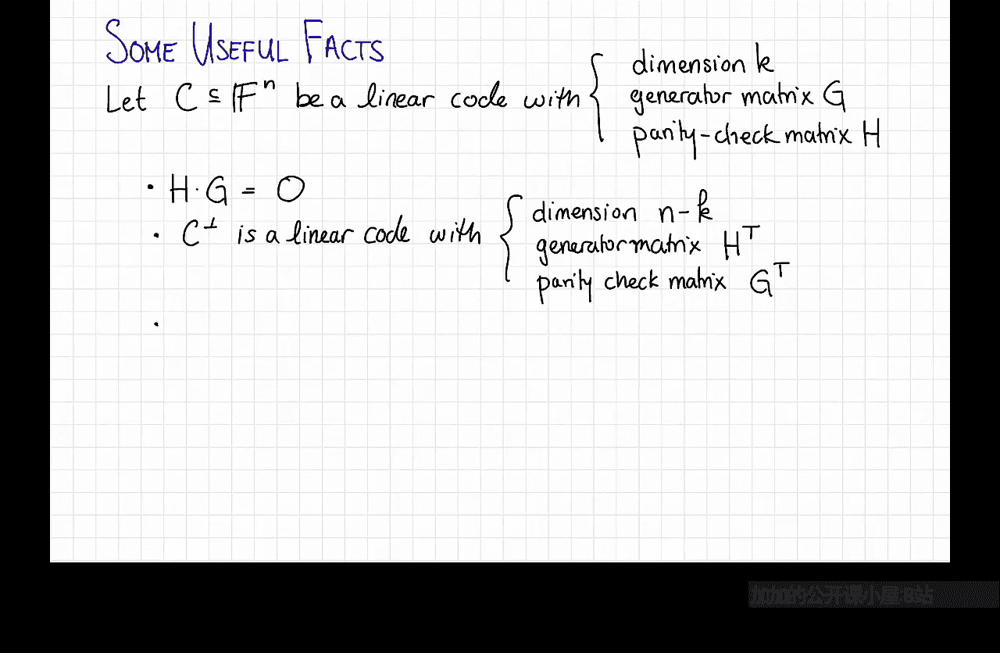

# 斯坦福大学【中英⚡代数编码导论｜Introduction to Algebraic Coding Theory】 p07 p6 2, Video 4： Linear Codes -BV16sRYYTEwg_p7-

Now that we have the necessary definitions， let's return to our discussion of using linear algebra to talk about codes。

Our first definition is of a linear code。So， a linear code， C。Of dimension， K。And block length N。

Over a finite field， F is just a K dimensional subspace of F to the N。

Notice that this is in line with our earlier definitions of codes and use of K as the message length and so on。

Indeed。Note that， if C。Is a code， just a plain old code。Of block length N。And message length， K。

Over the alphabet， sigma is equal to the finite field F。Then C is a linear code。

As per this definition， if and only if C is a subspace of F to the N。In particular。

 we can note that if the message length of the code is K， then the dimension is also K。

And that's just because。The size of C。If it's a subspace of dimension K。

Is equal to the size of F to the K。If this is an obvious， pause the video and think about it。

 why is the size of a subspace of dimension K size of the field， the K。But if you believe this。

 then taking logs of both sides。We have that K is equal to the log base。Size of F of the size of C。

 which was exactly our definition of message length。So this all checks out。

 So a linear code is just a code that happens to be a linear subspace。Next。

 we can define a generator matrix for a code。We already saw an example of this for the hand code。

 but now we can define it in more generality。So suppose that C is a linear code of dimension K。

 a subset of F to the N。We say that a matrix G in F to the n times k is a generator matrix for the code C。

If the code C is the column span of G。That is the code C should be the set G times x。

 where x ranges over all possible messages， x and F to the K。So the picture looks like this。

 G is a tall and skinny matrix。It's n by K。We multiply it by our message X， also of length K。

And what we're going to get is a code word C of length n。In this course。

 I'm always going to draw G generator matrices as being tall and skinny。

 It's also common to define generator matrices as short and fat and do the multiplication on the other side ass just a difference of convention。

 but this is how we're going to be doing it in this course。One observation。

Is that any linear code has a generator matrix。In particular。

 we can just take any basis for C since it's the subspace of F to the n and take those basis vectors and put them as the columns of G。

 and that'll do。A second observation。Is that generator matrices are not unique。

 There may be many generator matrices for the same code。In particular。Up to permutations of the rows。

There's always going to be a generator matrix that looks like this。That is。

 it has the identity matrix sitting up here and then some other stuff down here。

You can see this basically by row reducing the matrix G until it looks like this。

 That's not going to change the subspace spanned by the columns of G。

 So this is going to be a generator matrix for the same code。

A generator matrix that looks like this is nice because it corresponds to what's called a systematic encoding。

We say that an encoding map is systematic。If the K bits of the message occur as the first K bits in the code word。

 and you can see that if your generator matrix looks like this and you multiply it by some message。

 then the code word that you're going to get out because there's the identity sitting right here is going to have the message as the first K bits of the code word。

In particular， for a linear code， there is always a systematic encoding map。Next。

 let's define a dual code and a parity check matrix。First， a dual code。

So suppose that C subset of F to the n is a linear code。We define the dual code to C as C perp。

 which we'll denote like this。 C perp is equal to the set of all vectors， V in F to the N。

So the inner product of V and C is equal to0 for all C in our code C。And here， this notation。

 this just means the sum from I equals1 to n of V I times C I。

 So it's just the standard inner product。Notice that a dual code is exactly the same definition as a dual subspace from linear algebra。

Okay， next definition， parody check matrices。 We already informally defined a parody check matrix when we are looking at the example of the hamming code a few videos back。

 And now let's define it in general。So suppose we have a linear code C subset of F to the N of dimension K。

We say that a matrix H in F to the n minus k by k is a parity check matrix for the code C。

 if C is equal to the kernel of H， or equivalently。

 if C is the set of vectors so that H times x is equal to 0。So the picture looks like this。

 H is a short and fat matrix。Which is n minus k。By n。

And it has the property that whenever we multiply it by a code word of C。We should get 0。As before。

We can observe that any linear code has a parodity check matrix。

We just take the rows of the parodity check matrix to be any basis for the duel of C。And as before。

 we can observe that parodity check matrices are not unique。With these definitions under our belts。

 let's record some useful facts about generator matrices and parity check matrices。

We've already seen some of these facts in the context of that Hamming code example a few videos ago。

 So I'm not going to prove them here because we essentially already did when we talked about the Haming code。

 but you should make sure you understand why all of these are true。

So let's see， be a linear code subset of F to the N that has dimension K。

Generator matrix G and parodity check matrix H。Then the following things are true。

First， H times G。

Is it equal to the0 matrix。Second。

The duel of C， C Perp。 I it a linear code。With。😡，Dimenssion n minus k。Generator matrix。H transpose。

 So we take the parity check matrix for C， And that becomes the generator matrix for C perp。

And parodity check Ma。G transpose。So same thing， we take the generator matrix for C。

 and that becomes the parity check matrix for C perp。Next fact， the distance of sea。

Is the minimum weight of any nonze code wordency？We argued why this was true in the context of the handing code。

 and it's still true here for any linear code。 All we needed was linearity。And our last fact。

The distance of sea。Is the smallest number D。So that the parity check matrix H of C。

Has D linearly dependent columns。Again， we saw this in the context of the Hammingcoat example。

So in that example， we had our little parity check matrix。

And we wanted to say that the distance was 3。And we argued that it sufficed to show that no pair。

Of columns of H。We're linearly dependent。 So that means that the smallest D。

 So that H has D linearly dependent columns is 3， and the distance was 3 as well。So again。

 all we really used was linearity and this relationship holds for any linear code C。

But it's a good exercise to prove this for yourself。So that about wraps it up for this video。

 Thanks for watching。